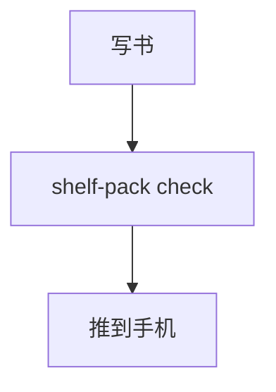

# Markdown 速查

这一页按「写法 | 效果」列出书架阅读器支持的写法。左列照抄就能用，右列是阅读器里看到的样子。写书时的完整规则以仓库里的 `books/AGENTS.md` 为准，这里只是速查。

## 文字

| 写法 | 效果 |
|---|---|
| `**粗体**` | **粗体** |
| `*斜体*` | *斜体* |
| `~~删除线~~` | ~~删除线~~ |
| `` `代码` `` | `代码`，等宽字体、浅色底 |
| 行末不加任何符号，空一行 | 分段；只换行不空行，阅读器会把两行接成一段 |
| `---`（单独一行） | 一条横向分隔线 |
| `> 一段话` | 引用块，左侧一条竖线 |

## 标题

| 写法 | 效果 |
|---|---|
| `# 章标题` | 一级标题，**每章只能有一个**，就是这一章在目录里的名字 |
| `## 小节` | 二级标题，出现在目录里 |
| `### 小小节` | 三级标题，也出现在目录里；更深的层级不进目录 |

## 列表

| 写法 | 效果 |
|---|---|
| `- 一项` | 无序列表，圆点开头 |
| `1. 第一步` | 有序列表，自动编号 |
| 列表项下一行缩进 3 个空格再写 `- 子项` | 嵌套列表 |

## 表格

| 写法 | 效果 |
|---|---|
| 第一行 `\| 列 A \| 列 B \|` | 表头 |
| 第二行 `\|---\|---\|` | 表头和内容的分隔，必须有 |
| 之后每行 `\| 值 \| 值 \|` | 一行内容 |
| 列多、单元格文字长 | 手机上会横向滚动。超过 4 列、或单元格里写长句时，考虑拆成两张表，或改成「小标题 + 列表」 |

单元格里要写竖线本身时，在它前面加一个反斜杠转义。完整的样子：

```markdown
| 设置 | 选项 |
|---|---|
| 字号 | 14–24，六档 |
| 行距 | 紧凑、适中、宽松 |
```

## 提示块

在引用块第一行单独写类型标记，**大写**，阅读器渲染成带图标和标题的彩色卡片：

| 写法（引用块第一行） | 效果 |
|---|---|
| `> [!NOTE]` | 「注意」卡片：补充说明 |
| `> [!TIP]` | 「提示」卡片：顺手的技巧 |
| `> [!IMPORTANT]` | 「重要」卡片：不能漏看的要点 |
| `> [!WARNING]` | 「警告」卡片：法规、财税、平台规则、软件版本这类可能过时的内容，**必须加**，写明按什么时候的资料整理、以哪个官方来源为准，放在那一小节的开头 |
| `> [!CAUTION]` | 「当心」卡片：操作有风险 |

```markdown
> [!WARNING]
> 本节按 2026 年 11 月的官方文档整理，可能已调整，以官方最新说明为准。
```

一章里不要堆太多卡片，普通的补充用普通引用块 `>` 就够了。

## 链接

| 写法 | 效果 |
|---|---|
| `[本章某小节](#小节锚点)` | 点按跳到本章的那个小节 |
| `[第 3 章](03-xxx.md)` | 跳到本书第 3 章 |
| `[某小节](03-xxx.md#锚点)` | 跳到本书第 3 章的某个小节 |
| `[《另一本书》](../book-id/)` | 打开另一本书，回到上次读到的位置；读完按返回回到这里 |
| `[某小节](../book-id/05-xxx.md#锚点)` | 打开另一本书的某一章某一小节 |
| `[官方文档](https://example.com)` | 外部网页，交给系统浏览器打开 |

锚点的算法：标题文字**转小写**、**空格换成 `-`**、**去掉标点**。

| 标题 | 锚点 |
|---|---|
| `## Stream 与背压` | `stream-与背压` |
| `## Go 1.27 带来了什么` | `go-127-带来了什么`（`.` 被去掉） |
| 同一章里第二个 `## 示例` | `示例-1`（重名的依次加 `-1`、`-2`） |

`shelf-pack check` 会校验链接指向的书、章节、小节是否存在。`assets/x.svg`、`../../` 这类写法不是合法的链接，会报错。

## 图片

| 写法 | 效果 |
|---|---|
| `` | 显示本书 `assets/` 目录里的图片，点按可放大 |
| `` | SVG 也一样；画图用 SVG 时要带白色圆角底板，暗色主题下才看得清 |
| `` | **不允许**：远程图片会被阅读器拦截，`check` 也会报错 |

- 图片只能放在本书的 `assets/` 下，格式限于 png、jpg、jpeg、gif、webp、svg
- 方括号里的说明（alt）写成完整的一句话，说清这张图画的是什么
- SVG 的尺寸、字体、配色规范见 `books/AGENTS.md` 的「SVG 规范」：宽 360 左右、白底、`rx="10"` 圆角、字号不小于 11

## 代码块

围栏后面写上语言名，**必须写**；原样的文本（命令输出、日志、prompt）写 `text`：

````markdown
```go
fmt.Println("hello")
```
````

| 写法 | 效果 |
|---|---|
| ` ```go `、` ```ts `、` ```bash `… | 按语言高亮，右上角有复制按钮 |
| ` ```text ` | 不高亮，原样显示 |
| 一行很长的代码 | 默认横向滚动；读者可以在阅读设置里改成自动换行 |

**不要在代码块里用字符画图**（`│ ╲ └─` 画坐标、`████` 画柱子、空格对齐的表），手机上会错位。图用 Mermaid 或 SVG，表用 Markdown 表格。

## 公式

用 KaTeX 语法：

| 写法 | 效果 |
|---|---|
| `$E = mc^2$` | 行内公式：$E = mc^2$ |
| `$\frac{a}{b}$` | 分数：$\frac{a}{b}$ |
| `$\sum_{i=1}^{n} i$` | 求和：$\sum_{i=1}^{n} i$ |
| `$x_i^2$` | 下标和上标：$x_i^2$ |
| 正文里的美元符号 `\$` | 写成 `\$`，避免被当成公式开头 |

块级公式单独成段，用 `$$` 包起来，居中显示：

```markdown
$$
\sqrt{a^2 + b^2}
$$
```

效果：

$$
\sqrt{a^2 + b^2}
$$

长公式在手机上会横向滚动；能拆成几行的，用 `\begin{aligned} … \end{aligned}` 分行。

## Mermaid 图表

流程、步骤、层级、时序、状态变化用 Mermaid，写在 ` ```mermaid ` 代码块里，阅读器直接画成图：

````markdown

````

效果：


竖屏手机上正文宽约 343pt，写的时候按这几条来：

| 写法 | 为什么 |
|---|---|
| 流程图用 `flowchart TD`（上下方向） | 竖屏上纵向空间多；只有 3 个以内节点的短链才用 `LR` |
| 节点文字每行不超过 8 个汉字，用 `<br/>` 分行 | 节点太宽会把整张图撑宽；长说明放正文 |
| 同一层并排不超过 3 个节点 | 分支多时用 `subgraph` 分组，或拆成两张图 |
| 时序图参与者不超过 4 个，名字用简称 | 参与者多的拆成两张图 |
| 不要依赖「点按查看大图」 | 过宽的图会被缩到屏幕宽，这只是兜底，字会变得很小 |
