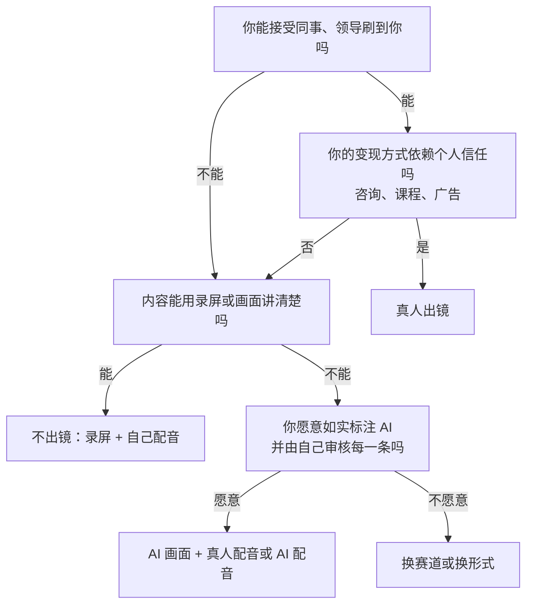

# 赛道与人设

做账号的人最常见的起手式是：先注册，先发，发着发着再看适合什么。结果往往是前 20 条什么都发一点，系统不知道该推给谁，自己也看不出哪条数据好是因为内容好还是运气好。

定位不是一句口号，而是在动手之前把四个问题回答清楚，并且写在一张纸上，后面每一条内容都拿它来对照。这一章先讲赛道怎么选、人设怎么搭、要不要真人出镜，最后给一张「一页定位卡」。

这本书只讲「账号定位」这一件事。内容方向和一人公司方向的通用选法见《一人公司方法论》第 2 章「选方向」；选题和钩子的写法见《选题与爆款结构》；每个平台的推荐机制见《抖音与快手》和《小红书、视频号与 B 站》。

## 定位要回答的四个问题

```text
1. 给谁看？      —— 一群具体的人，能说出他们在哪、在烦什么
2. 看什么？      —— 你持续提供的那一类内容，不是某一条
3. 为什么看你？  —— 同样的内容，别人为什么选你而不是别人
4. 看完之后呢？  —— 他会关注、收藏、买东西、找你咨询，还是只是划走
```

第 4 个问题最容易被跳过。一个账号的变现方式（广告、带货、知识付费、引流到自己的产品）会反过来限制前三个问题的答案：做带货，人群要有消费力，内容要能自然挂商品；做知识付费，内容要能让人觉得「这个人懂，我想系统学」。变现路径的细节见《自媒体与短剧一人公司全景》，这里只要求你在定位时写下一个**最可能的**变现方式。

## 赛道不是话题

「我想做 AI」「我想做职场」这类说法是话题，不是赛道。同一个话题下面，人群和需求可以完全不同：

| 话题 | 人群 | 需求 | 内容形式 | 这才是赛道 |
|---|---|---|---|---|
| AI | 文员、运营 | 下班前把重复的表格活干完 | 录屏教程，1 分钟一个技巧 | 「办公室 AI 提效」 |
| AI | 大学生、转行者 | 搞懂大模型能不能找到工作 | 口播 + 图表，讲行业和路径 | 「AI 求职科普」 |
| AI | 开发者 | 把模型接进自己的项目 | 长视频、代码演示 | 「AI 应用开发」 |
| AI | 小店老板 | 用 AI 做菜单、海报、文案 | 手机录屏，全程不用电脑 | 「门店 AI 实操」 |

所以赛道 = **人群 × 需求 × 形式**。三者任何一个变了，对标账号、选题库、变现方式都会跟着变。

一个检验办法：把你的赛道写成一句话，交给一个不认识你的人，问他「你能想到这个账号的下一条视频是什么吗？」如果他能说出三条，赛道就足够具体；如果他只能说「大概讲 AI 吧」，就还不够。

## 赛道选择打分表

先列 3–5 个候选赛道，每个都写成「人群 × 需求 × 形式」的完整句子，然后用下面这张表打分。权重是本书给的起点，你可以按自己的情况调整，但调整要有理由。

| 维度 | 权重 | 1 分 | 5 分 | 怎么查 |
|---|---|---|---|---|
| 变现清晰度 | 3 | 想不出这群人会为什么付钱 | 已经能看到同赛道账号在挂商品、接广告或卖课 | 翻对标账号主页的橱窗、合集、简介 |
| 持续供给 | 3 | 想 20 个选题就枯竭 | 能一口气写出 100 个选题，且每周有新素材 | 现场写选题清单，计时 30 分钟 |
| 你的可信度 | 3 | 跟这个领域没有交集 | 每天都在做这件事，有作品或经历可以展示 | 列出你能拿出来的证据 |
| 单条生产成本 | 2 | 一条要一整天以上 | 一晚上能做完一条 | 按你实际的工具和技能估 |
| 竞争空间 | 2 | 搜不到同类账号，或头部完全垄断 | 有一批腰部账号在稳定更新，形式还有差异空间 | 第 2 章的搜索方法 |
| 合规与资质风险 | 2 | 涉及金融、医疗、法律、教育等需要资质的领域，而你没有 | 没有资质门槛，也不涉及敏感话题 | 见下文「资质领域」 |
| 兴趣 | 1 | 做 10 条就烦 | 不更新也会自己去研究 | 回想过去一年你主动花时间在什么上 |

满分是 $16 \times 5 = 80$ 分。分数本身不精确，它的作用是**逼你给每一项写下理由**。

### 一个打分示例

假设读者是一位在职的后端开发者，下班有 2 小时左右，列了三个候选：

```text
A. 给运营、文员讲「用 AI 把重复的表格活自动化」，录屏教程，1 分钟一条
B. 给想转行的大学生讲「程序员真实的一天和求职经验」，真人口播
C. 给开发者讲「AI 应用开发实战」，B 站长视频 + 抖音切片
```

| 维度（权重） | A | B | C |
|---|---|---|---|
| 变现清晰度（3） | 4：工具推荐、模板、小课都能挂 | 2：咨询和简历修改有人买，但量小 | 3：课程和咨询有人买，但人群窄 |
| 持续供给（3） | 5：每个办公软件功能都能出一条 | 3：个人经历讲几十条后会重复 | 4：技术更新快，素材多 |
| 可信度（3） | 3：会写脚本，但不是天天做表格的人 | 4：本身就是程序员 | 5：日常工作就是这个 |
| 生产成本（2） | 4：录屏 + 配音，一晚能出两条 | 4：手机口播即可 | 2：长视频准备一周 |
| 竞争空间（2） | 2：同类账号非常多 | 2：同类账号非常多 | 3：腰部账号不少，但深度内容少 |
| 合规风险（2） | 5 | 4：求职建议注意别承诺结果 | 5 |
| 兴趣（1） | 3 | 3 | 5 |
| **加权合计** | 12+15+9+8+4+10+3 = **61** | 6+9+12+8+4+8+3 = **50** | 9+12+15+4+6+10+5 = **61** |

A 和 C 并列。这时不要硬选，而是看**哪一项是硬伤**：C 的生产成本只有 2 分，对每天只有 2 小时的人来说是真实的瓶颈；A 的可信度 3 分，可以靠「我是写代码的，所以知道怎么让机器替你干活」这个角度补上。最后这位读者先做 A，把 C 留作半年后的长视频方向。这个判断过程比分数重要。

### 资质领域：先查再选

有一批领域，不是你懂就能讲。2023 年 7 月中央网信办秘书局印发的《关于加强「自媒体」管理的通知》要求平台严格核验从事**金融、教育、医疗卫生、司法**等领域信息内容生产的自媒体，并在账号主页展示认证材料名称、加注所属领域标签（来源：新华网、人民网等对通知的报道，2023-07-10）。2026 年 6 月启动的「清朗·整治账号名称信息乱象」专项行动，把「未经资质认证却在名称、简介里加注『首席规划师』『资深法律顾问』『专业健康导师』之类头衔」列为整治对象（来源：中国网信网，2026-06-18）。

对选赛道的影响：

- 讲理财、炒股、医疗健康、法律咨询、升学教育的内容，先确认平台对该领域的认证要求和你能否满足，查不到就按「需要资质」处理
- 「程序员聊理财」「开发者讲健康」这种跨界选题偶尔做一两条可以，作为主赛道要谨慎
- 具体有哪些领域、需要什么材料，以各平台最新的认证页面为准，合规细节见《自媒体与短剧合规财税》

## 人设 = 身份 + 专长 + 态度

人设这个词被用坏了，很多人理解成「演一个角色」。在这本书里，人设只是**让观众在 3 秒内知道你是谁、凭什么听你说**的那套信息，它由三部分组成：

| 组成 | 回答的问题 | 例子 |
|---|---|---|
| 身份 | 你是谁 | 在职 8 年的后端开发；两个孩子的爸爸；在三线城市工作的程序员 |
| 专长 | 你在这件事上凭什么 | 写过 200 多个自动化脚本；每天用 AI 写代码 |
| 态度 | 你用什么方式讲 | 只讲能马上用的；不吹不黑，测过才说；说话直，讲缺点 |

三者组合起来，就是你的人设句：

```text
我是 ______（身份），
因为 ______（专长 / 经历），
所以我只讲 ______（态度 + 内容边界）。
```

示例：

```text
我是在职 8 年的后端程序员，
写了几百个让电脑替我干活的小脚本，
所以我只讲普通上班族明天就能用上的 AI 提效办法，不讲概念。
```

### 正例和反例

| 反例 | 问题 | 改成 |
|---|---|---|
| 「AI 领域资深专家，带你掌握未来」 | 身份虚、专长无证据、态度是口号 | 「每天用 AI 写代码的程序员，测过的工具才推荐」 |
| 「年入百万的程序员副业导师」 | 无法证明的收入、营销腔，容易踩虚假宣传 | 「上班写代码，下班做账号，公开记录副业的真实收入和花费」 |
| 「一个有趣的灵魂」 | 没有身份和专长，观众不知道为什么要关注 | 删掉，换成具体的身份 |
| 「大厂架构师」（实际不是） | 职业信息与真实不符 | 只写真实的身份。2022 年施行的《互联网用户账号信息管理规定》要求个人账号的职业信息与真实职业一致（来源：国家网信办，2022-06-27 发布、2022-08-01 施行） |

### 人设的三条边界

1. **只放真的东西**。身份、经历、数据都要经得起追问。人设一旦被拆穿，掉的不是一条视频，而是整个账号的信任
2. **态度要能持续**。「毒舌」「暴躁」之类的态度很抓人，但你要问自己能不能连续 100 条都这么说，以及会不会招来你不想要的评论区
3. **不暴露不想暴露的东西**。在职开发者尤其要想清楚：公司名、工牌、办公环境、内部系统截图、同事，都不要出现在内容里。公司是否允许员工做副业、做自媒体，先看劳动合同和员工手册

## 真人出镜、不出镜、纯 AI：怎么选

这是开发者最纠结的问题。三种形态各有代价，没有哪种更高级：

| | 真人出镜 | 不出镜（录屏、手部、配音、图文） | 纯 AI（数字人、AI 画面 + AI 配音） |
|---|---|---|---|
| 信任建立 | 最快，观众记住的是你这个人 | 中等，靠内容质量和固定的声音、画面风格 | 最慢，观众对 AI 账号天然更警惕 |
| 单条成本 | 低到中：一部手机 + 一个安静的房间 | 中：录屏、剪辑、配音更花时间 | 前期搭流程成本高，跑通后单条低 |
| 可复制性 | 低，你本人是瓶颈 | 中 | 高，适合矩阵 |
| 变现上限 | 高：广告、带货、咨询都吃人设 | 中：教程、模板、工具推荐 | 低到中：多依赖流量分成和带货，商单少 |
| 职场风险 | 高：同事、领导会刷到 | 低 | 低 |
| 平台规则风险 | 低 | 低 | 高：要标识 AI 内容，账号运营方式受限 |

### 纯 AI 账号要先知道的规则

- 国家网信办等四部门发布的《人工智能生成合成内容标识办法》自 2025 年 9 月 1 日起施行，要求对 AI 生成合成的文本、音频、图片、视频等内容添加标识，并禁止恶意删除、篡改、隐匿标识（来源：新华网、科技日报，2025-03-14 / 2025-09-01）
- 抖音 2023 年 5 月发布的《关于人工智能生成内容的平台规范暨行业倡议》要求对 AI 生成内容进行显著标识、虚拟人需在平台注册、虚拟人技术使用者需实名认证；2024 年 3 月抖音安全中心公告处置了用 AI 虚构境外人设、虚假俊男美女形象引流的账号（来源：IT之家、财联社等报道）
- 小红书 2026 年 3 月发布打击「AI 托管运营」账号的公告：偶发用 AI 代写、代发、互动的账号会被警告或限制分发，通过 AI 托管工具注册、发布、互动的账号会被封禁（来源：光明网，2026-03-10）

这些规则的方向很一致：**AI 可以当生产工具，但不能冒充真人，也不能让 AI 替你「运营」**。纯 AI 账号能做，前提是如实标识、由真人负责选题和审核、不批量托管。AI 生产流程本身见《AI 内容生产工具链》。

### 一个选择流程



对大多数在职开发者，本书的建议是**从「不出镜 + 自己的声音」开始**：录屏或手部画面，配自己的声音。声音本身就能建立辨识度，又不暴露脸；等账号跑通、想做咨询或课程时，再考虑出镜。

## 一页定位卡

把本章的结论填进下面这张卡，打印出来或者放在剪辑软件旁边。后面每条内容发布前都对一遍：这条是不是给卡上那群人看的？

```text
【一页定位卡】                        日期：____

账号一句话：给 ______（人群）讲 ______（需求），用 ______（形式）

人群画像：
  - 他们是谁：____
  - 他们在哪刷：____（主平台）
  - 他们最常抱怨的三件事：____ / ____ / ____

人设句：我是 ____，因为 ____，所以我只讲 ____

出镜形式：真人出镜 / 不出镜 / AI 画面（选一个），理由：____

内容边界：
  - 一定讲：____
  - 绝对不讲：____（例：不讲具体股票、不评价前公司）

最可能的变现方式：____
资质与风险检查：是否涉及需要资质的领域？____  在职限制？____

对标账号（第 2 章填）：头部 ____ / 腰部 ____ / 同起点 ____
```

一个填好的例子：

```text
【一页定位卡】                        日期：2026-11-03

账号一句话：给天天跟表格打交道的上班族讲用 AI 少加班的办法，用电脑录屏 + 我的配音

人群画像：
  - 他们是谁：行政、运营、财务助理，25–35 岁，不会写代码
  - 他们在哪刷：抖音为主，小红书收藏教程
  - 最常抱怨：每周重复做同样的报表 / 领导临时要数据 / 合并几十个文件

人设句：我是在职 8 年的后端程序员，因为写过几百个自动化小脚本，
        所以我只讲普通上班族明天就能用上的办法，不讲概念

出镜形式：不出镜，理由：在职，不想让同事刷到；内容本来就是屏幕操作

内容边界：
  - 一定讲：具体步骤、能复制的提示词、常见报错
  - 绝对不讲：公司内部系统、需要破解或违规获取的软件

最可能的变现方式：先接 AI 办公工具的广告，后期做模板包
资质与风险检查：不涉及资质领域；劳动合同无禁止副业条款（已确认）

对标账号：第 2 章填
```

## 本章要点

- 定位回答四个问题：给谁看、看什么、为什么看你、看完之后做什么；变现方式会反过来约束前三个
- 赛道 = 人群 × 需求 × 形式，话题不是赛道；检验标准是陌生人能否猜出你的下一条内容
- 用加权打分表比较候选赛道，重点看每个候选的硬伤，而不是总分
- 金融、医疗、法律、教育等领域需要资质认证，未认证加注专业头衔是监管整治对象
- 人设 = 身份 + 专长 + 态度，只放经得起追问的真实信息；职业信息要与真实一致
- 真人出镜信任最快、职场风险最高；纯 AI 账号要如实标识、由真人负责，不能托管运营
- 在职开发者建议从「不出镜 + 自己的声音」起步，把结论写进一页定位卡
