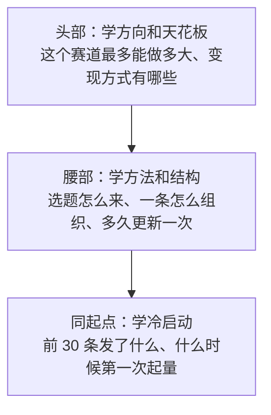

# 找对标

对标账号是**平台已经替你验证过的需求**：有一群人在看、在点赞、在买东西，说明这个「人群 × 需求 × 形式」的组合在这个平台上成立。新号最大的风险不是做得不够好，而是做了一件平台上根本没人要的事。找对标就是用最低成本排除这个风险。

对标也不是照抄。这一章讲怎么找、怎么筛、怎么分层，下一章讲怎么拆。

## 什么样的账号算对标

不是同话题的账号都算。一个合格的对标要同时满足：

| 条件 | 为什么 | 怎么判断 |
|---|---|---|
| 人群相同 | 人群不同，选题和语气全都不一样 | 看评论区的人在说什么、自称什么身份 |
| 需求相同 | 同人群不同需求，等于不同赛道 | 看它最高赞的几条在解决什么问题 |
| 形式你做得出来 | 对标一个需要摄影团队的账号，你学不来 | 估一下它一条要几个人、什么设备 |
| 近期仍在更新且数据正常 | 停更的账号反映的是过去的平台 | 看最近 30 天有没有发、数据有没有断崖 |
| 不依赖不可复制的资源 | 颜值、明星关系、大公司背书都学不来 | 去掉这个资源后，内容本身还成立吗 |

最后一条最容易忽略。一个讲 AI 的账号涨得快，可能是因为博主本人在某大厂做相关岗位、常有一手消息，这部分你复制不了；能复制的只是它的选题结构和表达方式。

## 搜索方法

### 关键词矩阵

在平台内搜索，比任何第三方工具都直接。关键是**不要只搜一个词**。把你的定位拆成三类词，交叉组合：

| 人群词 | 需求词 | 形式词 |
|---|---|---|
| 上班族、打工人、行政、运营、财务 | Excel、报表、自动化、提效、不加班 | 教程、技巧、一分钟、保姆级、实操 |
| 程序员、开发者 | AI 编程、Cursor、提示词 | 实测、对比、踩坑 |
| 大学生、应届生 | 转行、求职、简历 | 经验、复盘 |

组合出的搜索词示例：

```text
Excel 自动化 教程
打工人 AI 提效
行政 报表 不加班
一分钟 Excel 技巧
AI 做表格 实测
财务 批量处理 文件
```

每个词在主平台上搜一遍，分别看「综合」排序和「最新」「最多点赞」等筛选（筛选项名称以 App 当前版本为准）。综合排序告诉你平台觉得谁最相关，最新排序告诉你现在还有谁在做。

### 顺藤摸瓜

找到 2–3 个合格的对标后，从它们身上继续扩：

1. **主页的推荐账号**：很多平台在你关注一个账号后会推荐相似账号，这是平台对「同类」的判断，参考价值很高
2. **评论区里的同行**：同赛道的博主常在大号评论区出现，头像点进去看
3. **对标关注的人**：有些博主会关注自己的老师、同行和对手
4. **合拍、引用、提到**：内容里提到的其他博主，往往是同一个圈子
5. **反向搜索**：把对标某条爆款的标题关键词拿去搜，能看到同选题的其他做法

### 平台官方工具

各平台的创作者后台都有找选题、看同类创作者的入口，免费，而且数据来自平台本身：

| 平台 | 入口（以当前版本为准） | 能看什么 |
|---|---|---|
| 抖音 | 抖音创作者服务中心的「创作灵感」等功能 | 热门话题、同类创作者、可参考的同领域视频（来源：第三方教程描述，入口名称可能调整） |
| 抖音 / 巨量引擎 | 巨量算数 | 关键词热度趋势、人群画像，偏宏观 |
| 小红书 | 创作者中心的灵感、热点类功能 | 平台推荐的选题方向和热门笔记 |
| B 站 | 创作中心 | 创作激励、热门活动和话题 |

这些入口改版频繁，具体名称和位置以你登录后看到的为准。

### 跨平台找

同一个需求，往往在不同平台以不同形式存在：

- B 站长视频里讲透的东西，抖音上可能还没人做成 1 分钟版本
- 小红书上的图文教程，搬到抖音做成录屏视频，形式就有了差异
- 公众号上的深度长文，可以拆成一组短视频

这不是搬运（原作者的内容不能直接拿来用），而是**确认需求存在后，用自己的内容和形式去满足它**。

## 第三方数据工具：知道类别就够

有一批第三方平台在做账号数据、榜单和监测。新号阶段**不必付费**，但要知道它们能干什么：

| 类别 | 代表（举例，非推荐） | 擅长 | 新号用得上吗 |
|---|---|---|---|
| 抖音电商与直播数据 | 蝉妈妈、飞瓜 | 达人带货数据、直播监测、商品榜 | 做带货赛道时有用，主要看「哪些达人在卖什么」 |
| 跨平台内容榜单 | 新榜 | 公众号、视频号、抖音、小红书、B 站等多平台的账号榜单 | 按领域看榜单，快速找头部和腰部 |
| 小红书专项数据 | 千瓜等 | 小红书笔记和达人数据 | 做小红书时可以了解，功能以官网为准 |
| 官方趋势工具 | 巨量算数 | 关键词热度、人群画像，偏宏观 | 验证一个需求是在涨还是在跌 |

说明：上表各工具的定位来自其官网和应用商店描述及第三方介绍（检索于 2026-11），价格、功能和覆盖的平台经常调整，以各官网为准。

使用这类工具要注意三点：

1. **数据是估算的**。第三方拿不到平台的后台数据，播放量、销售额多为推算，看趋势和排序，不要把具体数字当真
2. **免费额度先用够**。多数工具有免费的榜单和有限次数的查询，新号阶段足够
3. **不要自己写爬虫批量抓平台数据**。开发者很容易想「我自己抓更快」，但批量抓取通常违反平台用户协议，账号和法律风险都不小。找对标靠人工看，几十个账号足够了

## 对标分层：头部、腰部、同起点

对标不能只找一种。不同层级的账号，学的东西完全不同：



| 层级 | 怎么定义（本书的经验划分，非平台口径） | 找几个 | 主要学什么 | 不要学什么 |
|---|---|---|---|---|
| 头部 | 该赛道粉丝和影响力排在最前面的几个账号 | 2–3 个 | 赛道天花板、变现方式组合、选题的大方向 | 制作水准、团队规模、它现在的随意风格（它有存量粉丝兜底） |
| 腰部 | 稳定更新、能看到明确的变现动作（商品、广告、课程），规模在头部之下 | 5 个左右 | 选题结构、开头写法、节奏、栏目设计 | 个别爆款的偶然因素 |
| 同起点 | 起号不久，或者能回溯到前 30 条作品的账号 | 5 个左右 | 冷启动期发了什么、哪一条开始起量、包装怎么改过 | 它后来的成熟内容 |

层级的边界按赛道调整：一个小众技术赛道的「头部」，粉丝量可能只有大众赛道腰部的水平。判断标准是**在这个赛道内的相对位置**，不是绝对粉丝数。

「同起点」最难找，也最有价值。找法：

- 关键词搜索时切到「最新」，翻到近几个月的新账号
- 看腰部账号的作品列表拉到最底，找他们早期的样子，这本身就是同起点样本
- 主页作品数在几十条以内、但最近有一两条明显高于自己平均水平的账号

## 筛掉不合格的对标

找到的候选里，下面这几类要剔除：

| 剔除信号 | 可能的原因 |
|---|---|
| 点赞很高，评论很少且多是「666」「好」之类空洞内容 | 数据可能不真实，或者是互动引导出来的 |
| 粉丝很多，但最近几十条作品的数据都很低，和粉丝量不成比例 | 粉丝是早期红利或其他赛道带来的，对你没参考价值 |
| 作品画面明显来自别人（影视片段、其他博主的视频） | 搬运号，随时可能被处罚，不能学 |
| 最近一两个月没更新 | 停更号 |
| 内容大量依赖博主本人的特殊身份或资源 | 不可复制 |
| 频繁出现夸大承诺（「月入过万」「包会」） | 合规风险，学了会连带出问题 |

刷量、搬运、洗稿都是平台重点打击的行为，[《国内私域与内容平台》第 9 章](../private-domain-cn/09-rules-and-bans.md)「平台规则与封号风险」列过高风险行为清单。对标里混进这类账号，你学到的规律会是错的。

## 对标池：一张表管起来

把筛过的对标放进一张表，后续拆解、复盘都围绕它：

| 层级 | 账号名 | 平台 | 粉丝量级 | 最近 30 天发布数 | 主要形式 | 主要变现 | 为什么选它 | 加入日期 |
|---|---|---|---|---|---|---|---|---|
| 头部 | | | | | | | | |
| 头部 | | | | | | | | |
| 腰部 | | | | | | | | |
| 腰部 | | | | | | | | |
| 腰部 | | | | | | | | |
| 腰部 | | | | | | | | |
| 腰部 | | | | | | | | |
| 同起点 | | | | | | | | |
| 同起点 | | | | | | | | |
| 同起点 | | | | | | | | |
| 同起点 | | | | | | | | |
| 同起点 | | | | | | | | |

「粉丝量级」只记大致量级（如「万级」「十万级」），不需要精确数字，它会变。「为什么选它」这一列一定要写，三个月后回看时，你会发现有些选它的理由已经不成立了。

## 一次完整的找对标流程

按下面的步骤，一个周末可以做完：

```text
第 1 步（30 分钟）：拿出一页定位卡，写出 3×5 的关键词矩阵，组合出 15 个以上搜索词
第 2 步（90 分钟）：在主平台逐个搜索，每个词看前 20 个结果，把看起来相关的账号记下来，目标 30 个
第 3 步（60 分钟）：逐个点进主页，用「合格对标」五个条件过一遍，剩 15–20 个
第 4 步（30 分钟）：用「剔除信号」表再筛一遍，剩 12 个左右
第 5 步（30 分钟）：按头部 / 腰部 / 同起点分层，填进对标池表
第 6 步（30 分钟）：从腰部和同起点账号顺藤摸瓜，补 3–5 个漏掉的
第 7 步（15 分钟）：把对标池里的账号名回填到一页定位卡
```

如果第 2 步怎么都找不到 30 个候选，说明两种可能：赛道太窄（平台上真的没什么人做），或者你的关键词不对（用的是你自己的说法，不是用户的说法）。先换关键词，用用户在评论区里的原话去搜；还是找不到，回到第 1 章重新考虑赛道。

### 让 AI 帮你扩关键词

关键词矩阵可以让大模型帮你扩，但账号必须自己去平台上找：

```text
我要在抖音做一个账号，定位是：给天天跟表格打交道的上班族讲用 AI 少加班的办法。

请按「人群词 / 需求词 / 形式词」三列，各列出 10 个普通用户在抖音搜索框里可能输入的词。
要求：
1. 用用户的口语，不要用行业术语
2. 不要编造账号名或数据
3. 最后给出 15 个两两或三三组合的搜索词
```

模型给出的词只是起点，搜一遍就知道哪些词有内容、哪些没有。

## 对标池的维护

对标池不是一次性的：

- **每周**：花 20 分钟看一遍对标池里账号的新作品，有明显高于它自身平均水平的，记进下一章的拆解表
- **每月**：剔除停更、转型、数据异常的账号，补充新发现的同起点账号
- **每季度**：回看「为什么选它」，如果你自己的定位调整了（见第 8 章），对标池要跟着换

## 本章要点

- 对标是平台已验证过的需求；合格对标要人群相同、需求相同、形式你做得出来、近期活跃、不依赖不可复制的资源
- 搜索用「人群词 × 需求词 × 形式词」矩阵，结合顺藤摸瓜和平台官方工具；跨平台找需求，但不能搬内容
- 第三方数据工具知道类别即可，数据是估算的；不要自己写爬虫批量抓平台数据
- 对标分三层：头部学方向和天花板，腰部学方法和结构，同起点学冷启动；层级按赛道内相对位置判断
- 剔除数据异常、搬运、停更、依赖特殊资源、夸大承诺的账号
- 用对标池表管理 12 个左右的对标，每周看、每月清、每季度回看选它的理由
