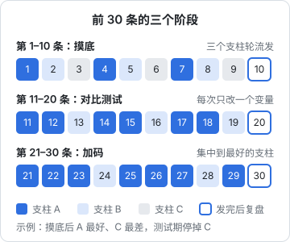

# 冷启动前 30 条：计划

定位卡写好了，对标拆完了，主页包装好了，终于可以发了。这时最常见的做法是「想到什么发什么」，结果 30 条发完，你只知道「数据不太好」，却说不出哪里不好、下一步该改什么。

前 30 条不是用来涨粉的，是用来**做实验的**。这一章讲怎么把 30 条排成一个有设计的实验：测什么、怎么排、怎么保证在职的情况下发得完。下一章讲怎么读这 30 条的数据。

## 前 30 条要回答的三个问题

```text
1. 方向对不对：平台愿不愿意把我的内容推给定位卡上的那群人？
2. 哪个支柱最好：我的几个内容方向里，哪个最能留住人、最能转粉？
3. 我能不能持续：按这个形式和节奏，我能不能稳定生产下去？
```

第 3 个问题和前两个一样重要。很多账号不是因为内容不行停掉的，是因为作者发到第 15 条就累了。前 30 条也是在测你自己。

为什么是 30 条？这不是平台的规定，而是一个经验上够用的样本量：少于 20 条，单条的偶然性太大，看不出规律；多于 50 条还不调整，时间成本太高。对在职开发者，30 条大约是两个多月，正好是一个能坚持下来、也能看出结果的周期。

## 关于「养号」

网上流传很多「养号」说法：新号先刷几天同类视频、先点赞评论、发布前先在某个时段活跃。**没有找到平台官方对这类做法有效性的说明**，这些多是经验之谈，有的还会适得其反。

能确定的是：

- 正常使用账号（浏览、关注对标、在对标评论区真诚交流）没有问题
- 一部手机频繁切换多个账号、用模拟器或改机工具、加入「互赞群」「互粉群」，都是平台风控重点识别的行为（各平台社区规范均有相关条款，具体以平台公示为准），会带来真实的风险
- 买粉、刷播放、刷评论，属于虚假流量，是平台明确打击的行为，也会让你自己的数据完全失去参考价值

前 30 条要的是**真实的信号**，任何形式的刷量都在污染你的实验。

## 内容支柱：先定 3 个方向

前 30 条不要所有内容都一样，也不要什么都发。从定位卡和对标拆解里，挑出 **3 个内容支柱**：同一个人群、同一个大需求下的三个子方向。

接第 4 章的示例（给上班族讲用 AI 处理乱表格）：

| 支柱 | 内容 | 来自哪里 | 预期 |
|---|---|---|---|
| A：乱表格急救 | 表头不一致、格式混乱、合并多表这类具体场景，每条一个场景 | 对标拆解的「机会」栏 + 高数据规律 | 最可能起量 |
| B：AI 工具实测 | 用不同 AI 工具处理同一张表，讲哪个免费、哪个要登录、哪个结果靠谱 | 评论区「哪个工具能用」的疑问 | 收藏高，涨粉可能一般 |
| C：程序员视角 | 为什么这张表会乱、怎么从源头避免，带一点程序员的思路 | 人设差异化 | 有风险：可能偏原理，对标里这类数据低 |

支柱 C 是一个**有意识的冒险**：拆解告诉我们原理类数据低，但它是这个人设区别于对标的地方。前 30 条正好用来验证这个冒险值不值得。

## 三个阶段



| 阶段 | 条数 | 目的 | 做法 | 阶段结束时的产出 |
|---|---|---|---|---|
| 摸底 | 1–10 | 看三个支柱的基础表现 | A、B、C 轮流发，形式和时长保持一致 | 三个支柱的排序；砍掉或调整最差的那个 |
| 对比测试 | 11–20 | 在好的支柱上找最好的做法 | 每次只改一个变量（开头写法、时长、封面），和上一条对比 | 一套「目前最好」的做法：开头怎么写、多长、封面怎么做 |
| 加码 | 21–30 | 验证规律、形成系列 | 集中在最好的支柱，用测出来的做法，开始做成合集 | 判断能否继续（下一章）；2–3 条可以置顶的作品 |

### 一次只改一个变量

对比测试最常见的错误是一次改很多：换了选题、换了开头、换了时长、换了发布时间，数据变好了，但不知道是哪个起作用。

可测的变量和测试方法：

| 变量 | 版本 A | 版本 B | 怎么比 |
|---|---|---|---|
| 开头写法 | 问题式：「同事发来 12 个表，表头还都不一样？」 | 结果先行：直接放合并好的表，「这张表是 12 个乱表合出来的」 | 前几秒留存（下一章讲口径） |
| 时长 | 30 秒左右，只讲一种做法 | 60 秒左右，讲 Excel、WPS、Mac 三种 | 完播率和平均观看时长，同时看收藏 |
| 封面 | 只有大字标题 | 前后对比图 + 小字标题 | 在主页和搜索结果里的点击（如果后台有这项数据） |
| 结尾 | 引导收藏 | 引导评论「你遇到过哪种乱表」 | 收藏率和评论率 |
| 发布时间 | 工作日晚上 | 周末上午 | 发布后 24 小时内的播放量（只作参考，见下文） |

测试时，两条的**选题要尽量接近**（同一个支柱、难度相当），否则选题本身的差异会盖过你测的变量。

发布时间这一项要谨慎看。推荐机制下，内容的生命周期不只在发布后几小时，发布时间的影响通常小于内容本身。它可以测，但别排在前面。

## 30 条发布计划表（示例）

下面是一份完整的计划表，按每周 3 条排，共 10 周。选题是示例账号的，你需要换成自己的；但「测试变量」这一列的设计方法可以照搬。

| 序号 | 周 | 支柱 | 选题 | 测试变量 / 说明 |
|---|---|---|---|---|
| 1 | 1 | A | 12 个表头不一样的表，合成一个 | 基准：问题式开头，约 45 秒，大字封面 |
| 2 | 1 | B | 3 个 AI 工具处理同一张乱表，结果对比 | 基准 |
| 3 | 1 | C | 为什么你的表格总是越用越乱 | 基准 |
| 4 | 2 | A | 日期格式五花八门，一次统一 | 基准 |
| 5 | 2 | B | 不用登录的 AI 工具，能不能整理表格 | 基准 |
| 6 | 2 | C | 程序员是怎么设计一张「不会乱」的表的 | 基准 |
| 7 | 3 | A | 合并单元格害死人：一键拆开并填充 | 基准 |
| 8 | 3 | B | 让 AI 写公式，哪些情况它会写错 | 基准 |
| 9 | 3 | C | 一个表头规范，让全组的表不再乱 | 基准 |
| 10 | 4 | A | 从系统导出的表全是文本数字，怎么救 | 基准；发完做第一次阶段复盘 |
| 11 | 4 | A | 重复数据删不干净的 3 种情况 | 开头：问题式（对照组） |
| 12 | 4 | A | 姓名、电话混在一列，怎么拆开 | 开头：结果先行（实验组） |
| 13 | 5 | B | AI 生成的透视表靠不靠谱 | 支柱 B 保留，基准做法 |
| 14 | 5 | A | 两张名单找出谁漏了 | 时长：30 秒，只讲一种做法 |
| 15 | 5 | A | 两张名单找出谁多了 | 时长：60 秒，三种软件都讲 |
| 16 | 6 | B | 同一个提示词，在不同 AI 工具里整理表格 | 支柱 B 保留 |
| 17 | 6 | A | 一列里有空格、换行、乱码，一次清干净 | 封面：只有大字（对照组） |
| 18 | 6 | A | 金额有的带「元」有的不带，统一成数字 | 封面：前后对比图（实验组） |
| 19 | 7 | B | 给表格截图，让 AI 还原成表 | 支柱 B 保留 |
| 20 | 7 | A | 部门名称写法不统一，批量规范 | 用目前最好的组合；发完做第二次阶段复盘 |
| 21 | 7 | A | 「乱表格急救」系列：手机号格式统一 | 进入系列，开始建合集 |
| 22 | 8 | A | 「乱表格急救」系列：地址拆成省市区 | 系列 |
| 23 | 8 | A | 「乱表格急救」系列：多个 sheet 结构不同怎么合 | 系列 |
| 24 | 8 | B | 本月实测：哪个 AI 工具最适合整理表格 | 支柱 B 改为月度汇总 |
| 25 | 9 | A | 「乱表格急救」系列：身份证号变成科学计数法 | 系列；只用虚构号码演示 |
| 26 | 9 | A | 「乱表格急救」系列：一个单元格里有多个值 | 系列 |
| 27 | 9 | A | 「乱表格急救」系列：从 PDF 里导出的表 | 系列 |
| 28 | 10 | B | 观众投稿的乱表，我用 AI 现场整理 | 测试互动型选题；投稿表格须去除个人信息 |
| 29 | 10 | A | 「乱表格急救」系列：评论区呼声最高的问题 | 选题来自评论区 |
| 30 | 10 | A | 「乱表格急救」系列：总结篇，十种乱表一张图 | 发完做第三次阶段复盘 |

这张表里的几个设计点：

- 第 1–10 条三个支柱各 3 条左右，**形式保持一致**，这样支柱之间的差异才是内容的差异
- 示例假设摸底后 A 最好、C 最差，所以第 11 条起停掉 C，B 保留少量
- 第 11/12、14/15、17/18 是三组对比，每组只改一个变量，选题尽量接近
- 第 21 条起进入系列，合集名就是支柱名，方便主页包装
- 第 28 条涉及观众投稿：要提醒投稿人删掉真实的个人信息，自己演示时也只用虚构数据

如果你的摸底结果和示例不同（比如 C 最好），后 20 条就要按真实结果重排。**计划是为了有东西可以偏离，不是为了照着执行**。

## 在职开发者的生产节奏

每周 3 条，对下班只有 2 小时左右的人是一个现实的上限。关键是**批量生产，而不是每天现做**。

### 开播前先囤稿

正式发第 1 条之前，先做好 5 条成片。理由：

- 冷启动期最容易断更的时候，是某一周加班
- 有存稿，你可以在看到前几条数据后从容地调整后面的内容，而不是一边赶工一边改方向

### 一周时间表（示例）

| 时间 | 做什么 | 时长 |
|---|---|---|
| 周一晚 | 看上周 3 条的数据，填复盘表（下一章） | 30 分钟 |
| 周二晚 | 写本周 3 条的脚本 | 1.5 小时 |
| 周三晚 | 发一条存稿；看对标池新作品 | 1 小时 |
| 周四晚 | 录屏 + 配音 3 条 | 2 小时 |
| 周五晚 | 发一条存稿 | 15 分钟 |
| 周六上午 | 剪辑 3 条，做封面 | 3 小时 |
| 周日 | 发一条存稿；休息 | 15 分钟 |

合计每周大约 8–9 小时。如果实际做不到，**宁可降到每周 2 条，也不要断更后再补**。稳定的节奏比偶尔的高频更重要，它也是你给自己的承诺。

脚本写法见《短视频脚本与分镜》，录屏、剪辑和批量生产见《拍摄与剪辑实务》，这里不展开。

## 发布前检查清单

每条发布前过一遍：

```text
定位
  [ ] 这条是给定位卡上那群人看的吗？
  [ ] 属于哪个支柱？测试变量是什么？已记录在计划表里

内容
  [ ] 前 3 秒说出了具体场景或结果
  [ ] 演示数据全部是自己编的，没有公司真实数据、没有真实个人信息
  [ ] 涉及 AI 生成的画面或声音，已按平台要求标注

合规
  [ ] 没有收益承诺、效果保证、「最」「第一」之类的绝对化表述
  [ ] 视频、标题、评论区置顶里没有站外联系方式
  [ ] 背景音乐来自平台曲库或有授权
  [ ] 推荐的工具如果有任何合作或利益关系，已按规定标明广告

记录
  [ ] 标题、封面、时长、发布时间已填进计划表
```

广告标注和音乐版权的细节见《自媒体与短剧合规财税》。

## 冷启动期不要做的事

| 做法 | 为什么不要 |
|---|---|
| 数据不好就删掉重发 | 删除和重复发布可能被识别为异常行为（经验说法，平台未公开具体规则），而且你丢掉了实验样本 |
| 一天连发好几条 | 打乱节奏，也让单条数据难以比较 |
| 发到第 8 条看数据不好就换赛道 | 样本太少，等第一次阶段复盘再判断 |
| 每条都改一堆东西 | 无法归因 |
| 找朋友、家人集中点赞转发 | 他们不是目标人群，会给系统错误的人群信号，也污染你的数据 |
| 加互赞群、买量 | 虚假流量，风险见上文「关于养号」 |
| 为了追热点发和定位无关的内容 | 即使数据好，吸来的也不是你的人群 |

## 本章要点

- 前 30 条是实验，要回答三个问题：方向对不对、哪个支柱最好、自己能不能持续
- 「养号」说法没有官方依据；正常使用即可，刷量、互赞、多号切换都是真实风险，还会污染数据
- 先定 3 个内容支柱，其中可以有一个有意识的冒险
- 分摸底（1–10）、对比测试（11–20）、加码（21–30）三个阶段；对比测试一次只改一个变量，选题尽量接近
- 在职开发者每周 3 条、批量生产、先囤 5 条存稿；做不到就降频，不要断更
- 每条发布前过检查清单；不删重发、不找亲友刷、不为热点偏离定位
