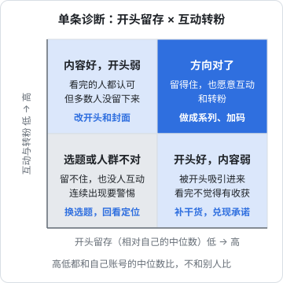

# 冷启动数据怎么读

发了 10 条，后台有一堆数字：播放量、完播率、点赞、收藏、涨粉……新手最常见的两种反应，一种是只看播放量，涨了就高兴、掉了就焦虑；另一种是把每个数字都拿去和网上流传的「标准」比，比如「完播率低于多少就是不行」。

两种都会让你得出错误的结论。这一章讲冷启动期该看哪几个数、怎么跟自己比、怎么从单条诊断到阶段判断，以及一套可以直接用的复盘表。

各平台推荐机制和后台功能的细节见《抖音与快手》和《小红书、视频号与 B 站》，投流后的数据分析见《投流与数据分析》。这一章只讲冷启动期、不投流时的判读。

## 先讲清楚：没有通用的「合格线」

网上常能看到「完播率要达到多少」「互动率低于多少会被限流」之类的说法。**本书没有查到任何平台官方公开过这类阈值**。它们大多是个人经验，而且忽略了一个事实：不同时长、不同赛道、不同形式的内容，这些比例天然差很多。60 秒教程和 15 秒段子的完播率不可能用同一把尺子量。

所以本书的方法是：**只和你自己比**。用你自己账号的中位数做基准，看每一条、每个支柱是高于还是低于这个基准。

## 看哪几个数

把后台的指标按观众的行为顺序排，就是一条漏斗：


| 环节 | 指标 | 回答的问题 | 主要受什么影响 |
|---|---|---|---|
| 被推荐 | 播放量 | 平台给了多少流量 | 前面几个环节的综合表现、选题的受众面、偶然性 |
| 留下来 | 开头留存，例如抖音创作者后台常见的「5 秒完播率」「2 秒跳出率」一类指标 | 刷到的人有没有在开头划走 | 开头第一句、第一个画面、封面 |
| 看下去 | 完播率、平均观看时长 | 留下来的人有没有看完 | 结构、节奏、有没有兑现开头的承诺 |
| 有反应 | 点赞、收藏、评论、转发 | 看完的人觉得值不值 | 内容的实用性、情绪、是否引发讨论 |
| 想要更多 | 主页访问、新增粉丝 | 看完这条，想不想看你的下一条 | 定位清晰度、主页包装、是否有系列感 |

指标的名称和计算口径**以你所在平台后台的「指标说明」为准**，不同平台、不同版本会有差别。下文用通用的叫法。

### 把绝对数换成比率

播放量差别很大的两条，点赞数没法直接比。冷启动期建议算这三个比率：

$$
\text{互动率} = \frac{\text{点赞} + \text{收藏} + \text{评论} + \text{转发}}{\text{播放量}}
$$

$$
\text{收藏率} = \frac{\text{收藏}}{\text{播放量}}
$$

$$
\text{千次播放涨粉} = \frac{\text{新增粉丝}}{\text{播放量}} \times 1000
$$

收藏率单独拿出来，是因为工具型、教程型内容的核心价值是「以后要用」，收藏比点赞更能说明这一点。千次播放涨粉是冷启动期最重要的一个数：它直接回答「看过的人想不想看你的下一条」，也就是定位成不成立。

## 用中位数，不用平均数

冷启动期的数据经常有一条突然高出很多。如果用平均数，这一条会把整体拉高，让你误以为所有内容都不错。中位数不受单条极端值影响。

下面是第 6 章示例账号摸底期 10 条的数据（**虚构，仅用于演示计算**）：

| 序号 | 支柱 | 播放 | 开头留存 | 完播率 | 赞 | 藏 | 评 | 转 | 涨粉 | 互动率 | 收藏率 | 千次涨粉 |
|---|---|---|---|---|---|---|---|---|---|---|---|---|
| 1 | A | 1820 | 52% | 31% | 46 | 61 | 9 | 5 | 12 | 6.6% | 3.4% | 6.6 |
| 2 | B | 960 | 41% | 22% | 18 | 40 | 3 | 2 | 3 | 6.6% | 4.2% | 3.1 |
| 3 | C | 610 | 33% | 14% | 7 | 5 | 2 | 0 | 1 | 2.3% | 0.8% | 1.6 |
| 4 | A | 2450 | 55% | 34% | 70 | 102 | 15 | 9 | 19 | 8.0% | 4.2% | 7.8 |
| 5 | B | 1130 | 44% | 25% | 21 | 52 | 6 | 3 | 4 | 7.3% | 4.6% | 3.5 |
| 6 | C | 540 | 30% | 12% | 5 | 4 | 1 | 0 | 0 | 1.9% | 0.7% | 0.0 |
| 7 | A | 1390 | 49% | 29% | 31 | 44 | 7 | 3 | 8 | 6.1% | 3.2% | 5.8 |
| 8 | B | 3900 | 47% | 27% | 62 | 210 | 21 | 14 | 11 | 7.9% | 5.4% | 2.8 |
| 9 | C | 720 | 36% | 15% | 9 | 6 | 3 | 1 | 2 | 2.6% | 0.8% | 2.8 |
| 10 | A | 2010 | 53% | 32% | 52 | 70 | 11 | 6 | 14 | 6.9% | 3.5% | 7.0 |

按支柱取中位数：

| 分组 | 条数 | 播放 | 开头留存 | 完播率 | 互动率 | 收藏率 | 千次涨粉 |
|---|---|---|---|---|---|---|---|
| 全部 | 10 | 1260 | 45% | 26% | 6.6% | 3.4% | 3.3 |
| 支柱 A | 4 | 1915 | 52% | 32% | 6.8% | 3.4% | 6.8 |
| 支柱 B | 3 | 1130 | 44% | 25% | 7.3% | 4.6% | 3.1 |
| 支柱 C | 3 | 610 | 33% | 14% | 2.3% | 0.8% | 1.6 |

怎么读：

- **只看播放量会看错**。第 8 条（支柱 B）播放 3900，是 10 条里最高的，但它的千次涨粉只有 2.8，低于全部的中位数 3.3。它被推得多、被收藏得多，但看完的人不太想关注。B 的整体播放中位数只有 1130，第 8 条更像一次偶然
- **支柱 A 是方向**。开头留存、完播率、千次涨粉三项都是最高的，尤其千次涨粉 6.8，是整体中位数的两倍。看过的人想看下一条
- **支柱 B 是「好内容、弱转粉」**。互动率和收藏率都最高，但千次涨粉低。说明这类内容有用、但不能让人记住你。适合保留少量，作为收藏型内容，不适合当主力
- **支柱 C 各项都最低**。开头留存 33% 说明从开头就留不住人，和拆解时「原理类数据低」的规律一致。人设差异化的冒险没有成功，至少在当前写法下

这就是第 6 章计划表里「第 11 条起停掉 C、B 保留少量」的依据。

### 一个计算脚本

数据多了以后手算容易出错。把后台数据手动抄到一个 CSV 里，用下面这个脚本算中位数（只读本地文件）：

```python
# analyze_posts.py —— 按支柱汇总冷启动数据
# 用法：python3 analyze_posts.py posts.csv
# CSV 表头：no,pillar,plays,hook,finish,likes,saves,comments,shares,follows
#           hook 和 finish 写成小数，如 0.52
import csv
import sys
from collections import defaultdict
from statistics import median

rows = list(csv.DictReader(open(sys.argv[1], encoding="utf-8")))
for r in rows:
    plays = int(r["plays"])
    acts = sum(int(r[k]) for k in ("likes", "saves", "comments", "shares"))
    r["engage"] = acts / plays
    r["save_rate"] = int(r["saves"]) / plays
    r["fans_per_k"] = int(r["follows"]) / plays * 1000

def show(name: str, group: list[dict]) -> None:
    print(
        f"{name:6s} n={len(group):2d}"
        f"  播放 {median(int(r['plays']) for r in group):>6.0f}"
        f"  开头留存 {median(float(r['hook']) for r in group):.0%}"
        f"  完播 {median(float(r['finish']) for r in group):.0%}"
        f"  互动率 {median(r['engage'] for r in group):.1%}"
        f"  收藏率 {median(r['save_rate'] for r in group):.1%}"
        f"  千次涨粉 {median(r['fans_per_k'] for r in group):.1f}"
    )

show("全部", rows)
groups: dict[str, list[dict]] = defaultdict(list)
for r in rows:
    groups[r["pillar"]].append(r)
for key in sorted(groups):
    show("支柱" + key, groups[key])
```

```bash
python3 analyze_posts.py posts.csv
```

不要写程序去自动抓后台数据。冷启动期每周只有三条，手抄五分钟；自动化抓取既可能违反平台协议，也会让你失去逐条看数据时的那点感觉。

## 单条诊断：开头留存 × 互动转粉

每条发完 3–7 天、数据基本稳定后，用两个维度给它定位：横轴是开头留存，纵轴是互动率和千次涨粉。高低都和你自己的中位数比。



| 象限 | 现象 | 下一步 |
|---|---|---|
| 右上：方向对了 | 开头留得住，看完的人也互动、转粉 | 同类选题做成系列；记下这条的开头写法和结构，作为模板 |
| 左上：内容好，开头弱 | 开头大量流失，但留下来的人很认可 | 选题保留，重写开头第一句和第一个画面，重做封面；可以隔段时间用新开头重新做一版 |
| 右下：开头好，内容弱 | 开头吸引人，但看完没反应 | 检查开头是否承诺过度（「一招解决」实际要五步）；补充具体步骤和结果 |
| 左下：选题或人群不对 | 各项都低 | 单条出现不用慌；同一支柱连续 3 条落在这里，回看这个支柱是否成立 |

用示例数据对一下：第 4 条（A）落在右上；第 8 条（B）开头留存 47% 略高于中位数、互动率高、但涨粉低，介于右上和右下之间；第 3、6、9 条（C）都落在左下，而且是同一个支柱连续三条，这正是需要警惕的信号。

## 复盘表

### 单条复盘（每条发完 3–7 天填）

```text
【单条复盘】  序号：__  支柱：__  发布日期：____  复盘日期：____

测试变量：____（本条和对照条只差在哪）

数据：播放 ____  开头留存 ____  完播率 ____  平均观看时长 ____
      赞 __ 藏 __ 评 __ 转 __  新增粉丝 __
      互动率 ____  收藏率 ____  千次涨粉 ____

相对中位数：开头留存 高 / 平 / 低   互动 高 / 平 / 低   转粉 高 / 平 / 低
诊断象限：右上 / 左上 / 右下 / 左下

流失点（看后台留存曲线，如有）：第 __ 秒附近明显下降，那时画面 / 台词是：____

评论区：
  需求延伸 __ 条，代表：____
  适用性疑问 __ 条，代表：____
  质疑纠错 __ 条，代表：____

结论（一句话，必须基于上面的数据）：____
下一条要改的一件事：____
```

后台如果有观看留存曲线，一定要看**曲线在哪一秒掉得最陡**，然后回到视频那一秒看画面和台词。这比任何总体指标都具体。

### 阶段复盘（第 10、20、30 条发完后）

```text
【阶段复盘】  阶段：摸底 / 对比测试 / 加码   覆盖序号：__–__   日期：____

一、整体（中位数）
  播放 ____  开头留存 ____  完播 ____  互动率 ____  收藏率 ____  千次涨粉 ____
  和上一阶段比：____

二、按支柱
  | 支柱 | 条数 | 开头留存 | 完播 | 互动率 | 千次涨粉 | 判断 |
  （填表）

三、对比测试结果（对比测试阶段填）
  第 __ / __ 条，变量：____，结果：____，是否采用：____

四、评论区汇总
  本阶段出现最多的需求：____
  有没有人问「还有吗」「出个系列」：____

五、自己的状态
  计划发 __ 条，实际发 __ 条；平均每条耗时 __ 小时
  哪个环节最累：____；能否持续：能 / 勉强 / 不能

六、决定
  保留：____
  停掉：____
  下阶段要测：____
```

第五部分不要跳过。第 6 章说过，前 30 条也在测你自己。如果数据不错但你已经累得不行，那要调整的是生产方式，而不是硬撑。

## 常见误读

| 误读 | 实际情况 |
|---|---|
| 「这条播放量突然很高，说明这个方向对了」 | 先看千次涨粉和互动率；单条高播放可能是偶然推到了更宽的人群 |
| 「播放量一直几百，被限流了」 | 新号播放量低是常态；先看开头留存和完播，内容本身留不住人时，平台不会继续推。确认限流要看平台的违规通知或作品状态，不要自己猜 |
| 「这条点赞多，下一条照着做」 | 点赞多可能是选题情绪好，不代表结构好；照着做之前先放进诊断矩阵 |
| 「完播率低是因为视频太长」 | 先看留存曲线在哪掉；常常是中段某个地方节奏拖了，不是总时长的问题 |
| 「数据不好是发布时间不对」 | 发布时间影响通常小于内容本身；在其他变量都测过之前，不要把锅推给时间 |
| 「涨了 100 个粉，说明可以了」 | 看这 100 个粉来自哪几条、是不是目标人群；评论区和粉丝画像（如果后台有）能帮你确认 |

关于「限流」：平台对违规内容确实会限制分发，通常会有站内通知或作品状态提示。处理方法见《国内私域与内容平台》第 9 章「平台规则与封号风险」。没有任何通知、只是数据低，多数情况是内容本身的问题。

## 本章要点

- 没有平台公开的通用合格线，只和你自己账号的中位数比
- 按「播放 → 开头留存 → 完播 → 互动 → 涨粉」的漏斗看数据；指标口径以后台说明为准
- 把绝对数换成互动率、收藏率、千次播放涨粉；千次涨粉最能说明定位是否成立
- 用中位数而不是平均数，避免单条极端值误导
- 单条用「开头留存 × 互动转粉」矩阵诊断；同一支柱连续 3 条落在左下要警惕
- 每条填单条复盘、每 10 条做阶段复盘，阶段复盘要包括自己的状态
