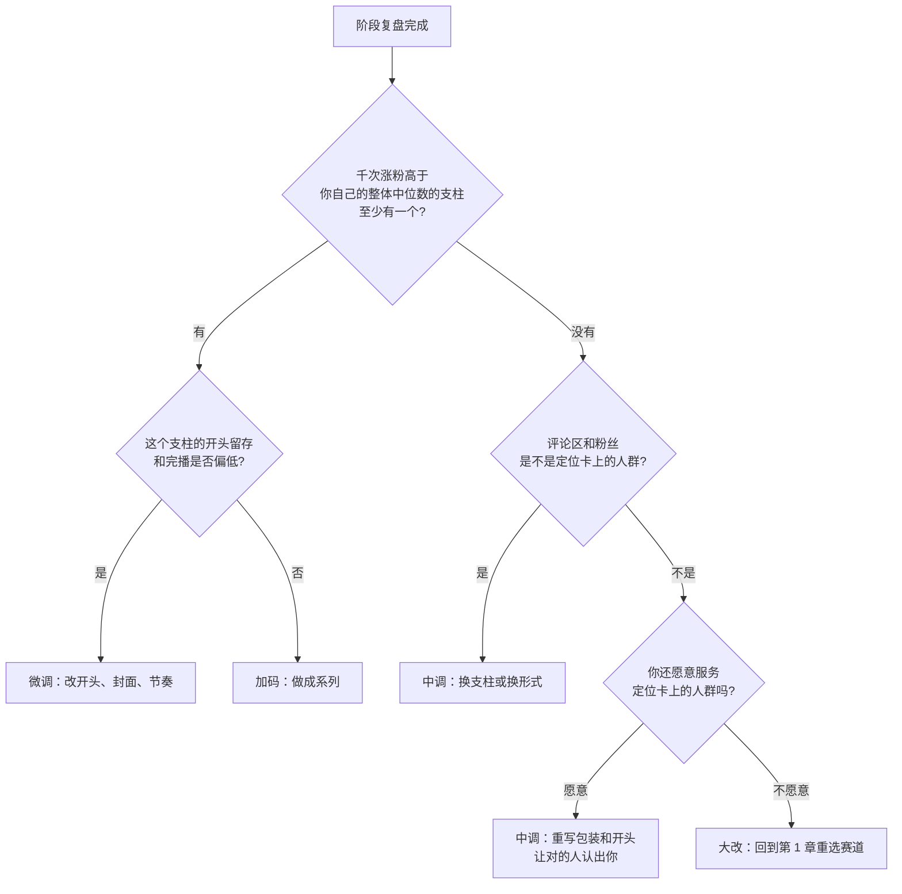

# 定位迭代与换方向

30 条发完，你会落在三种处境之一：方向明显对了，方向明显不对，或者不好不坏。第三种最常见，也最难办：放弃觉得可惜，继续又看不到起色。

这一章讲怎么判断该微调、该大改还是该换，换的时候用老号还是开新号，以及哪些「换方向」的做法是坑。一人公司层面的止损思路见[《一人公司方法论》第 6 章](../opc-playbook/06-when-to-quit.md)「什么时候该放弃」，这里只讲账号定位。

## 调整的三个层级

不是所有问题都要换方向。按改动范围从小到大，分三级：

| 层级 | 改什么 | 不改什么 | 典型触发信号 | 代价 |
|---|---|---|---|---|
| 微调 | 开头写法、封面、时长、节奏、标题 | 人群、需求、支柱 | 诊断矩阵里「内容好，开头弱」「开头好，内容弱」多 | 几乎没有 |
| 中调 | 支柱组合、内容形式、人设表达 | 人群 | 某个支柱一直在左下；形式做不动或产能跟不上 | 老粉可能少量流失 |
| 大改 | 人群或核心需求，也就是赛道 | 只剩你自己 | 所有支柱都在左下；评论区不是你要的人；做不下去 | 粉丝基本作废，等于重新冷启动 |

原则是**能用小的解决就不用大的**。大部分账号的问题出在微调层面：选题和人群其实没错，只是开头留不住人。在这种情况下换赛道，等于把一个只需要换轮胎的车扔掉。



注意第一个判断用的是「高于你自己的整体中位数」，不是任何外部标准。如果所有支柱都差不多，说明它们之间没有区分度，同样走「没有」那条线。

## 30 条之后的判断表

把阶段复盘的结果填进这张表，每一行给出一个判断：

| 检查项 | 信号 | 指向 |
|---|---|---|
| 千次涨粉的趋势 | 第 21–30 条的中位数高于第 1–10 条 | 定位在变清晰，继续 |
| | 三个阶段持平或下降 | 定位没有被平台和观众「认出来」，至少中调 |
| 最好的支柱 | 有一个明显好于其他，且好在转粉 | 收窄到这个支柱 |
| | 好在播放和收藏，但不转粉 | 内容有用但没有人设，补人设表达（见下文） |
| 评论区 | 出现「还有吗」「出个系列」「怎么关注你的更新」 | 强信号，加码 |
| | 评论人群和定位卡不符（比如做上班族却来了很多学生） | 要么接受新人群，要么调整开头和包装 |
| 你自己 | 每条耗时在下降，还有余力 | 可以考虑提频 |
| | 每条耗时没降，已经开始拖更 | 先改生产方式（形式、模板化），再谈方向 |

### 好在收藏、不转粉怎么办

这是工具型、教程型账号最常见的处境：观众觉得内容有用，收藏了，但不关注。原因通常是「这条有用」和「这个人值得关注」之间缺了一步。补法：

| 做法 | 例子 |
|---|---|
| 系列化 | 每条标题带系列名和编号，「乱表格急救 07」，结尾说「这个系列还有 20 种」 |
| 人设露出 | 开头或结尾加一句固定的自我介绍，「我是写代码的阿杰，专治乱表格」 |
| 预告 | 结尾预告下一条：「明天讲从 PDF 导出来的表」 |
| 主页承接 | 合集和置顶对应得上，点进主页一眼看到「还有很多」 |

这些都属于微调到中调之间，不需要换方向。

## 一次中调的完整示例

接第 6、7 章的示例账号（**虚构**）。假设 30 条发完后，阶段复盘得到这样的结果：

| 观察 | 数据或证据 |
|---|---|
| 支柱 A「乱表格急救」 | 三个阶段的千次涨粉中位数逐步上升，第 21–30 条里有 4 条落在诊断矩阵右上 |
| 支柱 B「AI 工具实测」 | 收藏率一直最高，千次涨粉一直低于整体中位数 |
| 评论区 | 约三分之一的提问来自「小公司老板」「个体户」，问能不能直接给一套进销存或工资表模板 |
| 自己 | 每条耗时从 3 小时降到 2 小时；B 支柱每次都要重新注册、测试新工具，最累 |

按上面的流程图走：有千次涨粉明显更高的支柱（A），它的开头留存和完播不低，所以 A 加码；B 好在收藏、不转粉，而且最耗精力，降为每月一条汇总；评论区出现了一群新人群（小老板），他们和原人群需求相近、而且更有付费意愿，于是决定**中调**：

| 定位卡项 | 调整前 | 调整后 |
|---|---|---|
| 账号一句话 | 给上班族讲用 AI 处理乱表格 | 给上班族和小老板讲用 AI 处理乱表格，附可直接用的模板 |
| 支柱 | A 乱表格急救 / B AI 工具实测 / C（已停） | A 乱表格急救（每周 2 条）/ B 月度工具汇总（每月 1 条）/ D 小生意表格模板（每周 1 条，新增） |
| 变现 | 工具广告 | 工具广告 + 模板包 |
| 包装 | 简介只写上班族 | 简介加上「小生意也能用」；新开合集「小生意表格」 |
| 对标池 | 5 个上班族办公类腰部账号 | 保留 3 个，新增 2 个小商家经营类账号 |

注意几点：人群是**扩展**而不是替换，原人群不受影响；新支柱 D 按第 6 章的方法当作一次新的摸底，先发 10 条再判断；止损线也要为 D 单独写一份。

## 止损线：提前写下来

换不换方向，最怕的是在情绪里做决定：一条爆了就觉得找到方向，连续几条差就想放弃。办法是在开始前就**写下止损线**，到时候按条件执行。

```text
【止损线】  写于：____（第 1 条发布前）

时间与产量：
  - 我计划在 ____ 周内发完 ____ 条

继续的条件（满足任意两条）：
  - 第 21–30 条的千次涨粉中位数 ≥ 第 1–10 条的 ____ 倍
  - 至少有 ____ 条落在诊断矩阵右上
  - 评论区出现「出系列」「还有吗」类评论累计 ≥ ____ 条
  - 我的单条耗时降到 ____ 小时以内

中调的条件：
  - 不满足继续条件，但评论区是我要的人群

大改或停止的条件：
  - 30 条后不满足任何继续条件，且评论区不是我要的人群
  - 或者：连续 ____ 周无法按计划更新，且改生产方式后仍然无法恢复

签字：____
```

空格里的数字由你自己定，本书不给标准答案，因为不同赛道差别很大。关键是**在看到数据之前就定下来**。看到数据之后再定的标准，总会不自觉地向你想要的结论倾斜。

## 换方向：老号还是新号

决定大改之后，第二个问题是在原账号上改，还是开一个新号。

| 情况 | 建议 | 理由 |
|---|---|---|
| 新人群和老人群有重叠（如「上班族表格」→「上班族 AI 办公」） | 老号改 | 老粉有一部分仍然是目标人群，系统对账号的标签可以逐步迁移 |
| 新人群和老人群完全不同（如「上班族表格」→「AI 短剧」） | 新号 | 老粉不会看，留在老号上反而让新内容的早期数据很难看 |
| 老号有违规记录或长期被判定异常 | 新号 | 但要先弄清楚违规原因，避免在新号上重犯 |
| 老号积累了少量但精准的粉丝，且你打算继续做老方向的变现 | 老号保留低频更新，新方向开新号 | 不要为了新方向浪费已有的信任 |

老号改方向的步骤：

```text
1. 先改包装（名字可以先不改，改简介、背景图、置顶、合集）
2. 新方向的内容在开头给一个过渡：「以前讲表格，最近发现大家更需要 AI 办公，所以……」
3. 旧内容不要批量删除，可以设为私密或移出合集（具体功能以平台为准）
4. 按第 6 章的方法重新走一遍摸底，旧数据不再作为基准
5. 改名放在新方向稳定之后，避免老观众认不出你
```

关于同一个人开多个账号：多数平台允许一个实名主体开设多个账号，但有数量和使用上的限制，并且严格限制「矩阵式」发布同质化内容、多号互相导流、用多设备批量操作等行为。开新号前查清楚平台当下的规则；矩阵号的玩法见[《自媒体与短剧一人公司全景》](../media-opc-overview/)和[《AI 内容生产工具链》](../ai-content-pipeline/)。

## 换方向时的坑

| 做法 | 风险 |
|---|---|
| 买一个「已有粉丝」的号来做新方向 | 账号买卖违反各平台用户协议，账号可能被回收；原有粉丝也不是你的人群；原主人的违规记录会跟着账号走 |
| 改名蹭热点人物、热点事件 | 冒充热点事件当事人或相关人员是「清朗·整治账号名称信息乱象」专项行动的整治对象（中国网信网，2026-06-18） |
| 突然转向「AI 赚钱」「副业月入」 | 收益类内容是虚假宣传和平台治理的重点领域；如果你没有真实的、可公开的收入数据，不要做 |
| 换方向后把老内容全部删掉 | 可能触发异常行为识别，也删掉了你过去的实验记录 |
| 每 10 条换一次方向 | 每个方向都没测完，永远在冷启动；至少按一个完整的 30 条周期走 |
| 照搬一个刚爆起来的账号 | 你看到它爆的时候，同类账号已经很多了；而且它爆的原因可能你复制不了 |

## 定位是会长的

最后一点：定位不是一次定死的。一个健康的账号，定位会随着你和观众的互动慢慢长出来：

- 开始时是「给上班族讲 AI 处理表格」
- 30 条后收窄成「乱表格急救」，因为这个支柱转粉最好
- 60 条后评论区有很多人问自动化脚本，于是加了一个「不用写代码的自动化」支柱
- 100 条后发现有一批观众是小公司老板，开始有人问能不能帮他们做一套表格模板，变现方向也随之清晰

每一步都是**被数据和评论区推着走的**，而不是自己拍脑袋想出来的。每个季度回看一次一页定位卡，把实际发生的变化写进去，并更新对标池（第 2 章）。

## 本章要点

- 调整分微调、中调、大改三级，能用小的解决就不用大的；多数问题出在开头和包装，不在赛道
- 用「有没有千次涨粉高于自己整体中位数的支柱」「评论区是不是目标人群」「你还愿不愿意服务这群人」三个问题走判断流程
- 好在收藏、不转粉，用系列化、人设露出、预告、主页承接来补
- 止损线要在第 1 条发布前写下来，看到数据后再定的标准会偏
- 人群有重叠用老号改，完全不同开新号；不要买号、蹭热点改名、批量删旧内容
- 定位会随数据和评论区慢慢长出来，每季度回看一次定位卡和对标池
