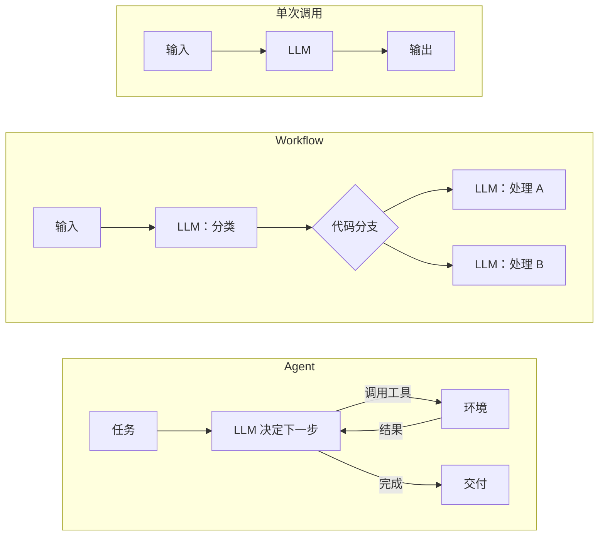
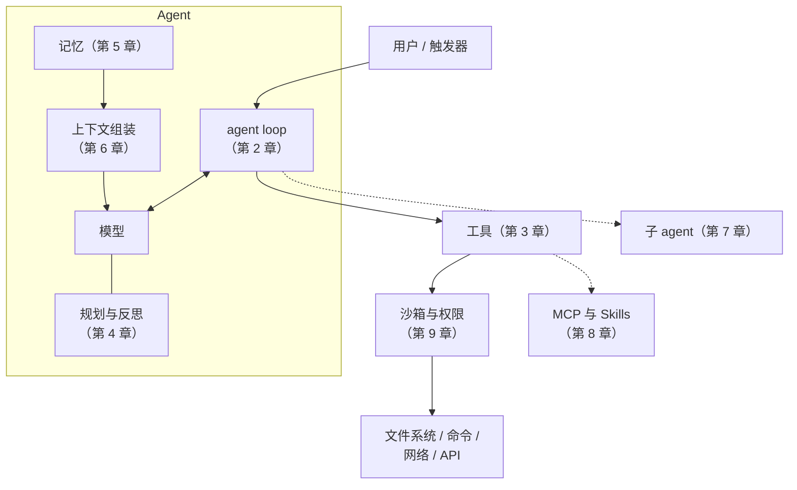
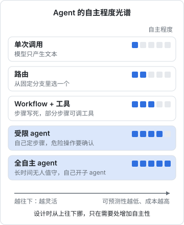

# 什么是 Agent

你每天在用 Claude Code 这类编码 agent：丢给它一句「把书架页的顶部空白去掉」，它自己去读代码、改文件、跑类型检查、看报错再改，最后告诉你改完了。同一个模型，放在聊天窗口里只会回答问题，放进 agent 里却能把一件事做完。差别在哪里？

这一章先回答「Agent 到底是什么」，把它和普通的 LLM 调用、固定流程的 workflow 区分开，再给出全书要用的一张「零件图」。

## 关于这本书

### 讲什么

这本书是 Agent 系列的**总纲**。它把一个 agent 拆成几个零件：循环、工具、规划、记忆、上下文、多 agent 协作、协议与扩展、沙箱与权限，每个零件讲清楚三件事：

- 它解决什么问题
- 核心原理是什么
- 设计时最常见的取舍

每个主题只讲到「心里有数」的深度。需要深挖的部分，后面几本书各自展开：

| 本书章节 | 深入阅读 |
|---|---|
| 上下文工程概览、记忆 | [《上下文工程》](../context-engineering/) |
| 工具与行动、MCP | [《工具设计与 MCP》](../tools-and-mcp/) |
| 多 agent 概览 | [《多 Agent 编排》](../multi-agent/) |
| 沙箱与权限 | [《Agent 安全》](../agent-safety/) |
| 全书的代码片段 | [《动手构建 Agent》](../build-your-agent/)会把它们拼成一个能跑的 agent |
| 日常使用 | [《编码 Agent 实战》](../coding-agents/)[《个人 Agent 工作流》](../personal-agent-workflow/) |

### 适合谁

- 已经在用编码 agent，想知道它为什么有时聪明、有时犯傻
- 想给自己的产品加一个 agent 功能，不知道从哪里开始设计
- 读过[《大模型原理科普》](../llm-fundamentals/)，知道模型是「预测下一个 token」的机器

书里的代码用 TypeScript，因为这是读者的日常栈；概念本身与语言无关。

### 怎么读

建议按顺序读。前五章是单个 agent 的内部结构，第 6–9 章是把 agent 放进真实环境要面对的问题，第 10 章把前面所有内容收拢成一份失败模式清单。如果你只有半小时，读第 2 章和第 10 章。

## 一个可操作的定义

「Agent」这个词被用得很滥：带 prompt 模板的聊天机器人叫 agent，一条固定的 RAG 管线也叫 agent。本书采用一个窄而可操作的定义：

> **Agent = 一个在循环里使用工具、由模型自己决定下一步做什么、直到任务完成的 LLM 系统。**

拆开看有三个要素：

1. **循环**：不是一问一答，而是「想一步、做一步、看结果」反复多轮
2. **工具**：模型能通过工具作用于外部世界，读文件、跑命令、查数据库、发请求
3. **自主决定控制流**：调用哪个工具、调用几次、什么时候停，由模型根据中间结果决定，而不是写死在代码里

第三点是关键。很多系统有循环、有工具，但每一步做什么是程序员事先编排好的，那是 workflow，不是 agent。

## 三种形态：调用、workflow、agent

| 形态 | 控制流由谁决定 | 可预测性 | 适合 |
|---|---|---|---|
| 单次调用 | 无控制流 | 高 | 翻译、摘要、分类、抽取 |
| Workflow | 程序员写死 | 较高 | 步骤固定、可以画出流程图的任务 |
| Agent | 模型运行时决定 | 低 | 步骤数和路径事先说不清的任务 |

举一个读者自己项目里的例子。hatch-counter 用视觉模型识别进货单：拍照 → 模型抽取成结构化的品名、数量、单价 → 程序校验 → 名字对不上的列出来让店主选。这是一条 **workflow**：步骤是固定的，模型只负责其中「看图抽字段」这一步。它不需要是 agent，也**不应该**是 agent。

反过来，「修好这个只在真机上复现的 WebView 白屏」就没法事先画流程图：要读哪些文件、试几种假设、跑几次构建，都取决于中间看到了什么。这种任务才值得交给 agent。

## 什么时候该用 agent

agent 的自主性是有代价的：

- **更贵**：一次任务可能几十轮模型调用，每轮都带着越来越长的上下文
- **更慢**：串行的思考加工具执行
- **更难预测**：同样的输入可能走出不同路径，出错方式也更多样
- **更难测试**：没有固定路径，传统的单元测试覆盖不了

所以一个实用的原则是：**能用单次调用就别用 workflow，能用 workflow 就别用 agent**。只有当任务同时满足下面几条时，agent 才划算：

- 路径事先说不清，需要根据中间结果调整
- 结果可以被验证：有测试、有类型检查、有人看一眼就知道对不对
- 犯错的代价可控：可以回滚、可以在沙箱里试、可以让人在关键步骤确认
- 任务价值足以覆盖多轮调用的成本

编码之所以成为 agent 最成功的领域，正是因为它几乎完美满足这些条件：路径多变，但有编译器和测试当裁判，有 git 可以回滚。

## Agent 的零件图

把一个 agent 拆开，能看到下面这些部分。本书每一章讲其中一块：

注意一个容易忽略的事实：**模型本身是无状态的**。每一轮调用，模型看到的只有你这一轮发过去的上下文。所谓「agent 记得之前做过什么」，只是因为 loop 把之前的对话和工具结果又塞了回去。理解这一点，后面关于上下文、记忆、压缩的所有讨论都会顺理成章。

## 自主程度是一条光谱

agent 和 workflow 不是非黑即白。实际系统往往处在中间某个位置：

- **单次调用**：模型只产生文本
- **路由**：模型从几个固定分支里选一个
- **固定 workflow + 工具**：步骤写死，某几步允许模型调用工具
- **受限 agent**：模型自己决定步骤，但工具集很小、每个危险操作要人确认
- **全自主 agent**：长时间无人值守运行，自己拆任务、开子 agent

设计时应该从上往下挪，**只在确实需要的地方增加自主性**。很多「agent 产品」失败，是因为一开始就选了最下面那一档，结果在可控性上付出巨大代价。

## Agent 能做好的前提

模型能力越来越强，但 agent 的表现并不只取决于模型。同一个模型，在两个不同的 agent 框架里表现可以天差地别。决定性因素通常是：

| 因素 | 说明 | 对应章节 |
|---|---|---|
| 工具设计 | 工具是否好用、描述是否清楚、错误是否可读 | 第 3 章 |
| 上下文 | 每一步模型看到的信息是否必要且充分 | 第 6 章 |
| 反馈信号 | 有没有测试、类型检查、执行结果这类客观信号 | 第 2、4 章 |
| 边界 | 权限和沙箱是否让它敢放手做 | 第 9 章 |

你在仓库里写的 `CLAUDE.md`、配置的权限白名单、写的测试，本质上都是在改善这几个因素。这也是本书想让你建立的视角：**agent 的质量是被设计出来的**。

## 本章要点

- Agent 是在循环里使用工具、**由模型自己决定控制流**、直到完成任务的 LLM 系统
- 控制流写死的是 workflow，不是 agent；两者是一条自主程度光谱的不同位置
- agent 更贵、更慢、更难预测，**能用简单形态就别用 agent**
- agent 适合路径多变、结果可验证、犯错可回滚的任务，编码是典型
- 模型是无状态的，agent 的「记忆」全靠 loop 把信息塞回上下文
- agent 的表现取决于工具、上下文、反馈信号和边界，这些都是可以设计的
