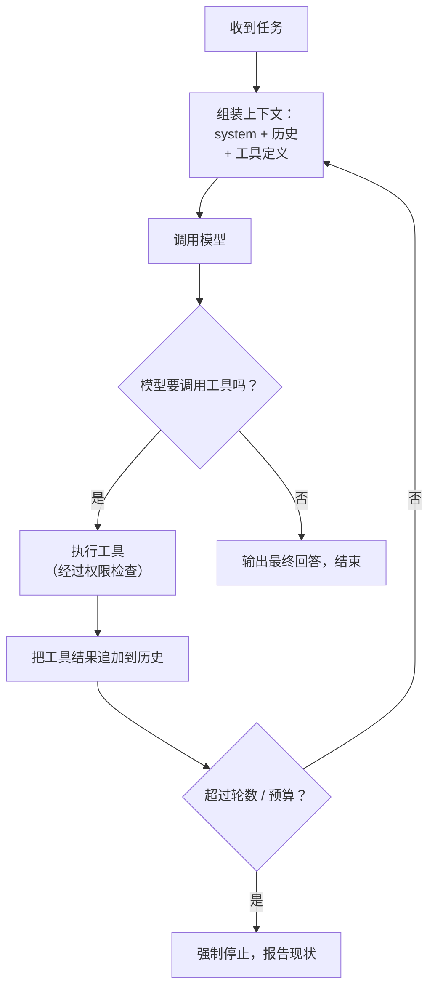
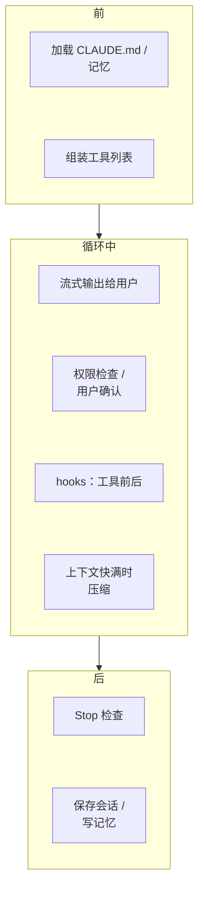

# agent loop

上一章说 agent 的核心是「在循环里使用工具」。这一章把这个循环拆开：它每一轮做什么、靠什么停下来、消息是怎么一轮轮累积起来的，以及为什么几十行代码的循环就能撑起一个编码 agent。读完你会发现，Claude Code 这类产品最核心的部分并不神秘，复杂度都在循环之外。

## 循环的骨架

几乎所有 agent 的主体都是同一个结构：



用一句话说：**模型提议行动，程序执行行动，结果反馈给模型，直到模型认为完成**。模型从不直接碰外部世界，它只能「说」自己想调用什么工具、参数是什么；真正执行的永远是你的代码。这条边界是后面讨论权限和安全的基础。

## 一个最小实现

去掉类型和错误处理，循环的核心只有十几行（以 Anthropic Messages API 的协议为例）：

```typescript
const messages = [{ role: "user", content: task }];
for (let turn = 0; turn < MAX_TURNS; turn++) {
  const res = await client.messages.create({ model, system, tools, messages });
  messages.push({ role: "assistant", content: res.content }); // 整条回复原样放回历史

  if (res.stop_reason !== "tool_use") return textOf(res); // 不再调工具：模型认为完成了

  const results = [];
  for (const call of res.content.filter((b) => b.type === "tool_use")) {
    const output = await runTool(call.name, call.input); // 失败也返回错误文字，不抛异常
    results.push({ type: "tool_result", tool_use_id: call.id, content: output });
  }
  messages.push({ role: "user", content: results }); // 工具结果作为一条 user 消息
}
return "达到最大轮数，任务未完成。";
```

能跑的完整版本（工具定义、逐个处理停止原因、用量统计、用假模型测试）见[《动手构建 Agent》第 1 章](../build-your-agent/01-minimal-loop.md#第一版循环)。

这十几行已经具备了 agent 的全部要素：循环、工具、模型决定何时停止。几个值得注意的细节：

- **工具结果走 `user` 角色**：从协议角度看，工具执行结果是「环境」给模型的输入，和用户输入同属外部信息
- **`tool_use_id` 必须对上**：模型一轮可以并行发起多个工具调用，结果要逐一按 id 回填
- **错误也是结果**：读文件失败不抛异常，而是把错误信息返回给模型，让它自己决定换个路径还是放弃。这是 agent 自我纠错的基础，第 3 章会细讲
- **轮数上限是保险丝**：没有它，一个陷入死循环的 agent 会一直烧钱

[《动手构建 Agent》](../build-your-agent/)会从这个骨架出发，逐步加上更多工具、记忆、评测，最后换成 Agent SDK。

## 消息历史是怎么长大的

跑一个任务「`bridge.ts` 里定义了哪些消息类型？」，messages 数组会这样增长：

```text
[0] user       : bridge.ts 里定义了哪些消息类型？
[1] assistant  : (文字) 我先找到这个文件。
                 (tool_use id=t1) read_file {path: "app/src/reader/bridge.ts"}
[2] user       : (tool_result t1) <文件全文，约 3000 token>
[3] assistant  : (文字) 文件里定义了以下几类消息……
```

每一轮调用都要把**整个数组**重新发给模型。这带来一个重要后果：


**单轮成本线性增长，总成本按二次方增长**：一个 20 轮的任务，累计输入可以到几十万 token，具体算法和 prompt 缓存能省多少见[《上下文工程》第 1 章](../context-engineering/01-scarce-window.md#稀缺之一钱)。这就是为什么长任务一定要关心上下文管理（第 6 章），也是 prompt 缓存对 agent 格外重要的原因。

## 停止条件

一个 agent 什么时候停下来，比看上去复杂。常见的停止条件有四类：

| 停止条件 | 谁触发 | 说明 |
|---|---|---|
| 模型不再调用工具 | 模型 | 正常结束，模型认为任务完成 |
| 轮数或 token 预算耗尽 | 程序 | 保险丝，防止失控 |
| 需要人类输入 | 模型或程序 | 遇到歧义、危险操作，主动暂停等待确认 |
| 外部信号 | 用户 | 用户按下中断、超时、进程退出 |

难点在第一类：**模型说「完成了」不等于真的完成了**。模型有很强的倾向在看起来差不多的时候宣布胜利，比如改完代码没跑测试就说「已修复」。对付它的办法不是在 prompt 里写「请务必确认」，而是给它**客观的完成判据**：

- hatch-shelf 的 `CLAUDE.md` 写着「声明任务完成前必须通过 `pnpm typecheck` 和 `pnpm test`」，这就是把完成条件从模型的主观判断变成可执行的检查
- 更进一步，可以在程序里强制：模型想停止时，自动跑测试，没通过就把失败输出塞回去，继续循环。Claude Code 的 Stop hook 就能实现这种机制，[《编码 Agent 实战》](../coding-agents/)会讲具体写法

## 反馈信号决定 agent 的上限

agent 能自我纠错，前提是环境给出了**有信息量的反馈**。对比两种工具返回：

```text
差：命令执行失败。
好：pnpm typecheck 退出码 2
    app/src/reader/bridge.ts(42,7): error TS2322:
    Type 'string' is not assignable to type 'ReaderMessage'.
```

第一种，模型只能瞎猜；第二种，它能直接定位到第 42 行。这就是为什么编码 agent 效果最好：编译器、类型检查、测试、linter 都是现成的高质量反馈源。hatch-shelf 开启 ESLint 的 `no-floating-promises`，除了保护人，也在给 agent 一个更早、更准的报错信号。

一个经验法则：**想让 agent 在某个领域做得好，先问这个领域有没有「编译器」**。没有的话，想办法造一个：写校验脚本、写断言、让另一个模型当评审（第 4 章）。

## 循环之外的复杂度

真实产品中的 agent loop 当然比上面的十几行复杂，但多出来的部分基本都在循环**周围**，而不是改变循环本身：



- **流式输出**：让用户实时看到模型的思考和行动，随时可以打断
- **权限检查**：执行工具前判断是否需要用户确认（第 9 章）
- **hooks**：在工具调用前后插入确定性的代码，比如改完文件自动格式化
- **上下文压缩**：历史太长时做摘要（第 6 章）
- **会话持久化**：中断后可以恢复

理解这一点有个实际好处：遇到 agent 行为异常时，你知道该往哪里排查。是模型判断错了（循环内），还是喂给它的上下文有问题（循环前），还是工具返回的信息不够（工具层）？

## 本章要点

- agent loop：**模型提议 → 程序执行 → 结果回填 → 再次调用**，直到模型不再调用工具
- 模型从不直接执行操作，执行权永远在你的代码里
- 每轮都重发完整历史，单轮成本线性增长、**总成本二次方增长**
- 必须有轮数和预算上限；「模型说完成了」不可靠，要用测试等**客观判据**定义完成
- 工具返回的反馈越具体，agent 自我纠错能力越强；有「编译器」的领域最适合 agent
- 产品级 agent 的复杂度主要在循环周围：流式、权限、hooks、压缩、持久化

## 动手练习

1. **看着上下文长大**（需要 API key）：把[《动手构建 Agent》第 1 章](../build-your-agent/01-minimal-loop.md#第一版循环)的完整循环跑起来，仿照那里的 `list_books` 再加一个 `read_file` 工具（`run` 里用 `readFile` 读模型给的路径），在每次调用模型之后加一行 `console.log(turn, res.usage.input_tokens)`，然后给它任务「依次读 package.json、README.md、tsconfig.json，告诉我这个项目用什么包管理器」。

   验证：每轮打印的 `input_tokens` 单调增加，相邻两轮的差值大致等于上一轮工具结果（文件内容）加模型输出的大小。

   参考答案：每次调用都重发完整的 `messages`，所以读进来的每个文件都会在之后每一轮重复计费。

2. **算出二次方增长**：沿用[《上下文工程》第 1 章](../context-engineering/01-scarce-window.md#稀缺之一钱)的假设（system 加工具定义 3000 token，每轮新增 2000 token），用一行 Node 算出 20 轮和 40 轮的累计输入 token。

   ```bash
   node -e 'for (const N of [20, 40]) { let s = 0; for (let n = 1; n <= N; n++) s += 3000 + 2000 * (n - 1); console.log(N, s) }'
   ```

   验证：输出 `20 440000` 和 `40 1680000`。

   参考答案：轮数翻倍，累计成本约变成 3.8 倍，而不是 2 倍；这就是长任务必须做上下文管理和 prompt 缓存的原因。

3. **错误也是结果**（需要 API key）：沿用上一题加了 `read_file` 的完整循环，给它一个不存在的路径，任务写成「读 app/src/nope.ts 并总结」。再把循环里执行工具的 `try/catch` 去掉重跑一次。

   验证：保留 `try/catch` 时，模型收到含 `ENOENT` 的错误结果后会说明文件不存在或尝试别的路径；去掉后整个进程抛出未捕获的异常退出。

   参考答案：把错误作为 `tool_result` 返回，模型才有机会自我纠错；抛异常则直接打断了循环。
