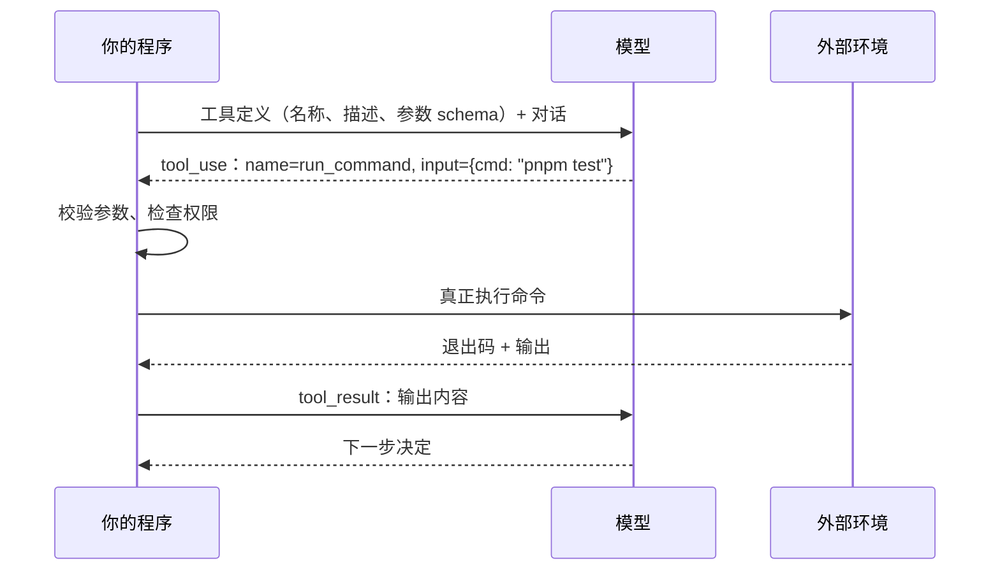

# 工具与行动

模型只会输出文本。让它能读文件、改代码、查数据库、发请求的，是**工具**。工具是 agent 的手，也是 agent 和外部世界之间唯一的接口：模型能做什么、做得好不好、会不会闯祸，很大程度上由工具决定。

这一章讲工具调用在协议层是怎么工作的，什么样的工具对模型友好，以及「行动」带来的副作用该怎么分类。工具设计的完整方法论在《工具设计与 MCP》里展开。

## 工具调用是怎么工作的

模型并不「运行」工具。整个过程是一次结构化的约定：



一个工具定义由三部分组成：

| 部分 | 作用 | 模型如何使用 |
|---|---|---|
| `name` | 唯一标识 | 在输出中引用 |
| `description` | 说明做什么、何时用、有什么限制 | 决定**要不要用、什么时候用** |
| `input_schema` | JSON Schema 描述参数 | 决定**怎么填参数** |

模型是在训练阶段学会「看到工具定义 → 在合适时机输出符合 schema 的调用」的。所以工具定义本质上是 **prompt 的一部分**，而且是模型每轮都会看到的那部分。工具描述写得含糊，就像给新同事一个只有名字没有说明的内部 API。

## 好工具的几个特征

### 描述写给「聪明但没有上下文的新人」

```json
{
  "name": "search_books",
  "description": "按关键词搜索书架上已导入的书，匹配书名、副标题和标签。返回最多 20 条，每条含 id、title、章节数。只搜索元数据，不搜索正文；要搜正文用 search_chapters。",
  "input_schema": {
    "type": "object",
    "properties": {
      "query": { "type": "string", "description": "关键词，空格分隔表示 AND" },
      "category": { "type": "string", "description": "可选，按分类前缀过滤，如 人工智能/Agent" }
    },
    "required": ["query"]
  }
}
```

好的描述回答了：做什么、范围在哪、返回什么、上限多少、和相邻工具的区别。最后一点尤其重要，模型最常犯的工具错误之一就是在两个功能相近的工具之间选错。

### 粒度贴合任务，而不是贴合底层 API

一个常见反模式是把 REST API 一对一包成工具：`list_books`、`get_book`、`list_chapters`、`get_chapter`……模型要完成「找到讲 MCP 的那一章」得连续调用四五次，每次都消耗一轮上下文。

更好的做法是按**任务**设计：一个 `search_chapters` 直接返回匹配的章节和片段。工具少而精，模型选择时的困惑也更少。

### 返回对模型有用的信息

- **控制体积**：一个返回 5 万行日志的工具会瞬间吃掉上下文。默认截断、分页，并告诉模型「共 5 万行，已显示最后 200 行，可用 offset 参数查看更多」
- **语义化而非原始**：返回 `title: "Agent 原理与设计"` 比返回 `uuid: "7f3a…"` 有用，模型拿 uuid 做不了判断
- **错误可行动**：说清楚哪里错了、可以怎么改

```text
差：Error 400
好：参数 category 的值 "agent" 不存在。可用分类：人工智能/大模型, 人工智能/Agent, 技术/前端。
```

可行动的错误让模型能在下一轮自己修正，而不是放弃或者胡乱重试。

## 通用工具与专用工具

编码 agent 有一个有意思的现象：一个 `bash` 工具几乎可以替代所有专用工具。读文件用 `cat`，搜索用 `grep`，跑测试用 `pnpm test`。那为什么 Claude Code 还要单独提供 Read、Edit、Grep 这些工具？

| 维度 | 通用工具（bash） | 专用工具（Read / Edit） |
|---|---|---|
| 覆盖面 | 几乎无限 | 只做一件事 |
| 输出可控 | 难，`cat` 一个大文件就爆 | 内置截断、行号、分页 |
| 权限粒度 | 粗，很难判断一条命令是否安全 | 细，读和写可以分开授权 |
| 可观测性 | 需要解析命令字符串 | 结构化，便于审计和触发 hooks |
| 模型熟悉度 | 很高，训练数据里大量 shell | 取决于描述质量 |

实践中的平衡是：**高频、高风险、需要精细控制的操作做成专用工具，长尾操作交给通用工具**。hatch-counter 的 `CLAUDE.md` 里特意写了「看代码、改代码用 Read / Edit / Write 工具」，原因是按路径加载的规则只在这几个工具碰到匹配文件时才触发，用 shell 命令看文件不会触发。这是专用工具「可观测性」带来的实际差别。

## 行动的副作用分级

工具不只是「读」，还会「写」。不同工具对世界的影响差异巨大，设计 agent 时应该给每个工具标一个副作用等级：

| 等级 | 例子 | 可逆性 | 默认策略 |
|---|---|---|---|
| 只读 | 读文件、搜索、查询数据库 | 无副作用 | 自动放行 |
| 本地可逆写 | 改工作区文件（有 git） | 可回滚 | 自动放行或首次确认 |
| 本地难逆 | `rm -rf`、`git reset --hard`、迁移数据库 | 难回滚 | 每次确认 |
| 外部可见 | 推送代码、发消息、发邮件、发布 | 别人已经看到 | 每次确认 |
| 不可逆外部 | 付款、删除线上数据 | 无法挽回 | 禁止或严格人工审批 |

这个分级直接对应第 9 章的权限设计。一个原则是：**模型越难判断后果的操作，越需要把决定权交给人**。

## 工具调用的几种进阶形态

### 并行调用

模型可以在一轮里发出多个互不依赖的工具调用，比如同时读三个文件。程序可以并发执行，显著减少轮数和延迟。前提是这些调用之间真的没有依赖，写操作的并行要格外小心。

### 结构化输出也是工具

一个小技巧：想让模型输出严格符合某个 JSON 结构，可以定义一个「提交结果」工具，把目标结构写成它的 `input_schema`，要求模型最后调用它。hatch-counter 识别进货单时要的就是结构化的品名、数量、单价，这种场景下用工具的 schema 约束输出，比在 prompt 里描述 JSON 格式可靠得多。

### 代码即行动

另一种思路是不给模型一堆工具，而是给它一个代码执行环境，让它写一段脚本一次完成多步操作。比如「统计 books 下每本书的章节数」，与其调用十几次 `read_file`，不如让模型写一段 Node 脚本直接跑出结果。优点是表达力强、轮数少、中间数据不经过上下文；代价是需要更强的沙箱（第 9 章）。

## 工具数量的上限

工具不是越多越好。每个工具定义都占上下文，而且工具越多，模型选错的概率越高。经验上：

- 几个到十几个工具时，模型基本能准确选择
- 工具多到几十上百个（比如接了很多 MCP server），就要考虑**按需加载**：先只给模型工具的名字和一句话简介，需要时再加载完整定义

按需加载的思路和第 8 章的 Skills、第 6 章的上下文工程是同一个原理：**上下文是稀缺资源，只在需要时才放进去**。

## 本章要点

- 模型只输出「想调用什么工具、参数是什么」，执行在你的程序里
- 工具定义是每轮都会看到的 prompt，**描述要写清做什么、范围、返回、与相邻工具的区别**
- 按任务设计工具粒度，不要把底层 API 一对一搬过来
- 工具返回要控制体积、语义化，**错误信息要可行动**
- 通用工具（bash）覆盖面广，专用工具更可控、更可观测，两者搭配使用
- 按副作用给工具分级：只读、可逆写、难逆、外部可见、不可逆，分级决定权限策略
- 工具过多时要按需加载；深入的工具设计见《工具设计与 MCP》
