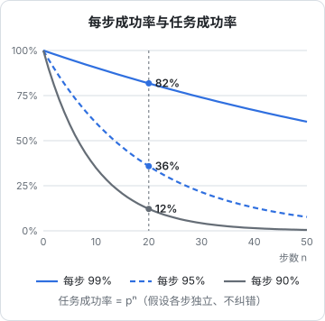
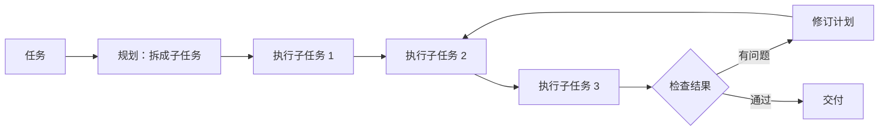

# 规划与反思

agent loop 让模型可以一步步行动，但「一步步」本身并不能保证走向终点。面对一个需要二三十步的任务，模型可能半路忘了目标、在一个子问题上打转，或者一路错下去却浑然不觉。**规划**解决「往哪里走」，**反思**解决「走得对不对」。

这一章讲 agent 怎样思考：从 ReAct 的「边想边做」，到先列计划再执行，再到用反馈和评审纠错。重点不是背论文名字，而是理解每种手段在对抗什么问题。

## 问题：错误会复利

假设 agent 每一步正确的概率是 $p$，各步独立，那么连续 $n$ 步全部正确的概率是：

$$
P = p^n
$$



这个模型当然过于简化（真实的 agent 可以发现并修正错误），但它揭示了一个核心事实：**哪怕每步 95% 可靠，20 步之后整体成功率只剩约 36%**。长任务的可靠性不能靠单步更聪明来解决，必须有机制让错误**被发现、被修正**。规划减少走错方向的步数，反思把「独立的错误」变成「可修正的错误」。

## 让模型先想再做

### ReAct：思考与行动交替

ReAct（Reasoning + Acting）是 2022 年提出的一种范式，后来成为几乎所有 agent 的默认工作方式：模型每一步先用自然语言写出思考，再决定行动，看到观察结果后再思考。下面是一段示意（简化过的轨迹）：

```text
思考：用户说书架页顶部有多余空白。先找到书架页的路由文件。
行动：list_files app/src/app
观察：_layout.tsx  index.tsx  book/  read/  transfer.tsx
思考：expo-router 里 index.tsx 是首页，也就是书架页。看看它怎么处理安全区。
行动：read_file app/src/app/index.tsx
观察：……页面自己又加了一层顶部安全区内边距……
思考：导航栏已经让出了安全区，页面又让了一次，导致重复。
```

为什么先写思考有用？模型是逐 token 生成的，**写出来的推理会成为后续生成的上下文**。先写「导航栏已经让出了安全区」，后面的行动就更可能对准这个判断。这和《大模型原理科普》里讲的思维链是同一个原理。

### 扩展思考

现在的主流模型大多支持「扩展思考」（extended thinking / reasoning）：在给出回答或工具调用之前，先生成一段较长的内部推理。它适合需要权衡多个方案的步骤，比如定位根因、设计数据结构。代价是更多 token 和延迟。对 agent 来说，通常不需要每一步都深度思考，在关键决策点给足思考预算即可。

## 显式规划

ReAct 是「走一步看一步」。对于步骤多、子任务之间有依赖的任务，更好的方式是**先列计划**。

### 计划写在哪里

计划不能只存在于模型的某一轮思考里，因为下一轮它可能就被淹没在长长的工具输出中。可靠的做法是把计划**外化**成一个持久的产物：

| 方式 | 例子 | 优点 |
|---|---|---|
| 待办清单工具 | Claude Code 的 todo 列表 | 结构化，每完成一项更新状态，用户也能看到进度 |
| 计划文件 | 在仓库里写一个 `PLAN.md` | 跨会话保留，可以人工修改 |
| 计划模式 | 先只读调研、产出计划，用户批准后再执行 | 把「想清楚」和「动手」分开，减少返工 |

待办清单之所以有效，部分原因在于**每次更新清单，计划就被重新写进了上下文的最新位置**，模型不会忘记还剩什么没做。

### 规划与执行分离

一种常见的架构是「规划者 + 执行者」：



关键是**计划可以被修订**。一开始的计划总是基于不完整的信息，执行到第二步发现文件结构和预想的不一样，就该回头改计划，而不是硬着头皮执行一个已经过时的计划。

### 计划的粒度

计划太粗（「修复 bug」）没有指导意义，太细（每一行代码都规划好）则在执行中必然大量偏离。合适的粒度是：**每一项都能独立验证是否完成**。比如：

- 找到书架页重复让出安全区的位置
- 去掉页面里多余的那层顶部安全区处理
- 在模拟器上确认顶部空白消失
- 跑 `pnpm typecheck` 和 `pnpm test`

## 反思：发现并修正错误

### 来自环境的反思

最可靠的反思来自**客观反馈**：测试失败、类型错误、命令报错、页面截图和预期不符。第 2 章讲过，这类信号的质量决定 agent 的上限。在规划中显式加入验证步骤，就是在主动制造反思的机会。

### 来自自身的反思

没有客观信号时，可以让模型回头审视自己的产出：「检查一下刚才的修改是否引入了新问题」。Reflexion 等研究探索过让 agent 把失败经验写成文字反思、下次尝试时参考。

但要清醒地认识到自我反思的局限：**模型很难发现自己的盲点**。同一个模型、同样的上下文，很可能在评审时重复写代码时的错误判断。自我反思对低级疏漏有效（漏改了一处调用），对方向性错误效果有限。

### 来自他者的反思

更有效的办法是引入**独立视角**：

- 开一个新的子 agent，**不给它原 agent 的推理过程**，只给它代码和需求，让它评审。没有被原来的思路「锚定」，更容易看出问题
- 让人在关键节点看一眼，比如计划模式下批准计划
- 用不同的模型交叉检查

这就是第 7 章多 agent 的一个主要动机：**上下文隔离带来独立判断**。

## 什么时候不需要规划

规划和反思都有成本。简单任务上加一套「先规划、再执行、再评审」反而让 agent 变慢、变啰嗦。一个粗略的判断：

| 任务特征 | 推荐方式 |
|---|---|
| 一两步就能完成，结果一眼可验证 | 直接做 |
| 五步以内，路径大致清楚 | ReAct，结束前跑一次验证 |
| 十步以上，涉及多个文件或模块 | 显式待办清单，每项完成后验证 |
| 方向不确定、改错代价大 | 计划模式：先调研出方案，人批准后执行 |
| 结果难以客观验证 | 加独立评审 |

## 本章要点

- 错误会复利：每步 95% 可靠，20 步后只剩约 36%，长任务必须有纠错机制
- **ReAct** 让模型边想边做，写出的推理成为后续行动的上下文
- 长任务要**外化计划**：待办清单、计划文件、计划模式，并且计划要能随执行修订
- 计划的每一项应当可以独立验证
- 反思的可靠性：**环境反馈 > 独立评审 > 自我反思**；自我反思难以发现方向性错误
- 规划和反思有成本，按任务复杂度选择，不要一律上全套
