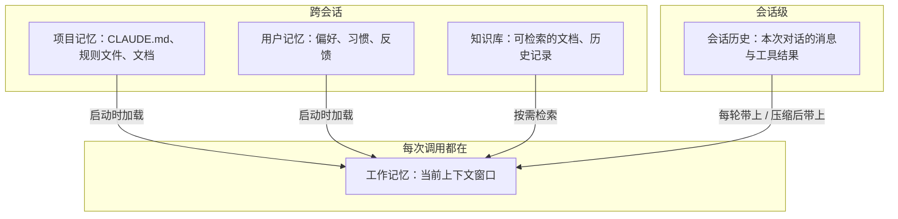

# 记忆

第 1 章说过，模型本身是无状态的：每一次调用，它只知道这一次发过去的内容。那么 agent 怎么「记得」你上周告诉它的偏好、这个项目的约定、昨天做到哪一步了？答案是：**记忆是 agent 系统在模型之外维护、并在合适时机放回上下文的信息**。

这一章把 agent 的记忆按时间尺度分层，讲每一层存什么、怎么写入、怎么读出，以及记忆系统最容易出的问题。记忆的组织和检索策略在《上下文工程》里有更细的展开。

## 记忆的分层

借用人类记忆的类比，agent 的记忆可以分成几层：



| 层级 | 生命周期 | 容量 | 典型载体 | 进入上下文的方式 |
|---|---|---|---|---|
| 工作记忆 | 一次调用 | 受上下文窗口限制 | messages 数组 | 本来就在 |
| 会话历史 | 一次会话 | 窗口内，满了要压缩 | 内存、会话文件 | 每轮全部带上 |
| 项目记忆 | 长期 | 应当精简 | `CLAUDE.md`、`.claude/rules/` | 启动时或按路径加载 |
| 用户记忆 | 长期 | 应当精简 | 记忆文件、数据库 | 启动时加载索引 |
| 知识库 | 长期 | 几乎无限 | 文件、向量库、搜索引擎 | 通过工具检索 |

核心矛盾只有一个：**长期记忆可以很大，但上下文窗口有限**。所有记忆设计都是在回答「什么时候、把哪一部分放进窗口」。

## 工作记忆与会话历史

工作记忆就是模型这一轮看到的全部内容。它的特点是**模型能直接使用，但容量有限，而且越长越容易被「稀释」**：上下文里塞了大量无关的工具输出，模型对关键信息的注意力会下降。

会话历史随着循环不断增长（第 2 章那张增长曲线）。窗口快满时，常见的处理方式是**压缩**：把早期的消息总结成一段摘要，保留关键决定和当前状态，丢掉冗长的工具原始输出。压缩是有损的，摘要里没写的细节就真的丢了。第 6 章会讨论怎么压缩更安全。

## 项目记忆：写给 agent 的入职手册

对编码 agent 来说，最有价值的长期记忆就是项目约定。这正是 `CLAUDE.md` / `AGENTS.md` 的角色。看 hatch-shelf 根目录的 `CLAUDE.md`，它写了：

- 仓库结构：每个目录放什么
- 原则：「文件即真相」「单一导入管线」「App 不联网」
- 易踩的坑：Expo 每个 SDK 都有破坏性变更，不要凭记忆写 API
- 命令和完成标准：声明完成前必须通过 `pnpm typecheck` 和 `pnpm test`

这些信息有一个共同点：**从代码本身很难推断出来，或者推断代价很高**。「App 不联网」这条原则，agent 读遍代码也未必能总结出来，但违反它的后果很严重。

一份好的项目记忆遵循几条原则：

| 原则 | 说明 |
|---|---|
| 写代码里看不出来的 | 决策原因、隐含约束、踩过的坑；代码里一眼能看到的不用写 |
| 精简 | 每一行都会在每次会话占用上下文，也在稀释其他指令 |
| 分层加载 | 通用的放根目录，局部的按路径加载 |
| 指向而非复制 | 「设计文档见 README 第 4 节」比把整节复制进来好 |

hatch-counter 把规则拆到 `.claude/rules/` 下，用 frontmatter 声明适用路径：

```markdown
---
paths:
  - "apps/api/**"
---

# 服务端

动到 `apps/api` 时加载。
```

动服务端代码时才加载服务端规则，改界面时才加载界面规则。这是**按需加载**在记忆上的应用：长期记忆可以很多，但每次只放进相关的那部分。《编码 Agent 实战》会专门讲这些文件怎么写。

## 用户记忆：从反馈里学习

用户记忆存的是关于「你」的信息：偏好、习惯、纠正过的错误。比如你告诉过 agent「提交信息不要加 AI 署名」，下次新会话它就应该记得。

一个典型实现是：

1. agent 在对话中识别出值得长期记住的信息（明确的偏好、反复出现的纠正）
2. 调用一个写记忆的工具，把它写成一条简短的记录，存成文件
3. 维护一个**索引文件**，每条记忆一行摘要
4. 新会话启动时加载索引；需要细节时再读具体的记忆文件

```text
MEMORY.md（索引，每次加载）
- [No AI attribution](no-ai-attribution.md) — 提交和 PR 不加 AI 署名
- [Prefer pnpm](prefer-pnpm.md) — 所有项目用 pnpm，不用 npm

no-ai-attribution.md（细节，按需读取）
提交信息和 PR 描述不加 Co-Authored-By、Generated with 之类的行。
原因：作者只有仓库所有者。
```

这种「索引常驻 + 细节按需」的两级结构，在记忆、Skills（第 8 章）、工具按需加载中反复出现，是上下文工程里最常用的模式之一。

## 知识库：检索而非加载

当长期信息多到不可能每次加载时，就要靠**检索**：把信息存在外部，让 agent 通过工具按需查找。

检索有两大类做法：

| 方式 | 原理 | 优点 | 缺点 |
|---|---|---|---|
| 关键词 / 文件搜索 | `grep`、`find`、全文搜索 | 精确、可解释、无需预处理 | 需要知道用什么词搜 |
| 语义检索 | 文本向量化，按语义相似度查找 | 能找到措辞不同但意思相近的内容 | 需要建索引，结果有时不准，难调试 |

一个值得注意的趋势是：编码 agent 大多直接用 `grep` 和读文件来「检索」代码，而不是预先建向量索引。原因是代码有精确的标识符，agent 又能多轮迭代搜索：第一次搜不到就换个词再搜。**让 agent 自己主动探索**，往往比预先算好的检索结果更可靠。语义检索更适合非结构化的大量文档。详细的检索设计见《RAG 与知识系统》和《上下文工程》。

## 记忆的常见问题

| 问题 | 表现 | 应对 |
|---|---|---|
| 过时 | 记忆说用 Expo SDK 52，项目已经升到 58 | 记录时写清适用范围；定期整理；以代码为准 |
| 冲突 | 两条记忆说法矛盾 | 写入前先查重；合并时保留更新的那条 |
| 膨胀 | 记忆越积越多，每次加载都占大量上下文 | 只记真正长期有效的；定期精简 |
| 错误写入 | 把一次性的临时要求当成长期偏好 | 只记用户明确表达或反复出现的信息 |
| 被投毒 | 网页或文件里的恶意内容诱导 agent 写入记忆 | 记忆写入要可审查；外部内容不得直接变成记忆 |

最后一条值得强调。记忆是会**跨会话持续生效**的指令，一旦被注入恶意内容，影响会延续到以后每一次会话。这是《Agent 安全》里的重要议题。

## 本章要点

- 模型无状态，**记忆是系统在模型之外维护、按需放回上下文的信息**
- 按时间尺度分层：工作记忆、会话历史、项目记忆、用户记忆、知识库
- 核心矛盾是长期记忆可以很大而窗口有限，设计的关键是**什么时候放什么进去**
- 项目记忆写代码里看不出来的东西，要精简、分层、按路径加载
- 「**索引常驻 + 细节按需**」是记忆和上下文管理中最常用的模式
- 编码场景下 agent 主动搜索往往比预建向量索引更可靠
- 记忆会过时、冲突、膨胀，还可能被投毒，需要维护和审查
