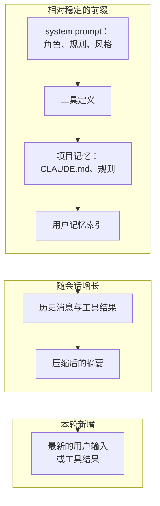
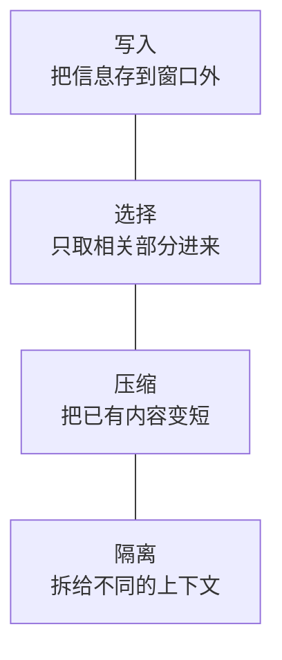
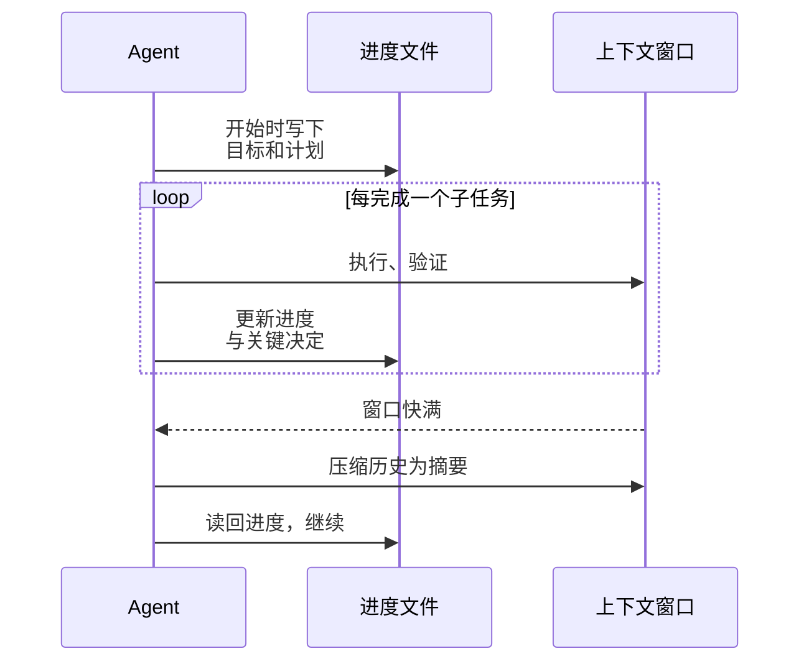

# 上下文工程概览

前几章反复出现一个主题：模型每一轮能看到什么，决定了它这一轮能做对什么。工具描述、计划、记忆、历史消息，最后都要变成上下文里的 token。**上下文工程**（context engineering）就是系统地设计「每一步给模型看什么」的学问。

早期大家谈「提示词工程」，关注的是怎么把一段 prompt 写好。到了 agent 时代，上下文是在几十轮循环中动态拼装出来的，一大半内容来自工具输出而非人手写，问题从「怎么写」变成了「怎么管」。这一章给出全景，完整的方法论在[《上下文工程》](../context-engineering/)一书中展开。

## 上下文里有什么

一次 agent 调用的上下文，大致由这些部分组成：

把稳定的内容放在前面、变化的内容放在后面，有两个好处：一是 prompt 缓存能命中更长的前缀，降低成本和延迟；二是结构清晰，排查问题时知道去哪里找。

## 为什么上下文越多不一定越好

直觉上，给模型的信息越多越好。但实践中，上下文过长会带来几种问题：

| 问题 | 原因 | 表现 |
|---|---|---|
| 成本与延迟 | 每轮重发全部内容 | 长任务费用二次方增长（第 2 章） |
| 注意力稀释 | 大量无关内容和关键信息竞争 | 忽略早期给的约束、遗漏关键细节 |
| 指令冲突 | 不同来源的说法不一致 | 模型随机遵从其中一条 |
| 错误残留 | 早期的错误假设和失败尝试一直留在历史里 | 模型反复被旧的错误思路影响 |
| 窗口溢出 | 超过上限 | 调用直接失败或被强制截断 |

窗口越来越大，但这并没有消除问题：能装下不等于能用好。所以上下文工程的核心目标可以概括为一句话：**用最少的 token，给出完成当前一步所必需的信息**。

## 四种基本手法

围绕这个目标，常用的手法可以归成四类：

### 写入：把信息存到窗口外

不是所有信息都要一直留在窗口里。把计划写进待办清单或文件、把中间结论写进笔记、把长期偏好写进记忆，需要时再读回来。agent 做长任务时，在工作目录里维护一个进度文件，即使上下文被压缩甚至会话重启，也能从文件恢复状态。

### 选择：只取相关的部分

- **按需检索**：通过搜索工具找到相关的文件片段，而不是一次性加载整个仓库
- **按路径加载规则**：只在改服务端代码时加载服务端规则（第 5 章 hatch-counter 的例子）
- **渐进式披露**：先给名字和一句话简介，需要时才加载全文，Skills 和工具按需加载都是这个思路（第 8 章）

### 压缩：把已有内容变短

- **工具输出截断**：日志只保留尾部、搜索结果只给前 N 条
- **清理旧的工具结果**：十轮之前读过的文件全文，现在多半不需要了，可以替换成一句「已读取 xxx」
- **摘要**：上下文快满时，把历史总结成一段摘要，开始新的窗口

压缩是有损的。一个好的摘要至少要保留：任务目标、已做出的关键决定及原因、当前状态、还没完成的事、已知的坑。最危险的是把「为什么这样做」压缩掉了，agent 很可能会把刚否决的方案又试一遍。

### 隔离：拆给不同的上下文

把一个子任务交给**子 agent**，在它自己的干净上下文里完成，最后只把结论返回给主 agent。比如「在整个仓库里找出所有调用 `parseBook` 的地方并分析用法」，子 agent 可能读了几十个文件，但主 agent 只收到一页结论。这是第 7 章多 agent 的主要价值之一。

## system prompt 的写法要点

system prompt 是上下文里最稳定、最有分量的部分。几条经验：

- **说明为什么，而不只是规定什么**。「不要发起网络请求，因为 App 定位是离线书架，用户可能在飞行模式下使用」比单纯写「不要联网」效果好，模型能据此推断出未明说的情况
- **高度合适**：太具体会变成一长串 if-else，模型在规则之外的情况下手足无措；太空泛又没有指导意义。描述原则和判断标准，再配少量典型例子
- **结构化**：用标题或 XML 标签分隔不同部分，便于模型定位
- **避免过度强调**：满篇「务必」「绝对」「IMPORTANT」会让模型对所有规则都过度敏感，反而分不清主次

对照 hatch-shelf 的 `CLAUDE.md`：原则部分每条都附了理由（「文件即真相：书籍原文只存在……SQLite 只存索引（可重建）和用户数据」），Expo 部分说明了为什么不能凭记忆写 API（每个 SDK 都有破坏性变更）。这是写给 agent 的上下文的好范例。

## 长任务的上下文管理

当任务长到一个上下文窗口装不下时（比如持续几小时的重构），需要把以上手法组合起来：

关键思想是：**把状态放在文件里，而不是只放在上下文里**。上下文是易失的，文件是持久的。git 提交本身也是一种进度记录，每完成一个可验证的步骤就提交，既能回滚也能给后续会话留下清晰的线索。

## 一个检查清单

agent 表现不佳时，先别急着换模型，按这个清单检查上下文：

| 问题 | 检查 |
|---|---|
| 它不知道某个约定 | 这个约定写进项目记忆了吗？在它需要时被加载了吗？ |
| 它忽略了某条规则 | 规则是不是淹没在一长串指令里？有没有冲突的说法？ |
| 它选错了工具 | 工具描述能区分相近的工具吗？工具是不是太多了？ |
| 它反复犯同一个错 | 失败的尝试和原因留在上下文里了吗？还是被压缩掉了？ |
| 它越做越糊涂 | 上下文里是不是塞满了无关的工具输出？该压缩或开子 agent 了吗？ |

## 本章要点

- 上下文工程关注的是「每一步给模型看什么」，是提示词工程在 agent 时代的延伸
- 稳定内容放前面（利于缓存），变化内容放后面
- 上下文过长会带来成本、注意力稀释、冲突、错误残留等问题，**能装下不等于能用好**
- 四种基本手法：**写入、选择、压缩、隔离**
- system prompt 要说明理由、高度适中、结构清晰、避免过度强调
- 长任务把状态放在文件里，上下文只是易失的工作区
- 完整的方法论见《上下文工程》
