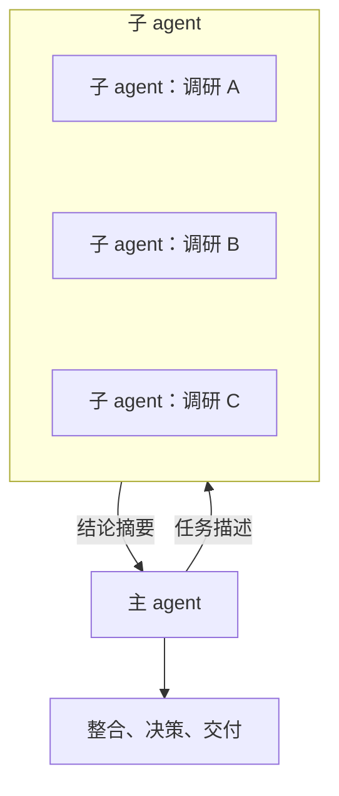
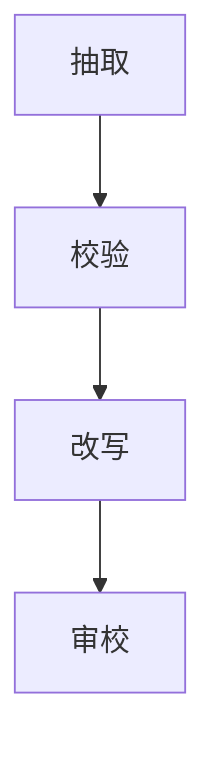
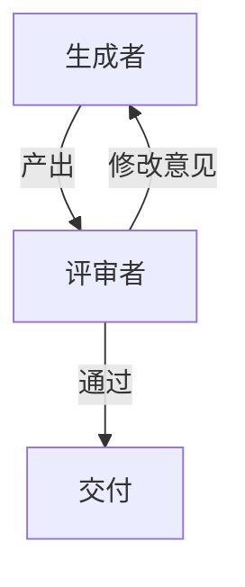

# 多 agent 概览

当一个 agent 不够用时，很自然的想法是：多来几个。让一个 agent 负责规划，几个负责执行，再来一个负责评审，像一个小团队一样协作。多 agent 系统确实能解决一些单 agent 解决不了的问题，但它也是最容易被过度使用的模式之一。

这一章讲多 agent 解决的到底是什么问题、几种基本的编排模式，以及什么时候不该用多 agent。具体的编排设计、成本控制和工程实现见[《多 Agent 编排》](../multi-agent/)。

## 多 agent 解决什么问题

先澄清一个常见误解：多 agent 的价值**主要不在于「分工让每个 agent 更专业」**。同一个模型换个角色名字，能力并不会变强。它的真正价值在三个方面：

| 价值 | 说明 | 例子 |
|---|---|---|
| 上下文隔离 | 子任务在独立窗口完成，主 agent 只收到结论 | 搜索全仓库、读大量文档后汇报要点 |
| 并行 | 互不依赖的子任务同时进行 | 同时调研三个技术方案 |
| 独立判断 | 没被原思路锚定的新上下文更容易发现问题 | 让另一个 agent 评审代码 |

三条都源于同一个事实：**每个 agent 有自己的上下文**。第 6 章说过，上下文是稀缺资源，而且会被无关信息污染。多 agent 本质上是一种上下文管理手段。

## 基本编排模式

### 主从：委派给子 agent

最常用的模式。主 agent 负责理解任务和整合结果，把边界清晰的子任务交给子 agent：

Claude Code 的子 agent 就是这种模式。关键在于**任务描述的质量**：子 agent 看不到主 agent 的上下文，你没写进任务描述的东西，它就不知道。一份好的委派要包含目标、已知信息、已排除的方向、范围边界、期望的返回格式。这和把活交给一个刚加入的同事完全一样。

### 流水线：前一个的输出是后一个的输入

每个阶段职责单一，适合步骤固定的任务。严格来说，如果每个阶段的顺序是代码写死的，这更接近第 1 章说的 workflow，而不是 agent 之间的自主协作。这并不是缺点，确定性的编排往往更可靠。

### 生成与评审

一个 agent 产出，另一个 agent 评审并给出意见，前者据此修改，循环若干次：

评审者的价值来自独立性。如果把生成者的全部推理过程也给评审者看，它很容易被说服、跟着犯同样的错。所以评审者通常只拿到需求和产出物。第 4 章讲反思时提到过这一点。

### 并行与汇总

把同一个问题交给多个 agent 独立解答，再汇总或投票。适合答案不确定、需要多视角的问题，比如多个 agent 分别从安全、性能、可维护性角度评审同一段代码。

## 多 agent 的代价

多 agent 不是免费的：

- **成本倍增**：每个子 agent 都要加载自己的 system prompt、工具定义和任务描述，再自己跑若干轮。并行多个子 agent 时，总 token 消耗可能是单 agent 的数倍
- **信息损失**：子 agent 只返回摘要，细节在传递中丢失；主 agent 的意图在委派时也可能被误解
- **协调难度**：多个 agent 同时写同一批文件会冲突；彼此的决定可能不一致
- **调试困难**：出了问题要在多份轨迹之间追踪是哪个环节出错

一个常见的失败是「为了多 agent 而多 agent」：把一个单 agent 就能完成的线性任务拆给五个角色，结果大部分 token 花在了 agent 之间互相传话上。

## 什么时候该用多 agent

| 情况 | 建议 |
|---|---|
| 任务线性、上下文装得下 | 单 agent |
| 有一个子任务需要读大量材料，但只需要结论 | 单 agent + 一个子 agent 隔离上下文 |
| 有多个互不依赖、各自较重的子任务 | 并行子 agent |
| 产出质量难以客观验证 | 加独立评审 agent |
| 多个子任务要频繁共享中间状态、协同修改同一批文件 | 慎用，通常单 agent 更好 |

判断的核心问题是：**拆分之后，各部分之间需要交流的信息是否远少于各部分内部处理的信息？** 如果是，拆分划算；如果子任务之间需要大量来回沟通，拆分只会增加损耗。

## 确定性编排与自主编排

多 agent 的编排逻辑本身也可以是确定性的或自主的：

- **确定性编排**：用代码写清楚先跑哪几个 agent、怎么汇总、失败怎么重试。行为可预测、易于测试，适合重复执行的流程
- **自主编排**：由一个主 agent 根据情况决定开哪些子 agent、开几个。灵活，但成本和结果都更难预测

这和第 1 章的自主程度光谱是同一个取舍。一种实用的组合是：**外层用代码写死流程骨架，内层每个环节交给 agent 自主完成**。比如批量写一套书：外层脚本按书目逐本派发，每本书内部由一个 agent 自主完成调研、写作和自检，最后由主会话统一更新进度表。

## 本章要点

- 多 agent 的核心价值是**上下文隔离、并行、独立判断**，而不是角色扮演带来的「专业化」
- 基本模式：主从委派、流水线、生成与评审、并行与汇总
- 委派时子 agent 看不到主 agent 的上下文，**任务描述要像交接给新同事一样完整**
- 多 agent 带来成本倍增、信息损失、协调和调试困难
- 判断标准：拆分后各部分之间要交流的信息，是否远少于各部分内部处理的信息
- 外层确定性编排、内层自主执行，是常见的实用组合
- 深入的编排模式、成本控制见《多 Agent 编排》

## 动手练习

1. **把一句话委派改成完整的任务描述**：原委派是「去看看为什么导入书很慢」。按本章说的五个要素（目标、已知信息、已排除的方向、范围边界、返回格式）改写成给子 agent 的任务描述。

   验证：把改写后的描述交给一个全新会话（不带任何前文），它不需要再反问就能开始工作。

   参考答案（示例）：「目标：找出导入一本 300 章的书耗时 20 秒的主要原因。已知：解压只占 1 秒（已打点）。已排除：网络，导入不联网。范围：只读代码和跑现有的基准脚本，不改代码。返回：耗时最多的前三处，各附文件路径、行号和证据，一页以内。」

2. **判断拆不拆**：用本章的核心问题（拆分后各部分要交流的信息，是否远少于各部分内部处理的信息）判断三个任务：(a) 调研三个 Markdown 渲染库并各写一页对比；(b) 把一个 2000 行的组件拆成五个小组件；(c) 在 200 个日志文件里找出所有超时错误并归类。

   验证：每个任务给出「拆 / 不拆」和理由。

   参考答案：(a) 拆，三个调研互不依赖，回来的只是三页结论；(b) 不拆，五个组件共享 props 和状态，需要频繁协调同一批文件；(c) 拆，每个子 agent 处理一批日志，只返回归类结果。

3. **观察上下文隔离**：在一个中等规模的仓库里开两个 Claude Code 会话，问同一个问题「找出所有调用某个函数的地方并总结用法」。会话 A 直接问；会话 B 要求「用子 agent 去查，只把一页结论带回来」。完成后在两个会话里用 `/context` 查看上下文占用（命令名以你的版本为准）。

   验证：会话 B 主上下文里的消息占用明显小于会话 A，因为读文件的过程留在了子 agent 的上下文里。

   参考答案：这就是多 agent 的第一项价值：上下文隔离。代价是会话 B 总 token 不一定更少，子 agent 自己也读了那些文件。
