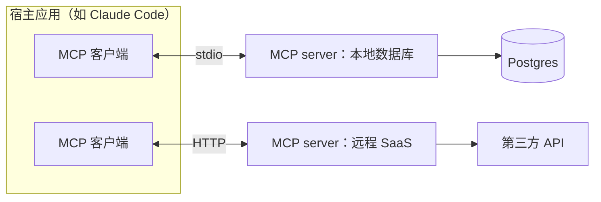
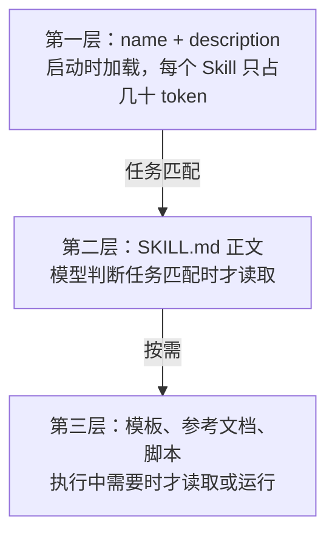

# MCP 与 Skills

到目前为止，agent 的工具和知识都是写在 agent 程序内部的。但你会很快遇到两个问题：想让 Claude Code 查你的 Postgres、读你的设计稿、操作你的日历，难道每接一个系统都要改 agent 的代码？想教 agent 一套「怎么写这个项目的发版说明」的流程，难道每次都在对话里重新解释一遍？

**MCP** 解决第一个问题：用一个标准协议把外部系统的能力接进任何 agent。**Skills** 解决第二个问题：把一套做事方法打包成 agent 可以按需加载的文件夹。这一章讲两者的原理和定位。MCP server 的完整开发见《工具设计与 MCP》，Skills 的加载机制在《上下文工程》里还会展开。

## MCP：agent 的「USB 接口」

### 为什么需要协议

没有标准时，每个 agent 产品都要为每个外部系统各写一套集成。M 个 agent 乘以 N 个系统，就是 M×N 份胶水代码。

MCP（Model Context Protocol，模型上下文协议）是 Anthropic 在 2024 年底开源的协议，后来被多家 AI 工具采纳。它规定了 agent 和外部能力提供方之间怎么对话，于是问题变成 M+N：每个 agent 实现一次 MCP 客户端，每个系统实现一次 MCP 服务端。



### 核心概念

| 角色 | 说明 |
|---|---|
| Host（宿主） | 用户使用的 AI 应用，如 Claude Code、桌面客户端 |
| Client（客户端） | 宿主内部与某个 server 保持一对一连接的组件 |
| Server（服务端） | 暴露能力的程序，可以是本地进程，也可以是远程服务 |

server 能向 agent 提供几类东西：

| 原语 | 由谁决定使用 | 用途 |
|---|---|---|
| Tools（工具） | 模型 | 可执行的操作，如查询、创建、发送 |
| Resources（资源） | 应用或用户 | 可读取的数据，如文件、表结构、文档 |
| Prompts（提示模板） | 用户 | 预置的工作流模板，通常以斜杠命令的形式出现 |

其中 Tools 最常用，它和第 3 章讲的工具是同一回事，只是定义和执行挪到了一个独立的进程里。消息格式基于 JSON-RPC 2.0，传输方式主要有两种：本地进程间用 **stdio**，远程服务用 **HTTP**（规范中称 Streamable HTTP）。协议还在演进，具体细节以官方规范为准。

### 一个最小的 MCP server

下面用官方 TypeScript SDK 写一个只读的书架查询 server。示例基于 SDK 2.x（`@modelcontextprotocol/server`，实现 2026-07-28 版协议），和《工具设计与 MCP》第 5 章的完整版本同一写法。网上很多教程还是 1.x 的 `@modelcontextprotocol/sdk` 写法，两者的差异见那一章开头的对照表。

```typescript
import { McpServer } from "@modelcontextprotocol/server";
import { serveStdio } from "@modelcontextprotocol/server/stdio";
import { readdir, readFile } from "node:fs/promises";
import { join } from "node:path";
import * as z from "zod/v4";

const BOOKS_DIR = process.env.BOOKS_DIR ?? "books";

function createServer(): McpServer {
  const server = new McpServer({ name: "shelf-books", version: "0.1.0" });

  server.registerTool(
    "list_books",
    {
      description: "列出 books 目录下所有书的 id 和 book.yaml 中的 title 行。只读。",
      inputSchema: z.object({}),
    },
    async () => {
      const entries = await readdir(BOOKS_DIR, { withFileTypes: true });
      const lines: string[] = [];
      for (const e of entries.filter((d) => d.isDirectory())) {
        try {
          const yaml = await readFile(join(BOOKS_DIR, e.name, "book.yaml"), "utf8");
          const title = yaml.match(/^title:\s*(.+)$/m)?.[1] ?? "(无标题)";
          lines.push(`${e.name}\t${title}`);
        } catch {
          // 没有 book.yaml 的目录不是书，跳过
        }
      }
      return { content: [{ type: "text", text: lines.join("\n") }] };
    },
  );

  server.registerTool(
    "read_chapter",
    {
      description: "读取某本书的某个章节文件全文。file 形如 01-what-is-agent.md。",
      inputSchema: z.object({ bookId: z.string(), file: z.string() }),
    },
    async ({ bookId, file }) => {
      // 只允许读 .md，且禁止路径穿越
      if (!/^[a-z0-9-]+$/.test(bookId) || !/^[a-z0-9-]+\.md$/.test(file)) {
        return { content: [{ type: "text", text: "bookId 或 file 格式不合法" }], isError: true };
      }
      try {
        const text = await readFile(join(BOOKS_DIR, bookId, file), "utf8");
        return { content: [{ type: "text", text }] };
      } catch {
        return { content: [{ type: "text", text: `找不到 ${bookId}/${file}，先用 list_books 确认 id` }], isError: true };
      }
    },
  );

  return server;
}

// stdio 是协议通道，日志只能写 stderr
serveStdio(createServer);
console.error("shelf-books MCP server 已启动");
```

2.x 的 server 由工厂函数创建，`serveStdio` 负责接管 stdin / stdout 并在需要时调用工厂；同一个工厂也可以交给 HTTP 处理函数，本地和远程共用一份工具定义。

在项目根目录放一个 `.mcp.json`，Claude Code 就能发现这个 server（首次使用时会请你确认是否信任）：

```json
{
  "mcpServers": {
    "shelf-books": {
      "command": "npx",
      "args": ["tsx", "tools/shelf-mcp/server.ts"],
      "env": { "BOOKS_DIR": "books" }
    }
  }
}
```

注意 `read_chapter` 里的参数校验：MCP server 收到的参数来自模型，模型的输入又可能受到外部内容影响，**server 必须像对待任何不可信输入一样校验参数**。hatch-shelf 把 zip slip 检查写在 `@shelf/spec` 里，道理相同。

### 使用 MCP 的注意事项

- **工具膨胀**：每接一个 server，就多一批工具定义进入上下文。接了十几个 server 后，工具定义可能占掉可观的上下文，模型选错工具的概率也上升。只启用当前项目需要的 server，或者使用支持工具按需加载的客户端
- **信任边界**：第三方 MCP server 是一段在你机器上运行或者能读到你数据的代码，它返回的内容会直接进入模型的上下文。安装前要像安装任何依赖一样评估来源
- **不是所有东西都需要 MCP**：如果一个能力用一行命令行就能完成（比如 `gh`、`psql`），而 agent 本来就能跑 shell，直接用命令行往往更简单

## Skills：打包的做事方法

### Skills 是什么

MCP 给 agent 新的**能力**（能调用什么），Skills 给 agent 新的**方法**（该怎么做）。一个 Skill 就是一个文件夹，核心是一个 `SKILL.md`：

```text
.claude/skills/release-notes/
├── SKILL.md            # 必需：元数据 + 说明
├── template.md         # 可选：参考模板
└── scripts/
    └── collect.sh      # 可选：可执行脚本
```

```markdown
---
name: release-notes
description: 为本仓库生成发版说明。当用户要求写 changelog、发版说明、release notes 时使用。
---

# 生成发版说明

1. 运行 `scripts/collect.sh <上一个 tag>` 收集提交列表
2. 按 feat / fix / 其他 分组，`chore:` 不写进说明
3. 用面向用户的中文描述「改完之后是什么样」，不写改了哪个文件
4. 套用 `template.md` 的格式输出
```

### 渐进式披露

Skills 最关键的设计是**分层加载**：



这让你可以装几十个 Skills 而几乎不占上下文：模型平时只看到一份「技能目录」，遇到相关任务时才打开对应的说明书。这和第 5 章「索引常驻 + 细节按需」的记忆结构是同一个模式。

也因此，**description 写得好不好决定 Skill 会不会被用上**。它要说清楚这个 Skill 做什么、什么时候该用，最好包含用户可能说出的关键词。

### 脚本：把确定性的部分交给代码

Skill 里可以附带脚本。像「收集两个 tag 之间的提交」这种确定性操作，与其让模型每次自己拼 git 命令，不如写成脚本让它调用。原则是：**需要判断的交给模型，确定的交给代码**。脚本的源码不需要进入上下文，模型只需要知道怎么调用、看到运行结果。

## 怎么选：项目记忆、Skill、MCP、子 agent

几种扩展机制经常让人困惑，对比一下：

| 机制 | 提供什么 | 加载时机 | 适合放 |
|---|---|---|---|
| `CLAUDE.md` / 规则文件 | 约定与背景 | 启动时或按路径 | 每次都需要知道的项目约定 |
| Skill | 做某类事的方法 | 任务匹配时 | 偶尔用到、步骤较多的流程 |
| MCP server | 访问外部系统的能力 | 启动时注册工具 | agent 原本够不到的数据和操作 |
| 子 agent | 独立的上下文 | 主 agent 委派时 | 需要隔离上下文的子任务 |
| hooks | 确定性的自动动作 | 特定事件触发 | 必须每次都执行、不能靠模型记得的事 |

一个判断方法：这件事是**每次都要知道**（记忆）、**有时要会做**（Skill）、**需要新能力**（MCP）、**需要干净的工作区**（子 agent），还是**必须保证发生**（hooks）？

## 本章要点

- MCP 是 agent 与外部系统之间的标准协议，把 M×N 的集成问题变成 M+N
- MCP 的三种主要原语：**Tools**（模型调用）、**Resources**（数据）、**Prompts**（模板）；传输有 stdio 和 HTTP
- MCP server 必须校验参数，第三方 server 要评估信任；接太多会造成工具膨胀
- Skills 是打包的做事方法，核心是 `SKILL.md`，可附带模板和脚本
- Skills 用**渐进式披露**分层加载，description 决定它能否被正确触发
- 记忆、Skill、MCP、子 agent、hooks 各有分工，按「知道 / 会做 / 能力 / 隔离 / 保证」来选
