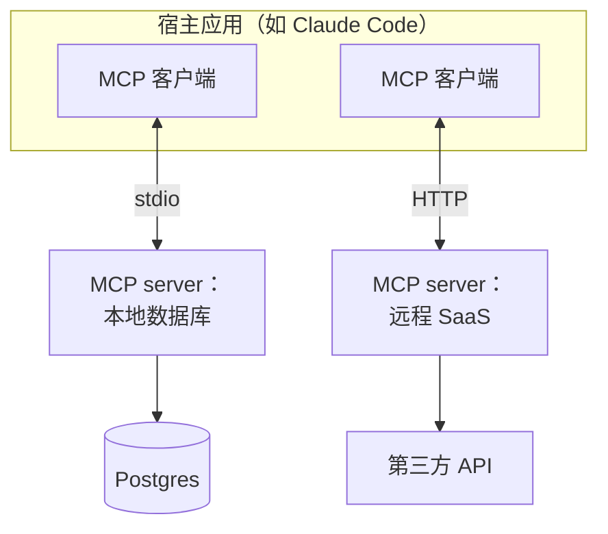
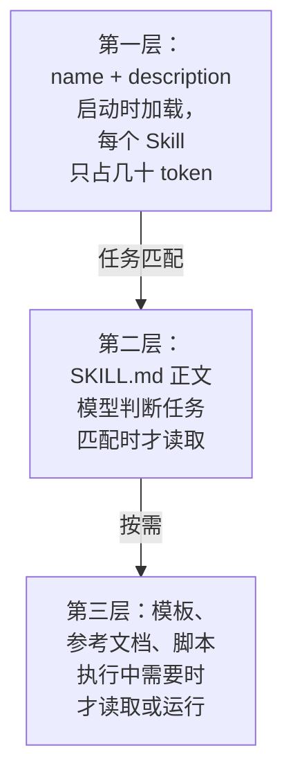

# MCP 与 Skills

到目前为止，agent 的工具和知识都是写在 agent 程序内部的。但你会很快遇到两个问题：想让 Claude Code 查你的 Postgres、读你的设计稿、操作你的日历，难道每接一个系统都要改 agent 的代码？想教 agent 一套「怎么写这个项目的发版说明」的流程，难道每次都在对话里重新解释一遍？

**MCP** 解决第一个问题：用一个标准协议把外部系统的能力接进任何 agent。**Skills** 解决第二个问题：把一套做事方法打包成 agent 可以按需加载的文件夹。这一章讲两者的原理和定位。MCP server 的完整开发见[《工具设计与 MCP》](../tools-and-mcp/)，Skills 的加载机制在[《上下文工程》](../context-engineering/)里还会展开。

## MCP：agent 的「USB 接口」

### 为什么需要协议

没有标准时，每个 agent 产品都要为每个外部系统各写一套集成。M 个 agent 乘以 N 个系统，就是 M×N 份胶水代码。

MCP（Model Context Protocol，模型上下文协议）是 Anthropic 在 2024 年底开源的协议，后来被多家 AI 工具采纳。它规定了 agent 和外部能力提供方之间怎么对话，于是问题变成 M+N：每个 agent 实现一次 MCP 客户端，每个系统实现一次 MCP 服务端。



### 核心概念

| 角色 | 说明 |
|---|---|
| Host（宿主） | 用户使用的 AI 应用，如 Claude Code、桌面客户端 |
| Client（客户端） | 宿主内部与某个 server 保持一对一连接的组件 |
| Server（服务端） | 暴露能力的程序，可以是本地进程，也可以是远程服务 |

server 能向 agent 提供几类东西：

| 原语 | 由谁决定使用 | 用途 |
|---|---|---|
| Tools（工具） | 模型 | 可执行的操作，如查询、创建、发送 |
| Resources（资源） | 应用或用户 | 可读取的数据，如文件、表结构、文档 |
| Prompts（提示模板） | 用户 | 预置的工作流模板，通常以斜杠命令的形式出现 |

其中 Tools 最常用，它和第 3 章讲的工具是同一回事，只是定义和执行挪到了一个独立的进程里。消息格式基于 JSON-RPC 2.0，传输方式主要有两种：本地进程间用 **stdio**，远程服务用 **HTTP**（规范中称 Streamable HTTP）。协议还在演进，具体细节以官方规范为准。

### 写一个 server 是什么样子

写一个 MCP server 的工作量很小：用官方 SDK 创建一个 server，逐个注册工具（名字、给模型看的描述、参数的 schema、执行函数），再挂到 stdio 或 HTTP 传输上；客户端那边，在项目根目录的 `.mcp.json` 里写上启动命令，Claude Code 就能发现它（首次使用时会请你确认是否信任）。工具的执行函数和第 3 章的工具没有区别：返回文本，失败时返回错误信息而不是抛异常。

有一点原理层面的要求值得单独说：**server 收到的参数来自模型，模型的输入又可能受到外部内容影响，所以 server 必须像对待任何不可信输入一样校验参数**，比如只允许读 `.md`、禁止路径穿越。hatch-shelf 把 zip slip 检查写在 `@shelf/spec` 里，道理相同。

完整的书架查询 server（SDK 2.x 写法、和 1.x 的差异、用真实客户端测试、接入 Claude Code）见[《工具设计与 MCP》第 5 章](../tools-and-mcp/05-build-mcp-server.md#注册工具资源和提示模板)，协议本身的消息格式和传输方式见[第 4 章](../tools-and-mcp/04-mcp-protocol.md#消息格式json-rpc-20)。

### 使用 MCP 的注意事项

- **工具膨胀**：每接一个 server，就多一批工具定义进入上下文。接了十几个 server 后，工具定义可能占掉可观的上下文，模型选错工具的概率也上升。只启用当前项目需要的 server，或者使用支持工具按需加载的客户端
- **信任边界**：第三方 MCP server 是一段在你机器上运行或者能读到你数据的代码，它返回的内容会直接进入模型的上下文。安装前要像安装任何依赖一样评估来源
- **不是所有东西都需要 MCP**：如果一个能力用一行命令行就能完成（比如 `gh`、`psql`），而 agent 本来就能跑 shell，直接用命令行往往更简单

## Skills：打包的做事方法

### Skills 是什么

MCP 给 agent 新的**能力**（能调用什么），Skills 给 agent 新的**方法**（该怎么做）。一个 Skill 就是一个文件夹，核心是一个 `SKILL.md`：

```text
.claude/skills/release-notes/
├── SKILL.md            # 必需：元数据 + 说明
├── template.md         # 可选：参考模板
└── scripts/
    └── collect.sh      # 可选：可执行脚本
```

```markdown
---
name: release-notes
description: 为本仓库生成发版说明。当用户要求写 changelog、发版说明、release notes 时使用。
---

# 生成发版说明

1. 运行 `scripts/collect.sh <上一个 tag>` 收集提交列表
2. 按 feat / fix / 其他 分组，`chore:` 不写进说明
3. 用面向用户的中文描述「改完之后是什么样」，不写改了哪个文件
4. 套用 `template.md` 的格式输出
```

### 渐进式披露

Skills 最关键的设计是**分层加载**：



这让你可以装几十个 Skills 而几乎不占上下文：模型平时只看到一份「技能目录」，遇到相关任务时才打开对应的说明书。这和第 5 章「索引常驻 + 细节按需」的记忆结构是同一个模式。

也因此，**description 写得好不好决定 Skill 会不会被用上**。它要说清楚这个 Skill 做什么、什么时候该用，最好包含用户可能说出的关键词。

### 脚本：把确定性的部分交给代码

Skill 里可以附带脚本。像「收集两个 tag 之间的提交」这种确定性操作，与其让模型每次自己拼 git 命令，不如写成脚本让它调用。原则是：**需要判断的交给模型，确定的交给代码**。脚本的源码不需要进入上下文，模型只需要知道怎么调用、看到运行结果。

## 怎么选：项目记忆、Skill、MCP、子 agent

几种扩展机制经常让人困惑，对比一下：

| 机制 | 提供什么 | 加载时机 | 适合放 |
|---|---|---|---|
| `CLAUDE.md` / 规则文件 | 约定与背景 | 启动时或按路径 | 每次都需要知道的项目约定 |
| Skill | 做某类事的方法 | 任务匹配时 | 偶尔用到、步骤较多的流程 |
| MCP server | 访问外部系统的能力 | 启动时注册工具 | agent 原本够不到的数据和操作 |
| 子 agent | 独立的上下文 | 主 agent 委派时 | 需要隔离上下文的子任务 |
| hooks | 确定性的自动动作 | 特定事件触发 | 必须每次都执行、不能靠模型记得的事 |

一个判断方法：这件事是**每次都要知道**（记忆）、**有时要会做**（Skill）、**需要新能力**（MCP）、**需要干净的工作区**（子 agent），还是**必须保证发生**（hooks）？

## 本章要点

- MCP 是 agent 与外部系统之间的标准协议，把 M×N 的集成问题变成 M+N
- MCP 的三种主要原语：**Tools**（模型调用）、**Resources**（数据）、**Prompts**（模板）；传输有 stdio 和 HTTP
- MCP server 必须校验参数，第三方 server 要评估信任；接太多会造成工具膨胀
- Skills 是打包的做事方法，核心是 `SKILL.md`，可附带模板和脚本
- Skills 用**渐进式披露**分层加载，description 决定它能否被正确触发
- 记忆、Skill、MCP、子 agent、hooks 各有分工，按「知道 / 会做 / 能力 / 隔离 / 保证」来选

## 动手练习

1. **用 Inspector 看一个 MCP server**：在临时目录里启动官方的文件系统参考 server，用 MCP Inspector 连接它（命令以官方仓库 README 为准）。

   ```bash
   mkdir -p /tmp/mcp-demo && echo hello > /tmp/mcp-demo/a.md
   npx @modelcontextprotocol/inspector npx -y @modelcontextprotocol/server-filesystem /tmp/mcp-demo
   ```

   验证：在 Inspector 的 Tools 页能列出读文件、列目录等工具；读 `/tmp/mcp-demo/a.md` 返回 `hello`；读 `/etc/hosts` 返回一个拒绝访问、路径不在允许目录内的错误。

   参考答案：拒绝发生在 server 内部，不依赖模型是否「听话」，这就是本章说的 server 必须自己校验参数。

2. **写一个 Skill 并观察 description 的作用**：在一个仓库里建 `.claude/skills/chapter-stats/SKILL.md`，description 写「统计 books/ 下每本书的章节数和字数。当用户问书有多少章、多少字时使用」，正文写一条 `find` / `wc` 的做法。然后在 Claude Code 里问「每本书各有多少字」。再把 description 改成「工具」重开会话问同样的问题。

   验证：第一次能看到 agent 调用了这个 Skill；改成「工具」后它多半不再调用，而是自己去拼命令。

   参考答案：模型平时只看到 name 和 description，description 没说做什么、什么时候用，就不会被选中。

3. **选扩展机制**：为下面五个需求各选一种机制（项目记忆、Skill、MCP、子 agent、hooks）：(a) 每次改完 `.ts` 文件都要跑 prettier；(b) 让 agent 能查公司内部的工单系统；(c) 一个月用一次的「发版十步流程」；(d) 「本仓库所有日期用 UTC 存储」；(e) 在 3 万行日志里找出一次崩溃的原因。

   验证：用本章「知道 / 会做 / 能力 / 隔离 / 保证」五个词对号入座。

   参考答案：(a) hooks，必须保证发生；(b) MCP，原本够不到的系统；(c) Skill，有时要会做；(d) 项目记忆，每次都要知道；(e) 子 agent，需要干净的工作区。
