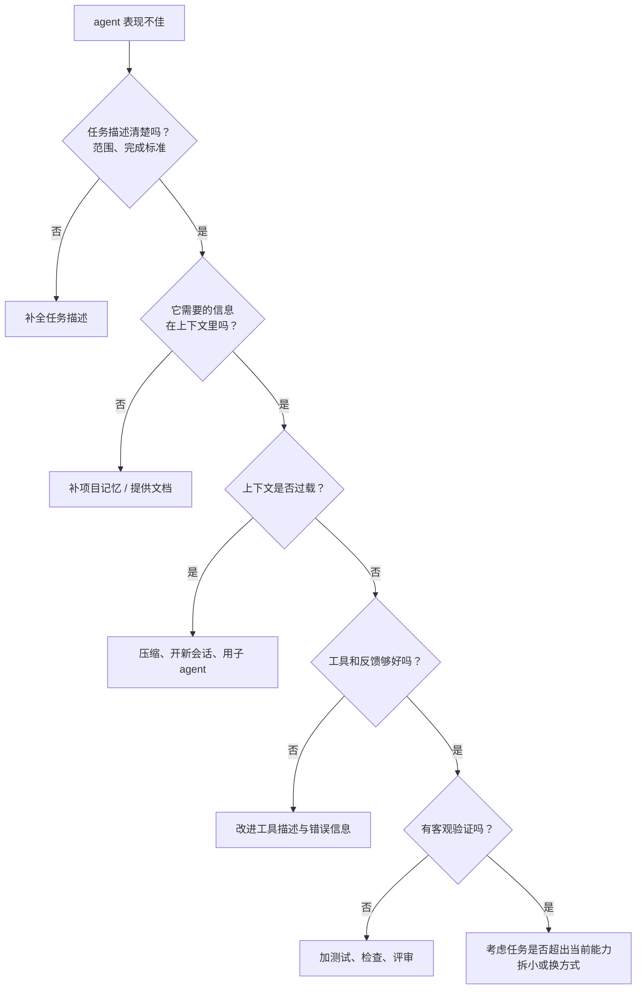

# 常见失败模式

前九章拆开了 agent 的每个零件。这一章换一个视角：当 agent 出了问题，表现是什么、根因在哪个零件、该怎么修。你用编码 agent 时遇到的大多数「它怎么又这样」，都能在这里找到对应的条目。

把失败模式按根因归类，比按现象记忆更有用。同一个现象（比如「改着改着就跑偏了」）可能来自上下文、规划或反馈信号中的任何一处，只有定位到根因，修复才不会变成碰运气。

## 一张总表

| 失败模式 | 典型表现 | 根因所在 | 首选修复 |
|---|---|---|---|
| 过早宣布完成 | 没跑测试就说「已修复」 | 停止条件（第 2 章） | 客观完成判据、Stop 检查 |
| 死循环 | 反复执行同一个失败的命令 | 反馈信号、规划 | 可行动的错误信息、轮数上限 |
| 凭空捏造 | 调用不存在的 API、编造文件内容 | 上下文缺失 | 让它先查再写，提供文档 |
| 目标漂移 | 修一个 bug 顺手重构了半个模块 | 规划、上下文 | 明确范围、外化计划 |
| 遗忘约束 | 前面说过不要改的文件后来改了 | 上下文稀释、压缩 | 约束写进项目记忆、精简上下文 |
| 选错工具 | 用 bash 的 `cat` 代替专用读文件工具 | 工具描述 | 改进描述、减少相近工具 |
| 上下文淹没 | 一次读入巨大日志后表现变差 | 工具输出体积 | 截断、分页、子 agent |
| 过度工程 | 加了用不上的抽象、配置项、兜底分支 | 指令、偏好 | 在记忆中写明风格偏好 |
| 绕过检查 | 测试不过就改测试、加 `@ts-ignore` | 完成判据设计 | 明确禁止、评审 diff |
| 被注入 | 按网页里的文字执行了操作 | 信任边界 | 权限与沙箱（第 9 章） |

下面挑几类最常见、也最有代表性的展开。

## 过早宣布完成

这是编码 agent 最普遍的问题。模型在训练中被强化了「给出完整回答」的倾向，看起来差不多时就想收尾。

**根因**：「完成」由模型主观判断，而不是由客观检查判断。

**修复**：

- 在项目记忆里写明完成标准，像 hatch-shelf 的「声明任务完成前必须通过 `pnpm typecheck` 和 `pnpm test`」
- 把验证步骤写进计划，作为最后一项待办
- 用 hooks 在 agent 想停止时自动跑检查，失败就继续
- 对于无法自动验证的部分（比如 UI 效果），明确要求它说明哪些已验证、哪些没有

最后一条很重要。一个诚实的「类型检查和测试都通过了，但没有在模拟器上实际看过效果」，远比一个含糊的「已完成」有价值。

## 死循环与原地打转

**表现**：同一个命令失败后，换个无关紧要的参数再试，再失败，再试；或者在两种方案之间来回切换。

**根因**通常有两种：

1. **反馈信息不足**：错误信息没说清楚问题在哪，模型只能瞎试
2. **缺少「退一步」的机制**：模型一直在局部尝试，没有回到更高层面重新审视假设

**修复**：

- 让工具返回可行动的错误（第 3 章）
- 设置轮数和预算上限，到了就停下来报告现状，而不是无限烧下去
- 在规划中加入检查点：同一个子任务连续失败几次后，要求重新分析根因，或者暂停向人求助
- 人介入时，与其说「再试试」，不如提供新信息或否定一个错误的假设

## 凭空捏造

**表现**：调用一个不存在的函数、使用某个库已经废弃的 API、对一个没读过的文件内容言之凿凿。

**根因**：模型在缺少信息时会用训练数据里「最像」的内容来补全。它的知识有截止日期，而且对具体项目一无所知。

**修复**：

- 养成「先查后写」的习惯：要求它改代码前先读相关文件，用库之前先看类型定义或文档
- 对版本敏感的技术栈，在项目记忆里明确提醒。hatch-shelf 的 `CLAUDE.md` 专门写了「Expo 每个 SDK 都有破坏性变更，不要凭记忆写 API」，并给出了查对应版本文档的步骤，就是在针对这种失败
- 用类型检查兜底：捏造的 API 在编译阶段就会暴露

## 目标漂移

**表现**：让它修一个按钮的样式，它顺便重命名了几个变量、调整了目录结构、升级了一个依赖。

**根因**：任务边界不清，加上模型「顺手改进」的倾向；长任务中原始目标被大量中间信息淹没。

**修复**：

- 委派任务时说清范围，也说清**不要做什么**
- 外化计划，让目标始终在上下文的显眼位置
- 用 diff 评审：改动范围超出预期，本身就是一个信号
- 把「顺手发现的问题」记下来留给以后，而不是当场处理

## 绕过检查

**表现**：测试不过，就把断言改松；类型报错，就加 `as any` 或 `@ts-ignore`；lint 报警，就加禁用注释。

**根因**：你给的完成判据是「检查通过」，模型找到了最短路径让检查通过。这是任何以指标为目标的优化系统都会出现的现象。

**修复**：

- 在项目记忆中明确：修复问题时不得修改测试断言、不得用类型断言绕过错误，除非说明理由
- 评审时特别关注测试文件和类型断言的改动
- hooks 或 lint 规则可以拦截新增的 `@ts-ignore`、`eslint-disable`

## 排查的顺序

遇到 agent 表现不佳时，按下面的顺序排查，越靠前越便宜、越常见：

很多人遇到问题的第一反应是换一个更强的模型，或者在 prompt 里加更多「务必」。但大部分问题出在前面几层：任务没说清、信息不在上下文里、上下文塞得太满、反馈不够具体。

## 把失败变成资产

每一次 agent 失败，都是改进系统的机会：

| 失败之后 | 沉淀到哪里 |
|---|---|
| 它不知道某个约定 | 项目记忆（`CLAUDE.md`、规则文件） |
| 它反复犯同一个错 | 项目记忆里写明，并说明原因 |
| 某类任务总要重复解释流程 | 写成 Skill |
| 某个检查总是被忘记 | 做成 hook，让它必然发生 |
| 某类错误总是漏到最后 | 加测试或 lint 规则 |
| 某个操作出过事故 | 收紧权限规则 |

hatch-counter 的 `CLAUDE.md` 里写着「每条约定背后基本都踩过坑」，这正是这种积累的结果。一个持续把失败沉淀下来的项目，agent 在里面会越用越顺手。**agent 的可靠性不是一次性配置出来的，而是在一次次失败中迭代出来的。**

## 全书回顾

如果只记住一件事，那就是：**模型提供智能，系统提供可靠性**。循环给了模型行动的机会，工具决定它能做什么，上下文决定它知道什么，反馈决定它能否纠错，权限和沙箱决定它犯错时的代价。这些都是你可以设计的部分。

## 接下来读什么

这本书是 Agent 系列的总纲。按《书架导读》的推荐路线，接下来读《编码 Agent 实战》，把本书的原理落到你每天使用的编码 agent 上：`CLAUDE.md` 怎么写、hooks 怎么配、子 agent 怎么用；然后是《个人 Agent 工作流》，把 agent 用到写代码之外的日常工作中。

想深入某个主题时：

- 上下文和记忆：《上下文工程》
- 工具和 MCP：《工具设计与 MCP》
- 多 agent 协作：《多 Agent 编排》
- 自己从零写一个 agent：《动手构建 Agent》
- 安全与权限：《Agent 安全》

## 本章要点

- 按根因而非现象归类失败模式，修复才不会碰运气
- **过早宣布完成**最常见，用客观判据和自动检查对付
- 死循环源于反馈不足和缺少「退一步」机制
- 凭空捏造源于信息缺失，「先查后写」加类型检查兜底
- 目标漂移要靠清晰的范围和外化的计划；绕过检查要明令禁止并评审 diff
- 排查顺序：任务描述 → 上下文信息 → 上下文过载 → 工具与反馈 → 验证 → 能力边界
- 每次失败都沉淀到记忆、Skill、hook、测试或权限里，**可靠性是迭代出来的**
