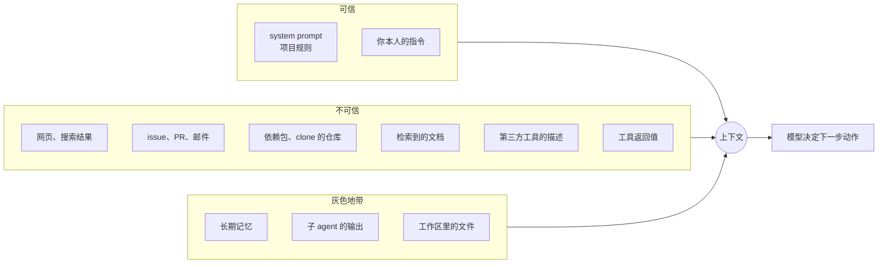
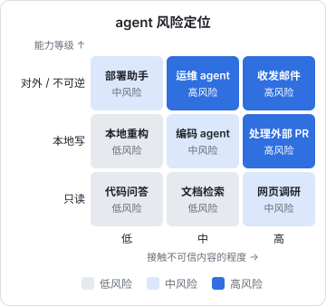

# 威胁模型

这本书讲怎样让一个能自己动手的 agent 不闯大祸。它写给已经在用或正在写 agent 的开发者：你读过《Agent 原理与设计》，知道 agent loop、工具和权限是怎么回事；也许还读过《LLM 应用上线》的 Prompt 注入一章和《工具设计与 MCP》的权限一章。那几章各自讲了一块，这本书把它们串成一套完整的防御：先建立威胁模型，再逐层讲注入、沙箱、权限、人在回路、审计，最后给一份可以逐条对照的设计清单。

全书只站在防御一侧。讲攻击原理是为了知道该在哪里设防，书里不会给可以直接拿去用的攻击载荷。建议按顺序读：第 1 章的概念（信任边界、污染、爆炸半径）后面每章都会用到。只想马上加固手头 agent 的，可以先跳到 [第 7 章的清单](07-security-checklist.md)，再回头看每一条背后的原因。

这一章回答一个问题：**在动手加防护之前，怎么系统地想清楚「会出什么事」**。

## agent 的风险为什么和普通应用不同

一个普通 Web 应用，代码路径是开发者写死的：用户点「删除」才会删除，而且删之前代码会检查权限。agent 不一样，**决定下一步做什么的是模型**，而模型的决定受上下文里所有文字的影响。

| 维度 | 普通应用 | LLM 应用（不带工具） | agent |
|---|---|---|---|
| 谁决定执行什么 | 开发者写的代码 | 代码，模型只产出文字 | 模型，代码只负责执行 |
| 不可信输入的影响 | 走固定的校验逻辑 | 可能让输出变得离谱 | 可能改变**接下来调用哪个工具、传什么参数** |
| 最坏后果 | 由代码路径决定，可枚举 | 一段错误或恶意的文字 | 由工具集决定：工具能做的，它都可能被诱导去做 |
| 出错的样子 | 抛异常 | 胡说 | 一连串看起来合理的操作 |

最后一行值得多想一下。agent 闯祸往往不是一个明显错误的操作，而是一串每一步都说得通的操作：读了一个 issue，按 issue 里的「复现步骤」跑了个脚本，脚本需要一个环境变量，于是读了 `.env`，为了「报告结果」又把输出贴进了 issue 评论。每一步单看都不可疑。

所以 agent 安全的核心观念是：**按工具集能造成的最坏后果来设计防护，而不是按模型「通常会怎么做」**。模型通常表现良好，这只说明出事的概率低，不说明出事的后果小。

## 威胁建模的四个问题

威胁建模不需要复杂的方法论。对任何一个 agent，依次回答四个问题：

1. **要保护什么？** 资产清单
2. **谁能影响 agent？** 入口与信任边界
3. **能出什么事？** 威胁枚举
4. **出了事有多严重、怎么兜？** 爆炸半径与控制措施

下面逐个展开。

## 资产：要保护什么

先列出 agent 能碰到的所有有价值的东西。不要只想「数据」，也要想「能力」和「信誉」：

| 资产类别 | 例子 | 被破坏的方式 |
|---|---|---|
| 机密 | `.env`、ssh 私钥、云服务令牌、数据库连接串 | 泄露 |
| 用户数据 | 门店的进货记录、客户手机号、私人笔记 | 泄露、篡改、删除 |
| 代码与配置 | 仓库、CI 配置、部署脚本、`.claude/` 配置 | 植入后门、改坏 |
| 运行环境 | 你的开发机、生产服务器 | 被当作跳板、挖矿、持久化驻留 |
| 对外身份 | 你的 GitHub 账号、邮箱、企业微信群机器人 | 以你的名义发布、发消息 |
| 钱 | 模型 API 额度、云账单、付款能力 | 被刷爆 |

其中**能力类资产**最容易被忽略。agent 手里的 GitHub 令牌本身不是「数据」，但它代表「以你的名义往仓库推代码」的能力；一个能发企业微信群消息的工具，代表「以你的名义对一群人说话」的能力。这些能力被劫持，损失可能比泄露一份数据更大。

## 入口与信任边界

### 一切进入上下文的文字都是入口

《LLM 应用上线》第 7 章把注入来源分成直接、间接和存储型。agent 的入口要多得多，因为它会主动去读：



「灰色地带」需要单独说明：

- **长期记忆**：记忆是 agent 自己写的，但写的时候它可能已经读过不可信内容。一次注入如果能让 agent 往记忆里写一条「以后遇到 X 就做 Y」，就完成了**持久化**，之后每个会话都会受影响
- **子 agent 的输出**：子 agent 读了网页再交一份总结回来，这份总结的可信度不会高于那张网页
- **工作区文件**：你自己写的代码是可信的，但 `node_modules/` 里的文件、刚 clone 下来的仓库、上一次被注入的会话改过的文件，都不是

判断标准只有一个：**这段文字的内容，最终能被你以外的人控制吗？** 能，就是不可信的。

### 信任边界

信任边界是「可信」和「不可信」交汇的地方。在传统系统里，边界是网络接口、进程边界、API 入口，你在边界上做校验。agent 的麻烦在于：**模型的上下文本身就是一个混合区，不存在可以做校验的边界**。不可信内容一旦进了上下文，就和你的指令混在一起，模型没有可靠的办法把它们分开。

这引出本书反复用到的一个概念：**污染**（taint）。一旦上下文里进入了不可信内容，就把这个会话视为「被污染了」，此后模型做出的每个决定，都可能部分来自攻击者。防御的落点因此不在「阻止模型被说服」，而在「被污染的会话最多能做什么」。第 2 章会把这个概念落实成代码。

## 威胁枚举

把攻击者、手段和后果组合起来，agent 面临的威胁可以归成几类：

| 威胁 | 典型路径 | 后果 | 主要对策（章节） |
|---|---|---|---|
| 数据外泄 | 注入诱导 agent 把机密带出边界 | 机密、用户数据泄露 | 切断出站通道（2、3） |
| 动作劫持 | 注入诱导 agent 调用有副作用的工具 | 删数据、发消息、推代码 | 权限、确认（4、5） |
| 持久化 | 注入让 agent 改写记忆、规则、hooks、CI 配置 | 一次注入，长期受控 | 保护配置文件（2、4） |
| 供应链 | 恶意 MCP server、依赖包、工具描述 | 以你的权限运行任意代码 | 沙箱、版本锁定（3） |
| 越权 | 多用户系统里 agent 用了比当前用户更大的权限 | 跨租户访问 | 身份传递、代码鉴权（4） |
| 资源滥用 | 死循环、被诱导大量调用 | 账单失控、服务被打满 | 预算、速率限制（4） |
| 误操作 | 没有攻击者，模型自己判断错 | 改坏、删错 | 沙箱、可回滚、确认（3、5） |

最后一类没有攻击者，却是最常发生的。好在针对注入设计的防护，大多同时防住了误操作：一个被沙箱限制只能写工作目录的 agent，无论是被诱导还是自己想错了，都删不掉 `~/`。

### 外泄需要通道

数据外泄这一类值得多说一句，因为它决定了很多防护设计。**数据要出去，必须经过某个通道**。agent 的出站通道比想象的多：

- 显式的网络工具：HTTP 请求、网页抓取（抓取时 URL 本身就能携带数据）
- 间接的网络行为：`npm install` 一个指定的包、`git clone` 一个指定的地址、`curl` 一个下载链接
- 渲染侧：输出的 Markdown 里引用远程图片，客户端加载时把 URL 里的数据带走
- 以你的身份对外写：发消息、发邮件、评论 issue、提交 PR、推送到公开仓库
- 共享的存储：写进别人能读到的文件、日志、公开的存储桶

《Agent 原理与设计》第 9 章提出「私密数据、不可信内容、对外通信」三要素同时具备最危险，要至少切断一条。三条里，**对外通信往往是最容易切、切了最有效的那条**，因为私密数据和不可信内容常常是任务本身需要的。hatch-shelf 的设计原则「App 不联网」就是一个例子：书是别人写的、可能不可信，阅读器渲染它；但阅读器的 WebView 只允许加载本地的阅读器页面，Markdown 渲染关闭了原始 HTML，书里就算藏了什么，也没有通道把数据带出手机。

## 爆炸半径

对每个威胁，问「最坏情况下影响多大」。爆炸半径由三个因素决定：

| 因素 | 问题 | 半径小 | 半径大 |
|---|---|---|---|
| 可逆性 | 出事后能撤回吗 | 工作区文件改动（git 可回滚） | 已发出的消息、删掉的生产数据 |
| 范围 | 影响多少人和系统 | 只影响本地一个分支 | 所有用户、所有租户 |
| 可见性 | 多久能发现 | 立刻在 diff 里看到 | 悄悄外泄，几个月后才知道 |

把「暴露程度」（agent 接触不可信内容有多频繁）和「能力等级」（工具集的最坏后果）放到一起，就得到一张粗略的风险图：



这张图的用法是：先定位你的 agent 落在哪一格，再决定防护的强度。落在右上角的，要么想办法往左移（减少接触不可信内容，比如只读白名单站点），要么往下移（拿掉高危工具，或者给它们加确认），而不是指望模型足够聪明。

## 一个例子：给自己的写书流水线做威胁建模

这套书本身就是 agent 写的：主会话给每个写书 agent 发一份简报，agent 读仓库里的范文和别的书，写进 `books/<id>/`。按四个问题过一遍：

**资产**：仓库里的代码和书稿；开发机上的 `~/.ssh`、各项目的 `.env`；以仓库所有者身份的 git 提交权限。

**入口**：简报和项目规则（可信）；仓库里其他书的内容（基本可信，但也是 agent 写的）；为核实事实而搜索、抓取的网页（不可信）；其他项目的 README 和文档（可信，但里面可能引用了外部内容）。

**威胁**：

- 误操作：多个 agent 并行，一个 agent 改了另一个 agent 的书，或者运行 git 命令打乱主会话的提交
- 注入：抓取的网页里藏着指令，诱导 agent 读取别的项目的 `.env` 并写进书里，书随后被推到手机，甚至被提交进仓库
- 信息泄露：agent 好心地把案例项目的域名、IP 写进书里

**控制措施**，按「软」和「硬」分开看：

| 措施 | 类型 | 说明 |
|---|---|---|
| 简报要求「只写 `books/<id>/`、不运行任何 git 命令、不写敏感信息」 | 软 | 靠模型遵守，被注入时可能失效 |
| `shelf-pack check` 自检 | 硬 | 能拦格式问题，拦不住内容里的机密 |
| 主会话统一审阅和提交 | 硬（人在回路） | 提交前看 diff，是最后一道防线 |
| 权限配置 deny `Read(**/.env*)`、限制网络 | 硬 | 被注入也读不到、发不出 |

这张表揭示了威胁建模最有用的一个产出：**把每条防护标成软的还是硬的**。软约束（写在 prompt、CLAUDE.md、简报里的规矩）在正常情况下很有效，能管住大部分误操作；但在被注入的情况下，它和攻击者的指令处于同一个层面，谁说了算是概率问题。硬约束（权限、沙箱、代码校验、人工审批）不依赖模型的判断。高风险的威胁，至少要有一条硬约束兜底。

## 把威胁模型写下来

威胁模型不必是一份正式文档，但值得写下来，放在项目里，随 agent 的工具集变化而更新。一个够用的模板：

```markdown
## Agent 威胁模型：<agent 名称>

- 用途：一句话
- 工具集：工具名 + 副作用等级（只读 / 本地可逆 / 本地难逆 / 外部可见 / 不可逆）
- 资产：它能碰到的机密、数据、能力
- 不可信入口：列出每个来源
- 出站通道：列出每一个能把数据带出去的路径
- 三要素：私密数据 [有/无]、不可信内容 [有/无]、对外通信 [有/无]，切断的是哪条
- 威胁与控制：
  | 威胁 | 最坏后果 | 软约束 | 硬约束 |
- 剩余风险：明知存在但接受的风险，以及接受的理由
- 更新于：日期
```

「剩余风险」这一栏很重要。安全不是把风险降到零，而是清楚地知道还剩下什么、为什么可以接受。个人项目尤其如此：给一个只在自己电脑上跑、只读自己仓库的 agent 配齐虚拟机隔离，成本远大于收益。

## 常见误区

| 误区 | 问题在哪 |
|---|---|
| 「我的 agent 只读自己的代码，没有不可信输入」 | 依赖包、抓取的文档、clone 的仓库、工具返回值都是不可信输入 |
| 「system prompt 里写了不要执行网页里的指令」 | 软约束，降低概率，不改变最坏后果 |
| 「用更强的模型就不会被注入了」 | 更强的模型更难被骗，但没有模型能保证不被骗 |
| 「加个注入检测器就行」 | 检测器会漏报，攻击者可以反复试到绕过为止 |
| 「每一步都让我确认，就安全了」 | 确认疲劳让人不看内容就点同意，见第 5 章 |
| 「出了事看日志就知道了」 | 前提是日志记了该记的、没被 agent 改过，见第 6 章 |

## 本章要点

- agent 的风险在于**模型决定执行什么**，不可信输入能改变它调用哪个工具、传什么参数；按工具集的最坏后果设计防护
- 威胁建模四问：保护什么、谁能影响、能出什么事、爆炸半径多大
- 资产不只是数据，还有能力（令牌、发消息、推代码）和对外身份
- 判断可信与否的唯一标准：内容最终能否被你以外的人控制；记忆、子 agent 输出、工作区文件属于灰色地带
- 上下文里没有可以做校验的边界，用**污染**来思考：被污染的会话最多能做什么
- 外泄必须经过通道，对外通信往往是三要素里最容易切断、切了最有效的一条
- 把每条防护标成软约束或硬约束；高风险威胁至少要有一条硬约束兜底
- 把威胁模型写下来，并明确剩余风险
