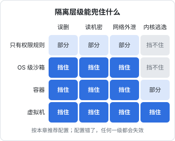
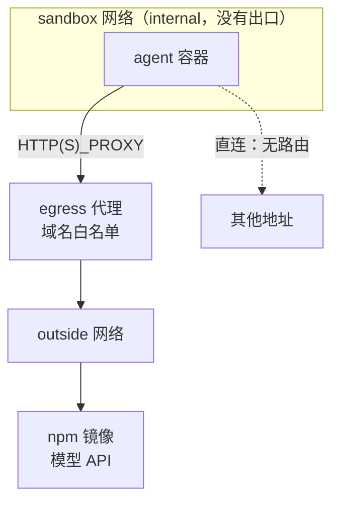

# 沙箱

上一章的污染跟踪和权限规则，都是在**工具调用**这一层做判断：模型想调用 `post_comment`，系统决定放不放。但 agent 只要有一个 shell 工具，这一层就有了无数条绕过的路：`curl` 被拦了还有 `node -e`，`Edit(.claude/**)` 被拦了还有 `echo >>`。权限规则判断的是命令长什么样，而命令可以有无数种写法。

沙箱换了个角度：不管命令怎么写，**进程能碰到的文件、网络和资源，由操作系统说了算**。[《Agent 原理与设计》第 9 章](../agent-principles/09-sandbox-permissions.md)讲了隔离的维度和几种强度，这一章把它落到可以照着做的配置上：OS 级沙箱、带出站白名单的容器、更强的虚拟机隔离，以及凭证怎么给、怎么验证沙箱真的生效。

## 沙箱要兜住什么

先回到第 1 章的威胁表，看哪些威胁必须由沙箱兜底：

| 威胁 | 权限规则能挡吗 | 沙箱怎么挡 |
|---|---|---|
| 读取机密（`~/.ssh`、其他项目的 `.env`） | 能挡住 Read 工具，挡不住 `cat` 的各种变体 | 文件系统里根本没有这些路径 |
| 网络外泄 | 能挡住已知的网络工具，挡不住脚本里的请求 | 网络命名空间断网，或只放行白名单域名 |
| 改写配置实现持久化 | 能挡住 Edit，挡不住 shell 重定向 | 配置路径以只读方式挂载 |
| 误删工作区外的文件 | 能挡住明显的 `rm -rf ~`，挡不住拼出来的路径 | 工作区外不可写 |
| 资源耗尽 | 挡不住 | CPU、内存、进程数、运行时长上限 |
| 恶意依赖或 MCP server | 挡不住，它们不经过模型 | 同上，它们和 agent 一样被关在里面 |

最后一行很关键。供应链攻击完全绕过模型：一个恶意的 npm 包在 `postinstall` 里读你的私钥，跟 prompt 没有任何关系。能兜住它的只有沙箱。

不同的隔离层级能兜住的范围不同：



对个人开发者，一个实用的分配：

- **日常交互式使用**：OS 级沙箱。你在旁边看着，主要防误操作和明显的外泄
- **无人值守、长时间运行、`bypassPermissions` 模式**：容器，配出站白名单
- **跑来源不明的代码、给别人用的 agent 服务**：虚拟机或带强隔离的运行时

## 第一级：OS 级沙箱

OS 级沙箱直接利用操作系统的隔离机制限制一个进程及其子进程：macOS 上是 Seatbelt（`sandbox-exec` 背后的机制），Linux 上常用 bubblewrap（基于命名空间）。主流编码 agent 一般都内置了基于这些机制的沙箱，Claude Code 也提供了沙箱模式，可以限制 Bash 命令的文件写入范围和网络访问，具体的开关和配置项以当前版本的官方文档为准。

内置沙箱够用时优先用内置的。理解它的原理仍然有用，因为你可能要给自己写的 agent、某个 MCP server 或者一个自动化脚本套上同样的限制。下面用 bubblewrap 演示在 Linux 上手工搭一个：

```bash
#!/usr/bin/env bash
# sandbox.sh：在当前目录里开一个受限 shell
# 只读挂载系统目录，只有工作区可写，.claude 和 .git/hooks 只读，没有网络，HOME 是空的
set -euo pipefail
WORK="$(pwd)"

exec bwrap \
  --ro-bind /usr /usr \
  --symlink usr/bin /bin --symlink usr/sbin /sbin \
  --symlink usr/lib /lib --symlink usr/lib64 /lib64 \
  --ro-bind /etc/resolv.conf /etc/resolv.conf \
  --ro-bind /etc/ssl /etc/ssl \
  --proc /proc --dev /dev \
  --tmpfs /tmp --tmpfs /home \
  --setenv HOME /home/agent --dir /home/agent \
  --bind "$WORK" "$WORK" \
  --ro-bind "$WORK/.claude" "$WORK/.claude" \
  --ro-bind "$WORK/.git/hooks" "$WORK/.git/hooks" \
  --chdir "$WORK" \
  --unshare-all \
  --die-with-parent \
  --new-session \
  "${@:-bash}"
```

逐项说明它挡住了什么：

| 参数 | 作用 |
|---|---|
| `--ro-bind /usr /usr` | 系统程序能用，但改不了 |
| 只挂 `/etc` 里两项 | 不暴露 `/etc` 下的其他配置；需要更多时逐项加 |
| `--tmpfs /home` + 新 `HOME` | 真实的家目录（`~/.ssh`、`~/.aws`、各种 CLI 的登录态）在沙箱里不存在 |
| `--bind "$WORK"` 之后再 `--ro-bind` 子目录 | 后面的挂载覆盖前面的：工作区可写，但配置和 git hooks 只读 |
| `--unshare-all` | 新的网络、进程、IPC 等命名空间；网络命名空间里只有一个回环接口，等于断网 |
| `--die-with-parent`、`--new-session` | 父进程退出时一起退出；防止通过终端注入按键 |

几个实际会遇到的问题：

- **用 nvm 之类装在家目录里的 Node 找不到了**。要么额外 `--ro-bind ~/.nvm ~/.nvm`，要么在系统路径装一份。只读挂载工具链是安全的，挂载整个家目录不是
- **需要装依赖时没有网络**。可以先在沙箱外装好依赖，沙箱内只做编辑和测试；需要联网时看下一节的出站代理
- **发行版的目录布局不同**。上面的符号链接适用于 `/bin`、`/lib` 已经合并进 `/usr` 的发行版（近几年的 Debian、Ubuntu、Fedora 都是），其他发行版要按实际情况调整

macOS 上的 `sandbox-exec` 已被苹果标为弃用，命令行接口和配置语言都没有正式文档，但系统和不少工具仍在使用底层机制。自己写配置文件不划算，优先用 agent 内置的沙箱。

## 第二级：容器加出站白名单

无人值守运行时，需要比 OS 沙箱更完整的隔离：独立的文件系统、独立的网络、明确的资源上限。Docker Compose 是你本来就熟悉的工具，用它搭一个「agent 只能通过白名单代理上网」的环境。

### 网络结构



关键在 `internal: true`：Docker 不给这个网络配置通往外部的路由。agent 容器里的进程即使忽略代理环境变量、直接连 IP，也出不去。代理容器同时接入两个网络，是唯一的出口。

### compose 文件

```yaml
# sandbox/compose.yaml
services:
  agent:
    image: node:22-bookworm          # 实际使用时固定到具体的版本或摘要
    user: "1000:1000"                # 镜像里的 node 用户，非 root
    working_dir: /work
    command: sleep infinity          # 用 docker compose exec agent bash 进去
    volumes:
      - ../:/work
      - ../.claude:/work/.claude:ro
      - ../.git/hooks:/work/.git/hooks:ro
    environment:
      HTTP_PROXY: http://egress:3128
      HTTPS_PROXY: http://egress:3128
      http_proxy: http://egress:3128
      https_proxy: http://egress:3128
    read_only: true                  # 根文件系统只读
    tmpfs:
      - /tmp
      - /home/node:uid=1000,gid=1000
    cap_drop: [ALL]
    security_opt: ["no-new-privileges:true"]
    pids_limit: 512
    mem_limit: 4g
    cpus: 2
    networks: [sandbox]

  egress:
    image: ubuntu/squid              # 同样固定版本
    volumes:
      - ./squid.conf:/etc/squid/squid.conf:ro
    networks: [sandbox, outside]

networks:
  sandbox:
    internal: true
  outside: {}
```

代理的白名单：

```text
# sandbox/squid.conf
http_port 3128

acl allowed dstdomain registry.npmjs.org .npmjs.org
acl allowed dstdomain api.anthropic.com
acl SSL_ports port 443
acl CONNECT method CONNECT

http_access deny CONNECT !SSL_ports
http_access allow allowed
http_access deny all

# 记录每一次放行和拒绝，第 6 章的审计会用到
access_log stdio:/dev/stdout
```

对 HTTPS，代理只能看到 `CONNECT` 请求里的域名，看不到路径和内容，所以白名单是**按域名**的。这已经足够切断大部分外泄路径：数据只能发往你列出的几个域名。

### 白名单里每个域名都是通道

列白名单时要清醒：**每个放行的域名都是一个潜在的外泄通道**。

- **模型 API 的域名必须放行**，agent 才能工作。这个通道是你和模型服务商之间的，风险可以接受
- **包仓库**：npm 允许任何人发布包，但「把数据发到 npm」需要发布凭证，沙箱里没有。可以接受
- **代码托管平台**：放行后，agent 可以访问任何公开仓库，也可能被诱导往某个地方写东西（如果它有凭证）。只在确实需要时放行，并且不给写凭证
- **通用搜索和任意网页**：放行等于没有白名单。需要查资料的任务，放到一个不接触机密的单独会话里做（第 2 章的「拆成两个会话」）

### 不要做的事

容器隔离很容易被一行配置抵消：

| 配置 | 后果 |
|---|---|
| 挂载 `/var/run/docker.sock` | 容器内可以启动一个挂载宿主根目录的新容器，等于宿主 root |
| `privileged: true` | 几乎拿掉所有隔离 |
| `network_mode: host` | 和宿主共用网络，白名单失效 |
| 挂载整个家目录 | 私钥、云凭证、浏览器数据全部可见 |
| 以 root 运行且不丢弃 capability | 扩大了内核漏洞的利用面 |
| 把宿主的 ssh agent 转发进容器 | 容器内可以用你的私钥签名，虽然拿不到私钥本身 |

## 第三级：虚拟机和强隔离运行时

容器和宿主共享同一个内核。内核漏洞可以让容器内的进程逃逸到宿主，这对「agent 被诱导在自己的仓库里搞破坏」来说概率很低，但对「运行完全不可信的代码」「给多个用户提供 agent 服务」来说必须考虑。

更强的隔离有几种选择：

- **完整的虚拟机**：一台专门给 agent 用的云服务器或本地虚拟机，和你的主力机器完全分开。最简单，开销也最大
- **用户态内核**（如 gVisor）：拦截容器的系统调用，在用户态实现，大幅缩小宿主内核的暴露面，可以作为 Docker 的运行时替换使用
- **微虚拟机**（如 Firecracker）：启动快、开销小的轻量虚拟机，云端的代码执行沙箱服务多用这类技术

对个人开发者，最实际的「第三级」通常是：**一台专门的便宜云服务器，上面什么机密都没有**，agent 在那里跑，产出通过 git 分支或 PR 交回给你审阅。

## 凭证：沙箱里放什么

沙箱挡住了 agent 去拿凭证，但你常常需要主动给它一些凭证才能干活。原则：

1. **默认什么都不给**。能不给就不给，比如推送代码由你在沙箱外执行
2. **给专用的，不给你自己的**。专门为 agent 创建的令牌，权限范围最小（第 4 章展开）
3. **给短期的，不给长期的**。能设过期时间就设，一次任务一个令牌
4. **通过环境变量或只读文件传入**，不写进会被提交的文件

hatch-counter 的部署设计里有一个很好的参照：静态站上线由服务器上的上线代理**自己去读**一份公开的版本指针，拉包、核对哈希、切软链；流水线手里**没有任何能进生产机的钥匙**，上线代理所在的机器上也没有发布用的凭证。被篡改的指针最多能做到「把桶里已有的某一版切上去」。这个思路同样适用于 agent：**与其给 agent 一把钥匙再限制它怎么用，不如设计成它根本不需要钥匙**。

## 验证沙箱真的生效

沙箱配错了往往不会报错，只是悄悄失效。每次改完配置，在沙箱里跑一遍自检：

```bash
#!/usr/bin/env bash
# sandbox-selftest.sh：在沙箱内运行，每一项都应该显示「已阻止」
check() {
  local name="$1"; shift
  if "$@" >/dev/null 2>&1; then echo "未阻止：$name"; FAIL=1; else echo "已阻止：$name"; fi
}
FAIL=0
check "读取真实家目录的 ssh 配置" test -r "/home/$(id -un)/.ssh/id_ed25519"
check "写入 .claude 配置"        touch .claude/.sandbox-probe
check "写入 git hooks"           touch .git/hooks/.sandbox-probe
check "写入工作区之外"           touch /usr/.sandbox-probe
check "访问白名单外的域名"       curl -sS --max-time 5 https://example.com
check "绕过代理直连"             curl -sS --max-time 5 --noproxy '*' https://registry.npmjs.org
exit $FAIL
```

把它放进你的沙箱启动流程里：自检不通过，就不启动 agent。

## 本章要点

- 权限规则判断命令的样子，沙箱限制进程能碰到的资源；shell 让前者必然有漏洞，后者是硬约束
- 恶意依赖和 MCP server 完全绕过模型，只有沙箱能兜住
- 交互式用 OS 级沙箱，无人值守用容器加出站白名单，不可信代码和多用户服务用虚拟机级隔离
- 手工搭沙箱的要点：系统目录只读、真实家目录不可见、工作区可写但配置和 hooks 只读、断网
- 容器的出站控制靠 `internal` 网络加代理，而不是靠代理环境变量；白名单里每个域名都是通道
- 挂 docker.sock、privileged、host 网络、挂家目录，任何一条都会让隔离失效
- 凭证默认不给，给就给专用、最小、短期的；更好的是设计成 agent 不需要钥匙
- 用自检脚本验证沙箱，不通过就不启动
