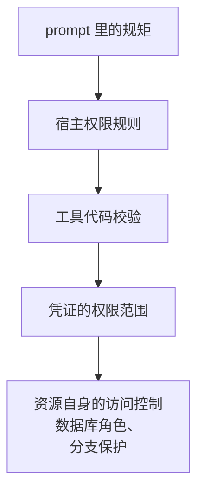
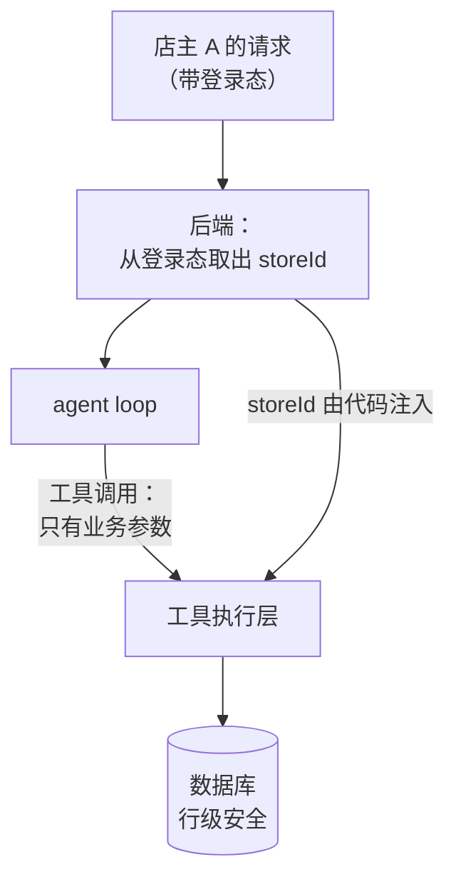

# 权限边界

[《工具设计与 MCP》第 6 章](../tools-and-mcp/06-auth-and-permissions.md)讲了一个 MCP server 的三层权限：server 暴露什么、宿主放不放行、凭证代表谁。[《Agent 原理与设计》第 9 章](../agent-principles/09-sandbox-permissions.md)讲了按副作用分级授权、白名单优于黑名单。这一章往外扩一圈，讨论 agent **作为一个行动者**在你的整个系统里的权限边界：它以什么身份行动，这个身份在下游系统（数据库、代码托管、云服务）里被允许做什么，工具代码怎样在参数层面施加约束，以及在多用户系统里怎样避免 agent 成为越权的跳板。

核心原则只有一句：**agent 的权限边界必须由 agent 之外的系统强制执行，并且尽量落在离资源最近的地方**。

## 边界该落在哪一层

一次 agent 操作要经过好几层，每一层都可以设边界：



越往右越硬、越难绕过：

| 层 | 例子 | 能被绕过吗 |
|---|---|---|
| prompt | 「不要修改 main 分支」 | 注入、误判都能绕过 |
| 宿主权限 | `deny: Bash(git push:*)` | 换一种命令写法、经由脚本间接执行 |
| 工具代码 | `push_book` 只接受白名单里的书 id | 只要工具代码正确，就绕不过 |
| 凭证范围 | 令牌只有一个仓库的读权限 | 只要凭证不泄露，就绕不过 |
| 资源访问控制 | 分支保护要求 PR 审核才能合并 | 连拿到凭证的人也绕不过 |

这张表引出一个实用的设计习惯：**每一条重要的边界，都问一句「能不能把它往右移一层」**。「不要改 main」写在 prompt 里是一层；放进权限规则是第二层；但最硬的是在代码托管平台上给 main 开分支保护，这样即使 agent 拿到了有写权限的令牌，也只能推到别的分支、开 PR。

## agent 用自己的身份

最常见、也最危险的做法，是让 agent 用你的身份干活：你的 ssh key、你的个人访问令牌、你的数据库超级用户。这样 agent 能做的事就等于你能做的事，所有下游系统都分不清一个操作是你做的还是 agent 做的。

正确的做法是**给 agent 一个专门的身份**，在每个下游系统里单独授权：

| 下游系统 | agent 专用身份 | 好处 |
|---|---|---|
| 操作系统 | 单独的系统用户或容器内用户 | 文件权限天然隔离 |
| 代码托管 | 专用的细粒度令牌或机器人账号 | 只能访问指定仓库，提交记录可区分 |
| 数据库 | 专用角色 | 授权精确到表和操作 |
| 云服务 | 专用的 API 令牌 | 只能访问指定的桶、指定的操作 |
| 消息通道 | 专用的机器人 | 发出的消息一眼看出是机器人 |

专用身份带来的不只是最小权限，还有**可追溯**和**可撤销**：日志里能区分出 agent 的操作；出事时吊销 agent 的令牌，不影响你自己继续工作。

### 代码托管：细粒度令牌加分支保护

以 GitHub 为例，给 agent 用的令牌应该是细粒度令牌（fine-grained personal access token），而不是经典令牌：

- **仓库范围**：只选需要的那一个仓库
- **权限**：按任务选最小集合，比如只需要读代码和开 PR，就只给 Contents 读写和 Pull requests 读写；不给 Administration、Workflows、Secrets
- **过期时间**：设一个短的过期时间

然后在仓库设置里用分支保护规则或规则集保护 main：禁止直接推送、要求 PR、要求审核。这样 agent 的最大能力就是「在一个分支上推代码，并开一个等你审核的 PR」。

为什么特别强调不给 Workflows 权限？因为能修改 CI 配置，就能让 CI 以仓库的身份运行任意代码，读取 CI 里配置的所有机密。这是第 2 章「持久化」的一种高危形式。

令牌的权限名称和可选范围会随平台更新而变化，配置时以平台当前的界面和文档为准。

### 数据库：只读角色加行级安全

假设要给 hatch-counter 加一个查询助手 agent，让店主用自然语言问「上个月哪个供货商的进货金额最多」。agent 需要查库，但绝不应该能写库，也绝不应该能看到别的门店的数据。在 PostgreSQL 里，这两条边界都可以交给数据库自己来强制：

```sql
-- 专用的只读角色（密码通过部署时的环境变量设置，不写进迁移文件）
CREATE ROLE agent_readonly LOGIN;

GRANT CONNECT ON DATABASE app TO agent_readonly;
GRANT USAGE ON SCHEMA public TO agent_readonly;
-- 只授权需要的表，不用 ALL TABLES
GRANT SELECT ON purchase_orders, purchase_order_lines, suppliers TO agent_readonly;

-- 会话默认只读、单条语句最多跑 5 秒，防止误写和拖垮数据库
ALTER ROLE agent_readonly SET default_transaction_read_only = on;
ALTER ROLE agent_readonly SET statement_timeout = '5s';

-- 行级安全：只能看到当前门店的数据
ALTER TABLE purchase_orders ENABLE ROW LEVEL SECURITY;
CREATE POLICY agent_store_isolation ON purchase_orders
  FOR SELECT TO agent_readonly
  USING (store_id = current_setting('app.store_id')::uuid);
```

工具不让模型写 SQL，而是提供几个参数化的查询工具；门店 id 由代码在每次查询前设置为会话变量：

```typescript
// 查询工具（Drizzle）：模型只决定时间范围，门店 id 来自登录态
import { sql } from 'drizzle-orm';

async function topSuppliers(storeId: string, from: string, to: string) {
  // agentDb 的连接池使用 agent_readonly 角色登录，和业务连接池分开
  return agentDb.transaction(async (tx) => {
    // set_config 的第三个参数 true 表示只在当前事务内生效
    await tx.execute(sql`select set_config('app.store_id', ${storeId}, true)`);
    return tx.execute(sql`
      select s.name, sum(l.amount) as total
      from purchase_orders o
      join purchase_order_lines l on l.order_id = o.id
      join suppliers s on s.id = o.supplier_id
      where o.ordered_at >= ${from} and o.ordered_at < ${to}
      group by s.name order by total desc limit 10`);
  });
}
```

这里有三道边界，都不依赖模型：

- **角色只有 SELECT**：即使将来某个工具写错了，数据库也不会执行写操作
- **默认只读事务**：即使不小心多授权了一张表的写权限，也还有一道保险
- **行级安全**：即使工具里的查询漏了门店条件（上面的查询就故意没写），也只会返回当前门店的行

注意几个细节：行级安全策略要给每张相关的表都加上（上面只演示了一张）；表的属主默认不受行级安全约束，所以 agent 角色绝不能是表的属主；`current_setting` 在变量未设置时会报错，这恰好是我们想要的，忘了设置门店 id 的查询会直接失败，而不是返回所有数据。

### 为什么不让模型直接写 SQL

「自然语言查数据库」最直接的做法是让模型写 SQL 再执行。有了只读角色和行级安全，看起来也安全了，但这里有一个容易漏掉的洞：**会话变量是当前连接自己可以改的**。模型写的 SQL 里只要也调用一次 `set_config`，就能把 `app.store_id` 换成别的门店，行级安全随之失效。

这是一个普遍的教训：**一条边界如果是由「被约束的一方能控制的东西」来维持的，它就不是边界**。修补办法有几种：

- **只提供参数化的查询工具**（上面的做法），模型填参数，不写 SQL。覆盖不了任意问题，但对一个门店助手，十来个查询工具通常就够了
- **一定要执行模型写的 SQL 时**，把门店身份放到模型改不了的地方：比如为每个门店建一个只读登录角色，按门店用不同的连接登录（注意不能让这个角色成为其他门店角色的成员，否则一句 `SET ROLE` 就能切过去）；再用 SQL 解析器确认只有一条 `SELECT` 语句、不调用任何会改会话状态的函数。这些方案都更复杂，要仔细验证
- 无论哪种，**执行模型写的 SQL 都要用专用连接池**，连接使用 `agent_readonly` 角色，绝不复用业务连接池

### 云服务：按资源限定的令牌

hatch-recordwall 用 Cloudflare Worker 加 R2。如果要让 agent 帮你整理存储桶里的文件，给它的 API 令牌应该只能访问那一个桶，只给需要的操作。Cloudflare、AWS 等平台都支持把令牌限定到具体资源和操作，具体的权限名称以各平台的控制台为准。

## 工具代码里的参数约束

宿主的权限规则只能看到工具名和粗粒度的参数模式。真正精细的约束要写在工具代码里，而且应该**集中写在一个策略函数里**，而不是散落在每个工具中：

```typescript
// policy/rules.ts：参数级的策略，集中维护
import path from 'node:path';

type Verdict = { ok: true } | { ok: false; reason: string };

const WORKSPACE = path.resolve(process.env.AGENT_WORKSPACE ?? process.cwd());
const PROTECTED = ['.claude', '.git', '.github/workflows', 'deploy'].map((p) => path.join(WORKSPACE, p));
const FETCH_HOSTS = new Set(['docs.expo.dev', 'nodejs.org', 'orm.drizzle.team']);

export function checkWritePath(p: string): Verdict {
  const abs = path.resolve(WORKSPACE, p);
  const rel = path.relative(WORKSPACE, abs);
  if (rel.startsWith('..') || path.isAbsolute(rel)) return { ok: false, reason: `只能写工作区内的文件：${p}` };
  if (PROTECTED.some((d) => abs === d || abs.startsWith(d + path.sep))) {
    return { ok: false, reason: `${rel} 是受保护的配置路径，需要用户亲自修改` };
  }
  if (path.basename(abs).startsWith('.env')) return { ok: false, reason: '不能写环境变量文件' };
  return { ok: true };
}

export function checkFetchUrl(raw: string): Verdict {
  let u: URL;
  try {
    u = new URL(raw);
  } catch {
    return { ok: false, reason: `不是合法的 URL：${raw}` };
  }
  if (u.protocol !== 'https:') return { ok: false, reason: '只允许 https' };
  if (!FETCH_HOSTS.has(u.hostname)) return { ok: false, reason: `${u.hostname} 不在允许抓取的域名列表里` };
  if (u.username || u.password) return { ok: false, reason: 'URL 里不能带凭证' };
  return { ok: true };
}
```

几个要点：

- **路径先解析成绝对路径再判断**。直接对字符串做 `startsWith` 判断，会被 `../`、符号链接、大小写等绕过。上面用 `path.relative` 判断是否跳出工作区；如果工作区里可能有符号链接，还要用 `fs.realpath` 解析之后再判断
- **URL 用 `URL` 解析而不是正则**。手写正则判断域名几乎一定有漏洞
- **拒绝理由写给模型看**，告诉它为什么不行、该怎么办
- **策略和工具分开**，改策略不用改工具，也方便给策略写单元测试

这和 `@shelf/spec` 的设计思路是一样的：hatch-shelf 规定「判断书籍结构的逻辑（容错规则、扩展名白名单、zip slip 检查）只写在 `@shelf/spec`，App 和 CLI 调用它」。安全检查集中在一处，才能保证每个入口都用同一套规则，也才能被充分测试。

## 多用户系统：防止混淆代理

如果你的 agent 是给多个用户用的产品（比如 hatch-counter 里给每个店主用的助手），会遇到一个个人工具里不存在的问题：**agent 本身的权限往往比任何单个用户都大**。它的后端服务能访问所有门店的数据，而每个店主只应该看到自己的。

这时如果权限判断依赖模型（「你是 A 店的助手，只查 A 店的数据」），任何一次注入或误判都可能导致跨租户访问。agent 就成了一个被借用的「代理」，帮一个用户做了这个用户自己无权做的事，这就是**混淆代理**（confused deputy）问题。



防御要点：

- **用户身份由代码传递，不经过模型**。门店 id、用户 id 从登录态取出，在工具执行层注入，**从不作为工具参数让模型填写**。模型能决定的只有业务参数（时间范围、供货商名）
- **用当前用户的权限执行，而不是 agent 的权限**。工具在执行时以当前用户的身份访问资源，上一节的行级安全就是这样做的
- **一次会话只服务一个用户**。不在一个上下文里混入多个用户的数据，这和[《LLM 应用上线》第 7 章](../llmops/07-prompt-injection.md)「一次调用只放一个租户的数据」是同一条原则
- **记忆按用户隔离**。长期记忆的读写同样要带用户维度，否则 A 的对话内容可能出现在 B 的上下文里

## 预算也是权限

还有一类边界常被忽略：**量**。一个只能调用只读工具的 agent，如果在死循环里调用一万次，也会造成实际损失：模型账单、下游 API 配额、数据库负载。

| 预算 | 防什么 | 怎么设 |
|---|---|---|
| 每会话最大轮数 | 死循环、目标漂移 | 达到上限时停下来，向人汇报进展 |
| 每会话最大花费 | 账单失控 | 累计每次调用的 token 成本，超过即停 |
| 每工具调用频率 | 被诱导批量操作 | 写操作每分钟最多 N 次 |
| 单次操作的影响范围 | 一次删太多 | 批量操作限定条数，超过要拆分并确认 |
| 运行时长 | 卡死、长期驻留 | 进程级超时，沙箱容器设定最长存活时间 |

[《LLM 应用上线》第 3 章](../llmops/03-rate-limits-quotas.md)讲过速率限制和配额的实现，agent 场景下把它们加到每个会话、每个工具的维度上即可。预算触顶时的行为也要设计：**停下并汇报，而不是静默失败**，让人知道它做到了哪一步。

## 授权的时效

权限最好不是永久的：

- **令牌设过期时间**。一个月不用的 agent，令牌应该已经失效
- **会话级授权**。用户在一个会话里批准了「这次可以推送」，不代表下个会话也可以。宿主的「本次会话允许」和「永久允许」要分清楚，高风险操作只给会话级
- **定期复查**。把 agent 的所有令牌、角色、权限规则列在一处（第 7 章的清单里有这一项），每隔一段时间看一眼还需不需要

## 本章要点

- 权限边界要由 agent 之外的系统强制执行，尽量落在离资源最近的地方；每条重要边界都问「能不能往右移一层」
- agent 用专用身份，不用你的：可以最小授权、可以追溯、可以单独吊销
- 代码托管用细粒度令牌加分支保护，不给修改 CI 的权限
- 数据库用专用只读角色、默认只读事务、语句超时、行级安全，边界交给数据库强制
- 参数级约束集中写在策略函数里：路径先解析再判断，URL 用解析器而不是正则，拒绝理由写给模型看
- 多用户系统里用户身份由代码注入、不经过模型，用当前用户的权限执行，防止混淆代理
- 预算（轮数、花费、频率、影响范围、时长）也是权限，触顶时停下并汇报
- 授权要有时效：令牌过期、会话级批准、定期复查
