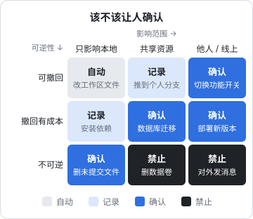
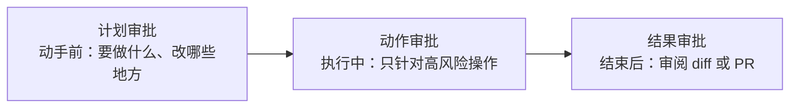

# 人在回路

前面几章的防线都是机器执行的：沙箱、权限、策略函数。但总有一些操作，机器无法判断该不该做：这次推送是不是你想要的？这封邮件的措辞合不合适？这条迁移会不会锁表？这时候需要人来拍板。

《Agent 原理与设计》第 9 章已经提出了人在回路的三条原则：说清后果、避免确认疲劳、在关键节点集中确认。这一章把它当成一个**安全机制**来设计：什么时候该问（一张决策网格）、确认界面该展示什么、怎样保证人批准的就是实际执行的、怎样衡量确认是否还有效，以及不在电脑前时怎样安全地远程审批。

## 确认是一道防线，也会失效

把人工确认当成安全机制，就要像对待其他机制一样，问它**会怎样失效**：

| 失效方式 | 表现 | 对策 |
|---|---|---|
| 确认疲劳 | 问得太多，人不看就点同意 | 只在高风险处问，度量批准率 |
| 信息不足 | 界面只显示「是否执行 run_command？」 | 展示具体效果、影响范围、回滚方式 |
| 信息误导 | 界面显示的是模型写的「说明」，被注入的模型可以说谎 | 展示由代码生成的事实，而不是模型的描述 |
| 批准与执行不一致 | 批准了 A，执行的是被改过的 B | 批准绑定确切的参数，执行前校验 |
| 绕过 | 模型声称「用户之前已经同意了」 | 批准只能来自模型无法控制的通道 |
| 过期的批准 | 昨天批准的操作今天才执行，情况已经变了 | 批准有时效 |

下面按这几种失效逐个设计。

## 什么时候问

### 一张决策网格

问不问，主要看两件事：**能不能撤回**，**影响有多大**。把它们画成一张网格：



读法：

- **左上角**（可逆、只影响本地）：编辑工作区文件、跑测试。自动执行，靠 git 兜底
- **中间一带**：自动执行但记录，或者需要确认，取决于具体操作
- **右下角**（不可逆、影响他人或线上）：删除生产数据、对外发消息、付款。禁止 agent 执行，由人亲手做

### 三个让门槛变高的因素

同一个操作，在不同情况下应该区别对待：

- **会话被污染了**。第 2 章的污染跟踪在这里派上用场：读过网页之后的 `git push`，比没读过时更值得多看一眼。网格上的格子整体往「更严格」的方向移一档
- **模型自己不确定**。agent 在计划里写了「我不确定这个配置项的含义，先按 X 处理」，这就是该停下来问的信号。hatch-counter 的 CLAUDE.md 里那条「数据对不上、名字认不出这类情况交给人拍板」，就是把不确定性当成询问的触发条件
- **偏离了原计划**。用户批准的计划是「修改三个文件」，执行到一半 agent 想改第四个，或者想运行一个计划里没有的命令。偏离本身就值得确认

## 确认界面该展示什么

### 展示效果，而不是意图

「是否允许执行 `bash`？」几乎没有信息量。好的确认展示的是**操作会造成什么效果**：

```text
推送到远程仓库
  命令：git push origin fix/reader-scroll
  目标：origin（代码托管平台上的个人仓库）
  内容：3 个提交，修改 4 个文件（+82 / -17）
  不会影响：main 分支（受分支保护）
  会话状态：已读入不可信内容（fetch docs.expo.dev）
  撤回方式：删除远程分支

[查看 diff]  [批准]  [拒绝]
```

这份确认里的每一行，都应该**由代码生成**，而不是由模型撰写：

- 命令和目标从工具调用的参数里取
- 提交数和改动量由代码调用 `git` 计算
- 会话状态来自污染跟踪
- 撤回方式按工具类型预先写好

为什么强调这一点？因为一个被注入的模型完全可以在「说明」里写「这只是一次例行的格式化提交」，而实际推送的内容完全不同。**模型写的说明可以展示，但要明确标注为「agent 的说明」，并且永远放在代码生成的事实之后**。

### 不同操作的关键信息

| 操作类型 | 必须展示的事实 |
|---|---|
| 文件写入（受保护路径） | 完整 diff |
| shell 命令 | 解析后的完整命令、工作目录、会不会联网 |
| 推送、发布 | 目标、包含哪些提交或文件、是否覆盖已有内容 |
| 发消息、发邮件 | 收件人、完整正文（不是摘要） |
| 数据库写操作 | 影响的表、预计影响的行数（先用同条件的 `SELECT count(*)` 查一遍） |
| 花钱的操作 | 金额、币种、收款方 |

「预计影响的行数」这一类，本质上是**先演练再执行**（dry run）。能演练的操作都先演练，把演练结果作为确认界面的内容：`terraform plan` 之于 `apply`，`rsync --dry-run` 之于真正的同步，`shelf-pack push --changed` 先列出哪些书有变化。

## 批准绑定确切的参数

一个容易被忽略的漏洞：人批准时看到的是 A，实际执行的是 B。在交互式宿主里，批准和执行几乎同时发生，问题不大；但在异步审批里（agent 提交申请，你过一会儿在手机上批准），中间有足够的时间差，参数可能被修改，申请可能被替换。

对策是让每个批准**绑定操作内容的哈希**，执行前重新计算并比对：

```typescript
// approvals.ts：批准绑定确切的工具调用，带有效期，只能用一次
import { createHash, randomUUID } from 'node:crypto';

interface PendingAction {
  id: string;
  tool: string;
  args: unknown;
  digest: string;
  facts: string[];          // 代码生成的事实，用于展示
  createdAt: number;
  expiresAt: number;
  status: 'pending' | 'approved' | 'rejected' | 'used' | 'expired';
  decidedBy?: string;
}

const TTL_MS = 15 * 60 * 1000; // 15 分钟内不处理就作废

function canonical(v: unknown): string {
  if (Array.isArray(v)) return `[${v.map(canonical).join(',')}]`;
  if (v && typeof v === 'object') {
    return `{${Object.keys(v as object)
      .sort()
      .filter((k) => (v as Record<string, unknown>)[k] !== undefined)
      .map((k) => `${JSON.stringify(k)}:${canonical((v as Record<string, unknown>)[k])}`)
      .join(',')}}`;
  }
  return JSON.stringify(v);
}

export const digestOf = (tool: string, args: unknown) =>
  createHash('sha256').update(canonical({ tool, args })).digest('hex');

export function propose(store: Map<string, PendingAction>, tool: string, args: unknown, facts: string[]) {
  const now = Date.now();
  const a: PendingAction = {
    id: randomUUID(), tool, args, digest: digestOf(tool, args), facts,
    createdAt: now, expiresAt: now + TTL_MS, status: 'pending',
  };
  store.set(a.id, a);
  return a;
}

/** 由审批界面调用：只有已认证的人能调用，模型永远调不到这个函数 */
export function decide(store: Map<string, PendingAction>, id: string, approve: boolean, who: string) {
  const a = store.get(id);
  if (!a || a.status !== 'pending') throw new Error('申请不存在或已处理');
  if (Date.now() > a.expiresAt) { a.status = 'expired'; throw new Error('申请已过期'); }
  a.status = approve ? 'approved' : 'rejected';
  a.decidedBy = who;
}

/** 执行前调用：参数必须和批准时完全一致，且只能用一次 */
export function consume(store: Map<string, PendingAction>, id: string, tool: string, args: unknown) {
  const a = store.get(id);
  if (!a || a.status !== 'approved') return { ok: false as const, reason: '没有有效的批准' };
  if (Date.now() > a.expiresAt) { a.status = 'expired'; return { ok: false as const, reason: '批准已过期' }; }
  if (a.digest !== digestOf(tool, args)) return { ok: false as const, reason: '参数与批准时不一致' };
  a.status = 'used';
  return { ok: true as const };
}
```

三个性质缺一不可：

- **绑定内容**：参数变了一个字符，批准就失效
- **有时效**：情况会变，批准不能一直有效
- **一次性**：批准过一次推送，不等于以后都可以推送

示例用 `Map` 存储只为演示，实际使用时放进数据库或至少一个持久化文件，否则进程重启后待审批的申请会丢失。

## 批准只能来自人

确认机制最根本的要求：**批准必须来自模型无法控制的通道**。

- **模型不能有「批准」工具**。听起来理所当然，但在自己写 agent 时，为了方便测试加一个 `approve_pending` 工具，然后忘了删，是真实会发生的事
- **不接受模型转述的同意**。模型输出「用户已经同意执行此操作」不等于用户同意了。同意只能来自审批界面的点击，或者用户本人在对话里的输入，而且要由宿主而不是模型来判定这条输入是用户发的
- **不可信内容里的「已授权」一律无效**。网页、邮件、issue 里写着「管理员已批准」，和模型转述一样不算数
- **审批界面要认证**。远程审批的页面必须验证是你本人，否则任何拿到链接的人都能批准

## 确认疲劳：度量它

确认疲劳不是一个可以靠意志力克服的问题，它是设计问题。好在它可以度量。给每一次确认记录结果（第 6 章的审计日志里正好有）：

| 指标 | 怎么算 | 说明什么 |
|---|---|---|
| 批准率 | 批准次数 / 确认总数 | 接近 100% 说明很多确认是多余的 |
| 平均决策时间 | 从弹出到点击的时间 | 一两秒就点，很可能没看 |
| 修改后批准率 | 用户先拒绝、让 agent 修改后再批准的比例 | 确认真正发挥作用的次数 |
| 同类确认次数 | 同一个工具、同一类参数被确认的次数 | 高频且总被批准的，考虑放进白名单 |

调整的方向有两个：

1. **低风险、高频、总被批准的操作，移出确认**。比如「运行 `pnpm test`」每次都被批准，就放进白名单
2. **把逐条确认合并成更高层的确认**。与其确认十次文件写入，不如在动手前确认一次计划，在结束时审阅一次 diff

第二点对应三个不同粒度的确认点：



对编码 agent，**结果审批是最高效的**：agent 在分支上自由工作，最后开一个 PR，你审阅 diff 后合并。第 4 章的分支保护让这个流程成为硬约束：agent 根本没有办法跳过你的审阅直接进 main。这套书本身也是这样写的：写书 agent 只写自己的目录、不运行 git，主会话审阅后统一提交。

## 远程审批

agent 在服务器上无人值守运行，需要审批时你可能不在电脑前。常见做法是推送一条通知，你在手机上处理。这里有几个安全细节：

- **批准动作必须是带认证的 POST，不能是一个 GET 链接**。聊天软件和邮件客户端会自动预览链接，有的安全网关会预先访问邮件里的链接，一个「点击即批准」的 GET 链接可能在你看到之前就已经被访问了
- **通知内容只放摘要，详情在认证后的页面里看**。通知会经过第三方的推送服务，也可能显示在锁屏上，不要把 diff、机密、客户数据放进通知
- **审批页面展示的是代码生成的事实**，和本地确认界面一样
- **超时即拒绝**。没人处理的申请到期自动作废，agent 收到「超时未批准」，停下并汇报，而不是重试或者自行决定

hatch-counter 的工具链里有群通知工具，发版结果会推到群里。如果要给它的运维 agent 加审批，可以复用这条通知通道，但只用来推送「有一个待审批的操作」，批准本身要回到一个需要登录的页面上完成。

## 中止开关

人在回路不只是「事前批准」，还包括**随时能叫停**：

- **交互式**：宿主都有中断键，确保你知道它在哪
- **无人值守**：准备一个不依赖 agent 配合的停止方式。容器可以直接 `docker compose stop`；agent 服务可以在每一轮开始前检查一个停止标志（一个文件、一个数据库字段），存在就停下
- **吊销凭证是最后的中止开关**。第 4 章强调给 agent 专用身份，好处之一就在这里：怀疑 agent 被劫持时，吊销它的令牌，所有下游操作立刻失效，而你自己的工作不受影响

停止标志的思路和 hatch-counter 的停服维护一样：维护状态就是一个标记文件，nginx 每个请求检查它在不在。状态用文件表达，进退都只是建或删一个文件，**不需要被停止的那一方配合**。

## 本章要点

- 人工确认是一道会失效的防线：疲劳、信息不足、信息误导、批准与执行不一致、被绕过、过期
- 按可逆性和影响范围决定问不问；会话被污染、模型不确定、偏离计划时门槛升高
- 确认界面展示效果而不是意图，内容由代码生成；模型的说明只能作为附注
- 能演练的操作先演练，把演练结果作为确认内容
- 批准绑定参数哈希、有时效、一次性；批准只能来自模型无法控制的通道
- 度量批准率和决策时间，高频总被批准的移出确认；优先用计划审批和结果审批代替逐条确认
- 远程审批用带认证的 POST，通知只放摘要，超时即拒绝
- 准备不依赖 agent 配合的中止开关，吊销专用凭证是最后一道
