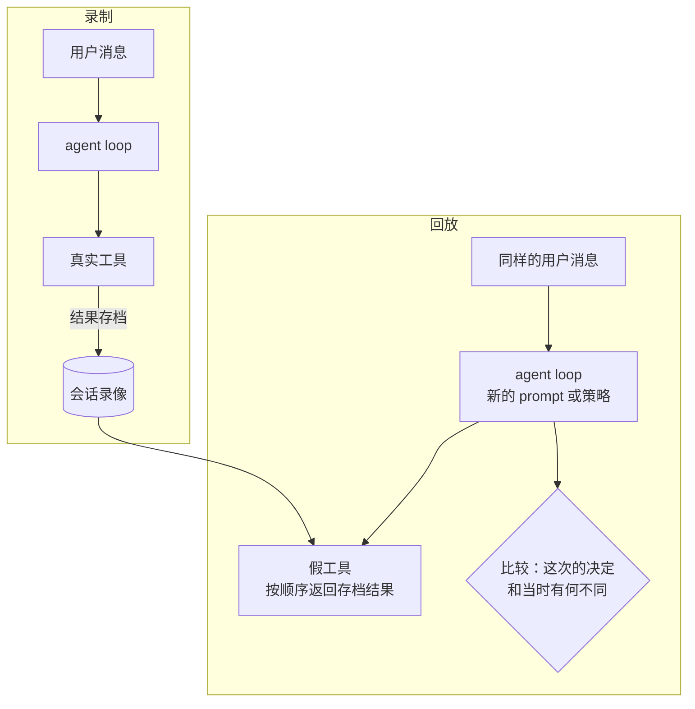
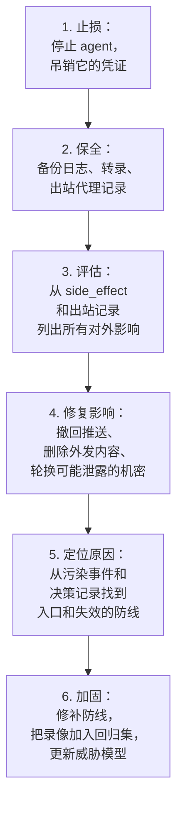

# 审计与回放

前面几章都在讲怎样**防止**出事。但再好的防护也有漏洞，而且 agent 的很多问题根本不是「被攻击」，而是「它为什么会这么做」。这时你需要两样东西：一份完整、可信的记录，告诉你发生了什么；以及一种重现的手段，让你能验证修复是否有效。

[《LLM 应用上线》第 6 章](../llmops/06-observability-tracing.md)讲过可观测性和追踪，关注的是延迟、成本、错误率这些运行指标。这一章关注的是**安全视角的记录**：记什么才能在事后回答「它为什么这么做、影响了什么」，怎样防止记录被 agent 自己篡改，怎样用记录回放一次会话来复现问题，以及出事时的处置流程。

## 审计要回答的问题

设计日志之前，先想清楚出事后要回答哪些问题。如果日志回答不了，记再多也没用：

| 问题 | 需要记录 |
|---|---|
| 它做了什么？ | 每一次工具调用：工具名、完整参数、结果摘要、耗时 |
| 为什么这么做？ | 当时的上下文：模型的输入和输出，至少是每轮的输出和调用意图 |
| 谁允许的？ | 每次权限决策：allow / ask / deny，依据哪条规则；人工批准的人和时间 |
| 不可信内容从哪来？ | 污染事件：哪次工具调用引入了不可信内容，来源是什么 |
| 影响了什么？ | 有副作用的操作的目标：写了哪些文件、推了哪个分支、发给了谁 |
| 当时是什么配置？ | 模型版本、system prompt 版本、工具集及其定义哈希、权限策略版本 |

最后一行常被漏掉。一个月后回看一次事故，如果不知道当时用的是哪个模型、哪版 prompt、哪些工具，就无法判断问题是否已经被后来的改动修好了。

## 事件日志的结构

用一种追加写入的结构化事件日志（JSON Lines，每行一个事件）记录一个会话里发生的所有事。事件类型不多：

```typescript
// audit/events.ts
export type AuditEvent =
  | { type: 'session_start'; model: string; promptVersion: string; toolsDigest: string; policyVersion: string; user: string }
  | { type: 'model_turn'; turn: number; inputTokens: number; outputTokens: number; text: string; toolCalls: { id: string; name: string }[] }
  | { type: 'tool_call'; turn: number; callId: string; tool: string; args: unknown }
  | { type: 'decision'; callId: string; decision: 'allow' | 'ask' | 'deny'; rule: string; reason?: string }
  | { type: 'approval'; callId: string; approved: boolean; by: string; waitedMs: number }
  | { type: 'tool_result'; callId: string; ok: boolean; bytes: number; preview: string; resultRef?: string }
  | { type: 'taint'; callId: string; source: string }
  | { type: 'side_effect'; callId: string; kind: 'file_write' | 'push' | 'message' | 'db_write' | 'http'; target: string }
  | { type: 'session_end'; reason: 'done' | 'budget' | 'stopped' | 'error'; turns: number; costUsd: number };
```

几个设计选择：

- **工具结果只存预览和引用**。完整的工具结果可能很大（整张网页、整个文件），放进同一个日志文件会让它难以浏览。存一个截断的预览，完整内容按 `resultRef` 另存，回放时需要
- **`side_effect` 单独成类**。出事后第一件事是评估影响范围，单独的副作用事件让你一条命令就能列出所有对外的影响
- **`decision` 记录依据的规则**。不只记结果，还记「因为哪条规则」，策略有漏洞时才能定位

## 先脱敏，再落盘

审计日志本身可能成为泄露源：agent 读了 `.env`（本不该发生，但万一发生了），工具结果里就有密钥，日志里也就有了。日志会被备份、会被同步、可能被你贴给别人求助。

落盘前做一道脱敏：

```typescript
// audit/redact.ts：落盘前替换常见的机密形态，宁可多替换
const PATTERNS: [RegExp, string][] = [
  [/-----BEGIN [A-Z ]*PRIVATE KEY-----[\s\S]*?-----END [A-Z ]*PRIVATE KEY-----/g, '[REDACTED_PRIVATE_KEY]'],
  [/\b(sk|pk|rk)[-_][A-Za-z0-9_-]{16,}\b/g, '[REDACTED_KEY]'],
  [/\bgh[pousr]_[A-Za-z0-9]{20,}\b/g, '[REDACTED_GITHUB_TOKEN]'],
  [/\b(postgres(?:ql)?|mysql|redis):\/\/[^\s'"]+/g, '[REDACTED_DSN]'],
  [/\b(Bearer)\s+[A-Za-z0-9._~+/=-]{16,}/g, '$1 [REDACTED]'],
  [/^([A-Z0-9_]*(?:SECRET|TOKEN|PASSWORD|PIN|KEY)[A-Z0-9_]*)=.+$/gm, '$1=[REDACTED]'],
];

export function redact(text: string): string {
  return PATTERNS.reduce((t, [re, rep]) => t.replace(re, rep), text);
}

/** 对事件里的每个字符串值脱敏：在序列化之前做，正则面对的是原始文本而不是转义后的 JSON */
export function redactDeep<T>(v: T): T {
  if (typeof v === 'string') return redact(v) as T;
  if (Array.isArray(v)) return v.map(redactDeep) as T;
  if (v && typeof v === 'object') {
    return Object.fromEntries(Object.entries(v).map(([k, x]) => [k, redactDeep(x)])) as T;
  }
  return v;
}
```

正则脱敏一定有漏网之鱼，它是一道补救而不是保证。真正的保证还是前面几章：沙箱里没有机密、Read 规则拒绝 `.env`。脱敏命中本身也是一个有价值的信号，**命中一次就说明有机密进了上下文**，值得记一条告警。

## 防篡改：agent 不能改自己的日志

如果审计日志写在 agent 能写的地方，一个被劫持的 agent 就可以在做完坏事之后删掉相关记录。两层防护：

**第一层，放在 agent 写不到的地方**。日志由 agent loop 的宿主进程写，而不是由 agent 的工具写；路径放在沙箱之外。用 Claude Code 时，配合第 3 章的沙箱和权限规则，确保 agent 不能写日志目录。

**第二层，哈希链**。每条记录带上前一条记录的哈希，任何一条被修改或删除，后面的链都会断：

```typescript
// audit/log.ts：带哈希链的追加日志
import { createHash } from 'node:crypto';
import { appendFile, readFile } from 'node:fs/promises';
import { redactDeep } from './redact';
import type { AuditEvent } from './events';

interface Record_ { seq: number; ts: string; session: string; event: AuditEvent; prev: string; hash: string }

const sha256 = (s: string) => createHash('sha256').update(s).digest('hex');

export class AuditLog {
  private seq = 0;
  private prev = 'genesis';
  constructor(private file: string, private session: string) {}

  async write(event: AuditEvent) {
    // 先脱敏，再算哈希
    const body = { seq: ++this.seq, ts: new Date().toISOString(), session: this.session, event: redactDeep(event), prev: this.prev };
    const hash = sha256(JSON.stringify(body));
    await appendFile(this.file, JSON.stringify({ ...body, hash }) + '\n');
    this.prev = hash;
  }
}

/** 校验整条链：返回第一个断点，完好则返回 null */
export async function verify(file: string): Promise<string | null> {
  const lines = (await readFile(file, 'utf8')).split('\n').filter(Boolean);
  let prev = 'genesis';
  for (const [i, l] of lines.entries()) {
    const { hash, ...body } = JSON.parse(l) as Record_;
    if (body.prev !== prev) return `第 ${i + 1} 行：prev 与上一行的 hash 不一致（有记录被删除或插入）`;
    if (sha256(JSON.stringify(body)) !== hash) return `第 ${i + 1} 行：内容被修改`;
    prev = hash;
  }
  return null;
}
```

要注意 `verify` 依赖 `JSON.stringify` 对同一个对象产生相同的字符串。这里成立，因为写入时 `hash` 是最后加上的字段、其余字段顺序不变；如果你要在别的语言里校验，换用第 2 章那种键排序的规范化 JSON 更稳妥。

哈希链能**发现**篡改，不能**阻止**篡改：攻击者如果能改日志，也能重新计算整条链。要让它真正有效，需要把链头的哈希定期存到 agent 碰不到的地方，比如每个会话结束时把最后一条的哈希发到你的另一台机器、或者写进一个只追加的存储。个人场景下，前一层（放在 agent 写不到的地方）通常已经够用，哈希链是额外的保险。

## 用 hooks 给现成的宿主加审计

自己写的 agent 可以在 loop 里调用 `AuditLog`。用 Claude Code 这类现成宿主时，可以用 hooks 补一份独立的审计记录。[《编码 Agent 实战》第 4 章](../coding-agents/04-hooks.md)讲了 hooks 的机制，这里只给审计用的配置：

```bash
#!/usr/bin/env bash
# ~/.claude/hooks/audit.sh：把每次工具调用前后的事件追加到用户级日志
# 日志目录在 ~/.local/state 下，不在任何项目里；用权限规则禁止 agent 写这里
set -euo pipefail
dir="$HOME/.local/state/agent-audit"
mkdir -p "$dir"
jq -c '{
  ts: (now | todate),
  session: .session_id,
  cwd: .cwd,
  event: .hook_event_name,
  tool: .tool_name,
  input: .tool_input,
  resultBytes: (if .tool_response then (.tool_response | tostring | length) else null end)
}' >> "$dir/$(date +%Y-%m).jsonl"
exit 0
```

```json
{
  "hooks": {
    "PreToolUse": [
      { "matcher": "*", "hooks": [{ "type": "command", "command": "~/.claude/hooks/audit.sh" }] }
    ],
    "PostToolUse": [
      { "matcher": "*", "hooks": [{ "type": "command", "command": "~/.claude/hooks/audit.sh" }] }
    ]
  },
  "permissions": {
    "deny": ["Edit(~/.local/state/agent-audit/**)", "Write(~/.local/state/agent-audit/**)", "Edit(~/.claude/settings.json)", "Edit(~/.claude/hooks/**)", "Write(~/.claude/hooks/**)"]
  }
}
```

这份配置放在用户级的 `~/.claude/settings.json`，对所有项目生效。`resultBytes` 字段只记录结果的长度，不记录内容，避免日志变成机密的副本；需要完整内容时去看会话转录。

Claude Code 自己也会把每个会话的完整转录保存在 `~/.claude/projects/` 下（每个项目一个目录，每个会话一个 JSONL 文件）。这份转录包含模型的输入输出，是回放的原始材料；但它和 agent 在同一个用户权限下，不能当作防篡改的审计记录。两者配合使用：转录用来理解「为什么」，hook 日志用来快速列出「做了什么」。转录的保存位置和格式以当前版本为准。

## 从日志里发现异常

日志不只是事后翻看，也可以实时产生告警信号。几个对 agent 安全最有用的信号：

| 信号 | 可能意味着 |
|---|---|
| 污染事件之后紧跟着被拒绝的外泄类调用 | 注入尝试，被污染跟踪拦下 |
| 短时间内大量 deny | agent 在反复试探边界，可能被诱导，也可能卡在循环里 |
| 脱敏规则命中 | 机密进入了上下文 |
| 访问受保护路径被拒 | 可能是持久化尝试 |
| 出站代理拒绝记录（第 3 章的 squid 日志） | 有进程试图访问白名单外的域名 |
| 工具定义哈希变化（第 2 章） | 第三方工具被更新，需要复查 |
| 单会话花费或轮数异常高 | 死循环或被诱导批量操作 |

一个简单的查询，列出所有「被污染后又被拒绝」的会话：

```bash
# 找出 taint 之后出现 deny 的会话
jq -r 'select(.event.type == "taint" or (.event.type == "decision" and .event.decision == "deny"))
       | [.session, (.event.decision // .event.type)] | @tsv' audit.jsonl \
  | awk '$2 == "taint" { t[$1] = 1 } $2 == "deny" && t[$1] { print $1 }' \
  | sort -u
```

个人项目不需要搭一套告警系统。每周花几分钟跑几条这样的查询，比什么都不看强得多；需要即时提醒时，把查询放进定时任务，命中时推一条通知。

## 回放

### 为什么需要回放

发现 agent 做了一件不该做的事，你改了 prompt 或策略，怎么知道改好了？重新跑一遍任务不一定能复现：模型有随机性，外部网页可能已经变了，当时的仓库状态也不在了。

**回放**的思路是：把当时会话里所有**外部输入**（用户消息、工具结果）录下来，然后在新的配置下重新驱动 agent loop，工具调用不真正执行，而是返回录下来的结果。



### 一个回放器

```typescript
// replay.ts：用录下来的工具结果重新驱动 agent，检查新配置下的行为
interface Recorded { tool: string; args: unknown; result: string }

export function replayTools(recording: Recorded[]) {
  let i = 0;
  const divergences: string[] = [];
  return {
    divergences,
    /** 替代真实工具执行：不产生任何副作用 */
    async run(tool: string, args: unknown): Promise<string> {
      const rec = recording[i];
      if (!rec) {
        divergences.push(`第 ${i + 1} 次调用 ${tool}：超出了原会话的调用次数`);
        return '回放：没有对应的录制结果';
      }
      if (rec.tool !== tool) {
        divergences.push(`第 ${i + 1} 次调用：原来是 ${rec.tool}，现在是 ${tool}`);
      }
      i++;
      return rec.result;
    },
  };
}
```

回放的两种用法：

- **验证修复**：原会话里 agent 在第 5 次调用时尝试了一个外泄操作。改完策略后回放，确认这次在第 5 步被拒绝，或者根本没有尝试
- **策略的反事实测试**：不改 prompt，只把新的权限策略套到录像上，看看如果当时用的是新策略，哪些调用会被拒绝、哪些会被要求确认。这对评估「收紧策略会不会影响正常工作」特别有用，用一批正常会话的录像跑一遍，被误拦的比例一目了然

回放有局限：一旦新配置下 agent 走了不同的路径（调用了原来没有调用的工具），后面的录制结果就对不上了。这时 `divergences` 会记录分歧点，分歧之前的部分仍然有参考价值。对安全问题来说，你最关心的通常就是「在关键那一步，它的决定有没有变」，分歧点恰好就是答案。

### 回放进回归集

有价值的录像应该留下来，变成回归测试的一部分。第 2 章提到用无害的占位动作构造注入样本；真实事故的录像比构造的样本更有价值，因为它代表了真实发生过的攻击路径或失误路径。每次改 prompt、换模型、改策略，都用这批录像回放一遍。

## 出事之后

发现 agent 可能被劫持或者造成了损失，按这个顺序处理：



几点经验：

- **先止损再调查**。吊销 agent 的专用凭证（第 4 章）是最快的止损方式，不需要先弄清楚发生了什么
- **假设机密已泄露**。只要有机密可能进入过上下文，就轮换它，不要因为「看起来没发出去」而侥幸。轮换的成本远小于被利用的代价
- **找的是失效的防线，不只是入口**。「网页里有注入」是入口；「被污染的会话还能调用外泄工具」才是需要修的防线。按第 1 章的软约束和硬约束去对照，看哪条硬约束缺失了
- **把复盘写回文档**。更新威胁模型的「威胁与控制」表，记下这次的教训

### 一次真实事故：Amazon Q 扩展里的删除指令

> [!WARNING]
> 本节事实按 AWS 安全公告 AWS-2025-015（2025 年 7 月 23 日发布、25 日更新，对应 CVE-2025-8217）整理，指令内容等细节参考了 CSO Online、iTnews 当时的报道。公告之外的细节以 AWS 官方说明为准。

用一个公开的事故把上面的六步走一遍。2025 年 7 月，Amazon Q Developer 的 VS Code 扩展发布了 1.84.0 版。按 AWS 的公告：扩展仓库的 CodeBuild 配置里有一个**权限过宽的 GitHub 令牌**，攻击者用它向开源仓库提交了恶意代码，这段代码随自动发版进入了 1.84.0。据媒体报道，加进去的是一段给 AI 助手的提示词，要求它清理本地文件和云上资源。AWS 的结论是这段代码因为语法错误没能运行，没有影响任何 AWS 服务和客户环境；AWS 吊销并更换了凭证，从分发渠道下架 1.84.0，发布 1.85.0，并请用户升级。

按本章的流程看它：

| 步骤 | 这次的情况 | 对自己项目的启发 |
|---|---|---|
| 止损 | 吊销令牌、下架版本 | 凭证要能单独吊销，下架要有现成的流程 |
| 保全 | 公告给出了 1.84.0 的 SHA-256 | 发出去的产物要能按哈希识别 |
| 评估 | 确认代码没执行、没有环境受影响 | 没有出站和副作用记录，就只能「推测」没受影响 |
| 修复影响 | 发布 1.85.0，提醒包括 fork 在内的副本一起升级 | 影响面包括别人基于你产物的再分发 |
| 定位原因 | 入口是恶意提交；**失效的防线是令牌权限过宽、提交能不经审核进入发版** | 找防线，不只找入口 |
| 加固 | 收紧凭证 | 构建凭证最小权限，发版前有人看 diff |

这次事故里，「入口」和「后果」都和 agent 有关，「失效的防线」却全是老问题：CI 凭证范围过大、自动发版没有人工关口。这正是第 2 章讲的[供应链注入](02-prompt-injection.md#供应链注入)：agent 会读的提示词、配置、扩展，本身就是攻击面；而能把它们送进来的，往往是一条普通的构建流水线。

还有一点值得注意：这次没出事，靠的是攻击者的代码写错了，不是任何一道防线。复盘时要把这种「运气」单独记下来，因为下次未必还有。对照本书的做法，能在后果层面兜住的是第 3、4 章的那几道硬约束：agent 跑在沙箱里、云凭证不在它能读到的地方、删除类命令需要确认。即使提示词进了上下文，它能造成的破坏也有上限。

## 本章要点

- 先确定事后要回答的问题，再设计日志：做了什么、为什么、谁允许的、不可信内容从哪来、影响了什么、当时是什么配置
- 用追加写入的 JSONL 事件日志，副作用和权限决策单独成类；完整的工具结果另存
- 落盘前脱敏，脱敏命中本身就是告警信号
- 日志放在 agent 写不到的地方，哈希链用来发现篡改；链头的哈希要存到 agent 碰不到的地方
- 现成宿主用用户级 hooks 补一份独立审计，会话转录用来理解原因
- 从日志里找信号：污染后被拒、大量 deny、脱敏命中、出站拒绝、工具定义变化
- 回放用录下来的工具结果重新驱动 agent，用来验证修复和做策略的反事实测试；有价值的录像进回归集
- 复盘找的是失效的防线而不只是入口；Amazon Q 扩展事故的防线问题是 CI 令牌过宽和发版无人工关口，没出事靠的是运气，要单独记下
- 出事后先止损再调查，假设机密已泄露，找的是失效的防线而不只是入口

## 动手练习

1. **篡改日志，看哈希链报警**：把本章的 `audit/events.ts`、`audit/redact.ts`、`audit/log.ts` 存进一个 `"type": "module"` 的目录，用 `AuditLog` 写三条 `tool_call` 事件，`verify` 一次；然后分别把第 2 行里的参数改一个字、删掉第 2 行，再 `verify`。`log.ts` 用了参数属性和不带扩展名的导入，用 `npx tsx` 运行，不要用 `node` 直接跑。

   ```bash
   npx tsx write3.ts && cp audit.jsonl audit.bak
   sed -i.orig '2s/f2/f9/' audit.jsonl && npx tsx verify.ts
   cp audit.bak audit.jsonl && sed -i.orig '2d' audit.jsonl && npx tsx verify.ts
   ```

   验证：完好时输出 `null`；改内容后输出「第 2 行：内容被修改」；删行后输出「第 2 行：prev 与上一行的 hash 不一致（有记录被删除或插入）」。

   参考答案：每条记录的 `prev` 指向上一条的哈希，删改都会让链断开。但能改日志的人也能重算整条链，所以链头哈希要存到 agent 碰不到的地方。

2. **给脱敏规则找漏网之鱼**：用本章的 `redact` 处理这几行：`TOKEN=abc123`、`DATABASE_URL=postgres://u:p@db:5432/app`、`api_key: abcdefghijklmnop1234`、`export OPENAI_API_KEY=xyz`。找出没被替换的，再补一条规则。

   验证：原规则下后两行原样输出；补上规则后四行都被替换，而 `name: keyboard` 这样的普通行不受影响。

   参考答案：环境变量那条规则要求行首就是大写变量名、用 `=` 连接，所以带 `export` 前缀的、YAML 写法的小写键都漏了。可以加一条：

   ```typescript
   [/^(\s*(?:export\s+)?[A-Za-z0-9_]*(?:secret|token|password|key)[A-Za-z0-9_]*\s*[=:]\s*).+$/gim, '$1[REDACTED]'],
   ```

3. **从审计日志里找「污染后被拒」**：把下面六行存成 `audit.jsonl`，用本章的查询找出「先被污染、之后又有调用被拒绝」的会话。

   ```text
   {"session":"s1","event":{"type":"tool_call","tool":"read_file"}}
   {"session":"s2","event":{"type":"decision","decision":"deny"}}
   {"session":"s2","event":{"type":"taint","source":"fetch"}}
   {"session":"s3","event":{"type":"taint","source":"fetch"}}
   {"session":"s3","event":{"type":"decision","decision":"deny"}}
   {"session":"s1","event":{"type":"taint","source":"issue"}}
   ```

   验证：只输出 `s3`。

   参考答案：s2 是先被拒、后被污染，顺序不对；s1 被污染后没有拒绝。注意 awk 比较的第二列必须是 `deny` 而不是 `decision`，所以 jq 输出时用 `.event.decision // .event.type` 取值。
