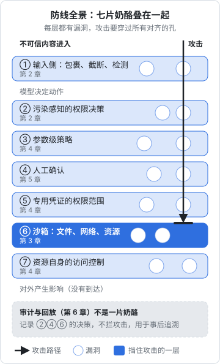

# 安全设计清单

前六章各讲了一层防线。这一章把它们收拢成可以直接使用的清单：先给一份按生命周期组织的总清单，再按四种常见的 agent 形态给出精简版，然后用一个完整的例子把整本书走一遍，最后列出常见的反模式。

清单的用法：新做一个 agent、给已有 agent 加新工具、或者每隔一段时间复查时，逐条过一遍。每一条后面标了对应章节，拿不准时回去看原因。不是每一条都必须做到，但每一条没做的，都应该能在威胁模型的「剩余风险」里说清楚为什么可以接受。

## 防线全景

下图用瑞士奶酪模型回顾整本书的防线是怎样叠在一起的：七层各有漏洞，一次攻击只有在每一层的孔都恰好对齐时才能穿过去。



每一层都可能失效，所以要叠在一起。读这张图时问自己：**如果上面某一层完全失效，下面还有什么能兜住？** 任何一个高风险操作，到达「对外产生影响」之前至少要穿过两道硬约束。

## 总清单

### 设计阶段

- [ ] 写下威胁模型：用途、工具集及副作用等级、资产、不可信入口、出站通道（第 1 章）
- [ ] 三要素检查：私密数据、不可信内容、对外通信，切断了哪一条（第 1 章）
- [ ] 每条防护标明是软约束还是硬约束，高风险威胁至少有一条硬约束（第 1 章）
- [ ] 工具集最小化：每个工具都问「真的需要通过 agent 来做吗」（第 4 章）
- [ ] 不可逆、对外可见的操作，优先设计成「agent 准备，人执行」（第 5 章）
- [ ] 研究类任务和执行类任务能否拆成两个会话（第 2 章）
- [ ] 多用户系统：用户身份由代码注入，不经过模型（第 4 章）
- [ ] 写下剩余风险及接受的理由（第 1 章）

### 构建阶段

- [ ] 每个工具标注：副作用等级、是否返回不可信内容、能否外泄（第 2 章）
- [ ] 实现污染跟踪：被污染后禁止外泄、写操作升级确认（第 2 章）
- [ ] 参数级约束集中在策略函数里，并有单元测试（第 4 章）
- [ ] 路径先解析再判断，URL 用解析器，命令用参数数组不经过 shell（第 4 章）
- [ ] 工具返回值包裹、标注来源、截断（第 2 章）
- [ ] 拒绝原因写给模型看，告诉它下一步该怎么做（第 2、4 章）
- [ ] 确认界面展示代码生成的事实，能演练的先演练（第 5 章）
- [ ] 批准绑定参数哈希、有时效、一次性（第 5 章）
- [ ] 模型没有任何能批准、能改权限、能改自身配置的工具（第 5 章）
- [ ] 审计事件覆盖：工具调用、决策、批准、污染、副作用、配置版本（第 6 章）
- [ ] 注入样本（用无害的占位动作）进回归集（第 2 章）

### 部署阶段

- [ ] 选对隔离层级：交互式用 OS 沙箱，无人值守用容器，不可信代码用虚拟机（第 3 章）
- [ ] 沙箱内看不到真实家目录，配置路径和 git hooks 只读（第 3 章）
- [ ] 网络默认断开或只走白名单代理，白名单每个域名都有理由（第 3 章）
- [ ] 没有 docker.sock、privileged、host 网络、整个家目录挂载（第 3 章）
- [ ] 沙箱自检脚本通过才启动 agent（第 3 章）
- [ ] agent 用专用身份：专用系统用户、细粒度令牌、只读数据库角色（第 4 章）
- [ ] 资源侧访问控制到位：分支保护、行级安全、按资源限定的云令牌（第 4 章）
- [ ] 令牌设过期时间，不给修改 CI 的权限（第 4 章）
- [ ] 预算：最大轮数、最大花费、写操作频率、运行时长（第 4 章）
- [ ] 第三方 MCP server 和依赖锁定版本，工具定义钉住哈希（第 2、3 章）
- [ ] 审计日志在 agent 写不到的地方，落盘前脱敏（第 6 章）

### 运行阶段

- [ ] 中止开关可用，且不依赖 agent 配合（第 5 章）
- [ ] 定期看审计信号：污染后被拒、大量 deny、脱敏命中、出站拒绝（第 6 章）
- [ ] 定期看确认的批准率和决策时间，调整确认点（第 5 章）
- [ ] 定期复查 agent 的所有令牌、角色、权限规则（第 4 章）
- [ ] 改 prompt、换模型、改策略后跑回归集和录像回放（第 6 章）
- [ ] 事故处置流程写下来：止损、保全、评估、修复、定位、加固（第 6 章）
- [ ] 工具集变化时更新威胁模型（第 1 章）

## 按形态的精简清单

总清单很长。不同形态的 agent，重点不一样：

### 个人编码 agent（Claude Code 等，在自己电脑上交互使用）

| 优先级 | 措施 |
|---|---|
| 必做 | Read 规则拒绝 `.env*`；`git push`、部署脚本放进 ask 或 deny |
| 必做 | `.claude/`、`CLAUDE.md`、CI 配置、`package.json` 的修改需要确认 |
| 必做 | 开启宿主的沙箱模式；`bypassPermissions` 只在容器里用 |
| 建议 | main 分支保护，agent 在分支上工作、你审 diff 后合并 |
| 建议 | 用户级 hooks 写审计日志 |
| 建议 | clone 来的仓库先看 `.claude/` 和 `.mcp.json` 里有什么再打开 |

### 自己写的 MCP server

| 优先级 | 措施 |
|---|---|
| 必做 | 写工具只在显式配置时注册；参数最少、凭证不进参数和返回 |
| 必做 | 路径、URL 在 server 内校验；命令用 `execFile` |
| 必做 | 远程部署：认证、HTTPS、只监听本地、校验 Host |
| 建议 | server 侧限速；返回值标明来源 |
| 建议 | 工具注解如实，但不依赖它做安全判断 |

这部分在[《工具设计与 MCP》第 6 章](../tools-and-mcp/06-auth-and-permissions.md)有完整的展开。

### 无人值守的定时 agent（在服务器上跑的巡检、整理、汇总）

| 优先级 | 措施 |
|---|---|
| 必做 | 容器 + 出站白名单 + 资源上限 + 最长运行时长 |
| 必做 | 专用的最小凭证，能只读就只读 |
| 必做 | 不可逆操作一律不做，只产出报告或待审批的申请 |
| 必做 | 审计日志在容器外；会话结束时汇总推送 |
| 建议 | 流程固定的用「先定计划」模式 |
| 建议 | 远程审批用带认证的 POST，超时即拒绝 |

### 面向用户的 agent 产品

| 优先级 | 措施 |
|---|---|
| 必做 | 用户身份由代码注入，用当前用户的权限执行，一个会话只服务一个用户 |
| 必做 | 资源侧强制租户隔离（行级安全等），不依赖模型 |
| 必做 | 每用户的预算和速率限制 |
| 必做 | 输出渲染禁用 HTML、远程图片、外部链接 |
| 必做 | 污染跟踪；用户上传的内容、检索到的内容都是不可信的 |
| 建议 | 分类、路由类功能用隔离模型 |
| 建议 | 注入样本和真实事故录像进回归集 |

## 一个完整的例子：店主的采购助手

把整本书走一遍。设想给 hatch-counter 加一个采购助手：店主在网页端问「下周要进些什么」，助手查进货记录和库存，给出建议；店主确认后，助手可以生成采购单草稿，并通过企业微信发给对应的供货商。

### 威胁模型

| 项 | 内容 |
|---|---|
| 工具集 | `query_purchases`（只读）、`query_stock`（只读）、`draft_order`（本地可逆：生成草稿）、`send_to_supplier`（外部可见） |
| 资产 | 门店的进货和库存数据；以门店名义给供货商发消息的能力 |
| 不可信入口 | 员工录入的商品名和备注、供货商名称（存储型注入）；进货单识别出的文字 |
| 出站通道 | `send_to_supplier`；网页端渲染的建议文字 |
| 三要素 | 私密数据：有；不可信内容：有；对外通信：有。**三者齐全**，必须处理 |

### 逐层设计

**切断三要素**（第 1、2 章）：对外通信是这个功能的核心，不能完全切断，于是用污染跟踪约束它。查询工具返回的数据包含员工录入的文字，标为 `returnsUntrusted`；`send_to_supplier` 标为 `canExfiltrate`。按第 2 章的策略，被污染的会话里调用 `send_to_supplier` 会被拒绝。

这看起来让功能做不成了，正好引出设计上的调整：**发送不由 agent 执行**。agent 只调用 `draft_order` 生成草稿，草稿出现在网页端的确认界面上，店主点「发送」时，由普通的业务代码（而不是 agent）调用企业微信接口。agent 的工具集里根本没有 `send_to_supplier`。

**约束输出**（第 2 章，配合[《LLM 应用上线》第 7 章](../llmops/07-prompt-injection.md)）：`draft_order` 的参数是严格的 schema：供货商 id 必须是本店已有的供货商、商品 id 必须存在、数量有上下限。agent 无法通过草稿夹带任意文字给供货商，也无法把草稿发给一个它编造的联系人。

**权限边界**（第 4 章）：门店 id 来自登录态，由工具执行层注入；查询用 `agent_readonly` 角色加行级安全；草稿写进一张专门的草稿表，agent 的数据库角色只能往这张表插入，不能改正式的采购单。

**人在回路**（第 5 章）：确认界面展示的是代码从草稿表生成的事实：供货商名、每一行商品和数量、和上周同期的对比、预计金额。agent 写的「建议理由」放在下面，标注为「助手的说明」。数量明显异常的行（比上周多出数倍）高亮。

**沙箱**（第 3 章）：agent loop 跑在 API 服务进程里，本身不执行 shell，也没有文件系统工具。沙箱在这个场景下的作用由「工具集里没有危险工具」代替，这是第 4 章「最有效的权限是不提供能力」的体现。

**审计**（第 6 章）：每次会话记录门店、用户、工具调用、草稿 id；店主发送采购单时，业务日志记录是哪个草稿、谁点的发送。出问题时可以从一条发出去的采购单追溯到生成它的会话。

### 剩余风险

- 员工录入的商品备注可以影响 agent 的「建议理由」，从而误导店主。**接受**：建议理由只是文字，所有数量和金额由代码生成并展示，店主在确认界面上看到的是事实
- agent 可能给出不合理的采购数量。**接受**：这是功能质量问题而非安全问题，由异常高亮和店主确认兜住

这个例子里，最关键的一步不是任何一项具体技术，而是**发现三要素齐全之后，重新划分了 agent 和业务代码的职责**：让 agent 做它擅长的（分析、起草），让确定性的代码做有后果的事（发送）。很多 agent 安全问题，最终都是用这种方式解决的。

## 反模式

| 反模式 | 为什么危险 | 改成 |
|---|---|---|
| 用你自己的令牌、ssh key 给 agent | agent 的能力等于你的全部能力，无法区分和单独吊销 | 专用身份、最小授权 |
| 安全规则只写在 prompt 里 | 软约束，被注入时可能失效 | 至少一条硬约束兜底 |
| 用黑名单拦危险命令 | 命令的写法无穷无尽 | 白名单加沙箱 |
| 一个 agent 读网页、读机密、能发消息 | 三要素齐全 | 拆会话，或用污染跟踪切断外泄 |
| 让模型填写用户 id、租户 id | 注入即越权 | 由代码从登录态注入 |
| 确认框只显示工具名 | 人无法判断，最终无脑同意 | 展示代码生成的效果 |
| 每一步都要确认 | 确认疲劳 | 计划审批加结果审批，低风险进白名单 |
| agent 能改自己的配置和规则文件 | 持久化，拆掉其他防线 | 这些路径 ask 或只读 |
| 跟随最新版本的第三方 MCP server | 批准后定义可能改变 | 锁版本、钉住定义哈希 |
| 审计日志写在 agent 能写的地方 | 出事后记录可能被抹掉 | 放在沙箱外，加哈希链 |
| 出事后先查原因再吊销凭证 | 调查期间损失还在扩大 | 先止损再调查 |
| 指望更强的模型或检测器解决注入 | 降低概率，不改变最坏后果 | 架构层面限制后果 |

## 全书回顾

| 章 | 核心问题 | 一句话答案 |
|---|---|---|
| [威胁模型](01-threat-model.md) | 会出什么事 | 按工具集的最坏后果想，用污染和爆炸半径来衡量 |
| [Prompt 注入](02-prompt-injection.md) | 怎样限制注入的后果 | 污染跟踪；被污染的会话不能外泄 |
| [沙箱](03-sandbox.md) | 绕过了权限怎么办 | 操作系统层面限制文件、网络、资源 |
| [权限边界](04-permission-boundaries.md) | agent 以什么身份做什么 | 专用身份，边界落在离资源最近的地方 |
| [人在回路](05-human-in-the-loop.md) | 什么时候让人拍板 | 按可逆性和影响范围，展示事实，绑定参数 |
| [审计与回放](06-audit-replay.md) | 出事后怎么办 | 可信的记录，可重现的回放，先止损 |

贯穿全书的一句话：**你无法保证模型不被说服，但可以设计系统，让被说服的模型也造不成严重后果。**

## 动手练习

1. **用精简清单检查自己的一个仓库**：挑一个你在用编码 agent 的仓库，对照「个人编码 agent」那张表逐条查。几条可以直接用命令看：

   ```bash
   jq '.permissions' .claude/settings.json
   ls -a .claude .mcp.json 2>/dev/null
   gh api repos/{owner}/{repo}/branches/main/protection --jq '.required_pull_request_reviews != null'
   ```

   验证：得到一张「已做 / 未做」的表；未做的每一项写一句「为什么可以接受」或「什么时候补」。

   参考答案：最常见的缺口是 deny 里没有 `.env*`、`.claude/` 和 CI 配置的修改不需要确认、main 没有分支保护（上面的 `gh api` 会返回 404 和 `Branch not protected`）。

2. **打开陌生仓库前先看它的 agent 配置**：写两条命令，列出一个仓库 `.claude/settings.json` 里所有 hooks 会执行的命令，以及 `.mcp.json` 里每个 MCP server 的启动命令。自己造一个带一条 hook 和一个 server 的测试仓库来验证。

   ```bash
   jq -r '[.hooks // {} | .. | .command? // empty] | .[]' .claude/settings.json
   jq -r '.mcpServers // {} | to_entries[] | "\(.key): \(.value.command) \(.value.args // [] | join(" "))"' .mcp.json
   ```

   验证：输出里能看到你在测试仓库里写的 hook 命令和 server 启动命令，每条一行。

   参考答案：hooks 和 MCP server 都会以你的身份执行命令，clone 来的仓库在打开之前就该看一眼，这是清单里「先看 `.claude/` 和 `.mcp.json`」那一条的具体做法。

3. **用清单分析一个定时 agent**：设想一个「团队日报」agent，每天早上读团队私有仓库里新开的 issue，汇总后发到群里。说出三要素是否齐全、按「无人值守的定时 agent」清单该怎么改。

   验证：答案里至少有一条硬约束，并且说明发送这一步由谁执行。

   参考答案：私有 issue 是私密数据，issue 正文是不可信内容（任何有权限的人都能写），发群消息是对外通信，三者齐全。参照采购助手的例子：agent 只做分类计数，输出严格的 schema（标签、数量、issue 编号）；群消息由确定性代码按 schema 拼出标题和链接后发送，不让模型的自由文本直接进群。

## 接下来读什么

- 想把这些原则用到每天在用的编码 agent 上：[《编码 Agent 实战》](../coding-agents/)，尤其是 hooks 和常见坑两章
- 想让 agent 接手更多日常工作，同时控制好放权的程度：[《个人 Agent 工作流》](../personal-agent-workflow/)，其中让 agent 做运维一章讲了分级放权
- 想自己从零写一个 agent，把污染跟踪、审批、审计都实现进去：[《动手构建 Agent》](../build-your-agent/)
- 想从更高的视角理解对齐、能力边界和人机分工：[《AI 认知进阶》](../ai-cognition/)

## 本章要点

- 防线要叠加，任何高风险操作到达外部之前至少穿过两道硬约束
- 总清单按设计、构建、部署、运行四个阶段组织；没做的条目要在剩余风险里说明理由
- 不同形态的 agent 重点不同：个人编码 agent 管配置和机密，MCP server 管工具和认证，定时 agent 管隔离和凭证，面向用户的产品管租户隔离和渲染
- 三要素齐全时，最有效的办法往往是重新划分职责：agent 分析和起草，确定性的代码执行有后果的操作
- 反模式的共同点是把安全寄托在模型的判断上；改法的共同点是把边界移到模型之外
