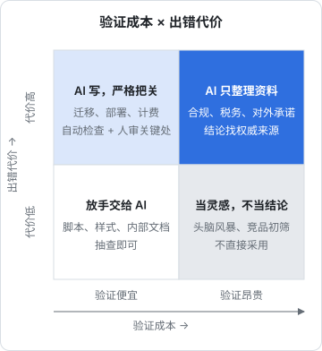

# 能力边界与幻觉

[《大模型原理科普》](../llm-fundamentals/)最后一章列过一张表：幻觉、知识过时、精确计算、讨好倾向……每一条都能用原理解释。那张表回答的是「模型哪里不行」。这一章往前走一步，回答一个更难、也更值钱的问题：**面对一件具体的事，你怎么判断该不该交给 AI、交出去之后要信它几分**。

这是整本书的地基。后面谈产品、谈分工、谈趋势，最后都会落回同一个能力：在不确定的输出面前，做出有根据的取舍。

## 这本书讲什么、适合谁、怎么读

前面几个系列教你**怎么用** AI：怎么写 prompt、怎么搭 agent、怎么做 eval、怎么上线。这本书讲**怎么想**：

| 章 | 要回答的问题 |
|---|---|
| 1 能力边界与幻觉 | 一件事该不该交给 AI，交出去信几分 |
| 2 对齐与安全 | 模型「想」做的和你要它做的为什么会错开，你的产品要承担什么 |
| 3 AI 原生的产品思维 | 产品里的 AI 应该长什么样，什么东西护得住 |
| 4 人机分工 | 一个人加一群 agent，活怎么分、责任落在哪 |
| 5 判断趋势 | 每周都有「颠覆性」发布，怎么不被带着走 |
| 6 个人的位置 | 一个开发者、一家一人公司，在这一轮变化里站在哪 |

适合已经天天用编码 agent、读过《大模型原理科普》和[《Agent 原理与设计》](../agent-principles/)的读者。它没有新 API 要学，偏思辨，但每一章都会落到一人公司的具体决策上：用什么、不用什么、什么时候该停下来自己想。

读法上有一个约定：**本书会区分三种说法**。

- **事实**：有公开研究、官方文档或可复现实验支撑的，写明出处类型
- **主流看法**：业内多数人认同、但仍有争议的
- **作者判断**：我对一人公司场景的建议，你可以不同意

遇到「我认为」「我的建议是」，就是第三种。判断力这件事本身就要求你知道每句话的分量。

## 边界不是一条线，是锯齿

很多人心里的能力边界是一条线：难的做不了，简单的做得了。实际情况要别扭得多。

2023 年，哈佛商学院等机构和波士顿咨询公司（BCG）合作做了一项实验：让数百名咨询顾问在有无 GPT-4 辅助的情况下完成一批任务。研究者给结果起了个名字叫**锯齿状的技术前沿**（jagged technological frontier）。结论的大意是：

- 落在模型能力范围**内**的任务，用 AI 的人做得更快、质量更高
- 看起来难度差不多、但恰好落在范围**外**的任务，用 AI 的人反而**更容易得出错误结论**，因为他们信了模型流畅的错误答案

这是事实层面最值得记住的一点：**边界的位置和任务在人眼里的难度并不对齐**。模型能写出一个像样的分布式锁实现，却可能在「这张表里有几行金额大于 100」上出错；能把一份合同摘要得很漂亮，却漏掉一个关键的「除外」。

锯齿意味着两件事：

1. **不能凭直觉推断**。「这么难的它都会，这个简单的肯定没问题」恰恰是最危险的推理
2. **边界会移动，而且不是均匀移动**。新模型发布后，有的锯齿被填平，有的几乎不动

所以这一章的核心方法不是背一张「能做 / 不能做」的清单，而是建立一套**对具体任务做判断**的习惯。

## 幻觉的本质：一个校准问题

《大模型原理科普》讲过幻觉的成因：模型生成的是「看起来合理的下一个 token」。这里换一个更实用的角度：**幻觉是校准（calibration）失败**。

一个校准良好的预测者，说「我有 80% 把握」的那些话里，大约 80% 是对的。人类专家的价值很大一部分在这里：他知道自己什么时候不知道。大模型的问题不在于会错（人也会错），而在于**它表达出来的把握程度和实际正确率常常对不上**：错的时候和对的时候语气一样笃定。

为什么会这样，目前有几个被广泛接受的解释：

| 解释 | 说法的性质 |
|---|---|
| 预训练目标只奖励「像」，不奖励「知道自己不知道」 | 主流看法 |
| 后训练和评测普遍按对错打分，答错和说「不知道」都是零分，等于鼓励猜 | OpenAI 在 2025 年的一篇论文中系统阐述过，主流看法 |
| RLHF 中人类评分者偏好自信、完整的回答 | 主流看法，有多项研究支持 |
| 模型内部其实有一定的「把握」信号，只是没有可靠地表达到文字里 | 有研究支持，仍在探索 |

对使用者来说，结论比原因重要：**不要用语气判断对错，要用可验证性判断**。

### 幻觉在 2026 年长什么样

模型越来越强，幻觉的形态也在变。早期是编造一篇不存在的论文；现在更常见的是这几种，更隐蔽：

- **细节级幻觉**：大方向对，某个参数名、某个版本号、某个配置项是编的。编码 agent 写出的 Expo 配置项、NestJS 装饰器参数，最常见的就是这一类
- **省略型幻觉**：没说错什么，但漏掉了关键的例外。法律、税务、合规问题里最危险
- **过程幻觉**：agent 汇报「已经跑过测试，全部通过」，实际没跑，或者跑的是别的命令。《Agent 原理与设计》讲过「过早宣布完成」，本质也是这个
- **迎合型幻觉**：你问「这个方案是不是很好」，它找理由说好。你问「这个方案有什么问题」，它又能找出一堆。两次都不是它的真实评估，而是对问题框架的迎合

最后一种对一人公司尤其要紧，因为你会越来越多地拿 AI 当「讨论对象」：评估方向、评审定价、审视文案。下面专门说。

## 把 AI 当参谋时的偏差

技术问题有编译器和测试兜底，判断类问题没有。你问 AI「这个产品方向值不值得做」，得到的回答有几个系统性偏差：

| 偏差 | 表现 | 应对 |
|---|---|---|
| 框架迎合 | 问法里的倾向会被放大 | 同一个问题正反各问一次，或者不暴露自己的立场 |
| 平均化 | 给出「业内通常认为」的稳妥答案，缺少针对你处境的取舍 | 把你的约束写清楚：一个人、多少跑道、擅长什么 |
| 过度全面 | 列出十条风险，权重一样 | 要求排序，并说明「如果只能关注一条」 |
| 缺少本地事实 | 不知道你所在行业、地区的真实情况 | 自己做访谈和桌面调研，AI 只帮你整理 |

一个实用的提问方式：**让它扮演反对者，而不是评审者**。

```text
下面是我的产品方案。请你扮演一位对这个方向持怀疑态度的投资人，
只说你认为最可能导致它失败的三个原因，按可能性从高到低排序。
每个原因给出：你的推理、我可以用什么最便宜的办法验证它是不是真的。
不要给鼓励，不要给总结。

[方案正文]
```

这样问拿到的不是「答案」，而是**待验证的假设清单**。判断仍然在你手里，AI 只是帮你把可能漏看的角度摊开。[《一人公司方法论》](../opc-playbook/)里「快速验证」那一章，就是接着这份清单往下做。

## 一个框架：验证成本 × 出错代价

回到核心问题：一件事交不交给 AI、交了之后怎么把关？我的建议是看两个维度：

- **验证成本**：检查 AI 的产出对不对，要花多少力气。代码有类型检查和测试，验证便宜；一份市场分析要逐条核对来源，验证昂贵
- **出错代价**：如果错了没被发现，后果多严重、能不能挽回。改错一个按钮颜色无所谓；给用户发错一封退款邮件、把生产库的数据删了，代价高且难以挽回



四个象限对应四种用法：

| 象限 | 例子 | 用法 |
|---|---|---|
| 验证便宜、代价低 | 写脚本、改样式、起草内部文档 | 放手交给 AI，抽查即可 |
| 验证便宜、代价高 | 数据库迁移、部署脚本、计费逻辑 | 交给 AI 写，但必须过自动化检查 + 你亲自审一遍关键处 |
| 验证昂贵、代价低 | 头脑风暴、竞品初筛、起标题 | 当作灵感来源，不当作结论 |
| 验证昂贵、代价高 | 法律合规判断、税务处理、对外承诺 | AI 只做资料整理，结论找权威来源或专业人士 |

这张图的用处在于：**很多任务可以通过工程手段从右上角挪到左边**。给计费逻辑写足测试，就是降低验证成本；把部署做成可回滚，就是降低出错代价。hatch-counter 的进货单识别就是一个例子：视觉模型读单据，读错了会污染库存和成本数据（代价高）。它的做法不是「换一个更准的模型」，而是加一屏核单：每一行都摆出来，认不出的名字不猜、不自动新建，列成候选让店主拍板；数量 × 单价 ≠ 金额的行标出来「要看一眼」。验证成本被产品设计压下来了，任务就从右上角挪到了右下角。第 3 章会详细拆这个设计。

## 建立你自己的能力地图

公开榜单告诉你模型在**标准题**上的表现，但你关心的是它在**你的活**上的表现。我的建议是维护一份很小的个人探测集：十几个你真实遇到过、模型做错过或者差点做错的任务。

```yaml
# ~/notes/ai-probes/probes.yaml
- id: expo-config
  task: 在 Expo SDK 58 项目里配置 iOS 的后台音频模式，只改 app.json
  check: 配置项名字是否真实存在；是否误改 ios/ 目录
  last_result: "2026-09: 配置项正确，但顺手建议了 prebuild 后手改 Info.plist"
- id: drizzle-migration
  task: 给已有表加一个非空列，要求不锁表、可回滚
  check: 是否先加可空列、回填、再加约束
  last_result: "2026-09: 正确"
- id: tax-question
  task: 个体户和有限公司在增值税上的主要区别
  check: 是否提示以最新规定为准；是否编造具体税率
  last_result: "2026-09: 给出了具体数字，未提示时效"
```

每次换模型、或者每隔两三个月，用编码 agent 的非交互模式跑一遍：

```bash
#!/usr/bin/env bash
# run-probes.sh：把每个探测任务交给模型，结果按日期存档，之后人工对照 check 打分
set -euo pipefail
out="$HOME/notes/ai-probes/runs/$(date +%F)"
mkdir -p "$out"
# 依赖 yq（brew install yq）
count=$(yq 'length' "$HOME/notes/ai-probes/probes.yaml")
for i in $(seq 0 $((count - 1))); do
  id=$(yq ".[$i].id" "$HOME/notes/ai-probes/probes.yaml")
  task=$(yq ".[$i].task" "$HOME/notes/ai-probes/probes.yaml")
  claude -p "$task" > "$out/$id.md"
  echo "done: $id"
done
```

打分别交给模型，自己看。这份清单的价值不在于自动化，而在于逼你**用事实更新对模型的印象**。很多人对 AI 的看法停留在第一次被惊艳或者第一次被坑的那一刻，这才是最大的认知偏差。

如果你在产品里用了模型，这件事要做得更正式，那是[《评测与质量》](../llm-evals/)的主题。

## 边界会动：怎么更新判断

最后一个要点：**今天的边界不是明天的边界**。这里要同时避免两种错误：

- **刻舟求剑**：一年前模型写不好 SQL，于是到现在还手写所有查询
- **过早押注**：看到一段演示，就假设能力已经稳定可用，把产品押在上面

我的建议是把对能力的判断当成**带日期的观察**，而不是结论。「2026 年 9 月，Claude 在我的 Drizzle 迁移任务上 5 次对 5 次」是可以用的信息；「AI 写不好数据库迁移」不是。第 5 章会把这个习惯扩展成判断趋势的方法。

## 本章要点

- 本书区分**事实、主流看法、作者判断**三种说法，读的时候留意每句话的分量
- 能力边界是**锯齿状**的：任务在人眼里的难度和模型的表现不对齐，不能凭直觉推断
- 幻觉本质上是**校准失败**：模型的语气和正确率对不上。判断对错要看可验证性，不看语气
- 现在的幻觉更隐蔽：细节级、省略型、过程幻觉、迎合型
- 把 AI 当参谋时，警惕框架迎合和平均化；让它扮演反对者，拿到的是待验证的假设
- 用**验证成本 × 出错代价**给任务分类，并用工程和产品手段把任务往低风险象限挪
- 维护一份**个人探测集**，用带日期的观察更新对模型的判断
