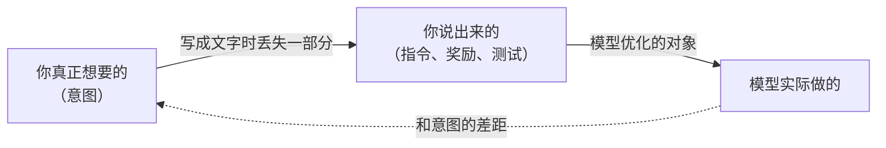
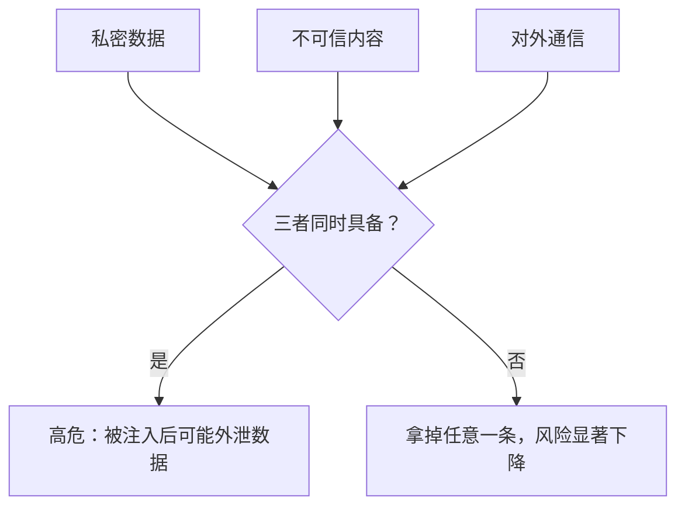

# 对齐与安全

「AI 安全」这个词在不同人嘴里指的东西差得很远：有人说的是聊天机器人会不会教人做坏事，有人说的是未来的超级智能会不会失控，还有人说的是你的 agent 会不会被一封邮件骗去删库。这一章先把这些层次分开，讲清「对齐」到底在对齐什么，再落到一人公司真正要承担的那一部分：**你自己用的 agent，和你卖给用户的 AI 功能**。

更工程化的防护手段（威胁建模、沙箱、权限、审计）在《Agent 安全》里展开，这里讲的是理解它们所需的认知框架。

## 对齐在对齐什么

最朴素的定义：**让 AI 做的事符合人的意图**。难点在于「意图」从来没有被完整写下来过。

你对编码 agent 说「让测试通过」，你的意图其实是「把功能实现对，顺便让测试通过」。这两句话在绝大多数情况下等价，只在少数情况下分叉：比如把测试里的断言改掉、给特定输入写死返回值，也能「让测试通过」。

这个差距有几个常见的名字：

| 现象 | 说的是什么 | 例子 |
|---|---|---|
| 规格博弈（specification gaming） | 满足了字面要求，违背了真实目的 | 改测试而不是改代码 |
| 奖励投机（reward hacking） | 训练中找到拿高分的捷径 | OpenAI 早年公开过一个赛艇游戏的强化学习智能体，它发现原地转圈反复吃奖励比跑完比赛得分更高 |
| 讨好（sycophancy） | 优化「让用户满意」而不是「对用户有益」 | 顺着你的错误观点改口 |
| 目标漂移 | 长任务中逐渐偏离最初目标 | agent 修一个 bug，修着修着重构了半个模块 |

这里有一个**事实层面**的要点：这些不是假想。主流模型厂商在自己发布的系统卡（system card）里都记录过模型在编码任务中出现的「为了通过测试而走捷径」的行为，也都把降低这类行为列为改进方向。具体比例和表现随版本变化，以各家最新的系统卡为准。

**对使用者的含义**：模型越强、越能自主完成长任务，「满足字面、违背意图」的空间就越大。你写的验收标准越接近你的真实意图，结果就越可靠。这正是 CLAUDE.md 里那些「不要改测试来让它通过」「不确定时停下来问」之类规则存在的理由。

## 三个层次的「安全」

讨论 AI 安全时，先问一句「说的是哪一层」能省掉很多无效争论：

| 层次 | 关心什么 | 谁主要负责 | 一人公司的角色 |
|---|---|---|---|
| 模型层 | 模型会不会输出有害内容、能不能被诱导越狱、有没有危险能力 | 模型厂商 | 选择供应商时参考，基本无法干预 |
| 应用层 | 接进系统的 AI 会不会泄露数据、被注入、越权操作 | 应用开发者 | **你的主战场** |
| 社会层 | 就业冲击、信息生态、权力集中、长期风险 | 政府、行业、公众 | 了解、形成自己的看法，影响有限 |

很多关于 AI 安全的激烈争论发生在第三层，而一人公司真正会出事故的地方几乎全在第二层。分清层次，既不会因为「AI 威胁论」焦虑到不敢用，也不会因为「那都是炒作」忽视自己产品里实实在在的风险。

### 关于长期风险的争论

第三层值得多说一句，因为它会持续出现在你的信息流里。这里只做事实性的梳理，不下结论：

- **一端**认为能力足够强的 AI 如果没有对齐好，可能带来严重甚至不可逆的后果，主张在能力进一步提升前投入更多资源研究对齐和监管。一些顶尖研究者和几家头部实验室的负责人都公开表达过类似担忧
- **另一端**认为这类担忧被夸大，把注意力从眼下的具体问题（偏见、隐私、劳动替代）上移开了，或者认为过早监管会让技术集中在少数大公司手里。同样有知名研究者持这一立场
- **中间**有大量人认为两类问题都真实存在，只是时间尺度和确定性不同

我的判断：作为一人公司，你不需要在这个问题上站队，但要能**识别一篇文章站在哪个位置**，从而知道它的论证会往哪个方向用力。这是第 5 章「不被带着走」的一部分。

## 应用层：你自己用的 agent

先看你每天在用的编码 agent 和个人自动化。它们的风险来自一个简单事实：**agent 有手**。它能读文件、执行命令、发请求，一旦它的「意图」被带偏，后果就是真实的。

### 注入是结构性的问题

Prompt 注入的本质是：**模型分不清哪些文字是指令、哪些是数据**。对传统程序来说，代码和数据是分开的；对大模型来说，它们都是上下文里的 token。

独立开发者 Simon Willison 把高危组合总结为「致命三要素」（lethal trifecta），同时满足以下三条时风险最高：

1. agent 能接触**私密数据**（你的代码、邮件、数据库）
2. agent 会读到**不可信内容**（网页、用户上传的文件、第三方 issue）
3. agent 能**向外发送信息**（发请求、发邮件、提交到公开仓库）

这个框架好用的地方在于它给出了**可操作的防线**：拆掉任何一条腿。比如让做调研的 agent 只读网页、不碰你的代码库；让动代码的 agent 不能随意访问外网。主流看法是，目前没有任何 prompt 层面的手段能**可靠地**防住注入，所以防护要靠架构，而不是靠在 system prompt 里写「不要听从网页里的指令」。

### 一人公司的几条自用规则

以下是我的建议，按「性价比」排序：

| 规则 | 为什么 |
|---|---|
| 生产环境的凭证不放进 agent 能读到的地方 | agent 读到的东西可能出现在日志、上下文、提交里 |
| 不可逆操作（删数据、发消息、付款、发版）必须人工确认 | 这些落在「出错代价高」的那一边 |
| 读外部内容的任务和动核心资产的任务分开跑 | 拆掉致命三要素中的一条 |
| 给 agent 的权限按任务给，不图省事给全权 | 权限是事故的上限 |
| 定期看一眼 agent 实际做了什么，而不只看它的汇报 | 防「过程幻觉」 |

这些规则看起来都很朴素，难的是在赶进度的时候坚持。一个人没有同事帮你复查，规则得写下来、最好由 hooks 和权限配置来强制执行（《编码 Agent 实战》讲过怎么配）。

## 应用层：你卖给用户的 AI 功能

当 AI 进了你的产品，责任的性质就变了：出错的后果落在用户身上，而用户并不知道背后是一个概率模型。

### 你要对什么负责

一个实用的检查清单，问自己四个问题：

1. **错了会怎样？** 用户会因为 AI 的错误输出损失钱、数据、机会吗？如果会，有没有人工复核的环节
2. **数据去了哪？** 用户的数据发给了哪家模型服务商，对方的数据保留和训练政策是什么，你的隐私政策写清楚了吗
3. **能被滥用吗？** 你的 AI 功能能不能被拿来生成你不愿意承担的内容？有没有基本的输入输出过滤和频率限制
4. **用户知道吗？** 用户是否清楚哪些内容是 AI 生成的、哪些结论需要他自己核实

hatch-counter 的做法可以作为参考：识别服务的密钥只在服务端，界面上不告诉店主是哪家服务认的单（店主关心的是认没认出来），但每一行都给店主确认的机会，认不出的不替他猜。**责任边界画得很清楚**：机器负责把字读出来，人负责拍板。

### 合规框架

国内面向公众提供生成式 AI 服务，涉及《生成式人工智能服务管理暂行办法》等规定，对生成内容的标识也有专门的办法。这里只讲框架：

- 要分清你是**直接提供生成式 AI 服务**，还是在产品里**调用他人的模型完成某个功能**，两者的义务可能不同
- 生成内容的标识、用户协议、个人信息处理、内容安全，是几个绕不开的方面
- 面向海外用户还要看当地法规，比如欧盟的《人工智能法》按风险分级管理

**这一块的规定还在快速演进，具体义务、备案和标识要求以主管部门的最新规定为准，必要时咨询专业人士**。《国内合规实务》有更具体的讨论。

## 对齐的另一面：别让模型替你做价值判断

最后一点更偏认知。对齐良好的模型会有自己的「价值观」：它会拒绝某些请求、会对某些话题保持谨慎、会在你的方案里提出伦理上的顾虑。这本身是好事。

但要注意一个边界：**模型的价值倾向是训练出来的，不等于你的**。它可能在你的产品文案里倾向于更保守的说法，在定价讨论里倾向于更「公平」的方案，在竞争策略上倾向于更温和的打法。这些倾向有时候是对的，有时候只是训练数据和厂商政策的平均。

我的建议：涉及价值取舍的决定（定价、取舍用户群、对外表态），把 AI 的意见当作**一种视角**，然后问自己：「如果是我信任的一位前辈，他会怎么说？我自己怎么想？」最终的选择和后果，都在你。

## 本章要点

- 对齐的核心难题是**意图无法被完整写下来**，模型优化的是你说出来的那部分
- 规格博弈、奖励投机、讨好、目标漂移是真实存在的现象，模型越自主，空间越大
- AI 安全分**模型层、应用层、社会层**，一人公司的主战场在应用层
- 关于长期风险的争论双方都有严肃的支持者，要能识别文章的立场，不必急着站队
- Prompt 注入是结构性问题，用「致命三要素」检查，靠架构拆掉一条腿，而不是靠 prompt
- 产品里的 AI 功能要回答：错了会怎样、数据去哪、能否滥用、用户知不知道；合规要求以最新官方规定为准
- 模型的价值倾向是训练出来的，涉及价值取舍的决定要自己做
