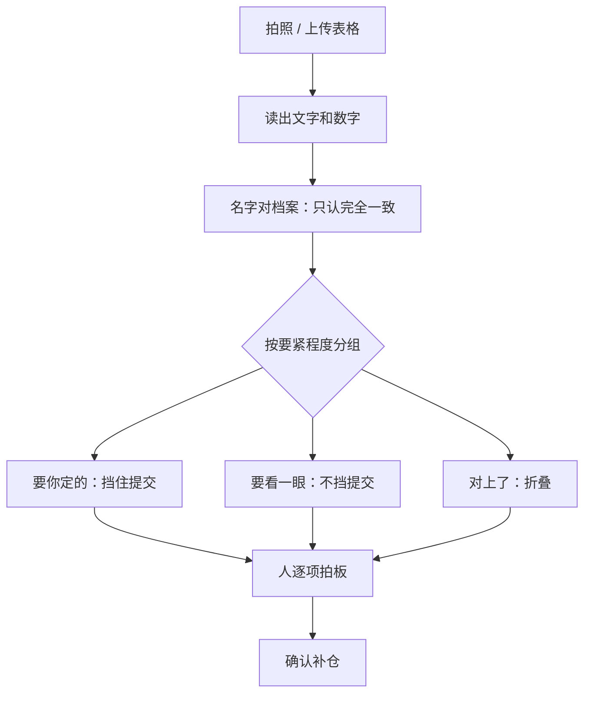

# AI 原生的产品思维

「我们的产品也加了 AI」是这几年最常见的发布标题，大部分时候指的是右下角多了一个聊天框。这一章讨论另一种思路：**把 AI 的特性当作产品设计的出发点**，而不是贴在现有产品上的功能。

具体会讲三件事：概率性的输出要求什么样的交互，AI 改变了哪些成本结构，以及当模型能力人人可买时，一人公司的产品靠什么站住。需求分析、MVP、优先级这些通用的产品方法在《产品思维》里，这里只讲 AI 带来的不同。

## 从「确定性软件」到「概率性软件」

传统软件的承诺是：同样的输入，同样的输出；按钮点下去，事情就按写好的逻辑发生。用户对它的信任建立在**可预测**上。

接入大模型的功能打破了这个承诺：同样的照片今天认出 7 行，换个角度可能认出 6 行；同样的问题，回答措辞每次不同；绝大多数时候对，偶尔错得离谱。

这带来一个根本性的设计转变：

| | 确定性软件 | 概率性软件 |
|---|---|---|
| 正确性 | 写对了就一直对 | 只能说「大部分时候对」 |
| 出错方式 | 报错、崩溃，用户知道出错了 | 输出一个看起来正常的错误结果，用户可能不知道 |
| 测试 | 单元测试覆盖逻辑 | 要靠测试集统计质量（见《评测与质量》） |
| 用户的角色 | 操作者 | 操作者 + 审核者 |
| 设计重点 | 流程顺畅 | 流程顺畅 + **让错误容易被发现和纠正** |

最后一行是关键。**AI 原生的产品，设计重心从「怎么生成」移到了「怎么审核」**。

## 为审核而设计：拆一个真实案例

hatch-counter 的「拍单补仓」是一个很好的例子。门店收到供货商的纸质进货单，拍张照，视觉模型把单据读成结构化数据，补进库存，顺带记一笔采购开支。

最朴素的做法是：识别 → 直接入库。问题显而易见：读错一个数，库存和成本就错了，而且没人知道。

它实际的设计是在识别和入库之间放一屏「核单」，这屏的几个决定都值得一人公司参考：

拆开看：

- **不猜**。名字对不上档案时，不自动新建、不模糊匹配，列成候选让人选。猜对了省一秒，猜错了污染整条数据链，这笔账不划算
- **按要紧程度排序，而不是按单据顺序**。认出名字但数没认出的排最上，然后是「要你定的」，再是「要看一眼」（比如数量 × 单价 ≠ 金额），最后才是对上了的。人的注意力是最贵的资源，先花在最可能出错的地方
- **区分「挡住」和「提醒」**。单位认不出会挡住提交（否则「豆腐 12 板」可能被当成 12 克，库存差几百倍）；金额对不上只提醒，因为单据本身可能就是手写算错了
- **每一格都能改**。审核者要能就地纠正，而不是退回去重来
- **用模板提高源头质量**。提供一份打印用的空白进货单，一格一个值、列顺序固定，识别率自然更稳。与其让模型适应混乱的输入，不如在能控制的地方让输入变规整

这些决定背后是同一个思路：**承认模型会错，然后把「发现错误」的成本压到最低**。这比换一个更准的模型更可靠，因为再准的模型也有错的时候，而好的审核流程对所有模型都有效。

### 几条通用原则

从这个案例可以抽出几条适用于大多数 AI 功能的原则（作者判断，但都有大量产品实践支持）：

| 原则 | 做法 |
|---|---|
| 让 AI 的产出可检查 | 把结果摊开成可逐项核对的结构，而不是一段话 |
| 把不确定性暴露出来 | 拿不准的地方明确标出，不要包装成确定的样子 |
| 人的修改要便宜 | 就地编辑、一键撤销，不要「全部重来」 |
| 不可逆操作前有确认 | 入库、发送、付款之前给人最后一眼 |
| 有降级路径 | 模型服务挂了，用户还能手工完成任务（hatch-counter 读表格不经过第三方服务，没配识别的店照样能补仓） |
| 保留原始输入 | 原图存档，出了问题能回溯 |

## AI 改变了成本结构

传统 SaaS 有一个好性质：软件写好后，多服务一个用户的边际成本几乎为零。AI 功能打破了这一点，**每一次调用都要花钱**，而且花多少取决于用户怎么用。

这对一人公司的影响很直接：

- **重度用户可能亏钱**。按月固定收费，一个用户每天调用几百次，模型费用可能超过他付的钱
- **成本会随模型降价而下降**。主流看法是，同等能力的模型调用价格过去几年下降得很快。今天勉强打平的功能，一年后可能利润可观；反过来，今天按高价设计的定价，可能被更便宜的竞争者击穿
- **选模型是产品决策，不只是技术决策**。用最强的模型还是够用的模型、要不要缓存、要不要先用便宜模型过滤一遍，直接决定毛利

因此在设计 AI 功能时，我建议从一开始就记录每个用户、每个功能的模型调用成本（《LLM 应用上线》讲了怎么做），并在定价里留出缓冲：用量上限、按量计费、或者把高成本功能放进更高的档位。《定价与商业模式》有更系统的讨论。

## 护城河在哪里

这是独立开发者最常问的问题：**模型能力人人都能买，我做的东西别人用同样的 API 一周就能复制，那我靠什么？**

先说一个事实：任何人都能调用同样的前沿模型。所以「我用了 AI」本身不构成任何优势。

再说主流看法：真正的壁垒通常在模型之外。下面这张表是我对一人公司场景的整理：

| 壁垒 | 说明 | 一人公司能做到吗 |
|---|---|---|
| 对某个行业的深度理解 | 知道店主真正在意什么、单据长什么样、哪些错误最要命 | 能，而且是最主要的优势 |
| 工作流嵌入 | 产品成了用户日常流程的一部分，换掉要重新适应 | 能，需要时间 |
| 专有数据 | 用户使用中积累的、别人拿不到的数据（如各家供货商的单据模板） | 能，要注意合规 |
| 信任与口碑 | 用户相信你不会乱用他们的数据、出了问题会负责 | 能，一人公司反而有优势 |
| 分发渠道 | 你能触达目标用户，而别人不能 | 看个人积累 |
| 模型本身 | 自己训练出更好的模型 | 基本不能，也不必 |

hatch-counter 的价值几乎全在第一行：它知道「10 斤」不应该逼店主先换算成 5000 克，知道单位认错会让一样料的进价涨穿，知道月结的采购要记成「没付」。这些知识写在产品的每一个细节里，换个开发者用同样的模型很难一周复制。

### 「下一个模型发布会杀死我吗」

一个有用的思考实验：**假设下个月的模型比现在强一倍，你的产品会更好还是会变得多余？**

- 如果你的产品主要在**弥补模型的缺陷**（比如复杂的 prompt 链只为让模型把格式输出对），模型变强后这部分价值会被吞掉
- 如果你的产品主要在**把模型能力接到具体场景里**（行业知识、审核流程、数据管道、用户信任），模型变强后你的产品跟着变强

这不是说不能做弥补缺陷的工作，产品总得今天就能用。而是说，**在分配精力时，往第二类倾斜**。这是创业圈里流传很广的一条建议，我认为对一人公司尤其适用：你没有资源和模型厂商赛跑。

## 什么时候不该用 AI

最后一个容易被忽视的问题。AI 原生不等于处处 AI，下面这些情况用确定性的代码往往更好：

- 规则明确、可以穷举的逻辑（税额计算、库存加减、权限判断）
- 对一致性要求极高的地方（同样的输入必须同样的输出）
- 调用频率极高、单次价值极低的操作
- 用户明确希望可预测的地方

hatch-counter 里，读表格（Excel / CSV）直接读格子，不经过任何模型；名字匹配只认完全一致，不用模型做模糊匹配。**AI 只用在确实需要「理解」的那一段**，也就是从照片里认字。其他地方，代码比模型更快、更便宜、更可靠。

## 本章要点

- AI 功能是**概率性软件**：大部分时候对，错的时候看起来很正常
- AI 原生的产品，设计重心从「怎么生成」移到「怎么审核」：可检查、暴露不确定性、修改便宜、有确认、有降级
- 承认模型会错、压低发现错误的成本，比换更准的模型更可靠
- AI 让边际成本不再为零，选模型、定价、用量控制都是产品决策
- 壁垒在模型之外：行业理解、工作流嵌入、专有数据、信任、分发
- 问自己「模型强一倍，我的产品会更好还是变多余」，把精力往前者倾斜
- 规则明确、要求一致、高频低值的地方，用确定性代码而不是 AI
