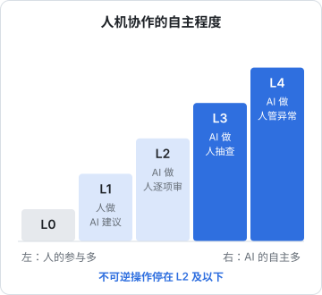
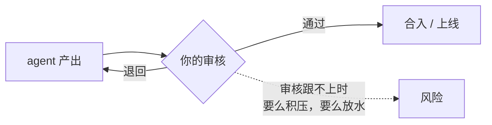

# 人机分工

一人公司的「一人」越来越名不副实：你身后有编码 agent、写作助手、定时跑的自动化任务。问题不再是「要不要用 AI」，而是**一个人加一群 agent，活怎么分**：哪些放手、哪些盯着、哪些必须自己来，以及怎么防止自己在这个过程中慢慢变成一个只会点「确认」的人。

《个人 Agent 工作流》讲了怎么把活拆成 agent 能接的形状，这一章讲拆之前的判断：分工的原则、自动化的陷阱，以及责任最终落在哪。

## 自动化的反讽

先讲一个比大模型早四十年的发现。1983 年，认知心理学家 Lisanne Bainbridge 发表了一篇题为《自动化的反讽》（Ironies of Automation）的论文，讨论工业控制系统的自动化。核心观点至今被反复引用：

1. **自动化越完善，人越少动手，技能越生疏**；而系统把控制权交还给人的时刻，恰恰是最棘手的异常情况
2. **人从操作者变成监控者，但人并不擅长长时间监控一个几乎不出错的系统**，注意力会自然下降
3. 设计者想用自动化消除人的错误，结果把人放在了一个更难做好的位置上

把「工业控制系统」换成「编码 agent」，几乎每一条都成立：

- agent 写了几个月代码，你对项目某些模块的细节已经不熟了；它卡住、需要你接手的时候，往往是最难的那个问题
- 它连续二十次都做对了，第二十一次你就不太会仔细看 diff
- 你本想用它减少疏忽，结果「审核一个看起来很对的大改动」比自己写更容易漏掉问题

这不是不用 agent 的理由，而是**设计分工时必须考虑的约束**。

## 一个反直觉的证据

2025 年，AI 评估机构 METR 发布了一项随机对照实验：让一批经验丰富的开源开发者在自己熟悉的大型代码库里完成真实任务，随机决定每个任务能否使用 AI 工具。结果是：

- 使用 AI 工具时，完成任务的时间**平均反而多了约 19%**
- 但开发者自己的感受是 AI 让他们**变快了**

这个结果需要谨慎解读，研究者自己也强调了适用范围：实验用的是 2025 年初的工具，参与者是在自己非常熟悉的代码库里工作的资深开发者，任务是那个代码库的真实 issue。换一批人、换一种任务、换更新的工具，结论可能不同。

但它揭示了一个值得警惕的现象，这一点我认为是稳健的：**对效率的主观感受和实际效率可能对不上**。AI 让你感觉流畅（不用面对空白编辑器、总有东西在动），但等待、审核、返工的时间容易被低估。

**对一人公司的含义**：不要凭感觉判断某类工作交给 agent 是否划算，偶尔记录一下真实耗时。

## 分工的维度

第 1 章用「验证成本 × 出错代价」给任务分类，这一章再加两个维度，得到一张更完整的分工表：

| 维度 | 偏向交给 AI | 偏向自己来 |
|---|---|---|
| 验证成本 | 低：有测试、类型检查、一眼能看出对错 | 高：要深入核对才知道对不对 |
| 出错代价 | 低、可逆 | 高、不可逆 |
| 频率 | 高频重复 | 一次性、关键节点 |
| 是否需要你的判断或品味 | 不需要，有明确标准 | 需要：定方向、定取舍、定调性 |

### 自主程度的阶梯

「交给 AI」也不是一个开关，而是一段阶梯。借用自动驾驶分级的思路，可以把人机协作分成几级：

| 级别 | 模式 | 一人公司的例子 |
|---|---|---|
| L0 | 人做，AI 不参与 | 和客户谈合同、做方向决策 |
| L1 | 人做，AI 建议 | 写文案时让 AI 给几个备选标题 |
| L2 | AI 做，人逐项审 | 编码 agent 改代码，你看每个 diff |
| L3 | AI 做，人抽查和看结果 | 定时整理日志、生成周报，你看摘要 |
| L4 | AI 做，人只管异常 | 自动分类客服邮件，只有拿不准的转给你 |

我的建议：

- **新任务从低级别开始**，积累了对 AI 在这类任务上表现的观察，再往上调
- **出过一次事故，就往下调一级**，直到找到原因并补上防线
- **不可逆操作永远停在 L2 或以下**，不管 AI 之前表现多好

### 一人公司的分工清单

下面是我对常见工作的建议起点，你应该根据自己的探测结果调整：

| 工作 | 建议级别 | 理由 |
|---|---|---|
| 写业务代码 | L2 | 验证便宜（测试），但你要对架构负责 |
| 写测试、写脚本、改配置 | L2 → L3 | 有自动化检查兜底 |
| 数据库迁移、部署、计费逻辑 | L2，且必须人工确认执行 | 出错代价高 |
| 文档、README、变更日志 | L3 | 代价低，抽查即可 |
| 客服首轮回复 | L1 → L4 | 先做草稿让你发，稳定后再自动处理常见问题 |
| 产品文案、着陆页 | L1 | 调性是你的品牌 |
| 竞品调研、资料整理 | L2 | 产出要核对来源 |
| 税务、法律、合同 | L1 | AI 整理资料，结论找权威来源 |
| 产品方向、定价、要不要做 | L0 → L1 | 这是你的工作本身 |

## 守住三样东西

在分工中，有三样东西我认为一人公司必须自己守住。

### 一、责任

无论 AI 参与了多少，**对外承担后果的是你**。用户不会因为「这段代码是 agent 写的」原谅一个数据泄露，税务机关也不会因为「AI 告诉我的」免除责任。

一个实用的检验：**这件事出了问题，我能不能解释清楚为什么这样做？** 如果你对一段代码、一个决定的理由一无所知，你就没法为它负责。这不要求你写每一行，但要求你理解每一个关键决定。

### 二、品味和方向

AI 擅长在给定方向上把事情做好，不擅长决定方向。做什么产品、服务什么用户、什么样的体验算「好」、什么功能坚决不做，这些判断来自你对用户和市场的理解、你的价值观、你的审美。

第 1 章说过，AI 的意见倾向于平均化。如果你的产品方向、文案调性、设计取舍都交给 AI，你会得到一个「挺不错但没有特点」的产品，而一人公司最需要的恰恰是特点。

### 三、核心能力

自动化的反讽告诉我们：不用的技能会生疏。问题是哪些技能值得刻意保持。

我的建议是保持**验证所需的能力**：你得能看懂 agent 写的代码、能判断一个数据库设计是否合理、能读懂一份合同的关键条款。不需要每样都比 AI 做得快，但要能**判断它做得对不对**。具体做法：

- 定期不借助 AI 完成一些小任务，比如每周手写一个小功能或修一个 bug
- agent 完成复杂任务后，让它解释关键决定，或者自己读一遍关键部分
- 遇到不懂的地方，先弄懂再接受，不要「能跑就行」

## 审核是新的瓶颈

当 agent 产出代码的速度远超你的阅读速度时，**你的审核能力决定了整个系统的吞吐量**。

审核跟不上时有两个选择：积压（agent 闲着等你），或者放水（看得越来越粗）。后者是事故的主要来源。

提升审核吞吐的几个办法，都是把审核的一部分交给机器：

| 办法 | 效果 |
|---|---|
| 类型检查、lint、测试作为硬门槛 | 机器能查的不用人查 |
| 让 agent 先自审，或者用另一个 agent 交叉审 | 过滤掉明显问题 |
| 要求 agent 的改动小而聚焦 | 小 diff 容易看 |
| 让 agent 写清楚改了什么、为什么、怎么验证的 | 你审的是推理，不只是代码 |
| 高风险区域（计费、权限、迁移）用 hooks 强制人工确认 | 注意力花在刀刃上 |

hatch-shelf 的规范里写着「声明任务完成前必须通过 `pnpm typecheck` 和 `pnpm test`」，就是把一部分审核责任交给了机器，同时也是对 agent「过早宣布完成」的约束。

## 本章要点

- **自动化的反讽**：自动化越完善，人越生疏、越难监控，接手的往往是最难的情况
- METR 2025 年的实验发现资深开发者用 AI 反而变慢，且自我感觉变快；结论有适用范围，但**主观感受和实际效率可能不一致**这一点值得警惕
- 分工看四个维度：验证成本、出错代价、频率、是否需要你的判断
- 人机协作有**自主程度阶梯**，新任务从低级别开始，出事故就往下调，不可逆操作停在 L2
- 一人公司必须守住三样东西：**责任、品味和方向、验证所需的核心能力**
- 审核是新的瓶颈，用自动检查、小 diff、交叉审、强制确认提升审核吞吐，而不是放水
