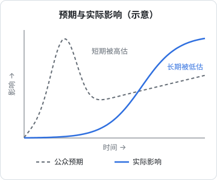
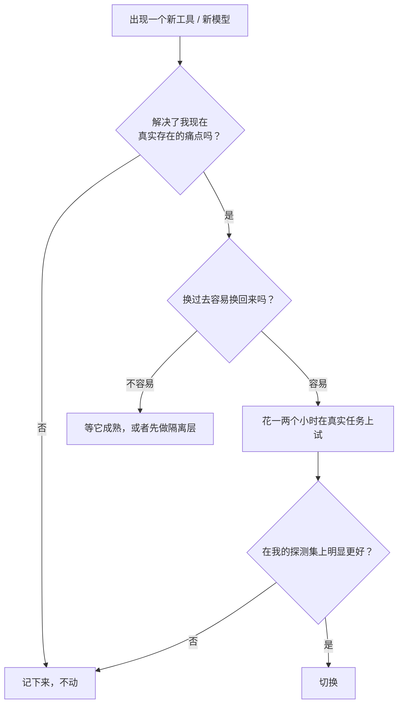

# 判断趋势、不被炒作带着走

AI 领域的信息流有一个特点：**每周都有「颠覆性」的发布**。新模型、新框架、新范式、新的「XX 已死」。对一人公司来说，这带来两种风险：一种是追着热点不停换工具、换方向，什么都没做深；另一种是被信息量压垮，干脆不看，错过了真正重要的变化。

这一章讲的是一套过滤和判断的方法：怎么区分信号和噪音、怎么看待基准和演示、怎么决定什么时候跟进，以及怎么让自己的判断随时间变得更准。

## 两条古老的定律

### 阿马拉定律

美国未来学家 Roy Amara 有一句被广泛引用的话，大意是：**人们总是高估一项技术的短期影响，低估它的长期影响**。

这句话对 AI 尤其贴切。短期内，演示让人以为「下个月所有程序员都要失业」；实际落地时，遇到可靠性、成本、集成、组织习惯等一堆问题，进展比预期慢，于是又有人宣布「AI 泡沫破裂」。而在这两种情绪之下，能力在持续地、一点点地累积，长期看改变的东西可能比任何人预想的都多。



这张图是示意，不代表任何具体数据。它想说明的是：**在任何一个时间点，公众情绪和真实进展之间都可能有很大的差距**，而且差距的方向会变。

### 古德哈特定律

经济学家 Charles Goodhart 的观察被后人概括为：**当一个指标变成目标，它就不再是好指标**。

AI 基准测试是这条定律的活教材：

- 一个基准被广泛使用后，各家都会针对它优化，分数涨了，但未必代表通用能力同等提升
- 基准题目可能出现在训练数据里（数据污染），模型「背」过答案
- 一些基准很快接近满分（饱和），失去区分度，于是又出现新的、更难的基准

这些都是业内公认的问题，不代表基准没用，而是说：**一个新模型在某个榜单上刷新纪录，只是一条弱信号**。

## 信号和噪音

面对一条 AI 新闻，可以用一组问题快速过滤：

| 问题 | 偏噪音 | 偏信号 |
|---|---|---|
| 来源是什么 | 二手转述、营销号、截图 | 官方技术报告、系统卡、可复现的开源代码 |
| 证据是什么 | 一段精心挑选的演示视频 | 多个独立用户在真实任务上的反馈 |
| 能不能马上用 | 「即将推出」「内测中」 | 已经开放，有价格、有文档 |
| 说的是什么层次 | 「AGI 来了」「XX 已死」这类宏大叙事 | 具体能力在具体任务上的变化 |
| 谁在说、他的利益是什么 | 卖课的、融资的、做咨询的 | 利益相关但给出了可验证的细节 |

最后一行不是说利益相关的人说的都是错的（模型厂商的技术报告往往是最重要的一手资料），而是说**要知道对方的论证会往哪个方向用力**。

### 演示和产品之间的距离

一个特别常见的落差：**演示展示的是能力的上限，产品需要的是能力的下限**。

一段演示里，agent 流畅地完成了一个复杂任务。你不知道的是：这是第几次尝试的结果？任务是不是精心挑选的？出错时有没有人在旁边纠正？

对产品来说，重要的是「一百次里能成功几次」以及「失败时会怎样」。演示里 1 次成功和产品里 95% 的成功率之间，可能隔着几个月到几年的工程工作。所以看到演示时，我的习惯是问：**它在我的任务上，十次能成几次？** 然后用第 1 章的探测集去试。

## 什么在真的变化

过滤掉噪音之后，有几条趋势是有相对扎实证据支持的（截至 2026 年底的主流看法，你应该持续用新证据检验）：

| 趋势 | 证据类型 | 对一人公司的含义 |
|---|---|---|
| 模型能自主完成的任务长度在增长 | METR 在 2025 年发表的研究追踪了这一指标，发现过去几年大约每隔数月翻一番 | agent 能接的活会越来越大，但要持续用探测集验证 |
| 同等能力的调用成本在下降 | 各家的公开价格变化 | 今天嫌贵的功能，明年可能可行 |
| 开源模型与闭源前沿的差距时大时小，但开源可用的能力整体在上升 | 公开评测和社区反馈 | 不要假设只有一家能用，保持可替换 |
| 编码是 AI 落地最深的领域之一 | 广泛的使用数据和开发者调查 | 你作为开发者正处在变化最快的位置 |

关于第一条要多说一句：「能力在指数增长」是一个有证据的观察，但**指数趋势能延续多久，没人知道**。历史上很多指数趋势最后都变成了 S 曲线。合理的态度是：按趋势做准备，但不要把公司押在趋势一定延续上。

## 什么时候跟进新东西

一人公司的精力极其有限，跟进每一个新工具是不可能的。一个简单的决策框架：



这里借用了亚马逊创始人贝佐斯在致股东信里提出的一个区分：**单向门和双向门**。走过去回不来的决定（单向门）要慎重；走过去随时能回来的决定（双向门）应该快速做。

| 类型 | 例子 | 策略 |
|---|---|---|
| 双向门 | 试一个新的编码 agent、换一个写作模型、试一个新的 prompt 方法 | 快速试，不行就换回来 |
| 单向门 | 把产品核心架构绑在某家模型的专有特性上、重写整个技术栈、转换产品方向 | 慢一点，先做隔离，或者等证据更充分 |

降低单向门风险的常用手段是**加一层隔离**：产品里调用模型的地方封装成自己的接口，而不是到处直接调某家的 SDK。hatch-counter 的识别服务就是这样：链上排着好几家服务商，会按错因降级，客户端完全不知道背后是哪家。换一家服务商只改服务端一处。

## 让判断随时间变准

最后讲一个大多数人不做、但效果最好的习惯：**把预测写下来，定期回看**。

心理学家 Philip Tetlock 长期研究预测的准确性，他的研究（以及据此写成的《超预测》一书）有一个重要发现：大多数专家的长期预测并不比简单基线好多少，但有一小部分人的预测持续更准，他们的共同特点包括用概率而不是绝对判断来表达、根据新信息频繁小幅调整、事后认真复盘。

你不需要成为超级预测者，但可以借用这个方法。维护一份很简单的预测日志：

```yaml
# ~/notes/predictions.yaml
- date: 2026-11-02
  claim: 到 2027 年 6 月，我用的编码 agent 能在无人干预下完成 hatch-counter 一个中等需求（含迁移和测试）
  probability: 0.6
  why: 最近半年在探测集上的进步；但迁移类任务仍然经常需要我纠正
  review_on: 2027-06-30
  result:
- date: 2026-11-02
  claim: 一年内，主流模型的同等能力调用价格继续明显下降
  probability: 0.8
  why: 过去几年的公开价格趋势
  review_on: 2027-11-01
  result:
```

几条要点：

- **写具体、可检验的论断**，不写「AI 会越来越强」这种无法判断对错的话
- **写概率**，逼自己想清楚有多确定
- **写理由**，回看时才知道是推理错了还是运气不好
- **定回看日期**，到期如实填结果

半年后回看，你会对自己的判断有一个真实的认识：在哪些问题上总是过于乐观，在哪些问题上总是过于保守。这比读一百篇趋势分析都有用。

## 信息源的管理

最后是一些实用建议（作者判断）：

- **一手资料优先**：模型厂商的技术报告、系统卡、更新日志，比二手解读信息量大、偏差小
- **少而精**：挑几个长期观察下来判断靠谱的个人和机构持续关注，比刷大量信息流有效
- **固定时间看**：比如每周集中看一次，而不是随时被推送打断
- **看到「震撼」的内容，等一周再判断**：很多爆款在一周后就被证明是夸大或误读
- **自己动手比读文章重要**：一个小时的亲自试用，胜过读十篇评测

## 本章要点

- **阿马拉定律**：高估短期、低估长期，情绪和真实进展之间常有大的落差
- **古德哈特定律**：基准被当成目标就会失真，刷榜只是弱信号
- 用来源、证据、可用性、层次、利益五个问题过滤信息
- 演示展示能力上限，产品需要能力下限，问「在我的任务上十次能成几次」
- 有扎实证据的趋势：任务长度增长、成本下降、编码落地最深；但指数趋势能延续多久没人知道
- 跟进新东西先看是否解决真实痛点，再看是**单向门还是双向门**；用隔离层降低绑定风险
- 写**预测日志**：具体、带概率、带理由、定期回看，让判断随时间变准
