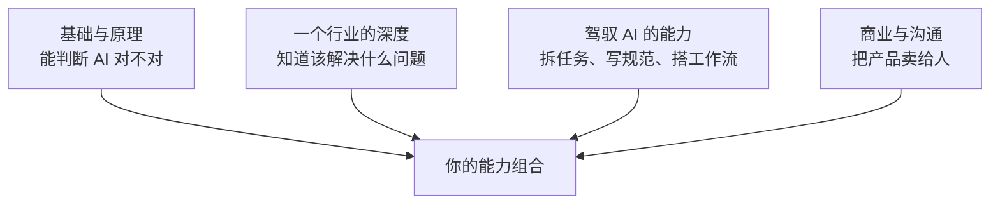

# 个人在 AI 时代的位置

前五章讲的是怎么看 AI：它的边界、它的风险、它进入产品的方式、它和人怎么分工、它的趋势怎么判断。最后一章把镜头转回自己：**当写代码这件事本身越来越便宜，一个开发者、一家一人公司，价值落在哪里？**

这个问题没有标准答案，本章也会比前几章有更多作者判断。我会尽量把推理过程摊开，方便你在不同意的地方停下来，形成自己的看法。

## 先承认不确定

关于 AI 对职业的影响，严肃的预测分布极广：从「大部分知识工作会被重塑」到「影响被高估、会像历次技术革命一样创造新岗位」。持各种观点的人里都有认真研究过的经济学家和技术专家。

事实层面能说的是：

- 编码、写作、客服、翻译等任务已经被 AI 显著改变，这是正在发生的事
- 历史上的技术变革（机械化、电气化、计算机化）都伴随着某些岗位消失和新岗位出现，但转型期对具体个人的冲击可能很大
- 这一次的速度和范围是否不同，目前没有共识

所以，与其押注某一种预测，我认为更好的策略是：**选择在多种未来下都不太差的位置**。下面的讨论都围绕这个思路。

## 什么在变便宜，什么在变稀缺

一个有用的经济学视角：**当一种东西变得便宜，和它互补的东西会变得更值钱**。

| 在变便宜的 | 在变稀缺的 |
|---|---|
| 写出能跑的代码 | 知道该写什么代码 |
| 生成文字、图片、方案 | 判断哪个方案对、哪个文案打动人 |
| 获取一般性知识 | 关于特定行业、特定用户的一手了解 |
| 执行明确的任务 | 定义问题、拆解问题 |
| 产出数量 | 可信度和责任 |
| 做一个产品 | 让人知道并愿意用这个产品 |

这张表是我对当前趋势的判断，不是定论。但如果它大致成立，对一个开发者的含义是：**你的价值重心要从「实现」往「判断」和「连接」移动**。

- **判断**：选对问题、选对方案、识别 AI 的错误、做出取舍
- **连接**：把技术能力连接到具体的人和具体的问题上，也就是理解用户、拥有分发渠道、建立信任

## 比较优势：一个常被误用的论证

关于「AI 什么都比人强之后人还能干什么」，经常有人援引经济学家李嘉图的**比较优势**理论：即使一方在所有事情上都更强，双方各自专注于相对优势最大的领域，整体仍然会受益。所以人总有可做的事。

这个论证有一定道理，但要注意它的前提：比较优势说的是**交换能带来收益**，不保证这份收益对个人来说足够体面。如果 AI 的成本足够低，人在某项工作上的「比较优势」可能只对应很低的报酬。

所以我不太依赖这个论证来安慰自己，而是更关心：**在哪些事情上，人的参与本身就是价值的一部分**？

- **责任**：用户需要有一个人为结果负责，能追责、能道歉、能修正
- **信任关系**：人们更愿意从一个他们了解、认可的人那里买东西
- **品味和观点**：一个有明确立场的产品、一个有个人风格的作者，本身就是吸引力
- **在场**：理解一家门店的经营，需要去店里看、和店主聊

这些恰好是一人公司天然具备的东西：**一个可以被认识、被信任、对产品负全责的人**。

## 一人公司的位置

AI 对一人公司的影响是双向的，诚实地看两面：

| 有利的一面 | 不利的一面 |
|---|---|
| 一个人能做的事大幅增加，以前要一个团队的产品现在一个人能做 | 别人也一样，做产品的门槛降低意味着竞争者变多 |
| 运营、客服、内容等原本吃人力的工作可以部分交给 AI | 纯技术壁垒在变薄，「我能做出来」不再稀缺 |
| 试错成本降低，可以更快验证更多方向 | 大公司和模型厂商可能直接做掉某些品类 |

综合起来，我的判断是：**AI 让「一个人做产品」变容易了，但没有让「一个人做成生意」变容易多少**。生意的难点：找到真实需求、触达用户、建立信任、持续经营，大部分仍然是人的工作。

这对选方向有直接影响。几条建议（作者判断）：

- **离通用能力远一点，离具体场景近一点**。做「AI 写作助手」要和所有模型厂商竞争；做「给餐饮门店识别进货单并算成本」，竞争者少得多，而且壁垒在行业理解里
- **选你有不公平优势的领域**：你了解的行业、你认识的人、你自己就是用户的场景
- **做模型变强时你也变强的产品**（第 3 章的思考实验）
- **重视分发和信任**：内容、口碑、社群，这些积累不会被下一个模型发布清零

## 能力组合：该学什么

技术人常问：既然 AI 能写代码，还要不要深入学技术？我的看法是要学，但**学的重点变了**。



| 能力 | 为什么重要 | 本书单里对应的书 |
|---|---|---|
| 基础与原理 | AI 写代码时，你要能判断它对不对、架构合不合理 | 技术栈纵深、运维系列 |
| 一个行业的深度 | 这是最难被复制的壁垒 | 没有书能替代，要去现场 |
| 驾驭 AI | 同样的工具，会用和不会用的产出差距巨大 | Agent 系列 |
| 商业与沟通 | 产品做出来只是开始 | OPC 系列 |

关于基础要不要学，有一个常见的误区：「反正 AI 会写，学了也用不上」。实际上，**基础知识的作用从「用来实现」变成了「用来验证和指挥」**。你不需要记住 PostgreSQL 每个配置项，但要知道锁、索引、事务隔离是怎么回事，才能在 agent 写出一个会锁全表的迁移时一眼看出来。这套书里的技术书，读的时候可以少关注「怎么写」，多关注「为什么」和「怎么判断好坏」。

## 心态：节奏和焦虑

最后说一点技术之外的事。AI 领域的变化速度，加上社交媒体上「某某一个人用 AI 月入 X 万」的故事，很容易让人焦虑：怕落后、怕选错、怕自己的技能贬值。

几个我认为有用的视角：

- **焦虑本身不产生价值**。把焦虑转化成具体行动：这周试一个新工具、跑一次探测集、和一个潜在用户聊一次
- **幸存者偏差**：你看到的成功故事是被筛选过的，失败的人不会发帖
- **节奏比速度重要**。[《一人公司方法论》](../opc-playbook/)讲过，一人公司最大的风险之一是精力耗尽。追每一个热点的人，往往什么都没做完
- **你不需要成为最懂 AI 的人**，只需要在你的领域里比你的用户和竞争者更会用它

## 写一份自己的原则

读完这本书，我建议你花一个小时，写一份个人的 AI 使用原则，放在你的笔记或者工作流配置旁边。它不需要很长，但要具体、是你自己的话。一个起点：

```markdown
# 我的 AI 原则（2026-11）

## 用
- 代码、脚本、文档默认先让 agent 做，我审
- 调研和资料整理交给 AI，但关键事实我自己核对来源

## 不用 / 慎用
- 产品方向和定价：AI 只当反对者，不当决策者
- 不可逆操作（迁移、发版、付款、对外发消息）永远人工确认

## 守住
- 每周至少手写一次小功能，保持读懂代码的能力
- 对上线的每个关键决定，我能解释为什么

## 更新
- 每季度跑一次探测集，回看预测日志
- 这份原则每半年修订一次
```

这份原则的价值不在于写得多好，而在于**它是你主动想过的结果**。AI 时代最容易失去的，就是「我为什么这样做」的意识。

## 全书回顾

| 章 | 一句话 |
|---|---|
| 能力边界与幻觉 | 边界是锯齿状的，用验证成本和出错代价判断，不用语气判断 |
| 对齐与安全 | 意图写不完整，安全的主战场在应用层，靠架构而不是 prompt |
| AI 原生的产品思维 | 设计重心从生成移到审核，壁垒在模型之外 |
| 人机分工 | 按自主程度阶梯分工，守住责任、品味和验证能力 |
| 判断趋势 | 区分信号与噪音，分清单向门和双向门，写预测日志 |
| 个人的位置 | 价值从实现移向判断和连接，选在多种未来下都不太差的位置 |

## 接下来读什么

这本书是 Agent 系列「使用」层的最后一本。按导读的路线，接下来可以：

- **把认知落到生意上**：读 OPC 系列，从《一人公司方法论》[《产品思维》](../product-thinking/)开始，再到[《定价与商业模式》](../pricing-monetization/)[《获客与增长》](../growth-marketing/)
- **把 AI 功能做进产品**：读[《大模型应用工程》](../llm-app-engineering/)[《评测与质量》](../llm-evals/)[《LLM 应用上线》](../llmops/)，把第 3 章的原则变成工程实践
- **把安全做扎实**：读[《Agent 安全》](../agent-safety/)，第 2 章的框架在那里有完整的工程展开
- **最后收尾**：读[《用 AI 撑起一人公司》](../ai-native-opc/)，它会把整套书单串起来

## 本章要点

- AI 对职业的影响没有共识，选择**在多种未来下都不太差**的位置
- 便宜的是实现和生成，稀缺的是判断、行业了解、信任和分发
- 比较优势论证有前提，更值得关心的是**人的参与本身就是价值**的地方：责任、信任、品味、在场
- AI 让做产品变容易，没有让做成生意变容易多少；离具体场景近一点，选有不公平优势的领域
- 基础知识的作用从「实现」变成「验证和指挥」，仍然要学，重点在「为什么」
- 焦虑转化成行动，节奏比速度重要
- 写一份自己的 AI 原则，定期修订
