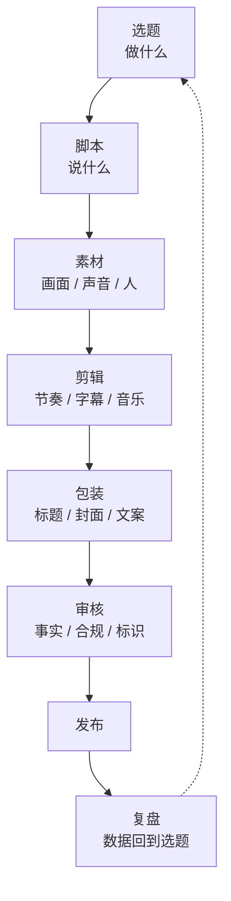
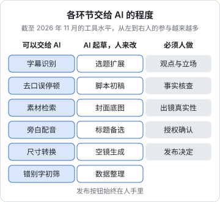

# AI 在内容生产里能做什么

做自媒体的人现在几乎都在用 AI：让大模型想选题、写口播稿，用图像模型出封面，用 TTS 配音，用剪映自动加字幕。工具不缺，缺的是一张清楚的地图：哪些环节交给 AI 能省下真金白银的时间，哪些环节交出去反而让账号变差，哪些环节根本不能交。

这本书面向会写代码的读者，目标是让你能搭起一条**有人把关的内容流水线**：选题、脚本、素材、剪辑、发布前审核，每一步都知道用什么工具、怎么写提示词、怎么检查质量、花多少钱、踩什么线。这一章先把全景铺开。

## 一条内容的生产链

不管是口播、图文、混剪还是剧情短视频，一条内容从无到有大致经过这几步：



传统做法里，这条链上最贵的是人的时间：一条 1 分钟的口播，写稿 1 小时、拍摄 1 小时、剪辑 2 小时是常态。AI 工具改变的是每一步的**单位成本**，但不是每一步都同等程度地改变。

## 每个环节的能力边界

截至 2026 年 11 月，各环节 AI 的实际水平可以粗分三档：

- **可以交给 AI**：结果好坏容易判断、出错代价低、有现成的检查方法
- **AI 起草，人来改**：AI 能做出 60–80 分的初稿，但最后那 20 分决定了内容能不能起量
- **必须人做**：涉及真实性、判断、责任，或者 AI 做出来恰恰是账号最大的风险



逐个环节看：

| 环节 | AI 能做好的 | AI 做不好的 | 人必须保留的 |
|---|---|---|---|
| 选题 | 从评论区、热榜、对标账号里归纳话题，批量扩写选题角度 | 判断这个选题在你的账号上会不会火；它没有你的后台数据和受众直觉 | 选哪几个、放弃哪几个 |
| 脚本 | 按结构模板出初稿、改写口语化、压缩字数、出多个开头钩子 | 真实经历、具体细节、有立场的观点；写出来普遍「正确但无聊」 | 观点、案例、事实核查 |
| 图像 | 配图、背景、氛围图、封面底图、风格化插画 | 准确的中文大字、真实产品的细节、同一角色几十张保持一致 | 封面上的字、品牌元素 |
| 视频生成 | 5–15 秒的空镜、转场、氛围镜头、动态插画 | 长镜头叙事、复杂动作、多人交互、精确的手部和文字 | 叙事和镜头选择 |
| 剪辑辅助 | 语音转字幕、去口误和停顿、自动卡点、长视频切片 | 判断哪里该停、哪里该快；剪辑节奏是内容的一部分 | 节奏和取舍 |
| 声音 | 旁白配音、多语种配音、降噪、BGM 生成 | 有情绪起伏的表演；用他人音色 | 音色授权、情绪段落 |
| 数字人 | 标准化口播：课程、资讯播报、产品讲解 | 让观众相信「这是一个真人在跟我说话」 | 是否用、用谁的形象 |
| 包装 | 批量出标题备选、封面文案备选 | 知道哪个标题在你的受众里点击率高 | 最终选择 |
| 审核 | 错别字、敏感词初筛、字幕和口播对齐检查 | 事实对错、语境里的冒犯、是否构成虚假宣传 | 发布按钮 |
| 复盘 | 把后台数据整理成表、写数据解读初稿 | 解释为什么这一条火了；容易编造原因 | 下一步做什么 |

这张表里反复出现一个模式：**AI 擅长「把已有的东西变多、变整齐」，不擅长「产生你的账号独有的东西」**。而平台推荐算法奖励的恰恰是后者。

## 为什么「全自动」做不出好账号

很多人第一次搭 AI 流水线的目标是「输入一个关键词，输出一条成片，自动发布」。技术上这完全做得到，这本书第 7 章的代码骨架稍改就能跑通。问题在于结果：

1. **同质化**。你用的模型、提示词套路、模板，别人也在用。全自动产出的内容彼此高度相似，平台对同质化内容有专门的识别和降权（见第 8 章和第 10 章）
2. **事实错误**。大模型会编造数据、引语、案例。一条带错误数据的知识类视频，轻则评论区翻车，重则构成虚假信息
3. **没有人设**。观众关注一个账号，关注的是背后那个人的视角和经历。AI 没有经历
4. **合规责任不会转移**。内容是你发布的，标识没加、侵权、虚假宣传，责任在发布者，「是 AI 生成的」不是免责理由
5. **平台明确在打击**。小红书 2026 年 4 月发布的 AI 内容治理规则把「套用模板批量生产同质化内容」列为 AI 低质内容，抖音 2025 年 5 月开展「AI 起号」专项治理（原文要点见第 10 章）

所以本书的流水线有一条贯穿始终的设计原则：

> **AI 负责产能，人负责判断和真实。流水线的最后一步永远是人工审核，发布按钮永远在人手里。**

这不是道德说教，是在当前平台规则和推荐机制下，效果和风险的最优解。

## 技术人的优势在哪里

会写代码的人做内容，优势不在于「会用 AI 工具」，现在人人都会。优势在这几处：

- **能把工具串起来**。大部分创作者在五六个网页之间复制粘贴，你可以用 API 把选题、脚本、配音、字幕串成一条脚本，省掉的是最无聊的那部分时间
- **能做结构化**。把选题库、提示词、素材、发布记录都变成文件和数据库，内容生产就变得可复盘、可迭代
- **能做检查器**。字数、敏感词、字幕时间轴、标识有没有加，这些都可以写成确定的检查，而不是靠肉眼
- **能算账**。按条算 API 成本、按月算订阅成本、算人工时间，知道哪一步值得自动化

劣势也明显：技术人容易沉迷搭系统，系统搭得很漂亮，内容本身却没打磨。一个经验法则：**先手工做出 10 条数据还不错的内容，再去自动化你重复做了 10 遍的步骤**。没有验证过的内容形态，自动化只会让你更快地生产没人看的东西。

## 工具的分类和选型标准

> [!WARNING]
> 下表的工具和型号按截至 2026-11 的公开资料整理，只是举例，几个月就会换一轮；能力、价格和商用条款以各工具官网（定价页、服务条款）为准。

AI 工具更新极快，具体型号几个月就换一轮。与其记型号，不如记住每一类工具看什么：

| 类别 | 代表性工具（截至 2026 年 11 月） | 选型时看什么 |
|---|---|---|
| 文本大模型 | DeepSeek、通义千问、豆包、Kimi、GPT、Claude、Gemini | 中文语感、长上下文、结构化输出、单价、国内可用性 |
| 图像生成 | 即梦 / Seedream、可灵图像、通义万相、Midjourney、GPT 图像、Gemini 图像、FLUX | 中文理解与文字渲染、参考图一致性、商用条款、API 可用 |
| 视频生成 | 可灵 Kling、即梦 / Seedance、海螺 Hailuo、Vidu、通义万相 Wan、Veo、Runway | 单条时长、分辨率、是否带原生音频、图生视频稳定性、按秒单价 |
| 剪辑辅助 | 剪映 / CapCut、必剪、Descript、各类长转短切片工具 | 字幕准确率、模板生态、是否支持批量和草稿导入 |
| 语音识别 | 剪映内置、Whisper 系列、FunASR / SenseVoice、各云厂商 ASR | 中文和方言准确率、时间戳精度、能否本地跑 |
| TTS 与配音 | 豆包语音 / 火山引擎、MiniMax 语音、CosyVoice、阿里云 / 腾讯云 / 讯飞、ElevenLabs | 中文自然度、情绪控制、音色克隆的授权机制、按字符单价 |
| 数字人 | 剪映数字人、腾讯智影、蝉镜、闪剪、硅基智能、HeyGen | 口型同步质量、形象授权流程、导出是否自带标识、按分钟计费 |

后面每章都会给一份更细的选型表和判断标准。

有三条通用的选型原则：

1. **国内发布优先用国内备案的服务**。根据《生成式人工智能服务管理暂行办法》，面向国内公众的生成式 AI 服务需要备案；用国内已备案服务生成的内容，元数据里一般会带上符合国家标准的隐式标识，后面在平台上的标识链路更顺
2. **看商用条款，不看宣传页**。免费档常常不允许商用，或者带水印；有的服务对生成物的权利归属写得很模糊。做商单、带货的内容尤其要看清
3. **同一类工具准备一个主力、一个备选**。服务涨价、限流、下线都很常见。2026 年 OpenAI 就宣布了 Sora 2 的网页端和 API 下线计划（据第三方汇总，API 于 2026 年 9 月停止），依赖单一服务的流水线会整条断掉

## 一个起步建议：先给自己的生产过程计时

在决定自动化哪一步之前，拿你最近做的 5 条内容，记下每个环节实际花了多少时间：

```text
内容：《30 岁转行做独立开发，第一年赚了多少》口播 1 分 40 秒
选题：20 分钟（翻评论区 + 对标账号）
脚本：75 分钟（初稿 30 分钟，改 3 遍）
拍摄：40 分钟（含补录 2 段）
剪辑：110 分钟（粗剪 40，字幕 30，B-roll 和音乐 40）
封面标题：25 分钟
发布与回复：15 分钟
合计：约 4.8 小时
```

这张表通常会告诉你两件事：第一，最花时间的往往是剪辑里的字幕和找素材，而不是你以为的写稿；第二，写稿虽然花时间，但它是内容质量的主要来源，压缩它要非常小心。

按「花时间多、对质量影响小」排序，就是你的自动化优先级。对大多数口播类账号，这个顺序是：字幕 → 素材检索与 B-roll → 标题封面备选 → 脚本初稿 → 配音（如果不出镜）。

## 本书的路线

| 章 | 内容 |
|---|---|
| 第 2 章 | 文案与选题：大模型辅助选题、脚本、改写，提示词模板 |
| 第 3 章 | 图像：封面、配图、风格一致性 |
| 第 4 章 | 视频：文生视频、图生视频、自动剪辑、字幕 |
| 第 5 章 | 声音：TTS、配音、音色克隆的授权问题 |
| 第 6 章 | 数字人：适用场景、平台态度 |
| 第 7 章 | 搭一条自动化流水线：架构和代码骨架 |
| 第 8 章 | 矩阵与批量：产能和质量的平衡 |
| 第 9 章 | 成本核算：按条、按月算 |
| 第 10 章 | 平台对 AI 内容的规则与标识 |

与系列其他书的分工：账号定位、选题方法、脚本结构、拍摄剪辑的基本功分别见[《账号定位与对标拆解》](../account-positioning/)[《选题与爆款结构》](../topic-and-hooks/)[《短视频脚本与分镜》](../video-script-storyboard/)[《拍摄与剪辑实务》](../shooting-editing/)；AI 短剧的分镜、角色一致性和后期见[《AI 短剧分镜与画面生成》](../ai-drama-storyboard/)[《AI 短剧后期》](../ai-drama-post/)；法律层面的 AI 标识、肖像权和版权见[《自媒体与短剧合规财税》](../media-compliance/)。图像生成和语音合成的模型原理见[《多模态应用》](../multimodal-ai/)第 5、6 章。

## 本章要点

- 内容生产链是选题、脚本、素材、剪辑、包装、审核、发布、复盘；AI 改变的是每一步的单位成本，程度各不相同
- AI 擅长把已有的东西变多变整齐，不擅长产生账号独有的视角、经历和判断，而推荐算法奖励的正是后者
- 全自动流水线的问题是同质化、事实错误、没有人设，而且合规责任不会转给 AI；平台已明确打击模板化批量内容
- 设计原则：AI 负责产能，人负责判断和真实，发布按钮永远在人手里
- 技术人的优势是串联工具、结构化、写检查器、算账；先手工做出 10 条验证过的内容，再自动化重复的步骤
- 记住每类工具的选型标准而不是型号：国内发布优先用已备案服务、看清商用条款、每类准备一个备选
