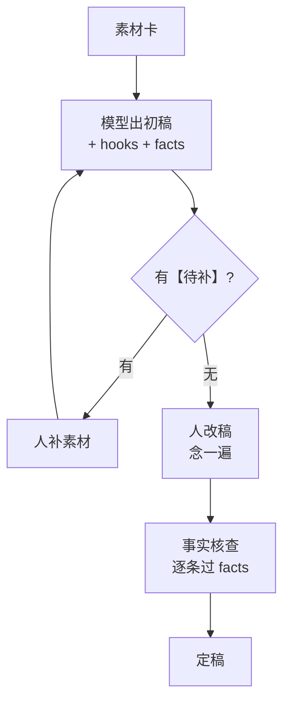

# 文案与选题

文字是整条流水线的上游：选题决定做什么，脚本决定说什么，后面的画面、配音、剪辑都围着脚本转。上游歪了，下游工具再好也救不回来。这一章讲怎么让大模型在选题、脚本、改写三件事上真正帮上忙，给出可以直接改用的提示词模板，也讲清楚哪些用法是在给账号埋雷。

选题方法论本身（选题库、热点、钩子、情绪曲线）见[《选题与爆款结构》](../topic-and-hooks/)，脚本格式见[《短视频脚本与分镜》](../video-script-storyboard/)，这里只讲 AI 怎么接进去。

## 先选模型

写中文短视频文案，模型之间的差距主要在三处：中文口语的语感、对平台语境的熟悉程度、按格式输出的稳定性。

| 维度 | 怎么测 | 说明 |
|---|---|---|
| 中文口语 | 让它写一段 60 秒口播，自己念一遍 | 念着拗口、书面语多、句子太长的，直接淘汰 |
| 平台语境 | 让它解释几个当下的平台黑话、给几个同赛道账号的标题风格 | 训练数据截止时间和中文语料比例影响很大 |
| 结构化输出 | 要求输出 JSON，跑 50 次看解析失败率 | 流水线里这一项比文笔更重要，见[《大模型应用工程》第 3 章](../llm-app-engineering/03-structured-output.md) |
| 单价 | 按你一条脚本的输入输出 token 估算 | 选题和改写调用量大，单价差几倍很明显 |
| 可用性 | 国内网络能否稳定调用、是否需要企业认证 | 流水线要的是稳定 |

截至 2026 年 11 月，国内模型（DeepSeek、通义千问、豆包、Kimi 等）在中文口语和平台语境上普遍不输海外模型，单价也低一截；海外模型（Claude、GPT、Gemini）在长指令遵循和结构化输出上各有长处。实际做法是**用自己的 20 个真实选题做一次盲测**，而不是看榜单。具体价格和型号以各家官网为准。

一个实用的组合：便宜的模型做量大的活（选题扩写、标题备选、批量改写），贵一点的模型做少而关键的活（脚本初稿、事实陈述抽取）。

## 一条原则：给素材，不给题目

大模型写文案最常见的失败是：给它一个题目，它还你一篇「正确的废话」。

```text
帮我写一个关于独立开发者如何找到第一批用户的短视频脚本。
```

这样的提示词，任何人输入都会得到差不多的结果：「第一，明确你的目标用户；第二，利用社交媒体；第三……」。这正是平台眼里的同质化内容。

模型擅长的是**把你给的东西重新组织**。所以要先给它你独有的素材：

- 你的真实经历和数据（「我的第一个付费用户是在 V2EX 一条回帖里来的」）
- 你的观点和立场（「我认为冷启动阶段不该投流」）
- 评论区里粉丝的原话
- 你记下来的案例、截图里的数字

把这些存成「素材卡」，提示词里引用素材卡，模型只负责结构和表达。这是 AI 文案「像不像你」的分水岭。

```text
# 素材卡 2026-11-01-first-users.md
观点：冷启动不要投流，先在三个社区里各找到 10 个真实用户
经历：
- 第一个付费用户来自 V2EX 一条回帖，我回答了他关于导出 CSV 的问题
- 第一个月 47 个注册，31 个来自我自己发的 3 篇帖子
- 投过 200 块小红书薯条，带来 2 个注册，都没留存
数据来源：自己的后台，截图在 assets/2026-11-01/
粉丝原话：
- 「独立开发最难的不是写代码是没人用」
- 「求问不会社交的程序员怎么推广」
```

## 选题：让模型做归纳和扩写

选题环节 AI 能做两件事：从杂乱的信息里**归纳**出话题，把一个种子选题**扩写**成多个角度。挑哪个，是你的事。

### 模板一：从评论区归纳选题

评论区是最好的选题来源，问题是评论多了看不过来。把最近 20 条视频的评论导出（手工复制或用平台允许的方式导出），交给模型归纳：

```text
你是短视频选题编辑。下面是我账号最近 20 条视频的评论，账号定位是「程序员做副业和独立开发」。

任务：
1. 找出被反复提到的问题、困惑和争议，每类给出：一句话概括、出现次数（估算）、2 条有代表性的评论原文
2. 只归纳评论里真实出现的内容，不要补充你认为观众可能关心的话题
3. 标出哪些评论是在质疑或反对我的观点

按出现次数从多到少输出，最多 15 类。

<comments>
{{粘贴评论}}
</comments>
```

关键是第 2 条：不加这句，模型会把它「觉得重要」的话题混进来，你就分不清哪些是观众真问的。

### 模板二：一个种子扩成多个角度

```text
种子选题：{{例：独立开发者怎么找第一批用户}}
我的素材卡：
{{粘贴素材卡}}

从下面 6 个角度各写 2 个具体选题，每个选题一行，格式「角度 | 标题式选题 | 用到素材卡里的哪一条」：
- 反常识：和普遍看法相反的结论
- 数字：用具体数字说话
- 踩坑：我犯过的错
- 对比：两种做法放在一起比
- 清单：可以收藏的步骤或工具
- 故事：一个具体的人或时刻

要求：每个选题都必须用到素材卡里的至少一条，用不到素材卡的角度就写「素材不足」，不要编。
```

「素材不足」这个出口很重要。它让模型在没有素材时承认没有，而不是编一个「我的一位朋友……」的假故事。

### 选题打分由你来做

模型扩出 12 个选题后，用一张简单的表自己打分，不要让模型打：

| 选题 | 我有没有独家素材（0–2） | 对标账号同类内容的数据（0–2） | 评论区有没有人问（0–2） | 我做起来顺不顺手（0–2） | 总分 |
|---|---|---|---|---|---|
| 投了 200 块薯条只换来 2 个注册 | 2 | 1 | 2 | 2 | 7 |
| 独立开发者推广的 5 个渠道 | 0 | 2 | 1 | 2 | 5 |

为什么不让模型打分？因为它看不到你的后台数据，不知道对标账号最近哪条起量，也不知道你拍哪类内容最自然。它给出的分数看起来有理有据，实际是在猜。

## 脚本：结构化地起草

### 模板三：口播脚本初稿

```text
你是短视频口播稿写手。根据选题和素材卡写一条 {{60}} 秒左右的口播稿（中文约 {{250}} 字）。

选题：{{投了 200 块薯条只换来 2 个注册，冷启动我只做这三件事}}
素材卡：
{{粘贴}}

结构：
1. 开头 3 秒：一句话抛出反常识结论或具体数字，不要自我介绍，不要「大家好」
2. 冲突：为什么大多数人的做法不对，用素材卡里的经历
3. 方法：2–3 个具体做法，每个都要有素材卡里的例子或数字
4. 结尾：一个可以在评论区回答的问题

语言要求：
- 口语，句子短，一句不超过 20 字
- 不用「首先、其次、最后」「总而言之」「值得注意的是」
- 不用排比，不用「不仅……而且……」
- 只使用素材卡里的数字和经历；需要但素材卡里没有的信息，写成【待补：说明需要什么】

输出 JSON：
{
  "hooks": ["开头备选 1", "开头备选 2", "开头备选 3"],
  "script": "完整口播稿，用 \n 分段，每段对应一个画面",
  "facts": ["稿子里出现的每一个事实陈述和数字，逐条列出"],
  "todo": ["所有【待补】的内容"]
}
```

这个模板里有几个设计值得说明：

- **hooks 要 3 个**。开头决定完播率，让模型多给几个备选，你挑一个或者自己改
- **facts 单独列出**。这是给事实核查用的，下一节会讲
- **【待补】标记**。逼模型在缺信息时留空而不是编造，流水线可以检查脚本里有没有残留的【待补】，有就不往下走
- **禁用词写进提示词**。「首先其次」「值得注意的是」这类词是 AI 腔的重灾区。怎么让 AI 写的东西不像 AI，系统的方法见[《文案与内容》第 7 章](../copywriting-content/07-ai-writing.md)

### 一条脚本的生命周期



「念一遍」不是走形式。口播稿是给耳朵听的，眼睛看着通顺的句子，念出来经常拗口或者太长。自己念一遍，卡住的地方就是要改的地方。

## 事实核查：让模型列，人来核

大模型最危险的错误不是文笔差，是**一本正经地编造事实**：一个不存在的统计数据、一句名人没说过的话、一个张冠李戴的案例。知识类、财经类、健康类账号尤其致命。

办法是把核查拆成两步：

1. **抽取**：让模型把稿子里每一个事实陈述逐条列出（模板三里的 facts 字段），或者对已有稿子单独跑一次抽取
2. **核对**：人逐条核对，每条标上来源

```text
下面是一条短视频口播稿。逐条列出其中所有可以被验证真假的陈述：数字、日期、引语、人名、机构名、政策规定、因果断言。

每条输出：
- 原句
- 需要核对的内容
- 风险等级：高（政策、医疗、金融、法律、他人言论）/ 中 / 低
- 建议去哪里核对（官网、原始公告、自己的后台）

不要判断真假，只负责列出。

<script>
{{粘贴稿子}}
</script>
```

注意最后一句「不要判断真假」。让同一个模型既写又核，它倾向于确认自己写的东西；让它只负责找出需要核的地方，判断交给人和原始资料。

核查记录建议和脚本存在一起：

```text
facts-check: 2026-11-01-first-users
[x] 第一个月 47 个注册 —— 后台截图 assets/2026-11-01/signup.png
[x] 投 200 元薯条带来 2 个注册 —— 薯条订单页截图
[x] 「小红书薯条最低 X 元起投」—— 已删除，不确定当前规则
```

拿不准的就删。一条少了一个数据的视频，比一条数据错了的视频安全得多。

## 改写：同一份内容，不同平台

改写是 AI 最稳定、最省时间的用法之一：把一条口播稿改成小红书图文、把长视频的稿子压成 30 秒版本、把视频号的稿子改成公众号文章。

### 模板四：跨平台改写

```text
把下面这条抖音口播稿改写成小红书图文笔记。

原稿：
{{粘贴}}

小红书笔记要求：
- 标题：20 字以内，包含一个具体数字或结果
- 正文：300–500 字，分 4–6 段，每段开头可以用一个 emoji
- 第一段直接给结论
- 结尾 3–5 个话题标签，用 # 开头
- 保留原稿所有观点和数字，不增加原稿里没有的信息
- 同时给出 6 张图的文字说明：第 1 张是封面（大字标题），后面每张一个要点

输出 JSON：{ "title": "", "body": "", "tags": [], "slides": [] }
```

各平台的内容形态和用户习惯差别很大，具体见[《抖音与快手》](../douyin-kuaishou/)[《小红书、视频号与 B 站》](../xhs-channels-bilibili/)。改写模板要按平台各写一份，存在仓库里，不要每次临时写。

### 改写自己的东西，不改写别人的

这里必须划一条线：**改写你自己的内容是效率工具；改写别人的内容就是洗稿**。

把别人的爆款视频转成文字，让模型「换个说法」再发，是 AI 时代最常见的违规玩法之一。它的问题：

- **侵权**：改写后的文字和原作在表达上实质性相似，就可能构成著作权侵权；改写程度越低风险越高
- **平台识别**：平台有原创保护和搬运识别，洗稿内容会被判为非原创，限流甚至处罚账号。小红书 2026 年 4 月的 AI 内容治理规则明确把「传授 AI 洗稿」列为 AI 违规运营行为
- **没有积累**：洗稿号没有自己的素材和观点，就没有人设，数据起来了也留不住粉

拆解对标账号是正当的学习方法（见[《账号定位与对标拆解》](../account-positioning/)）：学它的选题方向、结构和节奏，然后用自己的素材写。让模型做的是「分析这条视频的结构」，而不是「把这条视频换个说法」。

```text
分析下面这条视频文案的结构，不要改写它：
1. 开头用了什么钩子类型
2. 每一段的作用（冲突 / 论据 / 转折 / 方法 / 号召）和时长占比
3. 情绪在哪里起伏
4. 结尾怎么引导互动

最后用一行总结这条视频的结构公式，例如「数字钩子 → 反常识 → 3 个方法 → 提问」。
```

## 标题和封面文案：量大，挑选

标题和封面文案是 AI 产量优势最明显的地方：一次要 20 个，挑 2 个做 A/B。

```text
为下面这条视频写 20 个标题，每个不超过 {{18}} 字。

视频内容摘要：{{一句话}}
核心数字或结论：{{例：200 块换 2 个注册}}

分 4 类各 5 个：数字结果型、反常识型、提问型、身份共鸣型。
禁止：「震惊」「必看」「绝了」「家人们」；禁止承诺效果（「保证」「一定」「月入」）；禁止与内容不符的夸张。
```

最后一行禁止承诺效果，不只是品味问题。标题里写「月入过万」「保证涨粉」这类表述，涉及虚假宣传和平台违规，带货和知识付费类内容尤其要注意，具体见[《自媒体与短剧合规财税》](../media-compliance/)。

## 提示词要当代码管

做到第三周你会发现，提示词改了很多版，哪一版效果好已经记不清了。技术人的做法是把它当代码管：

```text
prompts/
├── topic-from-comments.v3.md
├── topic-expand.v2.md
├── script-koubo-60s.v5.md
├── fact-extract.v1.md
├── rewrite-xhs.v2.md
└── titles.v4.md
materials/
└── 2026-11-01-first-users.md
outputs/
└── 2026-11-01-first-users/
```

`outputs/2026-11-01-first-users/` 里放三个文件：

- `script.json`
- `facts-check.md`
- `meta.json`：用的哪个模型、哪版提示词、生成时间

meta.json 记下模型和提示词版本，等这条视频的数据出来，你才能回头判断是哪一版提示词写出的稿子数据更好。这个结构在第 7 章的流水线里会直接用到。

## 质量检查清单

每条脚本定稿前过一遍：

- [ ] 开头 3 秒有具体数字、结论或冲突，没有「大家好我是」
- [ ] 所有数字和经历都来自素材卡，没有残留【待补】
- [ ] facts 逐条核对过，拿不准的已删除
- [ ] 自己念过一遍，没有拗口的长句
- [ ] 没有「首先其次最后」「值得注意的是」「总而言之」
- [ ] 没有效果承诺、绝对化用语（「最」「第一」「100%」）
- [ ] 不是对他人内容的改写
- [ ] 换掉账号名，这条稿子仍然只有你能写出来

最后一条是最重要的检查。如果答案是「谁都能写」，这条内容大概率会淹没在同质化里。

## 常见坑

| 坑 | 表现 | 怎么办 |
|---|---|---|
| 直接给题目 | 稿子正确但无聊，和同行一模一样 | 先写素材卡 |
| 让模型打分选题 | 分数看着合理，实际是猜的 | 打分表自己填 |
| 模型编数据 | 稿子里出现你没给过的统计数字 | 提示词要求只用素材卡，facts 逐条核 |
| 提示词散落在聊天记录里 | 好的版本找不回来 | 存成文件，带版本号 |
| 一次让模型做太多 | 选题、脚本、标题、封面一个提示词全包，每样都平庸 | 拆成独立步骤，每步一个模板 |
| 越改越像 AI | 让模型反复「优化」，语言越来越书面 | 最后一遍由人改，或者让模型只做「删减」不做「润色」 |

## 本章要点

- 选模型用自己的真实选题盲测，看中文口语、平台语境、结构化输出稳定性和单价；量大的活用便宜模型
- 给素材不给题目：先写素材卡记下经历、观点、数据和粉丝原话，模型只负责结构和表达
- 选题环节让模型归纳评论区、把种子扩成多角度，并留「素材不足」的出口；选题打分由人做
- 脚本模板要求输出多个开头、事实清单和【待补】标记，流水线检查有无残留
- 事实核查拆成模型抽取、人工核对两步，拿不准的就删
- 改写自己的内容是效率，改写别人的内容是洗稿；拆解对标只分析结构不改写文字
- 提示词当代码管：文件化、带版本，产出记下模型和提示词版本，方便回头对照数据
