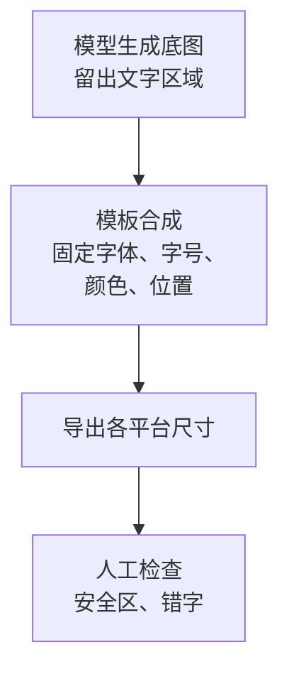

# 图像：封面、配图与风格一致性

自媒体里用到图的地方比想象中多：视频封面、小红书图文的 6–9 张配图、口播视频里插入的 B-roll 静帧、公众号头图、知识类视频里的示意插画。这些图以前要么自己用设计工具做，要么找图库、找设计师。图像模型把「出一张能用的图」的成本降到了几毛钱和几十秒，但也带来了新问题：每张图都好看，放在一起却不像一个账号；图里的中文字是乱码；生成的「产品图」和实物对不上。

这一章讲图像工具怎么选、封面和配图怎么做、一个账号的视觉怎么保持一致，以及图像生成在自媒体场景里的几条红线。模型原理和参数含义见[《多模态应用》第 6 章](../multimodal-ai/06-image-generation.md)，AI 短剧里的角色和场景一致性见[《AI 短剧分镜与画面生成》](../ai-drama-storyboard/)。

## 工具怎么选

> [!WARNING]
> 下表和下面的版本清单按 2026 年 11 月的官方更新公告和媒体报道整理，具体型号和价格变化很快，以各工具官网定价页和服务条款为准。

截至 2026 年 11 月，常见的图像生成工具大致分四类：

| 类型 | 代表 | 长处 | 短处 | 适合 |
|---|---|---|---|---|
| 国内综合平台 | 即梦（字节，Seedream 系列模型）、可灵图像（快手）、通义万相（阿里）、豆包 | 中文提示词理解好，中文文字渲染进步快，有 API，国内已备案 | 审美风格偏「平台味」，需要多调 | 国内发布的主力 |
| 指令遵循强的大模型图像 | GPT 图像系列、Gemini 图像系列 | 复杂指令、多图参考、对话式局部修改、文字渲染 | 单价较高，国内调用需要合规渠道 | 需要精确改图、多图融合 |
| 审美导向 | Midjourney | 风格化和质感，社区风格参考多 | 官方 API 有限，以订阅为主；中文文字弱 | 氛围图、插画风封面底图 |
| 开源可本地 | FLUX 系列、Stable Diffusion 生态 + ComfyUI | 可控性最强：LoRA、ControlNet、固定种子、批量；没有按张费用 | 要显卡，要折腾工作流 | 风格固定、量大、要训练自己的风格 |

表里只写系列名，因为版本换得太快。按 2026 年 11 月查到的较新版本（依据多为媒体报道，以官网为准）：

- **Seedream**：5.0（2026-02，先在剪映、CapCut 上线，即梦灰度），2026-06 火山引擎大会又发布了 5.0 Pro
- **GPT 图像**：`gpt-image-2`（2026-04，ChatGPT 里叫 Images 2.0）
- **Gemini 图像**：Nano Banana 2，即 Gemini 3.1 Flash Image（2026-02）
- **Midjourney**：V8.2（2026-07-24 官方更新公告）；8 月的 V8 编辑模型用最多 4 张参考图生成，取代了原来的全能参考
- **FLUX**：FLUX.2 系列（2025-11），2026-01 补了轻量的 klein；dev 版是开放权重，商用要看对应许可证

选型时问自己四个问题：

1. **图里要不要放中文字？** 要的话优先测文字渲染能力，但即使能渲染，封面大字也建议后加（下文）
2. **要不要几十张图保持同一风格？** 要的话看参考图 / 风格参考功能，或者走开源 + LoRA
3. **一个月出多少张？** 几十张用订阅，几千张算 API 单价，上万张考虑本地部署
4. **能不能商用？** 免费档常见限制商用或强制水印；看用户协议里生成物的使用权条款

## 封面：底图 AI 生成，大字后加

封面是 AI 图像在自媒体里最常见的用途，也是最容易做错的地方。错误做法是让模型一次性生成带标题的完整封面，结果是：中文字有错字或笔画畸形，字体每次都不一样，账号的封面墙看起来乱七八糟。

正确的分工：



**底图负责氛围和主体，文字由模板负责一致性。** 封面墙的统一感主要来自固定的字体、字号、位置和配色，而不是底图。

### 封面底图提示词模板

```text
{{主体：一位坐在书桌前的程序员背影，面前是两块显示器}}，
{{场景细节：深夜，台灯暖光，窗外是城市夜景}}，
风格：{{电影感摄影 / 扁平插画 / 3D 黏土风}}，
构图：竖版 3:4，主体位于画面下方 1/2，上方 40% 是干净的深色背景，用于放置标题文字，
光线：{{低调光，主光来自左侧台灯}}，
色调：{{深蓝与暖橙对比}}，
画面中不要出现任何文字、字母、logo、水印。
```

两处要点：**构图里明说留白的位置和比例**；**明确要求不出现任何文字**，否则模型经常在屏幕、书本、墙上画出乱码字。

### 用代码合成封面

文字合成可以用设计工具的模板手工做，量大时用代码。下面是一个 TypeScript 示例，用 sharp 把底图和一层 SVG 文字叠在一起（示例代码，未在生产环境跑过，字体需要本机已安装）：

```ts
import sharp from "sharp";

interface CoverSpec {
  base: string;          // AI 生成的底图路径
  title: string;         // 主标题，建议不超过 12 字
  subtitle?: string;     // 副标题
  out: string;
  width: number;         // 例：1080
  height: number;        // 例：1440（3:4）
}

// 把标题按字数折行；中文按字符数粗略处理即可
function wrap(text: string, perLine: number): string[] {
  const lines: string[] = [];
  for (let i = 0; i < text.length; i += perLine) lines.push(text.slice(i, i + perLine));
  return lines;
}

function escapeXml(s: string): string {
  return s.replace(/[<>&"']/g, (c) => `&#${c.charCodeAt(0)};`);
}

export async function makeCover(spec: CoverSpec): Promise<void> {
  const { width, height } = spec;
  const fontSize = Math.round(width * 0.11);
  const lines = wrap(spec.title, 6);
  const top = Math.round(height * 0.12);

  const titleSvg = lines
    .map((line, i) =>
      `<text x="${width / 2}" y="${top + (i + 1) * fontSize * 1.2}"
        font-size="${fontSize}" font-weight="900" fill="#ffffff"
        stroke="#000000" stroke-width="${fontSize * 0.06}" paint-order="stroke"
        text-anchor="middle" font-family="Source Han Sans SC, PingFang SC">${escapeXml(line)}</text>`)
    .join("");

  const subSvg = spec.subtitle
    ? `<rect x="${width * 0.15}" y="${top + (lines.length + 0.6) * fontSize * 1.2}"
         width="${width * 0.7}" height="${fontSize * 0.75}" rx="${fontSize * 0.15}" fill="#ffd400"/>
       <text x="${width / 2}" y="${top + (lines.length + 1.15) * fontSize * 1.2}"
         font-size="${fontSize * 0.45}" fill="#111111" text-anchor="middle"
         font-family="Source Han Sans SC, PingFang SC">${escapeXml(spec.subtitle)}</text>`
    : "";

  const overlay = Buffer.from(
    `<svg xmlns="http://www.w3.org/2000/svg" width="${width}" height="${height}">${titleSvg}${subSvg}</svg>`,
  );

  await sharp(spec.base)
    .resize(width, height, { fit: "cover", position: "attention" })
    .composite([{ input: overlay, top: 0, left: 0 }])
    .jpeg({ quality: 90 })
    .toFile(spec.out);
}
```

把字体、字号、颜色、描边、副标题色块都固定在模板里，换的只有底图和文字。做几套模板对应不同栏目（干货、踩坑、案例），封面墙就有了秩序。

### 封面检查清单

- [ ] 标题在手机列表页缩略图大小下仍然看得清（把图缩到宽 200 像素看一眼）
- [ ] 文字没有落在平台界面会遮挡的位置：竖屏视频的底部和右侧有标题、按钮、头像，封面关键信息放中上部
- [ ] 底图里没有乱码字、多余的手指、畸形的物体
- [ ] 没有使用他人商标、明星、真人肖像
- [ ] 封面内容和视频内容一致，没有夸大
- [ ] 尺寸符合目标平台后台的要求（常见 9:16、3:4、16:9，以各平台后台提示为准）

## 图文配图：一组图的节奏

小红书图文、公众号长图、视频号图片动态都是「一组图」。一组图的难点不在单张，而在节奏：封面抓眼球，中间每张一个要点，最后一张总结或引导。

第 2 章的跨平台改写模板已经让模型输出了每张图的文字说明，接下来分两类处理：

| 图的类型 | 做法 |
|---|---|
| 封面 | AI 底图 + 模板大字，同上 |
| 文字要点页 | 不用生成模型，用固定的版式模板（纯色或浅纹理背景 + 文字），代码批量排版 |
| 场景示意页 | AI 生成插画，统一风格卡（下文） |
| 截图、数据页 | 用真实截图，打码隐私信息 |

很多人把每一张都交给图像模型，结果是一组图风格各异、文字错乱。**能用版式模板解决的页面，不要用生成模型。** 生成模型只负责模板做不出来的那部分画面。

## 风格一致性

账号的视觉一致性有三个层次，越往下越难：

1. **版式一致**：字体、配色、位置固定。用模板解决，100% 可控
2. **画风一致**：所有插画都是同一种风格。用风格卡、风格参考图、LoRA 解决
3. **角色一致**：同一个卡通形象或 IP 角色出现在几十张图里都是同一个人。用参考图、角色 LoRA 解决，难度最高，AI 短剧里的系统做法见《AI 短剧分镜与画面生成》

### 风格卡

把账号的画风写成一段固定的描述，每次生成都原样拼在提示词后面：

```text
# style-card: warm-flat-v2
风格：扁平矢量插画，粗细一致的深灰描边，无渐变，轻微纸张颗粒质感，
配色：米白背景 #F5F0E6，主色深蓝 #24406B，强调色暖橙 #E8833A，辅助色浅灰 #D9D9D9，
人物：简化的圆头人物，无五官细节，比例 1:4，
画面：留白多，元素少于 5 个，
不要：照片质感、3D、霓虹色、文字、水印
```

颜色写成色值，比写「温暖的配色」稳定得多。风格卡和提示词一样存成文件、带版本。

### 风格参考与种子

只靠文字描述，风格还是会漂。几个增强手段：

- **风格参考图**：多数平台支持上传参考图控制风格（不同平台叫法不同：风格参考、参考图、图生图）。挑 3–5 张你最满意的图作为固定参考
- **固定种子**：本地或支持种子参数的 API，固定种子只改主体描述，可以得到构图和质感接近的变体
- **LoRA**：开源模型上用 20–50 张同风格的图训练一个小的风格适配器，是风格一致性最强的方案。训练素材必须是你有权使用的图，不要拿他人作品去训练

### 一致性怎么检查

把最近 30 张配图缩略图排成一张网格，自己看：有没有哪几张「一眼就不像这个号」。不像的那几张，回头看用的什么提示词和参考图，找出是哪一处漂了。这比任何自动指标都有效。

## 知识类插画的提示词模板

知识类账号常需要示意图：一个概念、一个对比、一个流程。

```text
为短视频知识讲解生成一张示意插画。
要表达的概念：{{例：冷启动时，三个社区各找 10 个用户，比投流更有效}}
画面：{{三个不同颜色的小圆圈代表三个社区，每个圆圈里有几个简化小人，箭头汇聚到中间的一个产品图标}}
{{拼接 style-card: warm-flat-v2}}
构图：16:9 横版，主体居中，四周留白，
画面中不要出现任何文字。
```

示意图里需要的文字（「社区 A」「10 人」）在剪辑或排版时后加。流程类、结构类的图，用代码或图表工具画往往比生成模型更准确。

## 红线：真实性和权利

图像模型能画出任何东西，这正是风险所在。

### 不能生成的

- **伪造的截图和证据**：假聊天记录、假订单截图、假收入后台、假新闻截图。这类图在晒收入、种草、知识付费引流里很常见，构成虚假宣传，平台把「伪造经历与截图」列为 AI 造假
- **真人肖像**：明星、公众人物、普通人的可识别肖像，未经授权生成即侵犯肖像权（《民法典》第 1019 条）；用于商业宣传问题更严重
- **假的产品图**：带货内容里用 AI 生成的「实拍图」展示商品，与实物不符，就是虚假宣传
- **新闻和公共事件的假图**：灾害、事故、社会事件的 AI 图像，即使你标了 AI，也可能被截图传播成谣言

### 需要小心的

- **模仿在世艺术家的风格做商用**：法律上风格本身是否受保护尚无定论，但点名模仿某位在世画师的风格，容易引发争议和投诉
- **品牌元素**：生成的图里出现了真实品牌的 logo、包装，商用时有商标风险，检查时要放大看
- **训练数据和条款**：不同服务对生成物权利归属的约定不同，商单、带货、出版类用途先看用户协议

### 标识

用国内服务生成的图，元数据里一般带有隐式标识，部分服务导出时还有显式水印。发布时要在平台上声明含 AI 生成内容，并且不得去除服务商添加的标识。规则原文见第 10 章。一个常见的误区是：「封面是 AI 底图 + 我自己加的字，算不算 AI 生成内容？」按《人工智能生成合成内容标识办法》的思路，内容中包含生成合成的部分就应当声明；拿不准时按声明处理，这是成本最低的选择。

## 批量出图的工作方式

一个账号每周要几十张图时，建议这样组织：

```text
images/
├── style-cards/
│   └── warm-flat-v2.md
├── refs/
├── templates/
└── jobs/2026-11-03-first-users/
    ├── prompts.jsonl
    ├── raw/
    ├── picked/
    └── final/
```

- `refs/`：风格参考图
- `templates/`：封面、要点页的版式模板
- `prompts.jsonl`：每张图一行：id、提示词、参考图、种子
- `raw/`：模型原始输出，每个 prompt 出 4 张
- `picked/`：人工挑选
- `final/`：合成文字后的成图

每个提示词出 4 张，人工挑 1 张，这是目前效率和质量比较好的平衡。挑选这一步不要省：模型输出的图里，大约总有一部分有明显瑕疵，自动化只能筛掉其中一部分（比如用视觉模型检查是否有乱码文字），最后一眼还得人看。

## 常见坑

| 坑 | 表现 | 怎么办 |
|---|---|---|
| 封面字让模型画 | 错字、字体每次不同 | 底图生成，大字模板合成 |
| 一组图全靠生成 | 风格不统一、文字页乱 | 文字页用版式模板，只有画面页生成 |
| 风格靠形容词 | 「温暖治愈风」每次理解不同 | 风格卡写色值、线条、比例、禁止项 |
| 只看单张不看整体 | 单张好看，封面墙杂乱 | 定期把 30 张缩略图排在一起看 |
| 忽略平台遮挡区 | 封面关键字被标题栏、按钮挡住 | 关键信息放中上部，发布前在手机上预览 |
| 免费档商用 | 商单交付后发现条款不允许 | 商用前看用户协议 |
| 拿别人作品训练 LoRA | 侵权和争议 | 只用自己有权使用的素材 |

## 本章要点

- 图像工具分国内综合平台、指令遵循强的大模型图像、审美导向、开源可本地四类，按是否要中文字、是否要风格一致、月出图量、商用条款选型
- 封面底图由模型生成并在提示词里明确留白和「不要文字」，大字用固定模板合成，封面墙的一致性来自模板
- 一组图文里，文字要点页用版式模板，只有画面页交给生成模型
- 风格一致性靠风格卡（写色值和禁止项）、风格参考图、固定种子，最强的是用自有素材训练 LoRA
- 不生成伪造截图、真人肖像、假产品图、公共事件假图；包含生成内容就在平台声明，不去除服务商的标识
- 批量出图每个提示词出几张，人工挑选，最后一眼必须人看
