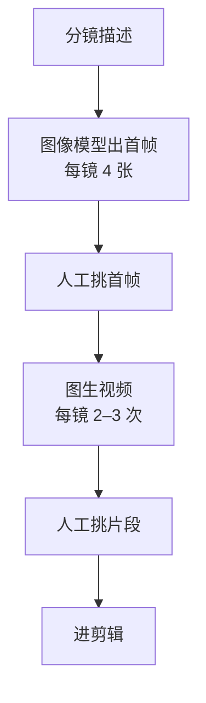
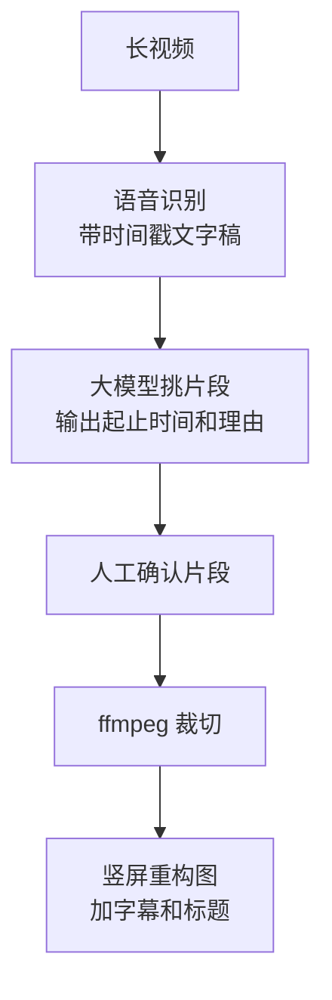

# 视频：生成与剪辑辅助

视频是 AI 工具变化最快、宣传最夸张的领域。演示视频里，一句话就能生成一段电影级画面；真正用到自己的账号上，你会发现生成的 10 秒镜头里人物的手在第 6 秒变了形，或者要抽七八次才有一条能用。另一方面，剪辑辅助类的 AI 功能（自动字幕、剪口误、长视频切片）已经足够成熟，安安静静地替很多创作者省下了一半剪辑时间。

这一章把视频相关的 AI 分成两块讲：**生成**（文生视频、图生视频）和**剪辑辅助**（字幕、剪口播、切片、模板化成片）。对大多数自媒体账号，第二块的投入产出比远高于第一块。剪辑的基本功见[《拍摄与剪辑实务》](../shooting-editing/)，AI 短剧里的镜头生成和运镜控制见[《AI 短剧分镜与画面生成》](../ai-drama-storyboard/)。

## 生成模型：现状和选型

### 截至 2026 年 11 月的格局

> [!WARNING]
> 本节的模型型号、下线时间和价格区间按截至 2026-11 的公开资料（含第三方汇总）整理，模型一个季度就会更新一轮，以各厂商官网、官方公告和定价页为准。

| 模型 | 厂商 | 公开资料中的特点 |
|---|---|---|
| 可灵 Kling 3.0 / Omni 系列 | 快手 | 多镜头、对白口型、原生音频；国内创作者用得最多的之一 |
| Seedance 2.x（即梦） | 字节跳动 | 支持多张参考图、视频、音频混合输入，叙事和一致性评价高 |
| 海螺 Hailuo 2.3 | MiniMax | 动作表现力好，性价比高 |
| Vidu Q 系列 | 生数科技 | 参考生视频、时长相对长 |
| 通义万相 Wan 2.x | 阿里 | 有开源版本，可本地部署 |
| Veo 3.1 | Google | 写实质感和原生音频突出 |
| Runway Gen-4.5 | Runway | 运镜控制、编辑工具链 |

几点说明：

- 单条生成时长普遍在 5–15 秒，长视频是多条拼接出来的
- 2026 年 OpenAI 宣布 Sora 2 网页端和 App 于 4 月下线、API 于 9 月下线（据第三方汇总，以 OpenAI 官方公告为准），这是「每类工具准备备选」的一个现成例子
- 据第三方聚合平台 2026 年年中的报价，主流模型 API 按秒计费，从每秒几分钱到二三毛美元不等，档位（快速 / 专业、分辨率、是否带音频）对价格影响很大；国内平台多用积分制会员。第 9 章会讲怎么按自己的用量算

### 选型看什么

| 维度 | 为什么重要 | 怎么测 |
|---|---|---|
| 图生视频的稳定性 | 自媒体里大部分可用镜头来自图生视频 | 拿你自己的 10 张图各生成 3 次，数能用的 |
| 抽卡率 | 决定真实成本，比单价更重要 | 同上，记录「生成次数 / 可用条数」 |
| 中文提示词理解 | 国内模型普遍更好 | 同一段中文描述横向对比 |
| 时长和分辨率 | 竖屏 1080p 是基本要求 | 看输出参数 |
| 原生音频 | 有环境音能省后期，但对白一般仍要单独配 | 听一遍 |
| 商用条款和标识 | 导出的视频是否带水印、能否商用 | 看会员档位说明和用户协议 |

**抽卡率是最容易被忽视的指标。** 单价便宜一半但每 5 次才有 1 条能用的模型，比单价贵一点但每 2 次就有 1 条能用的模型更贵，还更费人的时间。

## 什么镜头适合生成

先回答这个问题，再谈怎么生成。

| 适合生成 | 不适合生成 |
|---|---|
| 空镜和氛围：城市夜景、雨天窗户、咖啡冒热气 | 你本人出镜讲述，观众要的是真人 |
| 抽象概念的可视化：「数据流动」「时间流逝」 | 带货产品的展示，必须是实物 |
| 无法实拍的画面：历史场景、微观世界、科幻设定 | 新闻和真实事件，即使标注也容易被传播成谣言 |
| 静态插画动起来：封面图、示意图加一点运动 | 需要精确文字的画面：界面操作、数据图表 |
| 转场和片头片尾 | 复杂的多人互动、精细的手部操作 |

一个判断方法：**这个镜头如果换成图库素材，观众会在意吗？** 不在意的镜头，适合生成；观众在意真实性的镜头，不要生成。

口播类账号最常见的用法，是把 AI 生成的空镜和动态插画当 B-roll，插在口播段落之间，替代过去从图库里找素材。

## 先出图，再动起来

文生视频的可控性远不如图生视频。稳定的做法是两步：



好处有三：

1. **构图和风格在图像阶段就定下来了**，图像生成便宜、快，适合多试
2. **账号风格一致**：首帧可以套用第 3 章的风格卡和参考图
3. **视频生成只负责「动」**，提示词可以短而准，抽卡率明显提高

部分模型支持首尾帧（给定开头和结尾两张图，生成中间的运动），适合做转场和变化类镜头。

### 图生视频提示词模板

图生视频的提示词只描述**运动**，不要重复描述图里已经有的东西：

```text
镜头运动：{{缓慢推近 / 固定机位 / 从左向右平移 / 轻微手持晃动}}
主体动作：{{女孩抬头看向窗外，头发被风轻轻吹动}}
环境变化：{{窗外雨滴缓慢滑落，远处霓虹灯闪烁}}
节奏：{{缓慢、平静}}
时长：{{5}} 秒
保持：人物外貌、服装、画面风格与首帧一致；
避免：人物变形、多余肢体、画面闪烁、突然切换场景、出现文字。
```

几条经验：

- **一个镜头只做一件事**。「推近 + 转身 + 拿起杯子 + 微笑」四个动作放一个 5 秒镜头里，大概率崩
- **运镜比动作稳定**。镜头推拉摇移的成功率明显高于复杂的人物动作，拿不准时用运镜制造动态
- **人物动作幅度要小**。眨眼、转头、头发飘动、走路，这些小动作成功率高；跑跳、打斗、手部精细操作成功率低
- **记下每次生成的参数**：模型版本、提示词、首帧、种子（如果支持），好结果才能复现

### 生成片段的质检

每条片段进剪辑前看三遍：正常速度一遍、0.5 倍速一遍、逐帧拖动关键位置一遍。重点检查：

- [ ] 手和手指：数量、形状、是否和物体穿插
- [ ] 脸：前后是否是同一个人，眼睛和嘴有没有扭曲
- [ ] 文字：画面里的招牌、屏幕、书本有没有出现乱码
- [ ] 物理：液体、布料、头发的运动是否合理，物体有没有凭空出现或消失
- [ ] 闪烁：背景和光线有没有忽明忽暗
- [ ] 结尾：最后一秒有没有突然崩坏（很常见，剪掉即可）

有问题的片段，能剪掉问题部分就剪，剪不掉就重新生成。不要寄希望于观众看不出来：平台用户刷得多，对「AI 味」画面越来越敏感，评论区一句「AI 做的吧」就能拉低整条视频的信任感。

## 剪辑辅助：真正省时间的地方

### 自动字幕

字幕是 AI 在剪辑里最成熟的应用。剪映等剪辑软件的识别字幕功能已经能满足大部分口播需求，需要自己搭流水线时，可以用开源或云端的语音识别模型：

| 方案 | 特点 |
|---|---|
| 剪辑软件内置识别 | 最省事，和时间轴直接对齐 |
| Whisper 系列（含 faster-whisper 等实现） | 开源，多语言，本地可跑；中文需注意简繁和标点 |
| FunASR / SenseVoice | 阿里开源，中文和方言表现好 |
| 云厂商 ASR | 稳定，按时长计费，带热词功能 |

下面是用 faster-whisper 生成 SRT 字幕的 Python 示例（示例代码，未在生产环境跑过）：

```python
from faster_whisper import WhisperModel

def fmt(t: float) -> str:
    h, rem = divmod(t, 3600)
    m, s = divmod(rem, 60)
    return f"{int(h):02d}:{int(m):02d}:{int(s):02d},{int((s % 1) * 1000):03d}"

def to_srt(audio_path: str, out_path: str, hotwords: str = "") -> None:
    model = WhisperModel("large-v3", device="auto", compute_type="auto")
    segments, _ = model.transcribe(
        audio_path,
        language="zh",
        vad_filter=True,                # 过滤静音段
        initial_prompt=f"以下是简体中文口播，包含术语：{hotwords}。",
    )
    with open(out_path, "w", encoding="utf-8") as f:
        for i, seg in enumerate(segments, start=1):
            f.write(f"{i}\n{fmt(seg.start)} --> {fmt(seg.end)}\n{seg.text.strip()}\n\n")

if __name__ == "__main__":
    to_srt("voice.wav", "voice.srt", hotwords="独立开发, SaaS, 薯条, DOU+")
```

识别出的字幕最常见的错误是**专有名词和同音字**：「DOU+」识别成「豆加」，「SaaS」识别成「萨斯」。两个办法：识别时传热词（上面的 `initial_prompt`，或云服务的热词表），识别后用大模型按词表校对。

### 字幕校对模板

```text
下面是一段语音识别生成的 SRT 字幕。只修正识别错误，不要改写内容。

规则：
1. 只改错别字、同音字、专有名词，参考词表
2. 不改时间轴，不合并、不拆分条目，条目数量必须和输入一致
3. 不改口语表达，不删语气词（除非是明显的识别噪音）
4. 每条字幕不超过 {{16}} 个字；超过的不要改，在输出末尾列出条目编号
5. 输出完整的 SRT，然后输出一个修改清单：编号、原文、改后

词表：{{独立开发、SaaS、薯条、DOU+、V2EX、Stripe}}

<srt>
{{粘贴}}
</srt>
```

「条目数量必须和输入一致」这条可以在代码里检查：解析输出的 SRT，条目数和时间戳与输入逐条比对，不一致就丢弃重来。这正是第 1 章说的「能写成确定检查的就写成检查」。

### 剪口播：去口误和停顿

口播录制最费时的后期是剪掉口误、重复、长停顿。剪辑软件的「智能剪口播」类功能原理是：语音识别出带时间戳的文字 → 识别重复句、语气词、静音段 → 在时间轴上标出建议删除的片段。

用法上的建议：

- **录的时候就为它准备**：说错了停 2 秒，从这句开头重说。规律的停顿让自动识别更准
- **自动删除后一定要整体看一遍**。它会误删有意的停顿（制造悬念的那一下），也会漏删换了说法的重复
- 节奏是内容的一部分。自动剪出来的版本通常「太紧」，像机关枪，适当留回一些呼吸

### 长视频切片

把直播回放、播客、长视频切成多条短视频，是矩阵号和知识博主的常见做法。流程：



挑片段的提示词：

```text
下面是一段 {{90}} 分钟直播的文字稿，每行格式为 [开始秒数-结束秒数] 文字。

挑出 {{8}} 个适合做成 30–90 秒短视频的片段。标准：
- 开头一句话就能让人听懂在说什么，不依赖前文
- 有一个完整的观点、故事或问答
- 有具体的数字、例子或反常识的结论

每个片段输出：起止秒数（必须对齐文字稿里的时间）、建议标题、一句话理由、开头是否需要补一句说明背景。
不要拼接不相邻的段落。
```

模型给出时间后，用 ffmpeg 裁切：

```bash
# 从 1520.4 秒开始，截取 68 秒，重新编码以保证切点准确
ffmpeg -ss 1520.4 -i live.mp4 -t 68 -c:v libx264 -crf 20 -c:a aac clip-03.mp4
```

切片只能切**你自己有权使用**的内容：自己的直播和视频，或者取得授权的嘉宾内容。切别人的直播、影视剧、综艺发到自己的号上，是平台重点打击的搬运和侵权，不论是不是 AI 挑的片段。

## 模板化成片

当一类内容的结构固定（每日资讯、书单、数据播报、图文转视频），可以用代码批量生成成片，人只做审核。三条路：

| 方案 | 适合 | 注意 |
|---|---|---|
| 剪辑软件的模板和「图文成片」功能 | 不想写代码，量不大 | 模板同质化严重，别人也在用同一个模板 |
| ffmpeg / MoviePy 脚本 | 结构简单：图片序列 + 配音 + 字幕 | 复杂动画写起来累 |
| Remotion（用 React 写视频） | 前端开发者，需要精细的动画和数据驱动 | 商业使用有许可证要求，以官方许可证为准 |

剪映的草稿文件格式没有官方开放接口。社区有直接读写草稿文件的非官方项目，能把脚本生成的素材和字幕批量导进剪映再人工精修，但格式随版本变化，可能随时失效，用之前评估好维护成本。

模板化成片的最大风险是**同质化**：同一个模板、同一种配音、同一种结构，几十条视频看起来一模一样。平台对这类内容的处理见第 8 章和第 10 章。模板化应该用在「结构」上，每条的内容、素材、观点仍然要不同。

## 常见坑

| 坑 | 表现 | 怎么办 |
|---|---|---|
| 直接文生视频 | 风格乱，抽卡率低 | 先出首帧再图生视频 |
| 一个镜头塞多个动作 | 人物崩坏 | 一镜一事，用运镜制造动态 |
| 只看单价 | 实际成本是单价的好几倍 | 记录抽卡率，算每条可用片段成本 |
| 不逐帧检查 | 发出后评论区指出畸形的手 | 0.5 倍速 + 关键帧检查 |
| 字幕不校对 | 专有名词错误 | 热词 + 大模型按词表校对 + 代码检查条目数 |
| 自动剪口播不复看 | 节奏太紧、误删停顿 | 自动剪完整体看一遍，留呼吸 |
| 切别人的内容 | 侵权、搬运处罚 | 只切自己有权使用的内容 |
| 依赖单一模型 | 服务下线或涨价，流程断掉 | 每类准备备选，提示词不要写死某家的专有语法 |

## 本章要点

- 截至 2026 年 11 月，主流视频模型单条 5–15 秒，按秒或积分计费；比单价更重要的是抽卡率
- 适合生成的是观众不在意真实性的镜头：空镜、氛围、抽象概念、无法实拍的画面；真人讲述、带货实物、新闻事件不要生成
- 先用图像模型出首帧并挑选，再图生视频只负责「动」；一镜一事，运镜比复杂动作稳定
- 生成片段要用正常速度、0.5 倍速、逐帧三遍检查手、脸、文字、物理和闪烁
- 剪辑辅助的投入产出比最高：自动字幕加热词和词表校对、剪口播后复看节奏、长视频切片只切自己的内容
- 模板化成片用在结构上，内容和素材仍要每条不同，否则就是同质化
