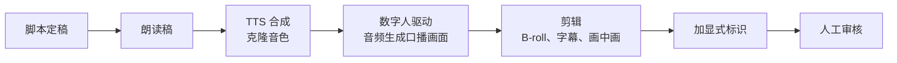

# 数字人：适用场景与平台态度

口播数字人是 AI 内容工具里最有争议的一类。一方面，它确实解决了真问题：讲课的人没时间每节都录，企业要把产品说明做成十几种语言，知识博主想日更但每天出镜太累。另一方面，它也是「AI 批量起号」「无人直播」「虚假人设种草」的核心工具，平台对它的态度明显比对 AI 配图、AI 字幕谨慎。

这一章讲数字人的几种技术形态、哪些场景适合用、怎么选和怎么做出不那么「假」的效果，以及平台目前的态度。AI 短剧里的角色口型同步属于另一类问题，见《AI 短剧后期》；数字人直播的完整风险见《直播实战》。

## 几种形态

| 形态 | 怎么做出来的 | 效果 | 典型用途 |
|---|---|---|---|
| 形象克隆数字人 | 用你本人几分钟的出镜视频训练，之后输入音频或文字驱动 | 最像本人，口型和小动作接近真实 | 博主的日常更新、课程 |
| 公共模特数字人 | 服务商提供的授权模特形象 | 质量稳定，但别人也在用同一张脸 | 企业宣传、产品说明、资讯播报 |
| 照片驱动 | 一张照片加一段音频，生成说话视频 | 头部动作有限，适合短片段 | 插画角色、历史人物讲解（注意权利） |
| 视频模型对口型 | 视频生成模型根据音频生成说话画面 | 灵活，可以有运镜和场景 | 剧情片段、AI 短剧 |
| 实时互动数字人 | 实时驱动，配合大模型回答问题 | 有延迟，互动生硬 | 直播、客服，风险最高 |

自媒体最常用的是前两种。下面的讨论以「形象克隆」为主。

## 适合和不适合

先说结论：**数字人适合「信息传递」型内容，不适合「关系建立」型内容。**

| 适合 | 不适合 |
|---|---|
| 系统课程、知识讲解：观众要的是信息，讲者是谁没那么重要 | 情感、生活、vlog：观众要的是真实的人和生活 |
| 资讯、财报、政策解读的播报 | 理财、医疗、法律建议：信任来自「真人负责」 |
| 产品功能说明、使用教程、多语种版本 | 带货推荐、使用体验：数字人没有用过产品，说「我用了三个月」就是虚假宣传 |
| 本人出镜之外的补充更新 | 人设账号的主力内容：观众关注的是那个人 |
| 企业对内培训 | 冒充真人、隐瞒 AI 身份的任何内容 |

还有一个现实的判断标准：**数字人内容的数据普遍不如本人出镜**。观众在前几秒就能察觉「这不是真人在说话」，完播率和互动率会受影响。如果一个账号的核心竞争力是「这个人」，用数字人替代主力内容，等于在削弱自己的核心竞争力。

更合理的组合是：重要的、有观点的、需要情绪的内容本人出镜；量大的、标准化的、信息型的内容用数字人；并且明确告诉观众哪些是数字人。

## 工具选型

截至 2026 年 11 月，国内常见的口播数字人工具有剪映数字人、腾讯智影、蝉镜、闪剪、硅基智能等，海外有 HeyGen 等；即梦、可灵等视频模型也提供了数字人或对口型能力。功能和价格以官网为准，选型看这几项：

| 维度 | 看什么 |
|---|---|
| 口型同步 | 中文的唇形是否对得上，尤其是「b p m f」这类闭口音；语速快时会不会糊 |
| 头部和手势 | 是否自然，有没有重复的循环动作（几秒一次相同的点头） |
| 形象授权流程 | 克隆形象时是否要求本人实名、本人出镜念授权声明；流程越严格，越说明服务商合规 |
| 标识 | 导出的视频是否自带 AI 标识，是否写入元数据隐式标识 |
| 计费 | 按分钟、按条还是会员制；克隆形象是否单独收费 |
| 音色 | 是否内置声音复刻，或能否导入你自己的 TTS 音频 |
| 输出 | 分辨率、是否支持绿幕或透明背景（方便后期合成） |

**授权流程严格是加分项，不是麻烦。** 如果一个服务允许你上传任意一段别人的视频就能克隆形象，它出了问题时你也会被连带。

## 拍训练素材

形象克隆的效果大半取决于训练素材。服务商一般有具体要求，通用的要点：

- **光线均匀**：正面柔光，避免顶光和侧逆光造成的脸部阴影
- **背景简单**：纯色背景或你常用的固定场景；想后期换背景就用绿幕
- **固定机位**：三脚架，平视，取景到胸部或腰部
- **自然说话**：用平时做视频的语气，带一些自然的手势，但不要大幅度动作
- **闭嘴停顿**：每段话之间闭嘴停 1–2 秒，帮助模型学到「不说话时的样子」
- **服装**：避免细条纹、小格子（容易产生摩尔纹），避免和背景同色
- **时长**：按服务要求，一般几分钟

训练素材里的你是什么样，数字人就是什么样。如果想要几套形象（正式、休闲），就分别拍几套素材。

## 从脚本到成片

两种驱动方式：

- **文字驱动**：在数字人平台里直接输入文字，平台用内置 TTS 合成并驱动。省事，但读法问题要在平台里调
- **音频驱动**：先用第 5 章的方法合成好朗读稿音频（或者干脆自己录音），再上传驱动数字人。读法更可控，也可以用你真实录的声音配数字人画面

建议用音频驱动。声音是观众最先察觉「不对劲」的地方，把声音单独处理好，数字人只负责画面。

### 让数字人不那么「假」

数字人口播最大的问题是**单调**：一个人从头到尾站在同一个位置、同一个景别说话。改善的办法都在剪辑里：

1. **不要全程大头**。数字人画面占 40%–60% 的时长，其余时间切 B-roll、图表、录屏，数字人缩成画中画或只保留声音
2. **切景别**。如果输出分辨率够高，可以在剪辑里裁出近景和中景交替使用，模拟双机位
3. **开头用真人**。开头 3 秒决定观众是否继续看，这几秒用你真实拍摄的画面
4. **不要让数字人做它做不好的事**：大笑、哭、激烈情绪、手持物品展示
5. **字幕和重点标注**多做一些，分散对口型的注意力

## 平台态度

平台对数字人的态度可以概括为：**允许标准化的、标识清楚的使用，打击批量起号、冒充真人和低质内容。** 几份直接相关的平台规则（要点概括，详细出处见第 10 章）：

- 抖音 2023 年发布《关于人工智能生成内容的平台规范暨行业倡议》，要求发布者对 AI 生成内容进行显著标识，并对虚拟人形象提出注册和使用者实名等管理要求
- 抖音 2024 年发布关于不当利用 AI 生成虚拟人物的治理公告，表示不鼓励利用 AI 虚拟人物进行低质创作，对发布违背科学常识、弄虚作假、造谣传谣内容的行为严格处罚
- 抖音 2025 年 5 月开展「AI 起号」专项治理，把引导规避平台 AI 标注、转让销售 AI 虚拟账号等列为违规
- 小红书 2026 年 4 月发布的 AI 内容治理规则，把「利用 AI 工具自动运营账号、冒充真人互动」列为 AI 违规运营，把「以虚假人设种草」列为 AI 造假

合在一起看，数字人账号的几条底线：

1. **标识**：视频要按规定加显式标识，发布时声明含 AI 生成内容；账号简介里写明使用数字人也是好习惯
2. **不冒充**：不让观众误以为是真人在说话；评论区不用 AI 自动以「本人」口吻回复
3. **不虚构体验**：数字人不说「我用过」「我吃了」「我亲测」
4. **不批量起号**：同一个数字人形象、同一套模板，铺几十个账号，是专项治理的直接对象（第 8 章）
5. **无人直播慎之又慎**：用数字人或录播替代真人直播，各平台都有限制，风险详见《直播实战》

### 用的是谁的脸

形象克隆只能用你自己的形象，或者取得明确书面授权的他人形象。授权的要点和第 5 章的声音授权书类似：用途、平台、期限、内容范围、撤回、报酬。肖像权受《民法典》保护，商业使用他人肖像未经同意构成侵权；深度合成管理规定同样要求编辑人脸要取得被编辑个人的单独同意。

公共模特数字人由服务商负责模特的授权，但你仍要看清使用条款：哪些内容类别不允许用（常见的禁止类别有医疗、金融、政治、成人），能否用于商业广告。

**绝对不能做的**：用明星、公众人物、网红的形象做数字人；用网上找来的照片或视频做照片驱动；做已故人物的「复活」视频而没有取得近亲属同意。

## 数字人的成本账

数字人的成本由三部分组成：形象克隆的一次性费用、按分钟或会员计的生成费用、剪辑加工的人工。一个容易忽略的事实是：**数字人省下的主要是拍摄时间，剪辑时间并没有少**，为了不单调，剪辑反而要花更多功夫。

是否值得用，可以这样估算：

$$
\text{每月节省} = N \times (t_{\text{拍摄}} - t_{\text{额外剪辑}}) \times c_{\text{时间}} - C_{\text{数字人订阅}}
$$

其中 $N$ 是每月用数字人替代的条数，$t$ 是每条的时间，$c_{\text{时间}}$ 是你一小时的时间价值。如果每条拍摄只要 20 分钟，而数字人版本要多剪 15 分钟，那省下的几乎可以忽略，还要付订阅费。数字人真正划算的，是「拍摄成本很高」的场景：多语种、需要专业布景、本人极度缺时间。第 9 章会把这类账算得更细。

## 质检清单

- [ ] 口型和音频对得上，尤其闭口音和语速快的段落
- [ ] 没有明显的循环动作、表情僵硬、牙齿或眼睛异常
- [ ] 数字人画面占比不超过一半，穿插了 B-roll 或其他画面
- [ ] 视频起始画面有显式 AI 标识，发布时声明了 AI 生成
- [ ] 稿子里没有「我用过」「我亲测」这类数字人无法真实做到的表述
- [ ] 形象是自己的、书面授权的或服务商可商用的模特，用途符合条款
- [ ] 内容不属于平台或服务商禁止数字人使用的类别

## 常见坑

| 坑 | 表现 | 怎么办 |
|---|---|---|
| 人设账号主力用数字人 | 数据下滑，粉丝流失 | 本人出镜做主力，数字人做补充 |
| 全程数字人大头 | 单调，完播低 | 画面占比控制在一半以内，多切 B-roll |
| 用文字驱动 | 读法错误难调 | 音频单独合成好再驱动 |
| 训练素材随手拍 | 脸部阴影、摩尔纹、动作怪 | 按拍摄要点重拍 |
| 用公共模特做敏感品类 | 违反服务商条款 | 先看禁止类别 |
| 不加标识 | 被平台识别后补标、限流 | 视频起始加标识，发布时声明 |
| 数字人带货说亲测 | 虚假宣传 | 只陈述产品客观信息 |

## 本章要点

- 数字人有形象克隆、公共模特、照片驱动、视频模型对口型、实时互动几种形态，自媒体常用前两种
- 数字人适合信息传递型内容（课程、播报、产品说明、多语种），不适合关系建立型内容（人设、情感、需要信任背书的建议）
- 选型看中文口型、动作自然度、授权流程、标识、计费；授权流程严格是加分项
- 用音频驱动，声音单独处理；剪辑里控制数字人画面占比，开头用真人，不让它做激烈情绪和展示动作
- 平台的态度是允许标识清楚的标准化使用，打击批量起号、冒充真人、虚假人设和低质内容
- 只用自己的、书面授权的或服务商可商用的形象；数字人省的是拍摄时间，剪辑时间反而可能增加
