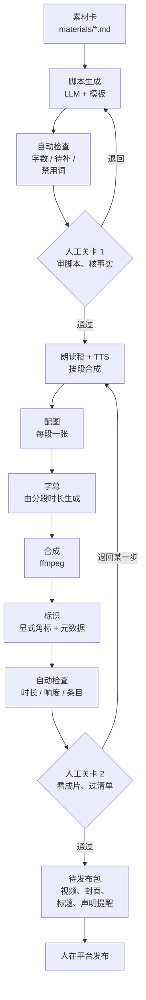

# 搭一条自动化流水线（上）：架构与骨架

前面几章把每个环节的工具和做法拆开讲了。这一章和[下一章](07-pipeline-stages.md)把它们串成一条流水线：从素材卡出发，经过选题、脚本、配音、配图、字幕、合成，到一个「待发布包」，中间有两道人工审核关卡，发布按钮留在人手里。第 7 章分上下两篇：上篇（本章）讲架构、数据结构和代码骨架的公共部分（类型、大模型调用、适配层、确定性检查、脚本步骤）；下篇讲配音、合成、标识、人工关卡、主流程和待发布包。

示例是一条「知识类图文口播」流水线：画面是配图加轻微运动，声音是 TTS 旁白，字幕自动生成。这是最容易完全跑通的形态，跑通之后，把配图换成图生视频、把 TTS 换成真人录音或数字人，骨架不用变。

**本章代码是骨架示例，未在生产环境跑过。** 它的目的是展示结构和关键的设计决策，各家 API 的具体参数以官方文档为准。通用的工作流编排思路见[《用 AI 撑起一人公司》第 7 章](../ai-native-opc/07-automation-pipeline.md)，LLM 调用的重试和错误处理见[《大模型应用工程》第 9 章](../llm-app-engineering/09-errors-retries.md)。

## 架构



几个设计决策：

1. **每一步的输入输出都是文件**。每条内容一个目录，每一步读上一步的文件、写自己的文件。出错了能看到在哪一步，改了某一步可以只从这一步重跑
2. **每一步幂等**。输出已经存在就跳过，除非显式要求重跑。图像和视频生成是花钱的，不能因为后面一步失败就从头再跑
3. **两道人工关卡**。脚本关卡在花钱之前：脚本不行，后面的配音配图都白做；成片关卡在发布之前
4. **自动检查只做确定的事**。字数、残留标记、时长、响度、字幕条目数，这些能用代码判断的，用代码判断；「内容好不好」留给人
5. **不自动发布**。理由见[下篇「为什么不自动发布」](07-pipeline-stages.md#为什么不自动发布)

## 目录和数据结构

```text
jobs/2026-11-03-first-users/
├── job.json
├── material.md
├── script.json
├── review-script.json
├── segments/
│   ├── 01.read.txt
│   ├── 01.mp3
│   ├── 01.png
│   └── ...
├── subtitles.srt
├── draft.mp4
├── final.mp4
├── cover.jpg
├── review-final.json
└── publish/
```

- `job.json`：状态和元数据
- `material.md`：素材卡副本
- `script.json`：脚本：hooks、segments、facts、todo
- `review-script.json`：人工关卡 1 的结论
- `segments/`：`01.read.txt` 是朗读稿，`01.mp3` 是配音，`01.png` 是配图
- `draft.mp4`：合成结果
- `final.mp4`：加标识后
- `review-final.json`：人工关卡 2 的结论
- `publish/`：待发布包

`job.json` 记录每一步的状态和用到的模型、提示词版本，方便回头和数据对照：

```json
{
  "id": "2026-11-03-first-users",
  "format": "koubo-image-60s",
  "stages": {
    "script":    { "status": "done", "model": "deepseek-chat", "prompt": "script-koubo-60s.v5", "at": "2026-11-03T09:12:00+08:00" },
    "gate1":     { "status": "approved", "by": "me", "at": "2026-11-03T09:40:00+08:00" },
    "tts":       { "status": "done", "provider": "volc", "voice": "my-clone-v2" },
    "images":    { "status": "running" },
    "subtitles": { "status": "pending" },
    "assemble":  { "status": "pending" },
    "label":     { "status": "pending" },
    "gate2":     { "status": "pending" }
  },
  "cost": { "llm": 0.03, "tts": 0.21, "image": 1.6, "currency": "CNY" }
}
```

`cost` 字段每一步累加，第 9 章算账时直接用。

## 代码骨架

用 TypeScript 写，Node 22+。目录结构：

```text
pipeline/
├── src/
│   ├── types.ts
│   ├── job.ts
│   ├── llm.ts
│   ├── providers.ts
│   ├── checks.ts
│   ├── stages/
│   └── cli.ts
└── prompts/
```

- `job.ts`：读写 job 目录
- `llm.ts`：大模型调用
- `providers.ts`：TTS、图像的适配层
- `checks.ts`：确定性检查
- `stages/`：每一步一个文件
- `prompts/`：第 2 章的提示词模板

### 类型

```ts
// types.ts
import { z } from "zod";

export const Segment = z.object({
  text: z.string().min(1),          // 字幕用的原稿
  visual: z.string().min(1),        // 这一段的画面描述，给图像模型
});

export const Script = z.object({
  hooks: z.array(z.string()).min(1),
  segments: z.array(Segment).min(3).max(12),
  facts: z.array(z.string()),
  todo: z.array(z.string()),
});
export type Script = z.infer<typeof Script>;

export type StageName =
  | "script" | "gate1" | "tts" | "images"
  | "subtitles" | "assemble" | "label" | "gate2" | "package";

export type StageStatus = "pending" | "running" | "done" | "failed" | "approved" | "rejected";

export interface StageState {
  status: StageStatus;
  at?: string;
  error?: string;
  [k: string]: unknown;   // model、prompt、provider 等元数据
}

export interface Job {
  id: string;
  dir: string;
  format: string;
  stages: Partial<Record<StageName, StageState>>;
  cost: Record<string, number>;
}
```

脚本的 schema 比第 2 章的模板多了一层 `segments`：每段文字配一个画面描述。这样后面的配音、配图、字幕都能按段对齐。

### 大模型调用

国内主流模型大多提供 OpenAI 兼容的接口，写一个薄封装就能切换：

```ts
// llm.ts
import type { ZodType } from "zod";

const BASE = process.env.LLM_BASE_URL!;   // 例：某家模型服务的 OpenAI 兼容地址
const KEY = process.env.LLM_API_KEY!;
const MODEL = process.env.LLM_MODEL!;

export async function chatJson<T>(prompt: string, schema: ZodType<T>, retries = 2): Promise<T> {
  let lastErr: unknown;
  for (let i = 0; i <= retries; i++) {
    const res = await fetch(`${BASE}/chat/completions`, {
      method: "POST",
      headers: { "Content-Type": "application/json", Authorization: `Bearer ${KEY}` },
      body: JSON.stringify({
        model: MODEL,
        messages: [{ role: "user", content: prompt }],
        response_format: { type: "json_object" },
        temperature: 0.7,
      }),
    });
    if (!res.ok) { lastErr = new Error(`LLM ${res.status}`); continue; }
    const data = (await res.json()) as { choices: { message: { content: string } }[] };
    try {
      return schema.parse(JSON.parse(data.choices[0].message.content));
    } catch (e) {
      lastErr = e;          // JSON 不合法或不符合 schema，重试
    }
  }
  throw lastErr;
}
```

`response_format` 各家支持程度不同，有的要换成工具调用或在提示词里约束，见[《大模型应用工程》第 3 章](../llm-app-engineering/03-structured-output.md)。关键是**输出一定要过 schema 校验**，不合法就重试，不要让不合法的数据流到下一步。

### 适配层

TTS 和图像服务换得频繁，用接口隔开：

```ts
// providers.ts
export interface TtsProvider {
  name: string;
  /** 合成一段朗读稿，返回音频文件路径、时长（秒）、费用 */
  synth(text: string, outPath: string, opts: { voice: string; speed?: number }):
    Promise<{ duration: number; cost: number }>;
}

export interface ImageProvider {
  name: string;
  /** 生成 n 张候选图，返回文件路径和费用 */
  generate(prompt: string, outPrefix: string, opts: { n: number; ratio: "9:16" | "3:4" | "16:9" }):
    Promise<{ files: string[]; cost: number }>;
}

// 具体实现按各家官方 API 文档写，例如：
// export const volcTts: TtsProvider = { name: "volc", async synth(...) { ... } };
// export const seedreamImage: ImageProvider = { name: "seedream", async generate(...) { ... } };
```

每个实现都要返回**费用**。费用按各家计费规则在本地估算（字符数乘单价、张数乘单价），写进 `job.json`。

### 确定性检查

```ts
// checks.ts
import type { Script } from "./types";

const BANNED = ["首先", "其次", "总而言之", "值得注意的是", "家人们", "震惊", "保证", "100%", "月入"];

export interface CheckResult { ok: boolean; problems: string[] }

export function checkScript(s: Script, maxChars: number): CheckResult {
  const problems: string[] = [];
  const all = s.segments.map((x) => x.text).join("");

  if (all.length > maxChars) problems.push(`字数 ${all.length} 超过 ${maxChars}`);
  if (all.includes("【待补")) problems.push("脚本里有未补的【待补】");
  if (s.todo.length > 0) problems.push(`todo 未清空：${s.todo.join("；")}`);
  for (const w of BANNED) if (all.includes(w)) problems.push(`出现禁用词「${w}」`);
  s.segments.forEach((seg, i) => {
    seg.text.split(/[。！？]/).forEach((sentence) => {
      if (sentence.length > 30) problems.push(`第 ${i + 1} 段有超过 30 字的长句`);
    });
  });
  return { ok: problems.length === 0, problems };
}

export function checkSrt(srt: string, expectedCount: number): CheckResult {
  const count = srt.trim().split(/\n\s*\n/).length;
  return count === expectedCount
    ? { ok: true, problems: [] }
    : { ok: false, problems: [`字幕 ${count} 条，应为 ${expectedCount} 条`] };
}
```

禁用词表按账号和平台维护。广告法里的绝对化用语、平台的敏感词，可以逐步加进来，但要记住：**词表只能挡住最明显的问题**，语境里的问题还是要人看。

### 步骤：脚本

```ts
// stages/script.ts
import { readFile, writeFile } from "node:fs/promises";
import { join } from "node:path";
import { chatJson } from "../llm";
import { Script } from "../types";
import { checkScript } from "../checks";
import type { Job } from "../types";

export async function runScript(job: Job): Promise<void> {
  const out = join(job.dir, "script.json");
  const material = await readFile(join(job.dir, "material.md"), "utf8");
  const template = await readFile("prompts/script-koubo-60s.v5.md", "utf8");
  const prompt = template.replace("{{material}}", material);

  const script = await chatJson(prompt, Script);
  await writeFile(out, JSON.stringify(script, null, 2));

  const check = checkScript(script, 300);
  job.stages.script = {
    status: "done",
    model: process.env.LLM_MODEL,
    prompt: "script-koubo-60s.v5",
    checks: check.problems,          // 检查结果交给人工关卡展示，不在这里拦截
    at: new Date().toISOString(),
  };
}
```

自动检查的结果不直接拦截，而是带到人工关卡给人看。原因是有些「问题」是有意为之（比如一个故意的长句），让人决定比让规则一刀切好。只有硬性问题（残留【待补】、schema 不合法）才在关卡前直接拦下。

## 本章要点

- 流水线按文件组织：每条内容一个目录，每一步读上一步的文件、写自己的文件，步骤幂等，花钱的步骤不重复跑
- 两道人工关卡：脚本关卡放在花钱之前，成片关卡放在发布之前
- 自动检查只做确定的事（字数、残留标记、禁用词、字幕条目、响度），结果展示给人，硬性问题才直接拦截
- 大模型输出必须过 schema 校验；TTS、图像用适配层隔开，每次调用记录费用

脚本过了关卡 1 之后的配音、合成、标识、关卡实现和待发布包，见[第 7 章（下）](07-pipeline-stages.md)。
