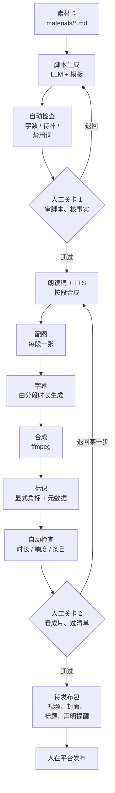

# 搭一条自动化流水线

前面几章把每个环节的工具和做法拆开讲了。这一章把它们串成一条流水线：从素材卡出发，经过选题、脚本、配音、配图、字幕、合成，到一个「待发布包」，中间有两道人工审核关卡，发布按钮留在人手里。

示例是一条「知识类图文口播」流水线：画面是配图加轻微运动，声音是 TTS 旁白，字幕自动生成。这是最容易完全跑通的形态，跑通之后，把配图换成图生视频、把 TTS 换成真人录音或数字人，骨架不用变。

**本章代码是骨架示例，未在生产环境跑过。** 它的目的是展示结构和关键的设计决策，各家 API 的具体参数以官方文档为准。通用的工作流编排思路见[《用 AI 撑起一人公司》第 7 章](../ai-native-opc/07-automation-pipeline.md)，LLM 调用的重试和错误处理见[《大模型应用工程》第 9 章](../llm-app-engineering/09-errors-retries.md)。

## 架构



几个设计决策：

1. **每一步的输入输出都是文件**。每条内容一个目录，每一步读上一步的文件、写自己的文件。出错了能看到在哪一步，改了某一步可以只从这一步重跑
2. **每一步幂等**。输出已经存在就跳过，除非显式要求重跑。图像和视频生成是花钱的，不能因为后面一步失败就从头再跑
3. **两道人工关卡**。脚本关卡在花钱之前：脚本不行，后面的配音配图都白做；成片关卡在发布之前
4. **自动检查只做确定的事**。字数、残留标记、时长、响度、字幕条目数，这些能用代码判断的，用代码判断；「内容好不好」留给人
5. **不自动发布**。理由见本章最后一节

## 目录和数据结构

```text
jobs/2026-11-03-first-users/
├── job.json
├── material.md
├── script.json
├── review-script.json
├── segments/
│   ├── 01.read.txt
│   ├── 01.mp3
│   ├── 01.png
│   └── ...
├── subtitles.srt
├── draft.mp4
├── final.mp4
├── cover.jpg
├── review-final.json
└── publish/
```

- `job.json`：状态和元数据
- `material.md`：素材卡副本
- `script.json`：脚本：hooks、segments、facts、todo
- `review-script.json`：人工关卡 1 的结论
- `segments/`：`01.read.txt` 是朗读稿，`01.mp3` 是配音，`01.png` 是配图
- `draft.mp4`：合成结果
- `final.mp4`：加标识后
- `review-final.json`：人工关卡 2 的结论
- `publish/`：待发布包

`job.json` 记录每一步的状态和用到的模型、提示词版本，方便回头和数据对照：

```json
{
  "id": "2026-11-03-first-users",
  "format": "koubo-image-60s",
  "stages": {
    "script":    { "status": "done", "model": "deepseek-chat", "prompt": "script-koubo-60s.v5", "at": "2026-11-03T09:12:00+08:00" },
    "gate1":     { "status": "approved", "by": "me", "at": "2026-11-03T09:40:00+08:00" },
    "tts":       { "status": "done", "provider": "volc", "voice": "my-clone-v2" },
    "images":    { "status": "running" },
    "subtitles": { "status": "pending" },
    "assemble":  { "status": "pending" },
    "label":     { "status": "pending" },
    "gate2":     { "status": "pending" }
  },
  "cost": { "llm": 0.03, "tts": 0.21, "image": 1.6, "currency": "CNY" }
}
```

`cost` 字段每一步累加，第 9 章算账时直接用。

## 代码骨架

用 TypeScript 写，Node 22+。目录结构：

```text
pipeline/
├── src/
│   ├── types.ts
│   ├── job.ts
│   ├── llm.ts
│   ├── providers.ts
│   ├── checks.ts
│   ├── stages/
│   └── cli.ts
└── prompts/
```

- `job.ts`：读写 job 目录
- `llm.ts`：大模型调用
- `providers.ts`：TTS、图像的适配层
- `checks.ts`：确定性检查
- `stages/`：每一步一个文件
- `prompts/`：第 2 章的提示词模板

### 类型

```ts
// types.ts
import { z } from "zod";

export const Segment = z.object({
  text: z.string().min(1),          // 字幕用的原稿
  visual: z.string().min(1),        // 这一段的画面描述，给图像模型
});

export const Script = z.object({
  hooks: z.array(z.string()).min(1),
  segments: z.array(Segment).min(3).max(12),
  facts: z.array(z.string()),
  todo: z.array(z.string()),
});
export type Script = z.infer<typeof Script>;

export type StageName =
  | "script" | "gate1" | "tts" | "images"
  | "subtitles" | "assemble" | "label" | "gate2" | "package";

export type StageStatus = "pending" | "running" | "done" | "failed" | "approved" | "rejected";

export interface StageState {
  status: StageStatus;
  at?: string;
  error?: string;
  [k: string]: unknown;   // model、prompt、provider 等元数据
}

export interface Job {
  id: string;
  dir: string;
  format: string;
  stages: Partial<Record<StageName, StageState>>;
  cost: Record<string, number>;
}
```

脚本的 schema 比第 2 章的模板多了一层 `segments`：每段文字配一个画面描述。这样后面的配音、配图、字幕都能按段对齐。

### 大模型调用

国内主流模型大多提供 OpenAI 兼容的接口，写一个薄封装就能切换：

```ts
// llm.ts
import type { ZodType } from "zod";

const BASE = process.env.LLM_BASE_URL!;   // 例：某家模型服务的 OpenAI 兼容地址
const KEY = process.env.LLM_API_KEY!;
const MODEL = process.env.LLM_MODEL!;

export async function chatJson<T>(prompt: string, schema: ZodType<T>, retries = 2): Promise<T> {
  let lastErr: unknown;
  for (let i = 0; i <= retries; i++) {
    const res = await fetch(`${BASE}/chat/completions`, {
      method: "POST",
      headers: { "Content-Type": "application/json", Authorization: `Bearer ${KEY}` },
      body: JSON.stringify({
        model: MODEL,
        messages: [{ role: "user", content: prompt }],
        response_format: { type: "json_object" },
        temperature: 0.7,
      }),
    });
    if (!res.ok) { lastErr = new Error(`LLM ${res.status}`); continue; }
    const data = (await res.json()) as { choices: { message: { content: string } }[] };
    try {
      return schema.parse(JSON.parse(data.choices[0].message.content));
    } catch (e) {
      lastErr = e;          // JSON 不合法或不符合 schema，重试
    }
  }
  throw lastErr;
}
```

`response_format` 各家支持程度不同，有的要换成工具调用或在提示词里约束，见[《大模型应用工程》第 3 章](../llm-app-engineering/03-structured-output.md)。关键是**输出一定要过 schema 校验**，不合法就重试，不要让不合法的数据流到下一步。

### 适配层

TTS 和图像服务换得频繁，用接口隔开：

```ts
// providers.ts
export interface TtsProvider {
  name: string;
  /** 合成一段朗读稿，返回音频文件路径、时长（秒）、费用 */
  synth(text: string, outPath: string, opts: { voice: string; speed?: number }):
    Promise<{ duration: number; cost: number }>;
}

export interface ImageProvider {
  name: string;
  /** 生成 n 张候选图，返回文件路径和费用 */
  generate(prompt: string, outPrefix: string, opts: { n: number; ratio: "9:16" | "3:4" | "16:9" }):
    Promise<{ files: string[]; cost: number }>;
}

// 具体实现按各家官方 API 文档写，例如：
// export const volcTts: TtsProvider = { name: "volc", async synth(...) { ... } };
// export const seedreamImage: ImageProvider = { name: "seedream", async generate(...) { ... } };
```

每个实现都要返回**费用**。费用按各家计费规则在本地估算（字符数乘单价、张数乘单价），写进 `job.json`。

### 确定性检查

```ts
// checks.ts
import type { Script } from "./types";

const BANNED = ["首先", "其次", "总而言之", "值得注意的是", "家人们", "震惊", "保证", "100%", "月入"];

export interface CheckResult { ok: boolean; problems: string[] }

export function checkScript(s: Script, maxChars: number): CheckResult {
  const problems: string[] = [];
  const all = s.segments.map((x) => x.text).join("");

  if (all.length > maxChars) problems.push(`字数 ${all.length} 超过 ${maxChars}`);
  if (all.includes("【待补")) problems.push("脚本里有未补的【待补】");
  if (s.todo.length > 0) problems.push(`todo 未清空：${s.todo.join("；")}`);
  for (const w of BANNED) if (all.includes(w)) problems.push(`出现禁用词「${w}」`);
  s.segments.forEach((seg, i) => {
    seg.text.split(/[。！？]/).forEach((sentence) => {
      if (sentence.length > 30) problems.push(`第 ${i + 1} 段有超过 30 字的长句`);
    });
  });
  return { ok: problems.length === 0, problems };
}

export function checkSrt(srt: string, expectedCount: number): CheckResult {
  const count = srt.trim().split(/\n\s*\n/).length;
  return count === expectedCount
    ? { ok: true, problems: [] }
    : { ok: false, problems: [`字幕 ${count} 条，应为 ${expectedCount} 条`] };
}
```

禁用词表按账号和平台维护。广告法里的绝对化用语、平台的敏感词，可以逐步加进来，但要记住：**词表只能挡住最明显的问题**，语境里的问题还是要人看。

### 步骤：脚本

```ts
// stages/script.ts
import { readFile, writeFile } from "node:fs/promises";
import { join } from "node:path";
import { chatJson } from "../llm";
import { Script } from "../types";
import { checkScript } from "../checks";
import type { Job } from "../types";

export async function runScript(job: Job): Promise<void> {
  const out = join(job.dir, "script.json");
  const material = await readFile(join(job.dir, "material.md"), "utf8");
  const template = await readFile("prompts/script-koubo-60s.v5.md", "utf8");
  const prompt = template.replace("{{material}}", material);

  const script = await chatJson(prompt, Script);
  await writeFile(out, JSON.stringify(script, null, 2));

  const check = checkScript(script, 300);
  job.stages.script = {
    status: "done",
    model: process.env.LLM_MODEL,
    prompt: "script-koubo-60s.v5",
    checks: check.problems,          // 检查结果交给人工关卡展示，不在这里拦截
    at: new Date().toISOString(),
  };
}
```

自动检查的结果不直接拦截，而是带到人工关卡给人看。原因是有些「问题」是有意为之（比如一个故意的长句），让人决定比让规则一刀切好。只有硬性问题（残留【待补】、schema 不合法）才在关卡前直接拦下。

### 步骤：配音和字幕

按段合成配音有一个额外的好处：**每段的时长是已知的，字幕可以直接由分段时长生成，不需要再跑一遍语音识别**。

```ts
// stages/tts-and-subtitles.ts
import { writeFile } from "node:fs/promises";
import { join } from "node:path";
import { toReadable } from "../pronounce";          // 第 5 章的发音词典
import type { Job, Script } from "../types";
import type { TtsProvider } from "../providers";

const GAP = 0.4;   // 段间停顿，秒

export async function runTts(job: Job, script: Script, tts: TtsProvider): Promise<number[]> {
  const durations: number[] = [];
  let cost = 0;
  for (const [i, seg] of script.segments.entries()) {
    const n = String(i + 1).padStart(2, "0");
    const readable = toReadable(seg.text);
    await writeFile(join(job.dir, "segments", `${n}.read.txt`), readable);
    const r = await tts.synth(readable, join(job.dir, "segments", `${n}.mp3`), { voice: "my-clone-v2" });
    durations.push(r.duration);
    cost += r.cost;
  }
  job.cost.tts = cost;
  job.stages.tts = { status: "done", provider: tts.name, at: new Date().toISOString() };
  return durations;
}

/** 每段原稿再按标点切成短句，按字数比例分配该段时长 */
export function buildSrt(script: Script, durations: number[]): string {
  const ts = (t: number) => {
    const ms = Math.round(t * 1000);
    const h = Math.floor(ms / 3600000), m = Math.floor(ms / 60000) % 60;
    const s = Math.floor(ms / 1000) % 60, r = ms % 1000;
    return `${String(h).padStart(2, "0")}:${String(m).padStart(2, "0")}:${String(s).padStart(2, "0")},${String(r).padStart(3, "0")}`;
  };
  const items: string[] = [];
  let t = 0;
  script.segments.forEach((seg, i) => {
    const lines = seg.text.split(/(?<=[，。！？；])/).map((x) => x.replace(/[，。；]$/, "")).filter(Boolean);
    const total = lines.reduce((a, l) => a + l.length, 0);
    for (const line of lines) {
      const d = durations[i] * (line.length / total);
      items.push(`${items.length + 1}\n${ts(t)} --> ${ts(t + d)}\n${line}\n`);
      t += d;
    }
    t += GAP;
  });
  return items.join("\n");
}
```

按字数比例分配时长是近似的，对于 60 秒的口播，误差通常在可接受范围内；对齐要求高的话，用第 4 章的语音识别重新打时间戳，或者用 TTS 服务返回的字级时间戳（不少服务支持）。注意字幕用的是**原稿** `seg.text`，配音用的是**朗读稿** `readable`，这是第 5 章说的两稿分离。

### 步骤：合成

用 ffmpeg 把每段的图和音频合成一个片段，再拼接、烧字幕。下面直接拼命令行参数调用 ffmpeg：

```ts
// stages/assemble.ts
import { execFile } from "node:child_process";
import { promisify } from "node:util";
import { writeFile } from "node:fs/promises";
import { join } from "node:path";

const run = promisify(execFile);

export async function assemble(dir: string, count: number, durations: number[]): Promise<void> {
  const parts: string[] = [];
  for (let i = 0; i < count; i++) {
    const n = String(i + 1).padStart(2, "0");
    const d = (durations[i] + 0.4).toFixed(2);
    const out = join(dir, "segments", `${n}.mp4`);
    // 静态图加缓慢推近，避免画面完全不动
    await run("ffmpeg", [
      "-y", "-loop", "1", "-i", join(dir, "segments", `${n}.png`),
      "-i", join(dir, "segments", `${n}.mp3`),
      "-filter_complex",
      `[0:v]scale=1188:2112,zoompan=z='min(zoom+0.0006,1.08)':d=1:x='iw/2-(iw/zoom/2)':y='ih/2-(ih/zoom/2)':s=1080x1920:fps=30[v];[1:a]apad[a]`,
      "-map", "[v]", "-map", "[a]", "-t", d,
      "-c:v", "libx264", "-pix_fmt", "yuv420p", "-c:a", "aac", "-ar", "48000", out,
    ]);
    parts.push(`file '${out}'`);
  }
  const list = join(dir, "segments", "list.txt");
  await writeFile(list, parts.join("\n"));
  await run("ffmpeg", [
    "-y", "-f", "concat", "-safe", "0", "-i", list,
    "-vf", `subtitles=${join(dir, "subtitles.srt")}:force_style='FontName=Source Han Sans SC,FontSize=12,MarginV=60'`,
    "-af", "loudnorm=I=-16:TP=-1.5:LRA=11",
    "-c:v", "libx264", "-crf", "20", "-c:a", "aac", join(dir, "draft.mp4"),
  ]);
}
```

字幕的 `MarginV` 要把字幕抬离画面底部，避开平台界面的遮挡区（第 3 章）。烧字幕需要 ffmpeg 编译时带 libass。

### 步骤：标识

按《人工智能生成合成内容标识办法》，视频的显式标识应在起始画面和播放周边适当位置添加（原文见第 10 章）。流水线里在合成后统一加一个角标，保证每条都不会漏：

```ts
// stages/label.ts
export async function addLabel(dir: string): Promise<void> {
  await run("ffmpeg", [
    "-y", "-i", join(dir, "draft.mp4"),
    "-vf",
    // 全程左上角小角标；前 3 秒在画面中上部再显示一次较大的提示
    "drawtext=fontfile=/path/to/SourceHanSansSC-Regular.otf:text='AI 生成':x=40:y=120:fontsize=30:fontcolor=white@0.85:box=1:boxcolor=black@0.35:boxborderw=8," +
    "drawtext=fontfile=/path/to/SourceHanSansSC-Regular.otf:text='本视频含 AI 生成内容':x=(w-text_w)/2:y=h*0.18:fontsize=44:fontcolor=white:box=1:boxcolor=black@0.45:boxborderw=14:enable='lt(t,3)'",
    "-metadata", "comment=AIGC: 含人工智能生成合成内容",
    "-c:a", "copy", join(dir, "final.mp4"),
  ]);
}
```

（`run` 和 `join` 的导入同上一段。）

两点说明：

- 上面写进 `comment` 的元数据只是一个自己的记录，**不等于**国家标准规定的隐式标识格式。隐式标识主要由生成服务提供者写入（你调用的 TTS、图像服务导出的文件里），平台发布时也会核验和添加。自己合成时不要删除或篡改上游文件里的标识
- 角标的位置和样式参考各平台的要求，发布时**还要**在平台上勾选 AI 内容声明。流水线加角标是兜底，不是替代

### 步骤：人工关卡

关卡的实现很简单：流水线跑到关卡就停，生成一份审核页，等人写下结论。

```ts
// stages/gate.ts
import { readFile, writeFile, access } from "node:fs/promises";
import { join } from "node:path";
import type { Job } from "../types";

const FINAL_CHECKLIST = [
  "完整看过一遍成片，声音和画面没有错误",
  "字幕没有错字，和配音一致",
  "事实清单逐条核对过",
  "画面没有畸形、乱码、他人商标和真人肖像",
  "起始画面和角标有 AI 标识",
  "标题和封面与内容一致，没有夸大和效果承诺",
  "这条内容换掉账号名后仍然只有我能做出来",
];

export async function gate(job: Job, name: "gate1" | "gate2"): Promise<boolean> {
  const file = join(job.dir, name === "gate1" ? "review-script.json" : "review-final.json");
  try {
    await access(file);
  } catch {
    await writeFile(join(job.dir, `${name}.todo.md`),
      `# 待审：${job.id}\n\n${FINAL_CHECKLIST.map((c) => `- [ ] ${c}`).join("\n")}\n\n` +
      `审完后写 ${file}：{"approved": true|false, "note": "...", "checked": [...]}`);
    job.stages[name] = { status: "pending" };
    return false;                      // 停在这里，等人
  }
  const r = JSON.parse(await readFile(file, "utf8")) as { approved: boolean; checked?: string[] };
  const allChecked = name === "gate1" || (r.checked?.length ?? 0) === FINAL_CHECKLIST.length;
  job.stages[name] = { status: r.approved && allChecked ? "approved" : "rejected", at: new Date().toISOString() };
  return r.approved && allChecked;
}
```

`gate2` 要求清单全部勾选才算通过。这是一个小小的强制：不让「看都没看就点通过」那么容易。

### 主流程

```ts
// cli.ts
import { loadJob, saveJob } from "./job";
import { runScript } from "./stages/script";
import { gate } from "./stages/gate";
// ……其余步骤

async function main(id: string): Promise<void> {
  const job = await loadJob(id);
  const step = async (name: keyof typeof job.stages, fn: () => Promise<unknown>) => {
    if (job.stages[name]?.status === "done") return;          // 幂等：做过就跳过
    try {
      job.stages[name] = { status: "running" };
      await fn();
    } catch (e) {
      job.stages[name] = { status: "failed", error: String(e) };
      throw e;
    } finally {
      await saveJob(job);                                      // 每一步后都落盘
    }
  };

  await step("script", () => runScript(job));
  if (!(await gate(job, "gate1"))) return void (await saveJob(job));
  // await step("tts", ...); await step("images", ...); await step("subtitles", ...);
  // await step("assemble", ...); await step("label", ...);
  if (!(await gate(job, "gate2"))) return void (await saveJob(job));
  // await step("package", ...);
}

main(process.argv[2]).catch((e) => {
  console.error(e);
  process.exit(1);
});
```

用法：

```bash
pnpm pipeline new 2026-11-03-first-users --material materials/2026-11-01-first-users.md
pnpm pipeline run 2026-11-03-first-users      # 跑到关卡 1 停下
# 审脚本，写 review-script.json
pnpm pipeline run 2026-11-03-first-users      # 继续跑到关卡 2 停下
# 看成片，写 review-final.json
pnpm pipeline run 2026-11-03-first-users      # 生成待发布包
pnpm pipeline rerun 2026-11-03-first-users images   # 只重跑配图及其之后的步骤
```

## 待发布包

流水线的终点是一个目录，而不是一次发布：

```text
publish/
├── final.mp4
├── cover.jpg
├── post.md
└── checklist.md
```

- `post.md`：各平台的标题、简介、话题标签
- `checklist.md`：发布时要做的事

`checklist.md` 提醒发布时的手工步骤：

```text
发布前：
- 在发布页勾选 AI 生成内容声明（抖音：高级设置中的自主声明；其他平台见各自发布页）
- 选择封面 cover.jpg，在手机上预览遮挡
- 如用平台曲库音乐，在平台内添加，不要用本地混好的版本
- 商单内容勾选对应的商业合作标识

发布后：
- 记录作品链接到 jobs/<id>/job.json
- 24 小时、72 小时各记录一次数据
```

## 为什么不自动发布

技术上，你可能找得到自动发布的办法：平台开放接口里的部分能力、浏览器自动化、各种「多平台一键分发」工具。这本书的建议是：**发布这一步由人在平台上完成**。理由：

1. **平台规则**。各平台对非官方的自动化操作（脚本模拟、群控、批量登录）都有明确限制，被识别为异常操作会影响账号，严重的封号。用官方开放平台的能力是可以的，但通常需要企业资质、应用审核，并且有用途限制，以各平台开放平台文档为准（给创作者做工具时的接口问题，见[《给创作者和短剧团队做工具》](../creator-tools/)）
2. **最后一眼**。在手机上预览封面、勾选声明、看一眼标题，这一分钟能挡住很多事故
3. **问责清楚**。人点了发布，就意味着人对这条内容负责。自动发布的流水线，出了问题很难说清是谁的决定

自动化的终点是「让发布只需要一分钟」，而不是「让发布不需要人」。

## 跑起来之后

流水线跑通只是开始。接下来该做的：

- **记录每条的耗时和费用**，和手工做法比，看哪一步还值得优化（第 9 章）
- **把数据接回来**：发布后的播放、完播、互动记录到 job 目录，按提示词版本、模型、配图风格分组看，才知道改动有没有用
- **定期抽查**：每周随机挑几条已发布的内容，重新按清单检查一遍，看看关卡有没有流于形式

## 本章要点

- 流水线按文件组织：每条内容一个目录，每一步读上一步的文件、写自己的文件，步骤幂等，花钱的步骤不重复跑
- 两道人工关卡：脚本关卡放在花钱之前，成片关卡放在发布之前；成片关卡要求清单全部勾选
- 自动检查只做确定的事（字数、残留标记、禁用词、字幕条目、响度），结果展示给人，硬性问题才直接拦截
- 大模型输出必须过 schema 校验；TTS、图像用适配层隔开，每次调用记录费用
- 按段配音让字幕可以直接由时长生成；字幕用原稿，配音用朗读稿
- 显式标识在流水线里统一加作兜底，不删上游的隐式标识，发布时仍要在平台声明
- 终点是待发布包而不是自动发布：非官方自动化有封号风险，最后一眼和问责都需要人
