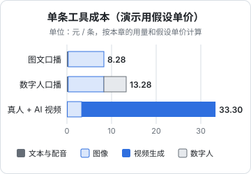

# 成本核算

「AI 做内容几乎不要钱」是一个常见的错觉。单次调用确实便宜，几分钱一次大模型、几毛钱一张图，但一条视频背后有几十次调用、反复的抽卡、几个月不用也在扣费的会员，以及最贵的那一项：你自己的时间。这一章教你按条、按月把账算清楚，知道钱花在哪里，哪一步值得自动化，什么时候该买会员、什么时候该走 API。

**本章所有单价都是为了演示计算方法而设的假设值，不是任何服务的报价。** AI 服务的价格变化很快，降价和改计费方式都很常见，算自己的账时请换成各家官网的当前价格。

## 成本由什么组成

| 类别 | 计费方式 | 特点 |
|---|---|---|
| 文本大模型 | 按 token，输入输出分别计价 | 单价低，但调用次数多 |
| 图像生成 | 按张，或会员积分 | 每张要出几张挑一张 |
| 视频生成 | 按秒，或会员积分；分辨率、档位、是否带音频影响大 | 最贵，抽卡率决定实际成本 |
| TTS | 按字符，或会员 | 单价低；克隆音色可能单独收费 |
| 数字人 | 按分钟，或会员；形象克隆可能一次性收费 | 会员制为主 |
| 剪辑软件、素材库、字体 | 月度或年度会员 | 固定成本，用不用都扣 |
| 人工 | 你的时间，或者外包、助理 | 通常是最大的一项 |

前五项是**可变成本**，随条数增长；会员是**固定成本**；人工介于两者之间，规模上去后单条时间会下降，但审核时间降得很有限（第 8 章）。

## 按条算：一个计算模板

> [!WARNING]
> 本章的单价都是演示用的假设值，不是任何工具在某个时间的实价；算自己的账时，以截至当时各工具官网定价页的价格和自己的调用记录为准，工具价格和会员档位经常调整。

把一条内容拆成调用次数：

$$
C_{\text{条}} = \sum_{\text{每类调用}} (\text{单价} \times \text{用量} \times \text{抽卡倍数})
$$

「抽卡倍数」是为了得到一个可用结果平均要生成几次。图像每次出 4 张挑 1 张，倍数就是 4；视频平均 3 次出 1 条可用，倍数就是 3。这个数用你自己的记录算，第 7 章流水线里每一步写进 `job.json` 的费用就是为此准备的。

下面用一组**假设单价**演示三种常见形态的单条成本：

| 假设单价（演示用） | 值 |
|---|---|
| 大模型输入 | 2 元 / 百万 token |
| 大模型输出 | 8 元 / 百万 token |
| TTS | 3 元 / 万字 |
| 图像 | 0.2 元 / 张 |
| 视频生成 | 0.5 元 / 秒 |
| 数字人 | 5 元 / 分钟（会员费按用量折算） |

### 形态 A：图文口播（配图 + TTS 旁白，约 60 秒）

| 项目 | 用量 | 计算 | 成本（元） |
|---|---|---|---|
| 大模型 | 选题、脚本、事实抽取、标题、改写，共约 2 万输入 token、8 千输出 token | 0.02 × 2 + 0.008 × 8 | 0.10 |
| TTS | 300 字，平均合成 2 遍 | 600 字 × 3 元 / 万字 | 0.18 |
| 图像 | 8 段配图 + 2 张封面底图 = 10 个提示词，每个出 4 张 | 40 张 × 0.2 | 8.00 |
| 合计 | | | 8.28 |

### 形态 B：真人口播 + AI 生成 B-roll

| 项目 | 用量 | 计算 | 成本（元） |
|---|---|---|---|
| 大模型 | 同上 | | 0.10 |
| 首帧图像 | 4 个 B-roll 镜头，每个出 4 张 | 16 张 × 0.2 | 3.20 |
| 视频生成 | 4 个镜头 × 5 秒，抽卡倍数 3 | 60 秒 × 0.5 | 30.00 |
| 合计 | | | 33.30 |

### 形态 C：数字人口播 + 配图 B-roll

| 项目 | 用量 | 计算 | 成本（元） |
|---|---|---|---|
| 大模型 | 同上 | | 0.10 |
| TTS | 同形态 A | | 0.18 |
| 数字人 | 1 分钟 | 1 × 5 | 5.00 |
| 图像 | 同形态 A | | 8.00 |
| 合计 | | | 13.28 |



在这组假设下，有几个结论不太依赖具体单价：

1. **大模型几乎可以忽略**。文字相关的调用加起来只有一毛钱量级，不必为了省这点钱换差的模型
2. **视频生成是大头**，而且对抽卡倍数非常敏感：倍数从 3 降到 2，形态 B 就省 10 元。提高抽卡率（先出图、一镜一事、短时长）是最有效的省钱手段
3. **图像的成本主要来自「每次出几张」**。出 4 张挑 1 张变成出 2 张挑 1 张，图像成本减半，但挑选余地也少了，要权衡

## 按月算：订阅和 API

### 月度总账

$$
C_{\text{月}} = N \times C_{\text{条}} + S + H \times c_h
$$

- $N$：每月条数
- $C_{\text{条}}$：单条可变成本
- $S$：每月订阅费合计
- $H$：每月投入的小时数
- $c_h$：你一小时的时间价值

用一个例子：每月 40 条形态 A，订阅合计 200 元（假设：剪辑软件会员、一个图像平台会员、素材库），每条人工 1.2 小时（含写素材卡、两道关卡、发布），时间价值按每小时 100 元算：

| 项目 | 计算 | 金额（元 / 月） |
|---|---|---|
| 工具可变成本 | 40 × 8.28 | 331 |
| 订阅 | | 200 |
| 人工 | 40 × 1.2 × 100 | 4,800 |
| 合计 | | 5,331 |
| 单条全成本 | 5,331 ÷ 40 | 约 133 |

人工占了九成。这就是为什么第 1 章说「先给自己的生产过程计时」：省工具钱的空间很小，省时间的空间很大，而时间里最不能省的又是审核。

### 订阅还是 API

同一个服务往往既有会员也有 API。判断方法是算盈亏平衡点：

$$
N^{*} = \frac{S_{\text{会员}}}{p_{\text{API}} \times q}
$$

$q$ 是每条的用量（张数、秒数），$p_{\text{API}}$ 是 API 单价。每月条数超过 $N^*$ 买会员更划算，低于它走 API 更划算。但还要考虑三点：

- **会员有额度上限**，超出后要么降速要么另付费；看清「无限」的具体含义
- **会员一般只能在网页或 App 里手工用**，不能接进流水线；要自动化就得走 API
- **会员常有商用限制**，低档会员可能不允许商用或带水印

一个常见的组合：探索期用会员手工试（不确定要不要长期做），流水线稳定后关键步骤切 API，同时保留一个最便宜档的会员用于手工补图。

## 时间账本

既然人工是最大的一项，就要像记工具费用一样记时间。工具费用流水线会自动写进 `job.json`，时间要自己记。最简单的办法是每条内容一行：

```text
date        id                         format   material  gate1  fix   gate2  publish  total
2026-11-03  2026-11-03-first-users     A        25m       30m    20m   15m    10m      100m
2026-11-04  2026-11-04-pricing-mistake A        15m       20m    5m    12m    8m       60m
2026-11-05  2026-11-05-v2ex-story      B        30m       25m    45m   20m    10m      130m
```

列的含义：写素材卡、关卡 1 改稿核事实、生成后的修补（重抽、补图、补录）、关卡 2 看成片、发布。记满一个月，看三件事：

1. **修补时间（fix）是不是在上升**。修补多，说明上游的提示词、风格卡、首帧质量有问题，应该回头改上游，而不是在下游补
2. **不同形态的总时间差多少**。上面的例子里形态 B 比形态 A 多花了约一倍时间，如果数据没有好一倍，就该少做 B
3. **关卡时间是不是在缩水**。关卡 2 的时间越来越短，可能是熟练了，也可能是在走过场；对照第 8 章的审核退回率一起看

把时间账本和工具费用合在一起，才是一条内容真实的成本。

## 预算护栏

流水线自动跑，费用也会自动涨。最常见的事故是：某一步出错反复重试、某个循环忘了上限、视频生成的参数设成了最高档。在流水线里加一个预算护栏：

```ts
// budget.ts —— 示例代码，未在生产环境跑过
import type { Job } from "./types";

const LIMITS = {
  perJob: 50,          // 单条内容的工具费用上限（元）
  perDay: 300,         // 每天的总上限（元）
};

export class BudgetExceeded extends Error {}

export function charge(job: Job, category: string, amount: number, spentToday: number): void {
  const jobTotal = Object.values(job.cost).reduce((a, b) => a + b, 0);
  if (jobTotal + amount > LIMITS.perJob) {
    throw new BudgetExceeded(`${job.id} 将超出单条上限 ${LIMITS.perJob} 元`);
  }
  if (spentToday + amount > LIMITS.perDay) {
    throw new BudgetExceeded(`今日费用将超出 ${LIMITS.perDay} 元`);
  }
  job.cost[category] = (job.cost[category] ?? 0) + amount;
}
```

在每次调用花钱的服务**之前**估算费用并调用 `charge`，超限就停下来通知你。此外，在各家服务的控制台里设置用量告警和充值上限，这是第二道保险。

## 成本控制清单

- [ ] 记录每条内容每一步的实际调用次数和费用，按月汇总
- [ ] 记录图像和视频的抽卡倍数，按模型、按镜头类型分别统计
- [ ] 视频先出首帧再图生视频；用最短够用的时长和够用的分辨率
- [ ] 便宜模型做量大的活（选题扩写、改写、标题），贵模型做关键的活
- [ ] 相同的提示词和参数结果缓存，不重复付费
- [ ] 流水线每一步幂等，失败重跑不重复花钱
- [ ] 设预算护栏和服务商控制台的用量告警
- [ ] 每季度清点一次会员，三个月没用过的取消
- [ ] 海外服务注意汇率、支付方式和发票问题（财税处理见[《自媒体与短剧合规财税》](../media-compliance/)）

## 和收入放在一起看

成本只是一半。单条全成本 133 元，值不值，要看一条内容能带来什么：平台的流量收益、商单报价、带货佣金、知识产品的转化。收入侧怎么算，分别见[《广告商单与品牌合作》](../brand-deals/)[《带货与选品》](../ecommerce-selling/)[《知识付费与私域变现》](../knowledge-products/)[《投流与数据分析》](../paid-traffic/)。

有一个简单的检查：**把单条全成本和单条平均收入并排写下来**。早期收入低于成本是正常的，那是在积累；但如果你发现提高产量只是让「每条亏多少」乘了一个更大的倍数，就该回头看质量，而不是继续加量。

## 本章要点

- 成本分可变成本（按 token、张、秒、字、分钟）、固定订阅和人工；人工通常是最大的一项
- 单条成本等于各类调用的单价乘用量乘抽卡倍数；抽卡倍数用自己的记录算
- 在演示的假设单价下，大模型几乎可以忽略，视频生成是大头且对抽卡倍数敏感，图像成本主要来自每次出几张
- 月度总账包括可变成本、订阅和人工；单条全成本里人工往往占九成，省时间比省工具钱有效，但审核时间不能省
- 订阅和 API 按盈亏平衡点选，同时考虑额度上限、能否接流水线和商用条款
- 流水线要有预算护栏，加上服务商控制台的用量告警；定期清点会员
- 成本要和收入并排看，加量只放大亏损时，回头看质量
