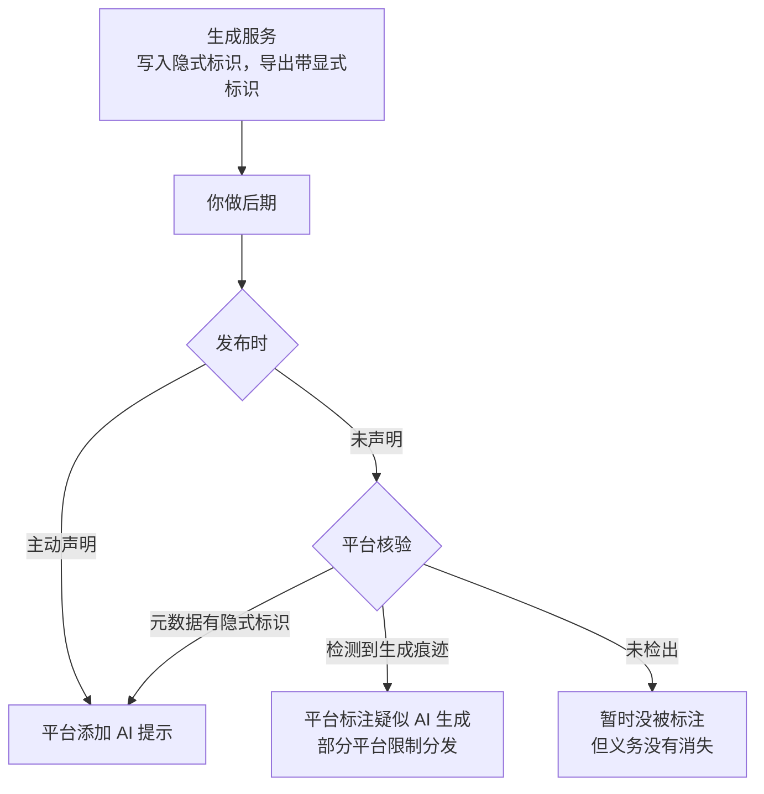

# 平台对 AI 内容的规则与标识

前面每一章都提到了「标识」「平台规则」。这一章把它们集中讲清楚：国家层面要求什么、各平台具体怎么执行、发布时该做什么、哪些行为会被处罚，以及怎么持续跟踪规则变化。

这一章只讲做内容的人需要知道和需要做的事。标识义务的法律分析、违规的法律责任、肖像权和版权的系统讨论，见《自媒体与短剧合规财税》。以下内容整理自截至 2026 年 11 月的官方文件和公开报道，**规则变化很快，以各平台和主管部门的最新原文为准**。

## 法规层：三份文件

和 AI 内容直接相关的国家规定主要有三份：

| 文件 | 发布 | 施行 | 和创作者相关的要点 |
|---|---|---|---|
| 《互联网信息服务深度合成管理规定》 | 国家网信办、工信部、公安部 | 2023 年 1 月 10 日 | 深度合成内容要标识；编辑人脸、人声等生物识别信息，要告知被编辑的个人并取得其单独同意 |
| 《生成式人工智能服务管理暂行办法》 | 国家网信办等七部门 | 2023 年 8 月 15 日 | 面向国内公众的生成式 AI 服务要备案；主要约束服务提供者 |
| 《人工智能生成合成内容标识办法》 | 国家网信办、工信部、公安部、广电总局，2025 年 3 月发布 | 2025 年 9 月 1 日 | 显式标识和隐式标识的具体要求；传播平台的核验义务；用户的主动声明义务 |

与《标识办法》同步实施的还有一份强制性国家标准《网络安全技术 人工智能生成合成内容标识方法》，规定了标识的具体技术格式。

### 《标识办法》的关键条款

《标识办法》是目前对创作者影响最直接的一份文件。按条概括（原文见国家网信办网站 2025 年 3 月 14 日发布的通知）：

**两种标识**。显式标识是在内容或交互界面中，以文字、声音、图形等方式呈现、用户可以明显感知的标识；隐式标识是通过技术措施写入文件数据、用户不易察觉的标识。

**第四条：显式标识放在哪**（这一条约束的是生成服务提供者，但对自己做后期的创作者有参考意义）：

| 内容类型 | 要求 |
|---|---|
| 文本 | 在起始、末尾或中间适当位置添加文字提示或通用符号提示 |
| 音频 | 在起始、末尾或中间适当位置添加语音提示或音频节奏提示 |
| 图片 | 在适当位置添加显著的提示标识 |
| 视频 | 在起始画面和播放周边的适当位置添加显著的提示标识，可以在末尾和中间适当位置添加 |

服务提供者提供下载、导出功能时，要确保导出的文件里含有显式标识。

**第五条：隐式标识**。服务提供者要在文件元数据中添加隐式标识，包括生成合成内容的属性信息、服务提供者名称或编码、内容编号等。

**第六条：传播平台怎么做**。这一条决定了你发布到抖音、小红书时平台会怎么处理：

1. 核验到文件元数据里有隐式标识的，在发布内容周边添加显著的提示标识
2. 没有核验到隐式标识，但**用户声明**为生成合成内容的，添加提示，提醒公众该内容「可能为生成合成内容」
3. 两者都没有，但平台检测到显式标识或其他生成合成痕迹的，识别为疑似生成合成内容并添加提示
4. 平台要提供标识功能，并**提醒用户主动声明**发布内容中是否包含生成合成内容

**第九条：不带显式标识的导出**。用户可以向服务提供者申请导出不含显式标识的内容，但服务提供者要在用户协议中明确用户的标识义务和使用责任，并留存相关日志不少于六个月。也就是说，即使你拿到了不带水印的文件，**发布时的标识义务仍然在你身上**。

**第十条：用户的义务**。这是写给每一个创作者的：

- 通过传播平台发布生成合成内容时，应当主动声明并使用平台提供的标识功能进行标识
- 任何组织和个人不得恶意删除、篡改、伪造、隐匿标识，不得为他人实施这些行为提供工具或服务

把第六条和第十条合起来看，链路是这样的：



最下面那一格值得强调。2025 年 9 月新京报记者实测，去掉水印的 AI 视频在多个平台都没有被识别出来。**平台识别不完美，不代表不声明没事**：主动声明是第十条规定的用户义务，而平台的识别能力和处罚力度都在持续加强。

## 平台层：各平台的规则

### 抖音

| 时间 | 规则 | 要点 |
|---|---|---|
| 2023 年 5 月 | 《关于人工智能生成内容的平台规范暨行业倡议》，同时发布《抖音关于人工智能生成内容标识的水印与元数据规范》 | 发布者要对 AI 生成内容进行显著标识；对虚拟人提出注册和使用者实名等要求 |
| 2024 年 | 关于不当利用 AI 生成虚拟人物的治理公告 | 不鼓励用 AI 虚拟人物进行低质创作，对违背科学常识、弄虚作假、造谣传谣的内容严格处罚 |
| 2025 年 5 月 19 日 | 抖音黑板报《抖音关于「AI 起号」专项治理行动的公告》 | 针对利用 AI 造假、批量起号、贩卖 AI 账号；引导规避平台 AI 标注、转让销售 AI 虚拟账号属违规；重申以任何形式赠与、借用、出租、转让、售卖账号均属违规 |
| 2025 年 9 月 1 日起 | 升级 AI 内容标识功能 | 上线 AI 内容标识功能和元数据标识读写功能；发布时可在「高级设置 → 发文助手自主声明 → 内容由 AI 生成」中声明；未声明的，平台检测后可能加注「疑似使用了 AI 生成技术」，核验到隐式标识的加注「作品含 AI 生成内容」；平台会为 AI 内容添加或更新隐式标识 |
| 2026 年 3 月 | 从严治理 AI 生成的色情低俗内容 | 据报道，抖音黑板报称当年已处置相关内容 4.2 万条、账号 1.4 万个，处罚包括限制推荐、禁言、封禁 |

### 小红书

| 时间 | 规则 | 要点 |
|---|---|---|
| 2025 年 8 月 29 日 | 标识功能公告 | 发布时可在内容类型声明中勾选「笔记含 AI 合成内容」；平台有权为未声明的 AI 内容添加标识；不得恶意篡改、隐匿标识 |
| 2026 年 2 月 12 日 | 薯管家：加强 AI 生成合成标识管理 | 未主动标识的 AI 生成合成内容，平台将限制分发；平台根据检测结果为未声明内容添加标识；严厉打击发布去除 AI 标识教程的内容 |
| 2026 年 4 月 27 日 | AI 内容治理规则 | 四类违规（见下表）；对未主动标注的 AI 内容，平台识别后统一添加标识；采取限制分发、封禁账号等梯度处置；上线申诉通道 |

小红书 2026 年 4 月规则列出的四类违规，是目前各平台中对 AI 内容违规行为列举得最具体的，可以当作所有平台的参照：

| 类别 | 规则列举的行为 |
|---|---|
| AI 违规运营 | 利用 AI 工具自动运营账号、冒充真人互动；传授 AI 洗稿、规避审核的做号方法 |
| AI 造假 | 克隆他人声音或面孔、以虚假人设种草；伪造经历与截图；制造涉及公共事件的虚假图文视频 |
| AI 侵权 | 未经授权生成他人可识别肖像；模仿受版权保护的作品 |
| AI 低质 | 套用模板批量生产同质化内容；以猎奇画面博眼球；传播极端不良价值观 |

规则同时说明，涉及违法违规、色情等内容的，无论是否由 AI 生成，都适用社区原有规则。

### 其他平台

2025 年 8 月底到 9 月初，《标识办法》施行前后，主要平台都上线了 AI 声明功能，表述大体一致：**用户应主动声明，平台有权为未声明的内容添加标识，不得恶意篡改、隐匿标识**。

| 平台 | 发布时的声明入口（据 2025 年 9 月公开报道，入口可能调整） | 其他 |
|---|---|---|
| 快手 | 发布页「作者声明」→「内容为 AI 生成」 | 对疑似 AI 内容加显著提示 |
| 视频号 | 发布页「添加声明」→「AI 创作声明」 | 腾讯旗下公众号等产品同期发布了标识规则 |
| B 站 | 投稿时的 AI 创作声明 | 平台对部分内容自动标注「疑似使用 AI 技术合成」 |
| 微博 | 发布页「公开」→ 分享范围 → 内容声明 → 内容由 AI 生成 | 投诉入口新增「未添加 AI 标识」类别 |

各平台对「不声明」的后果写得详略不一。小红书明确写了限制分发；其他平台多数表述为平台有权添加标识，并按社区规则处理。**不要因为某个平台没写处罚就不声明**，第十条的义务对所有平台都一样。

### 监管层面的执法

除了平台规则，网信部门也在持续开展针对 AI 滥用的专项治理。据 2026 年 2 月的公开报道，网信部门通报处置了一批涉及 AI 违规的账号，以及售卖「去除 AI 标识」工具和服务的电商店铺，涉及多个主流内容和电商平台。售卖和使用去标识工具，不只是平台违规，也直接触碰《标识办法》第十条。

## 什么内容需要声明

《标识办法》没有逐项列举「用 AI 做到哪一步算生成合成内容」。下面是一个按风险排序的判断参考，**不是法律意见**，拿不准的情况按需要声明处理：

| 用法 | 判断 |
|---|---|
| AI 生成的画面（图像、视频、数字人）出现在成片里 | 声明 |
| AI 合成的语音（TTS、克隆音色）出现在成片里 | 声明 |
| AI 生成的音乐作为背景音乐 | 声明 |
| 用 AI 写的稿子，人改过后由真人出镜念 | 灰区；内容主体是真人表演，但文本有生成成分，倾向于声明 |
| 用 AI 做字幕识别、降噪、剪口误 | 一般属于编辑辅助，通常不被视为生成合成内容；以平台说明为准 |
| 用 AI 想选题、做数据整理 | 不出现在成片里，一般不涉及 |

背后的道理很简单：**标识是为了让观众知道自己看到、听到的东西里有哪些不是真实拍摄和录制的**。按这个目的去判断，大多数情况都不难。声明的成本几乎为零，没声明被平台补标、限流甚至处罚的成本要高得多。

有人担心声明 AI 会影响流量。平台规则里没有「声明即降权」的表述，小红书的规则明确的是「不声明」会被限制分发。从长期看，观众对 AI 内容的接受度取决于内容本身的质量，被发现隐瞒反而会严重伤害信任。

## 发布前的标识检查

把下面这份清单放进第 7 章的待发布包：

- [ ] 成片里用到的 AI 生成画面、语音、音乐都已记录在 job.json 里
- [ ] 视频起始画面有显式标识（流水线自动添加的角标和开头提示）
- [ ] 没有裁掉、遮挡、模糊生成服务自带的水印或标识
- [ ] 没有用任何工具清除文件元数据里的隐式标识（重新编码时注意：部分转码工具默认会丢弃元数据，以服务商和平台的说明为准）
- [ ] 在发布页勾选了 AI 内容声明，每个平台分别勾选
- [ ] 数字人、克隆音色内容在账号简介或文案里也有说明
- [ ] 内容里没有冒充真人、伪造截图、未授权的他人肖像和声音

## 被误判了怎么办

AI 检测有误判。真人拍摄的内容被标「疑似 AI 生成」、被限流的情况，在规则施行后的报道里并不少见。应对方法：

1. **走平台申诉渠道**。小红书规则明确上线了申诉通道，其他平台在创作者后台的申诉或客服入口
2. **保留创作过程的证据**：原始拍摄素材、剪辑工程文件、录音原文件。第 7 章流水线的 job 目录本身就是很好的过程记录
3. **申诉时具体说明**：哪些部分是实拍、用了哪些 AI 辅助功能

反过来，**如果确实用了 AI 却去申诉说没用**，那就是在给自己找更大的麻烦。

## 不要做的事

这些行为在本书各章都提到过，这里集中列出，它们同时触碰法规和平台规则：

- 删除、裁剪、遮挡生成服务的水印和标识，清除元数据里的隐式标识
- 使用、售卖、传播「去 AI 标识」「过 AI 检测」的工具和教程
- 用 AI 洗稿他人作品、批量搬运
- 克隆他人的声音和面孔，生成他人可识别的肖像
- 伪造截图、经历、新闻和公共事件内容
- 用 AI 自动运营账号、在评论区冒充真人互动
- 批量注册、买卖、租借账号，用群控工具

## 规则跟踪 SOP

平台规则一年会变好几次。一个人做内容，也需要一个固定的跟踪习惯：

| 频率 | 做什么 |
|---|---|
| 关注 | 抖音黑板报、小红书薯管家、快手和视频号的官方规则账号、B 站的社区公告、国家网信办网站 |
| 每月一次 | 把各平台规则中心里和 AI、原创、营销相关的规则翻一遍，记下变化 |
| 规则变化时 | 更新流水线的检查清单、待发布包的 checklist、发布页入口说明 |
| 每季度一次 | 拿最近发布的内容按最新规则抽查，有问题的补声明或下架 |

变化记录建议也存在仓库里：

```text
rules/
└── changelog.md
    2026-04-27 小红书 AI 内容治理规则：四类违规，未标识统一补标，上线申诉
              → 流水线：相似度检查阈值下调；数字人内容简介加说明
    2026-02-12 小红书 未主动标识的 AI 内容限制分发
              → 待发布包 checklist 加「小红书勾选笔记含 AI 合成内容」
```

## 主要出处

- 国家网信办等四部门《关于印发〈人工智能生成合成内容标识办法〉的通知》，2025 年 3 月 14 日，国家网信办网站
- 抖音黑板报《抖音关于「AI 起号」专项治理行动的公告》，2025 年 5 月 19 日（澎湃新闻转载）
- 抖音关于升级 AI 内容标识功能的公告，2025 年 9 月 1 日试行（网易、IT 之家等报道）
- 小红书、微博、B 站、快手、视频号的 AI 标识公告和功能，2025 年 8 月 29 日至 9 月 1 日（36 氪、新京报 2025 年 9 月报道）
- 小红书薯管家关于加强 AI 生成合成标识管理的公告，2026 年 2 月 12 日（澎湃新闻报道）
- 小红书 AI 内容治理规则，2026 年 4 月 27 日（IT 之家报道）
- 抖音关于从严治理 AI 低俗内容的公告，2026 年 3 月（IT 之家等报道）

部分条目来自媒体转述，引用前请到平台官方账号核对原文。

## 本章要点

- 国家层面有深度合成管理规定、生成式 AI 服务管理暂行办法和 2025 年 9 月 1 日施行的《人工智能生成合成内容标识办法》，后者对创作者影响最直接
- 《标识办法》规定了显式和隐式两种标识；平台按隐式标识、用户声明、检测结果三种情况添加提示；用户发布时应主动声明，任何人不得删除、篡改、隐匿标识
- 抖音、小红书、快手、视频号、B 站、微博都上线了 AI 声明入口；小红书明确对未标识内容限制分发，并在 2026 年 4 月列出了 AI 违规运营、造假、侵权、低质四类违规
- 平台识别不完美不等于可以不声明，导出无水印文件也不免除发布时的标识义务
- 判断要不要声明看成片里是否有生成的画面、语音、音乐，拿不准就声明；声明的成本远低于不声明的后果
- 被误判时保留创作过程证据走申诉；不使用去标识工具，不洗稿、不克隆他人、不伪造、不批量起号
- 用固定频率跟踪平台规则，变化同步到流水线的检查清单
