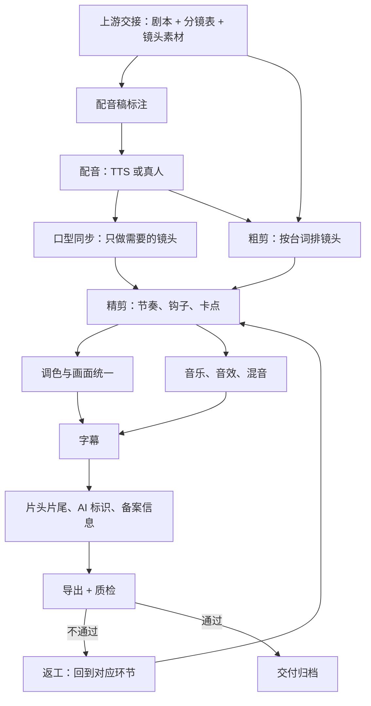

# 后期流程总览

一集 AI 短剧（或漫剧）在分镜和画面生成阶段结束时，手里是一堆零散的东西：几十个 3–10 秒的视频片段、一份分镜表、一份剧本。观众最后看到的是一条 1–2 分钟、有台词、有音乐、有字幕、节奏紧凑的成片。中间这一段就是**后期**。

很多第一次做 AI 短剧的人以为后期就是「拖进剪映拼一下」，结果做出来的东西有三个典型问题：配音像念稿、画面一镜一个色、节奏拖沓到观众 5 秒就划走。这三个问题都不是画面生成模型能解决的，只能在后期解决。平台也在把门槛往上抬：红果短剧 2026 年 7 月 21 日在创作者中心发公告，提高部分 AI 仿真人剧的准入门槛，点名的考察项包括画面衔接、人物形象、表情变化和**音画同步**，不达标的退回让版权方优化后重传（据新京报 2026-07-23 报道）。这几项里有一半是后期的活。

这一章先把整条流水线摆出来，约定贯穿全书的示例、文件组织和命名，后面每章展开一个环节。画面怎么生成见[《AI 短剧分镜与画面生成》](../ai-drama-storyboard/)；剪映、达芬奇的基础操作见[《拍摄与剪辑实务》](../shooting-editing/)，本书只讲 AI 短剧特有的部分。

## 后期要交付什么

先从终点倒推。一集成片交出去时，至少包含这些东西：

| 交付物 | 说明 | 谁要 |
|---|---|---|
| 成片视频 | 竖屏 1080×1920 的 MP4，H.264 + AAC | 平台、版权方 |
| 字幕文件 | 单独的 SRT（部分平台、出海译制要） | 平台、译制方 |
| 封面 | 竖版封面图，部分平台还要横版 | 平台 |
| 工程文件与分轨 | 剪辑工程、干声、音乐、音效分轨 | 自己留档，返工用 |
| 授权材料 | 配音演员授权、音乐授权、字体授权 | 平台审核、出问题时自证 |
| 质检记录 | 按清单逐项打勾的记录 | 自己和合作方 |

后两项最容易被忽略，但它们决定了这条片子出事时你能不能自证清白。声音和音乐的授权问题见下一章和第 4 章；质检清单见第 9 章。

## 流水线



几个和直觉不一样的地方：

- **配音在粗剪之前**。传统影视是先剪画面后配音，AI 短剧反过来：台词时长决定镜头时长。先把整集配音做出来，再按每句台词的长度去排镜头、决定要不要补生成画面，这样不会出现「画面 4 秒、台词 6 秒」的尴尬
- **口型同步只做少数镜头**。整集几十个镜头里，真正需要对口型的是正脸说话的近景和特写，通常不到三分之一。其余镜头用侧脸、背影、反应镜头、旁白规避，见第 3 章
- **调色和混音可以并行**。精剪锁定之后，画面和声音互不依赖，一个人做的话可以先调色、渲染的同时做混音
- **字幕放在最后**。字幕跟着最终的剪辑时间轴走，剪辑没锁定就做字幕，每改一刀就要重新对一次

## 每个环节的工具类别

截至 2026 年 11 月，下面是每个环节常用的工具类别。具体产品更新很快，每章会给出当时的选型和查证方式，这里只记分工：

| 环节 | 工具类别 | 产出 |
|---|---|---|
| 配音 | 云端 TTS、带情绪控制的语音大模型、音色复刻、真人配音 | 每句一个干声文件（WAV） |
| 口型同步 | 视频对口型模型（独立工具或视频生成平台内置功能） | 替换后的镜头 |
| 音乐 | AI 音乐生成、可商用曲库 | BGM 分轨 |
| 音效 | 音效库、AI 音效生成 | 音效分轨 |
| 剪辑 | 剪映专业版、达芬奇（DaVinci Resolve）、Premiere | 剪辑工程 |
| 调色与修补 | 剪辑软件自带调色、达芬奇、去闪烁插件、超分辨率工具 | 统一后的画面 |
| 字幕 | 剪辑软件自动识别字幕 + 人工校对 | 烧录字幕 + SRT |
| 导出与质检 | 剪辑软件、ffmpeg、响度表 | 成片 + 质检记录 |

开发者的优势在最后一行：导出参数检查、响度测量、字幕错字扫描、文件命名校验，这些都能用 ffmpeg 和几十行脚本自动化，后面每章会给出可以直接用的命令。

## 贯穿全书的示例

为了让每一章的模板都能接上，全书用同一个示例：

- **剧名**：古风漫剧《退婚之后》（虚构），共 40 集，每集 70–90 秒
- **本书演练的是第 1 集**：侯府嫡女沈知微在订婚宴上被未婚夫当众退婚，继母柳氏落井下石；沈知微当场撕毁婚书，宣布自立门户；结尾一个神秘人递来一封信，钩子留到第 2 集
- **角色**：沈知微（女主，17 岁，外柔内刚）、陆砚（未婚夫，傲慢）、柳氏（继母，阴阳怪气）、老侯爷（父亲，懦弱）、神秘人（只露手和半张脸）、旁白
- **画面形态**：2D 动态漫，画面由图像模型出图再用视频模型做 3–5 秒的动态镜头；第 1 集共 28 个镜头、14 句台词，定剪 70 秒

这个设定刻意包含了后期最常见的难点：多角色音色区分、情绪起伏大的台词、需要口型同步的正脸特写、结尾钩子、古风配乐。第 10 章会把这一集从拿到素材到交付完整走一遍，按小时列出步骤和产出物。

## 文件组织与命名

AI 短剧一集的文件数量很容易上百：每个镜头可能生成了 3–5 个版本，每句台词可能重配过几次。没有约定的话，第 3 天你就找不到哪个是最终版。建议每部剧一个目录，每集一个子目录：

```text
tuihun/
├── 00-bible/
│   ├── voices.md
│   ├── lut/
│   ├── music/
│   ├── fonts/
│   └── licenses/
├── ep01/
│   ├── 01-script/
│   ├── 02-shots/
│   ├── 03-vo/
│   ├── 04-lipsync/
│   ├── 05-music-sfx/
│   ├── 06-project/
│   ├── 07-subs/
│   ├── 08-export/
│   └── qc.md
└── ep02/
```

`tuihun/` 是剧名拼音缩写。`00-bible/` 放全剧共用的东西：

- `voices.md`：音色设定卡（第 2 章）
- `lut/`：全剧统一的调色预设
- `music/`：主题曲、角色动机
- `fonts/`：已授权字体及授权截图
- `licenses/`：配音授权书、曲库授权证书

每集目录（如 `ep01/`）里：

- `01-script/`：剧本、配音稿（带标注）
- `02-shots/`：镜头素材，只放选定版本；未选中的版本放在它下面的 `_takes/`，交付后可删
- `03-vo/`：干声，如 `ep01_L012_shenzhiwei_v2.wav`
- `04-lipsync/`：对口型后的镜头
- `06-project/`：剪辑工程
- `07-subs/`：字幕，如 `ep01.srt`
- `08-export/`：成片，如 `tuihun_ep01_v3_20261103.mp4`
- `qc.md`：质检记录（第 9 章）

命名规则只需要三条：

- **镜头**：`ep01_S07_v2.mp4`，S 后是分镜表里的镜头号，v 是版本
- **台词**：`ep01_L012_角色拼音_v2.wav`，L 后是配音稿里的行号，和分镜表的镜头号是两套编号，在配音稿里建立对应关系
- **成片**：`剧名_集号_版本_日期.mp4`，每次导出版本号加一，从不覆盖旧版

文件名里不要用中文和空格。剪映、达芬奇都能处理中文路径，但 ffmpeg 脚本、网盘同步、交给外包时的压缩包，经常在中文和空格上出问题。

工程文件和 `00-bible/` 建议放进同步盘或用 Git LFS 管理；镜头素材体积大，放 NAS 或对象存储，只同步当前集。

## 时间花在哪里

一集 70–90 秒的 AI 漫剧，一个熟练的人后期大约要 6–10 个小时（详细测算见第 10 章）。新手第一集花两三天很正常。时间大致这样分布：

| 环节 | 占比（经验值） | 说明 |
|---|---|---|
| 配音（含标注、生成、挑选、重配） | 20–25% | 情绪不对的句子要反复生成 |
| 口型同步 | 10–15% | 主要花在等生成和挑结果 |
| 粗剪 + 精剪 | 25–30% | 节奏是最耗时也最值钱的部分 |
| 调色与修补 | 10% | 统一预设后单集很快 |
| 音乐音效与混音 | 10–15% | 全剧主题音乐提前做好可以省一半 |
| 字幕 | 5–10% | 自动识别快，校对占大头 |
| 导出质检与返工 | 10% | 第一集偏多，流程稳定后下降 |

这个比例说明两件事：第一，节奏和配音是重点，值得花时间；第二，很多工作是**一次投入、全剧复用**的：音色设定、调色预设、字幕样式、片头片尾、主题音乐。第一集慢，从第三集开始会快得多。

## 和上下游的接口

后期不是孤立的。上游（编剧、分镜、画面生成）交过来的东西质量越高，后期越轻松。建议在开工前和上游约定：

| 上游交付 | 后期需要的格式 | 为什么 |
|---|---|---|
| 剧本 | 每句台词单独一行，标明角色 | 直接转成配音稿 |
| 分镜表 | 每个镜头标注：镜头号、景别、对应台词行号、是否正脸说话、预计时长 | 判断哪些镜头要对口型、哪些要补 |
| 镜头素材 | 统一分辨率和帧率（如 1080×1920、24 或 30 fps），文件名带镜头号 | 避免剪辑时变速、缩放导致画质下降 |
| 角色设定 | 年龄、性格、口头禅、情绪基调 | 写音色设定卡 |

如果上游就是你自己，那就在做分镜时顺手把「是否正脸说话」「预计台词时长」两列填上，后期能省下大量来回。

下游是发行和投流（见[《短剧发行、投流与备案》](../drama-distribution/)）。后期要提前知道这集发到哪个平台、是付费剧还是免费剧、要不要做投流素材，因为这会影响成片规格、片头片尾的写法，以及要不要额外剪 15–30 秒的投流切片。

## 本书路线

| 章 | 内容 | 主要模板 |
|---|---|---|
| 2 | 配音：TTS 选型、情绪控制、多角色、真人外包、音色克隆合规 | 配音稿标注模板、音色设定卡、授权书要点 |
| 3 | 口型同步 | 对口型决策表 |
| 4 | 音乐、音效与混音 | 音乐音效清单、响度目标 |
| 5 | 字幕 | 字幕规范、样式参数、校对清单 |
| 6 | 剪辑节奏 | 剪辑节奏标注示例 |
| 7 | 调色与画面统一 | 色差、闪烁、修补的处理流程 |
| 8 | 成片规格与交付 | 导出规格表、片头片尾与标识位置 |
| 9 | 质检与返工 | 质检清单、返工单 |
| 10 | 全流程演练与产能成本 | 按小时的演练表、工时成本模板 |

## 本章要点

- 后期把零散的镜头变成成片，配音像念稿、色调不统一、节奏拖沓这三个问题只能在后期解决
- AI 短剧的顺序是先配音再剪辑：台词时长决定镜头时长
- 口型同步只做正脸说话的近景，通常不到三分之一的镜头
- 交付物除了成片，还有字幕文件、分轨、授权材料和质检记录
- 每集一个目录，镜头、台词、成片三套命名规则，文件名不用中文和空格
- 音色、调色预设、字幕样式、片头片尾、主题音乐是全剧复用资产，第一集投入、后面省时间
- 开工前和上游约定分镜表要带「对应台词行号」「是否正脸说话」「预计时长」
