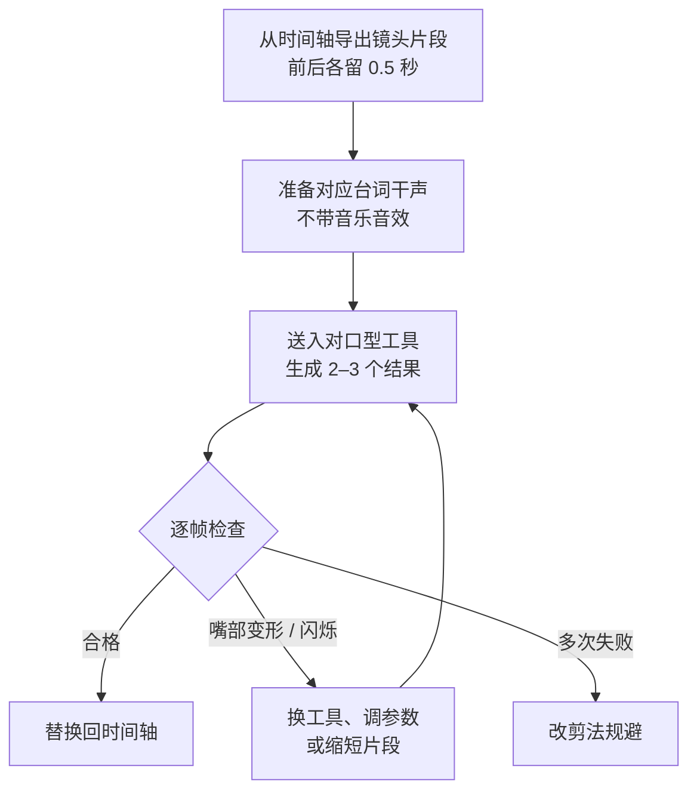

# 口型同步

画面里的人在说话，嘴型却和台词对不上，这是 AI 短剧最容易被一眼认出来的破绽之一。前面提到红果短剧 2026 年 7 月提高 AI 仿真人剧准入门槛时，「音画同步」是点名的考察项之一。但口型同步也是后期里最费时间、最容易出新问题的环节：生成慢、结果不稳定、有时把原本好看的脸改坏。

这一章的核心观点是：**口型同步是一种昂贵的修补手段，能不用就不用**。先学会判断哪些镜头必须做，再学怎么做好。

## 三种技术路线

> [!WARNING]
> 技术路线和工具形态按截至 2026 年 11 月的情况整理，对口型工具迭代很快；具体功能和商用条款以所用工具官网的当前说明为准。

让画面里的角色「说对词」大致有三种做法：

| 路线 | 输入 | 输出 | 典型形态 |
|---|---|---|---|
| 视频改口型 | 一段已有视频 + 一段音频 | 只改嘴部区域的视频 | 独立的对口型工具、视频平台内置的「对口型」功能、开源模型（如 LatentSync、MuseTalk 一类） |
| 图片驱动说话 | 一张角色图 + 一段音频 | 角色说话的视频，头部和表情一起动 | 数字人、「图片说话」类功能 |
| 音画一起生成 | 文字提示（含台词）或图 + 台词 | 自带对白和口型的视频 | 部分新一代视频生成模型支持直接生成带对白的镜头 |

三者的取舍：

- **视频改口型**保留了你已经满意的画面和动作，只动嘴。适合「镜头已经生成好了，只差嘴对不上」。缺点是嘴部区域可能和周围画质不一致，大动作、侧脸、遮挡时容易出错
- **图片驱动说话**从一张图直接出说话视频，表情自然度通常更好，但镜头基本是固定机位的半身或特写，运镜和肢体动作有限
- **音画一起生成**省掉一道工序，但台词的音色和情绪由视频模型决定，和你精心做的配音、音色设定卡对不上。常见做法是只用它的画面和口型，再用自己的配音替换音轨，这时要求自己配音的节奏和它生成的口型基本一致，否则又回到对不上的问题

具体用哪个产品，按第 2 章选 TTS 的思路做：看所用档位的商用条款，用本剧的角色和台词实测。不同工具对 2D 漫画风格和写实风格的效果差异很大，别人的测评只能参考。

## 哪些镜头必须对口型

不是所有有台词的镜头都需要。用分镜表里的两列（景别、是否正脸说话）就能筛出来：

| 镜头情况 | 处理 | 理由 |
|---|---|---|
| 正脸近景、特写，角色说话 | **必须对口型** | 观众视线就在嘴上 |
| 正脸中景，角色说话 | 对口型，或嘴部小幅开合即可 | 嘴在画面里占比小，偏差不明显 |
| 全景、远景 | 不做 | 看不清嘴 |
| 侧脸、背影、过肩镜头 | 不做 | 本来就看不到或看不全嘴 |
| 画外音（OS）、旁白、内心独白 | 不做，且嘴应当闭着 | 嘴动反而错 |
| 听者的反应镜头 | 不做 | 台词在画外，画面给听者表情 |
| 手部、道具、环境特写 | 不做 | 用来盖住长台词 |

示例剧第 1 集有 28 个镜头、14 句台词，筛下来真正需要对口型的只有 6 个：老侯爷举杯（S04）、陆砚两次宣布退婚（S09、S13）、柳氏的冷笑特写（S11）、沈知微说「不要了」（S17）和「自立门户」（S19）。柳氏和老侯爷后面各有一句中景台词，只做嘴部开合；其余台词由画外音、背影和反应镜头承载。第 6 章有完整的镜头表。

### 规避对口型的剪法

台词多但不想做口型时，剪辑上有一套成熟的规避手法，传统影视配音片也大量使用：

- **台词先入、画面后切**：一句台词的前半句在说话人的镜头上，后半句切到听者的反应。观众只看到了半句的口型
- **用反应镜头承载台词**：对手戏里，A 说话时给 B 的表情。B 的表情变化本身就是剧情信息
- **把台词改成画外音**：心理活动、回忆、宣言，改成 OS 加角色的凝视或背影，往往更有张力
- **用道具和细节镜头**：念信、宣读婚书时给信纸特写、手部特写
- **拉远景别**：本来设计成近景的台词，改成中景或全景，再用一个短特写收尾

这些剪法在第 6 章还会结合节奏讲。规避不是偷懒，一集里所有台词都是正脸大特写对口型，节奏反而单调。

## 漫剧和 2D 动态漫的特殊情况

2D 漫画风格的嘴型本来就简单。传统动画常用少数几个嘴型（闭、半开、全开，再加一两个圆口型）循环替换，观众并不会觉得不同步，只要**嘴在说话时动、不说时停**，开合大致跟着音量走。

所以漫剧可以分档处理：

| 档位 | 做法 | 适用 |
|---|---|---|
| 不动 | 嘴保持闭合或微张，靠剪辑规避 | 远景、低成本剧 |
| 开合 | 根据音量让嘴在两三个嘴型间切换，或用视频模型生成「说话中」的循环动作 | 大多数中近景 |
| 精确口型 | 用对口型工具逐句对齐 | 主角的关键台词特写 |

「开合」这一档特别适合开发者自己做小工具：从干声里按帧计算音量（RMS），超过阈值换成张嘴的图层。剪辑软件和一些动画工具也有「音频驱动嘴型」的功能，思路相同。

## 对口型工作流

以「视频改口型」为例，每个镜头的步骤：



几个细节：

- **先锁定配音，再做口型**。配音改了一个字，口型就要重做。所以对口型排在配音定稿之后、精剪之前
- **用干声，不用混好的音轨**。背景音乐和音效会干扰模型判断发音
- **片段前后留余量**（handles），回贴时方便和前后镜头衔接；但不要整段几十秒丢进去，越长越容易中途出问题
- **分辨率保持一致**。有的工具输出分辨率比输入低，或者只处理脸部区域后再贴回去，导致脸部比周围糊。输出后要和原片对比，必要时把整个镜头做一次超分辨率（第 7 章）
- **记录参数**：哪个镜头用了哪个工具、什么参数、第几次结果，记在分镜表里，返工时能复现

## 常见问题与处理

| 现象 | 常见原因 | 处理 |
|---|---|---|
| 牙齿糊成一片、嘴里发黑 | 模型对口腔内部生成能力有限，特写下尤其明显 | 换景别；或只在中景用；或换工具 |
| 嘴部区域闪烁、边缘有方框感 | 嘴部区域与周围融合不好 | 换工具；缩短片段；后期在嘴部加轻微模糊或颗粒统一质感 |
| 下巴、脸型变形 | 大角度侧脸、头部大幅运动 | 选正脸、头部稳定的片段；侧脸镜头不做口型 |
| 有遮挡时出错（手、扇子、头发挡嘴） | 模型把遮挡物也当成嘴 | 避开遮挡帧；或用规避剪法 |
| 整体延迟或提前 | 音频起点没对齐 | 在剪辑软件里把音轨整体前后挪几帧 |
| 口型对了但表情不对（笑着说狠话） | 改口型只动嘴，原画面表情不变 | 回到画面生成阶段重做表情，或换反应镜头 |
| 2D 角色嘴型变成写实风格 | 工具主要针对写实人脸训练 | 换用对动漫风格效果好的工具，或用「开合」档 |

最后一行是漫剧最常见的坑：把一张扁平的漫画脸送进写实对口型模型，嘴部会长出写实的嘴唇和牙齿，风格当场崩掉。动手前先用一个镜头测试风格兼容性。

## 音画同步的容差

即使不做口型，台词音频和画面的对齐也要检查。人对「声音比画面早」更敏感，对「声音比画面晚」更宽容（现实中远处的声音本来就会晚到）。广播电视领域常引用的 ITU-R BT.1359 建议书给出的可察觉阈值大约是：声音超前约 45 毫秒、滞后约 125 毫秒就开始能被察觉。

换成帧数更好记：30 fps 下一帧约 33 毫秒，**声音最多比嘴早 1 帧、晚 3 帧**，超过就要调。

检查方法：在剪辑软件里放大时间轴，找爆破音（「不」「怕」「把」）这种嘴型变化明显的字，看嘴张开的那一帧和音频波形起跳的那一帧是否对齐。如果整个成片的音频都有固定偏移（常见于某些导出设置或转码），可以用 ffmpeg 整体平移音轨：

```bash
# 音频整体延后 0.066 秒（30fps 下 2 帧）；要提前就把 adelay 换成 atrim 裁掉开头
ffmpeg -i in.mp4 -c:v copy -af "adelay=66:all=1" -c:a aac -b:a 192k out.mp4
```

## 合规提醒

> [!WARNING]
> 深度合成规定和平台公告按截至 2026 年 11 月的公开文本和媒体报道整理，红果公告依据为媒体转述；以中国网信网发布的最新规定和红果短剧等平台规则中心的最新公告为准。

口型同步本质上是对人脸进行编辑，属于深度合成。在 AI 短剧里：

- **只对你自己创作的虚拟角色做口型**。不要把真人演员、主播、名人的视频拿来改口型让他们「说」你写的台词
- **AI 仿真人角色的长相不要刻意贴近真实人物**。红果短剧 2026 年 7 月发布的《关于规范 AI 剧角色创作的公告》要求不得未经授权使用他人作品中有独创性的角色、造型等设计，并治理高频出现的「AI 脸」（据 IT 之家、新京报报道）
- 用了对口型的镜头属于 AI 生成合成内容，成片按第 8 章的要求做标识

## 本章要点

- 口型同步是昂贵的修补手段：先筛镜头，只做正脸近景和特写说话的镜头，通常不到三分之一
- 三种路线：视频改口型（保留画面）、图片驱动说话（表情好但运镜少）、音画一起生成（省工序但音色不受控）
- 用反应镜头、画外音、道具特写、拉远景别规避口型，同时让节奏更丰富
- 漫剧可分档：不动、按音量开合、精确口型；写实对口型模型可能破坏 2D 风格，先测一个镜头
- 配音定稿后再做口型，用干声，片段前后留余量，记录工具和参数
- 音画对齐的容差约为声音早不超过 1 帧、晚不超过 3 帧（30 fps）
- 只给自己创作的虚拟角色做口型，不改真人视频
