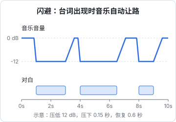

# 音乐、音效与混音

把配音铺上时间轴之后，成片还是「干」的：只有说话声，没有情绪的托底，也没有动作的分量。音乐负责情绪，音效负责真实感和冲击力，混音负责让三者各在各的位置、观众听得清台词。

这一层的风险也最集中：**音乐版权是短剧下架、被索赔最常见的原因之一**。这一章先讲素材从哪来、怎么留证，再讲怎么混。

## 声音的三层

| 层 | 内容 | 作用 | 优先级 |
|---|---|---|---|
| 对白 | 角色台词、旁白、OS | 传递剧情 | 最高，任何时候都要听清 |
| 音效 | 动作声（拟音）、环境声、转场和强调音效 | 真实感、冲击力、节奏点 | 中 |
| 音乐 | BGM、情绪音乐、片头片尾曲 | 情绪走向 | 低于对白，但决定「爽感」 |

AI 生成的画面本身没有声音（或者自带的声音你不打算用），所以这三层都要从零铺。实拍剧的现场环境声在 AI 短剧里也要补，否则画面里在下雨、在宴席上，背景却一片死寂。

## 音乐从哪来

三条来源，按版权确定性从高到低：

| 来源 | 版权确定性 | 成本 | 适合 |
|---|---|---|---|
| 正规曲库按授权购买 | 高：有授权证书 | 单曲授权或订阅制 | 付费剧、品牌定制剧、要出海的剧 |
| AI 音乐生成（付费档） | 中：取决于平台条款，生成内容自身的著作权归属在法律上仍有争议 | 订阅制，便宜 | 大量情绪 BGM、全剧主题 |
| 找人定制作曲 | 高：合同约定权属 | 最贵 | 有预算的系列剧主题曲 |

**绝对不能用的**：热门流行歌曲、影视剧原声、游戏配乐、综艺里的音乐，即使只用 10 秒。「15 秒以内不算侵权」是流传很广的谣言，没有法律依据。平台的音乐识别系统能识别出来，轻则静音、限流，重则下架和被版权方索赔。

### AI 音乐的条款

AI 音乐工具的商用条款普遍按付费档位划分，而且变化频繁。以 Suno 为例，其定价页（2026-11 查询）显示：

- 免费档：明确写「No commercial rights」（无商用权），没有每月歌曲下载额度
- Pro（每月 8 美元）和 Premier（每月 24 美元）：包含商用权，每月分别可下载 20 首和 60 首

也就是说，**用免费档生成的曲子放进商业短剧是越权的**，即使你后来升级了，也要看条款对历史作品怎么约定。国内也有多款 AI 音乐产品，条款各不相同，规则一样：用之前读当前版本的服务条款，截图留存。

AI 音乐还有两个实操上的注意：

- **不要用提示词指向具体歌手或歌曲**（「周杰伦风格」「像某首歌」），一是平台多半会拦截，二是生成结果过于接近原作时有侵权风险
- **生成后自己听一遍有没有「似曾相识」的旋律**。如果和某首知名歌曲很像，弃用

### 剪辑软件和平台自带的曲库

剪映、抖音等提供的音乐库用起来最方便，但授权范围要看清：很多曲目的授权**只限在特定平台内使用**，或者只限非商业用途。同一首曲子，在抖音上发没问题，导出成片发到其他平台或给短剧平台做付费内容，就可能超出授权。用之前看素材的商用标识和说明。

### 全剧音乐规划

一部 40 集的短剧，不需要每集找新音乐。提前准备一套「音乐包」，全剧复用，既省时间又形成听觉记忆：

| 曲目 | 用途 | 时长 | 备注 |
|---|---|---|---|
| 主题曲 | 片头、关键高光、结尾钩子 | 60 秒以上，可截取 | 能截出 3 秒、8 秒、15 秒三个版本 |
| 压迫 / 紧张 | 被欺负、阴谋、对峙 | 2 分钟循环 | 低频为主，不抢台词 |
| 反击 / 爽点 | 打脸、逆转、亮身份 | 30–60 秒 | 有明显的鼓点起点，方便卡点 |
| 悲伤 / 回忆 | 回忆、失去 | 2 分钟循环 | 钢琴或弦乐，音量要低 |
| 甜 / 轻松 | 感情线、日常 | 2 分钟循环 | |
| 悬念 | 结尾钩子 | 10–15 秒 | 结尾停在一个未解决的和弦上 |

古风剧用民乐配器（古筝、琵琶、笛箫），都市剧用电子和弦乐。风格统一比单曲好听更重要。

## 音效

### 音效的分类

| 类别 | 例子 | 示例剧第 1 集用到的 |
|---|---|---|
| 拟音（Foley） | 脚步、衣料摩擦、拍桌、倒茶、撕纸 | 撕婚书、甩袖、茶杯落地 |
| 环境声 | 宴席人声、风、雨、鸟鸣、集市 | 订婚宴的宾客嘈杂声 |
| 强调音效 | 重击（hit）、低频冲击（boom）、心跳 | 「不要了」三个字落下时的一记低频重击 |
| 转场音效 | 呼啸（whoosh）、上升音（riser） | 回忆闪回、切到结尾神秘人 |
| 情绪音效 | 倒吸气、众人哗然、耳鸣 | 宾客哗然 |

短剧对音效的使用比传统剧夸张，接近综艺：关键台词落地加重击，反转前加上升音，打脸时加众人哗然。这是类型片的语言，观众已经习惯了，不要吝啬，但同一集里同一种强调音效不要超过三四次，否则就麻木了。

### 音效从哪来

- **剪辑软件自带的音效库**：方便，同样看商用标识
- **专业音效库**：国内外都有订阅制音效库，授权清楚
- **开放音效社区**：比如 Freesound，每个音效单独标注许可证（CC0、CC BY、CC BY-NC 等）。CC BY 要求署名，CC BY-NC 禁止商用，短剧是商用，只能用 CC0 和注明署名的 CC BY
- **AI 音效生成**：用文字描述生成音效，适合找不到的特殊声音，条款同 AI 音乐
- **自己录**：撕纸、拍桌、倒水，手机录就够用，版权最干净

### 音乐音效清单模板

每集一份，放在 `ep01/05-music-sfx/cues.csv`。它既是工作单，也是版权证明的索引。被平台或版权方质询时，你能在几分钟内说清每一段声音的来源：

| 编号 | 入点 | 用途 | 来源 | 授权凭证 |
|---|---|---|---|---|
| M01 | 00:01.2 | 片头钩子 | 定制作曲 | 合同 C-2026-03 |
| A01 | 00:03.0 | 宴席人声 | 音效库 X | 订阅证书截图 2026-10 |
| M02 | 00:09.5 | 压迫 | AI 生成（付费档） | 生成记录 + 条款截图 |
| S01 | 00:00.0 | 片头撕婚书 | 自录 | 无需 |
| S05 | 00:31.0 | 撕婚书 | 自录 | 无需 |
| S06 | 00:34.6 | 重击 | Freesound CC0 | 页面链接存档 |
| M03 | 00:34.6 | 反击 | 曲库 Y | 授权证书 L-88412 |
| M04 | 01:03.5 | 结尾悬念 | 主题曲截取 | 合同 C-2026-03 |

完整的 `cues.csv` 还有出点、类型、素材名和处理方式，可以直接复制到表格软件里改：

```csv
编号,入点,出点,类型,用途,素材名,来源,授权凭证,处理
M01,00:01.2,00:03.0,音乐,片头钩子,主题曲 3 秒版,定制作曲,合同 C-2026-03,淡出 0.3 秒
A01,00:03.0,00:31.0,环境,宴席人声,banquet_crowd_01,音效库 X,订阅证书截图 2026-10,-28 dB 铺底
M02,00:09.5,00:29.0,音乐,压迫,tension_guzheng,AI 生成（付费档）,生成记录 + 条款截图,对白时自动闪避；29.0 处硬断
S01,00:00.0,00:00.8,音效,片头撕婚书,paper_tear_03,自录,无需,与 S05 同一素材
S05,00:31.0,00:31.8,音效,撕婚书,paper_tear_03,自录,无需,
S06,00:34.6,00:36.0,音效,重击,boom_low_02,Freesound CC0,页面链接存档,落在「不要了」的「了」字
M03,00:34.6,00:49.5,音乐,反击,rise_drums,曲库 Y,授权证书 L-88412,第一个重拍对齐重击
M04,01:03.5,01:10.0,音乐,结尾悬念,hook_sting,主题曲截取,合同 C-2026-03,停在未解决和弦，随切黑断
```

「授权凭证」那一列不要偷懒。曲库的授权证书、AI 平台的条款截图和生成记录、CC 素材的页面存档，统一放到 `00-bible/licenses/`。

## 混音基础

混音的目标只有两个：**台词任何时候都听得清**，**整片响度合适、各集一致**。不需要成为混音师，掌握下面几件事就够了。

### 轨道布局

剪辑软件里按固定顺序摆轨道，每集一样，方便复用和交接：

```text
A1  对白（所有角色）
A2  旁白 / OS
A3  拟音
A4  环境声
A5  强调与转场音效
A6  音乐
```

对白放一个轨道而不是每个角色一个轨道，是为了统一做处理；如果某个角色的音色需要单独调整，再拆出来。

### 闪避：让音乐给台词让路

最常用、最有效的一招：**有台词的时候，音乐自动压低；台词结束，音乐回来**。这叫闪避（ducking），剪映、达芬奇、Premiere 都有对应功能（自动闪避、侧链压缩、「自动降低背景音量」之类的名字）。



参数经验值：

| 参数 | 经验值 | 说明 |
|---|---|---|
| 压低量 | 10–15 dB | 太少听不清台词，太多音乐像断了 |
| 压下时间（attack） | 0.1–0.2 秒 | 台词开口前音乐就要开始降 |
| 恢复时间（release） | 0.4–0.8 秒 | 太快会「抽吸」，音乐忽大忽小 |

情绪高潮处（爽点、反转）可以例外：台词之后紧跟音乐爆发，这时手动画音量包络，让音乐在台词最后一个字落下的同时冲上来。

### 对白的简单处理

AI 配音和真人配音都建议做三步，剪辑软件自带的效果器就够：

1. **高通滤波**：切掉 80 Hz 以下的低频，去掉闷声和隆隆声
2. **压缩**：让大声和小声的差距变小，比例 3:1 左右，台词每个字都听得清
3. **统一响度**：每句对白的音量大致一致，不同 TTS 音色、不同批次生成的音量差异很大，要一句句对齐

不要给对白加混响，除非剧情需要（空旷大殿、回忆）。AI 配音本身是干的，加了混响反而更假。

### 响度：用 LUFS 而不是「听着差不多」

不同人用不同耳机，「听着差不多」不可靠。专业上用**响度单位 LUFS**（也写作 LKFS）衡量整段音频的平均感知响度，用**真峰值 dBTP** 衡量最高瞬时电平。

| 场景 | 常见目标 | 出处 |
|---|---|---|
| 欧洲广播电视 | -23 LUFS | EBU R128 |
| 美国广播电视 | -24 LKFS | ATSC A/85 |
| 音乐流媒体（如 Spotify） | 回放归一化到约 -14 LUFS | 平台公开说明 |
| 国内短视频和短剧平台 | 未查到平台公开的统一响度标准 | — |

截至 2026 年 11 月，没有查到抖音、快手、红果等平台公开的成片响度要求。手机外放场景的常见做法是：**整片综合响度 -14 到 -16 LUFS，真峰值不超过 -1 dBTP**，并且全剧每集用同一个目标。比 -14 LUFS 更响一般没有好处，平台如果做了响度归一化会把它压下来，没做的话会和前后视频的音量落差大到让观众划走。

用 ffmpeg 测量和归一化：

```bash
# 1. 测量：输出综合响度 I、响度范围 LRA、真峰值 TP
ffmpeg -i ep01_mix.wav -af loudnorm=print_format=summary -f null - 2>&1 | tail -12

# 2. 归一化到 -15 LUFS，真峰值 -1.5 dBTP（单遍模式，简单够用）
ffmpeg -i ep01_mix.wav -af loudnorm=I=-15:TP=-1.5:LRA=11 -ar 48000 ep01_mix_norm.wav
```

对追求精确的场景，loudnorm 推荐两遍模式：第一遍测量得到 `measured_I` 等参数，第二遍把测量值传回去做线性归一化，避免单遍模式的动态处理改变音乐的起伏。

## 混音的检查方法

混完之后用三种设备各听一遍：

| 设备 | 听什么 |
|---|---|
| 手机外放 | 最重要。台词是否清楚、低频是否完全消失（手机喇叭放不出低频，靠低频撑起来的冲击音效会变弱） |
| 普通耳机 | 左右声道是否平衡、音效是否刺耳 |
| 静音看一遍 | 只看画面和字幕，剧情能否看懂（大量用户是静音刷的，字幕必须完整，见第 5 章） |

## 本章要点

- 声音分对白、音效、音乐三层，对白优先级最高
- 音乐来源按版权确定性：正规曲库 > 定制作曲 > AI 生成付费档；热门歌曲和影视原声绝对不用，「15 秒以内不侵权」是谣言
- AI 音乐免费档通常无商用权（如 Suno 免费档），平台自带曲库常限定使用平台，用前读条款并截图
- 全剧准备一套音乐包（主题、紧张、爽点、悲伤、悬念），反复使用形成记忆
- 每集维护音乐音效清单，写清入出点、来源和授权凭证
- 有台词时音乐自动闪避 10–15 dB；对白做高通、压缩、统一音量，不加混响
- 国内短剧平台未查到公开响度标准，常见做法是 -14 到 -16 LUFS、真峰值不超过 -1 dBTP，全剧统一
