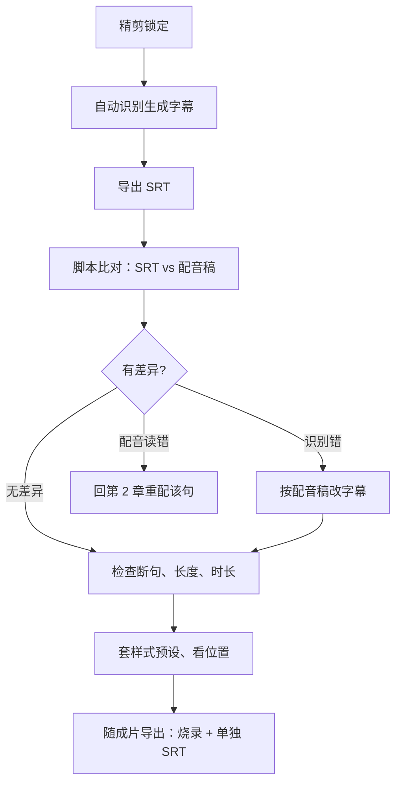

# 字幕

短剧的字幕不是可选项。大量用户在通勤、上班摸鱼、睡前刷剧时是静音或低音量的，没有字幕就看不懂剧情；AI 配音偶尔吐字不清，字幕也是兜底。字幕又是成片里最容易出低级错误的地方：错别字、和台词对不上、被平台界面挡住。每一个都会出现在评论区。

这一章讲字幕的规范、样式、自动识别后的校对，以及怎么用脚本把校对自动化。剪映里添加字幕的基础操作见[《拍摄与剪辑实务》](../shooting-editing/)。

## 字幕规范

国内对网络视听节目的字幕没有一份面向短剧创作者的统一技术规范，下面是行业通行做法，适合作为团队内部标准。其中「规范汉字、不出错别字」是硬要求，平台审核和广电对网络视听节目的管理都会关注用字规范。

### 文字

| 规则 | 说明 |
|---|---|
| 用规范简体汉字 | 古风剧也不用繁体字和异体字，除非是画面里的道具文字 |
| 不出错别字 | 包括同音错字（「既然」写成「即然」）和人名前后不一 |
| 数字 | 台词里口语化的数字用汉字（「三天之内」），日期、金额等按习惯可用阿拉伯数字，全剧统一 |
| 外文和网络用语 | 古风剧里不出现；都市剧按人设，慎用低俗网络用语 |
| 不规范、不文明用语 | 台词里有骂人的话，字幕不能照写脏字，要么改台词，要么用替代说法 |
| 不出现联系方式、引流信息 | 二维码、微信号、站外链接在字幕里出现会被判违规 |

### 标点

中文影视字幕的通行做法：

- **行尾不加句号和逗号**
- **句中逗号、顿号用一个空格代替**：「从今日起 我自立门户」
- **保留问号、感叹号、省略号**，它们承载语气
- **引号、书名号照常使用**：《退婚之后》
- 一个字幕条里如果有两个角色说话（快速对话），每人一行，行首加短横线。短剧里尽量避免这种情况，拆成两条

### 断句与长度

竖屏画面宽度有限，字幕太长会换行甚至挡住人脸：

| 规则 | 建议值 |
|---|---|
| 每条字幕行数 | 1 行为主，最多 2 行 |
| 每行字数 | 竖屏 1080 宽、字号 54 左右时，不超过 14–16 个汉字 |
| 单条显示时长 | 不少于 1 秒，不多于 6 秒 |
| 阅读速度 | 每秒不超过 7–8 个字，超过就拆条或删字 |
| 断句位置 | 在语义完整处断开，不要把一个词、一个人名拆到两行 |

台词「从今日起我自立门户与侯府再无瓜葛」16 个字，已经顶到一行的上限，读起来也累。按语义拆成两条：「从今日起 我自立门户」「与侯府再无瓜葛」，各自对齐配音的停顿。

### 时间轴

- **入点对齐开口**：字幕出现在说话声开始的那一帧，可以提前 1–2 帧，绝对不要晚于声音
- **出点跟随话尾**：说完后可以多停留 0.2–0.5 秒，方便读完，但不要拖到下一个镜头的新场景里
- **不跨剪切点**：字幕条尽量不跨越镜头切换，跨切的话观众会感到字幕「粘」在画面上。做不到时让字幕在切点前后至少 0.3 秒处出入
- **两条字幕之间留空或紧接**：间隔小于 0.3 秒时直接首尾相接，避免闪烁

### 角色与画外音的区分

| 内容 | 处理 |
|---|---|
| 画内台词 | 常规样式 |
| 画外音（OS）、内心独白 | 加括号，或用同色调的不同明度；不要用斜体，中文斜体是软件拉斜的伪斜体，难看 |
| 旁白 | 可以与台词同样式，也可以放在画面上方，全剧统一 |
| 电话、广播 | 可加引号或单独颜色 |
| 歌词 | 片头片尾曲有歌词时，按规范加字幕，并单独样式 |

## 样式

### 字体：先确认授权

字体是有版权的。剪辑软件里能选的字体，不代表可以商用；系统自带的字体也不一定允许嵌入商业视频。商业短剧用字体前确认：

- **字体许可证允许商用**：如思源黑体、思源宋体使用 SIL Open Font License，可以免费商用；一些企业发布的免费商用字体会附带使用条款，读清楚
- **商业字体买授权**：方正、汉仪等字库的字体用于商业视频需要购买相应授权
- **剪辑软件内的字体**：看软件内的商用标识或说明

授权截图放进 `00-bible/fonts/`。字体侵权的索赔案例并不少见，而且索赔的往往是整部剧。

### 样式参数

竖屏 1080×1920 下的建议起点，全剧固定为一个预设：

| 参数 | 建议 | 说明 |
|---|---|---|
| 字体 | 黑体类（无衬线） | 小屏上比宋体清楚；古风剧可以片名、花字用书法体，正文字幕仍用黑体 |
| 字号 | 48–60 px | 以手机上不眯眼能读、一行装下 14 字为准 |
| 颜色 | 白色或浅黄 | 浅黄在明亮画面上更不容易糊 |
| 描边 | 黑色，2–4 px | 保证在任何背景下可读 |
| 阴影 | 轻微，可选 | 和描边二选一或叠加 |
| 背景条 | 一般不用 | 遮画面；画面极花时可加半透明底 |
| 位置 | 画面下方，但避开平台界面遮挡区 | 见第 8 章安全区示意图 |

**位置是最容易出问题的**。竖屏短剧平台的播放界面，底部有标题、简介、进度条、选集按钮，右侧有点赞评论分享按钮。字幕放得太低会被挡住。通行做法是字幕底边离画面底部约 20%–25% 的高度（1920 高的画面里，大约在 y = 1450–1550 之间），具体在每个目标平台上实机看一遍。

### 强调字（花字）

短剧会在关键台词上用放大、变色、抖动的强调字，比如女主说「**不要了**」时这三个字放大变红。规则：

- 每集 2–4 处，只给剧情转折和爽点
- 强调字在普通字幕之外单独加一层，**普通字幕照常完整显示**，不要用强调字替代字幕
- 全剧固定一两种强调样式

## 自动字幕识别与校对

现在的剪辑软件都能自动识别语音生成字幕，速度很快。但 AI 短剧有个优势：**你手里有配音稿**，每一句台词的正确文本是已知的。所以校对的思路不是「听一遍改错字」，而是「拿识别结果和配音稿对」。

### 流程



比对能同时发现两类问题：识别错（字幕错了，配音没错），以及**配音读错了**（TTS 把多音字读错，识别也就跟着「错」）。第二类在纯人工听校时很容易漏掉，因为人会脑补。

部分剪辑软件支持导入文稿、按文稿自动对齐时间轴，能省去比对步骤；但人名、专名仍要人工过一遍。

### SRT 格式

SRT 是最通用的字幕文件格式，每条四部分：序号、时间、文本、空行：

```text
1
00:00:01,300 --> 00:00:02,900
（三个时辰前 他还要娶我）

2
00:00:15,600 --> 00:00:18,400
沈伯父 晚辈今日来 是退婚的

3
00:00:20,100 --> 00:00:21,900
哎呀 侯府的脸面可都丢尽了
```

时间格式是 `时:分:秒,毫秒`，注意用逗号分隔毫秒。文件编码用 UTF-8。

### 比对脚本

下面的 Python 脚本读入 SRT 和配音稿（CSV，至少有「行号」「台词」两列），去掉标点和空格后逐句比较，列出差异，并检查每条字幕的长度、时长和阅读速度：

```python
import csv, re, sys
from difflib import SequenceMatcher

PUNCT = re.compile(r"[\s，。、！？!?…：:；;“”\"'《》（）()\-—]")

def norm(s: str) -> str:
    return PUNCT.sub("", s)

def parse_srt(path):
    blocks = open(path, encoding="utf-8-sig").read().strip().split("\n\n")
    subs = []
    for b in blocks:
        lines = b.strip().splitlines()
        if len(lines) < 3:
            continue
        start, end = [t.strip() for t in lines[1].split("-->")]
        subs.append((to_sec(start), to_sec(end), "".join(lines[2:])))
    return subs

def to_sec(t):
    h, m, rest = t.split(":")
    s, ms = rest.split(",")
    return int(h) * 3600 + int(m) * 60 + int(s) + int(ms) / 1000

def main(srt_path, script_path):
    subs = parse_srt(srt_path)
    rows = list(csv.DictReader(open(script_path, encoding="utf-8-sig")))
    script_text = norm("".join(r["台词"] for r in rows))
    srt_text = norm("".join(s[2] for s in subs))

    # 1. 全文比对，列出不一致的片段
    sm = SequenceMatcher(None, script_text, srt_text, autojunk=False)
    for op, a1, a2, b1, b2 in sm.get_opcodes():
        if op != "equal":
            print(f"[差异] 配音稿「{script_text[a1:a2]}」 字幕「{srt_text[b1:b2]}」")

    # 2. 单条检查：长度、时长、阅读速度
    for i, (st, ed, text) in enumerate(subs, 1):
        n, dur = len(norm(text)), ed - st
        if n > 14:  # 竖屏一行 14 字为宜
            print(f"[过长] 第 {i} 条 {n} 字：{text}")
        if dur < 1.0 or dur > 6.0:
            print(f"[时长] 第 {i} 条 {dur:.1f} 秒：{text}")
        if dur > 0 and n / dur > 8:
            print(f"[太快] 第 {i} 条 每秒 {n / dur:.1f} 字：{text}")
        if re.search(r"[，。]$", text):
            print(f"[标点] 第 {i} 条行尾有逗号或句号：{text}")

if __name__ == "__main__":
    main(sys.argv[1], sys.argv[2])
```

```bash
python3 check_subs.py ep01/07-subs/ep01.srt ep01/01-script/vo_script.csv
```

输出示例：

```text
[差异] 配音稿「嫡」 字幕「敌」
[过长] 第 9 条 16 字：从今日起我自立门户与侯府再无瓜葛
[太快] 第 10 条 每秒 8.8 字：你一个女子离了侯府能去哪
```

第一条是识别错误，改字幕即可；如果差异是配音读错导致，回去重配那一句。

### 人工校对清单

脚本之外，还有几项必须人看：

- [ ] 人名、地名、专名全剧一致（建一张专名表，和音色设定卡放在一起）
- [ ] 画面里有文字（信件、牌匾）时，字幕不和它重叠
- [ ] 字幕没有挡住人脸、关键道具
- [ ] 强调字没有替代普通字幕
- [ ] 画外音、旁白的样式符合约定
- [ ] 第一条字幕在片头钩子里出现得够早（静音用户在前 3 秒就要看到文字）

## 烧录字幕与外挂字幕

| 方式 | 说明 | 用在 |
|---|---|---|
| 烧录（硬字幕） | 字幕作为画面的一部分导出 | 国内短视频和短剧平台的成片，通常都是烧录 |
| 外挂（软字幕） | 单独的 SRT 文件，播放器叠加显示 | 部分平台单独上传、出海译制、无障碍需求 |

建议两样都留：成片烧录字幕，同时导出一份 SRT 存档。出海时译制方需要的就是这份 SRT 和一个**不带字幕的干净版本**（clean version），所以导出时顺手再导一个无字幕版，以后不用重新渲染。

## 本章要点

- 静音观看的用户很多，短剧字幕必须完整，且第一条要在前 3 秒出现
- 规范简体汉字、无错别字是硬要求；行尾不加句号逗号，句中逗号用空格，保留问号感叹号
- 竖屏每行不超过 14–16 字，单条 1–6 秒，每秒不超过 7–8 字；入点对齐开口，可提前 1–2 帧
- 字体要有商用授权；字幕位置要避开平台界面遮挡区，在目标平台上实机检查
- 自动识别后不要只靠听校：拿 SRT 和配音稿脚本比对，同时能抓出配音读错
- 成片烧录字幕，同时保留 SRT 和无字幕干净版，方便出海译制
