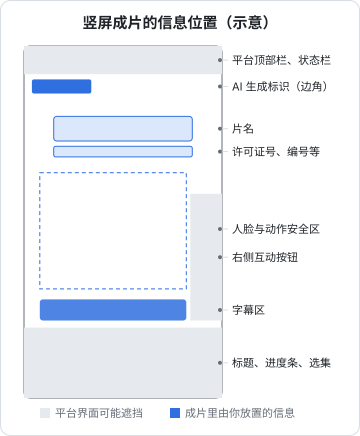

# 成片规格与交付

剪好、调好、混好、字幕上好，最后一步是导出和交付。这一步看起来是点一下「导出」按钮，实际上要回答四个问题：导出成什么规格、片头片尾要放哪些信息、AI 生成标识怎么加、交给平台或版权方的是哪些文件。任何一项不合格，片子都可能被平台退回，或者上线后被下架。

先说清楚这一章的边界：备案、审核、上线流程本身见《短剧发行、投流与备案》，相关法规的系统梳理见《自媒体与短剧合规财税》。这里只讲**成片里要体现什么、放在哪里、怎么导出**。

## 关于平台规格的说明

截至 2026 年 11 月，我查了抖音、红果短剧、快手、微信等平台公开的资料，**没有找到面向短剧版权方的成片技术规格（分辨率、码率、响度等）的公开文档**。这些要求通常在平台的短剧创作者后台、合作协议附件或对接群里下发，并且会调整。能查到的公开信息如下：

| 平台 | 公开可查的要求 | 出处 |
|---|---|---|
| 微信小程序短剧 | 短剧媒资管理接口：小于 10 MB 的文件可单次上传，更大的文件分片上传，每片 5 MB、最多 100 片；小程序需具备「文娱-微短剧」或「文娱-互动微短剧」类目 | 微信开放文档「短剧媒资管理」（2026-11 查询） |
| 抖音 | 2024 年 6 月 1 日起新上线的短剧，上传时需提交成本配置比例情况报告表和片酬承诺书，由平台统一向省级广电部门备案 | 澎湃新闻 2024 年报道 |
| 红果短剧 | 2026 年 7 月 21 日公告提高部分 AI 仿真人剧准入门槛，考察画面衔接、人物形象、表情变化、音画同步，不达标退回优化后重传；7 月 23 日发布《关于规范 AI 剧角色创作的公告》 | 新京报 2026-07-23、IT 之家报道 |

所以下面的规格表是**行业通行的安全做法**，不是某个平台的官方规定。真正上传前，以目标平台后台的最新要求为准，并且先传一集小样，在手机上看压缩后的效果。

## 导出规格表

建议每集导出四个版本，各自用途不同：

| 版本 | 用途 | 分辨率 | 帧率 | 视频编码与码率 | 音频 | 字幕 |
|---|---|---|---|---|---|---|
| 母版 | 存档、以后重新转码 | 1080×1920 | 与素材一致（如 30） | H.264 High 或 ProRes，H.264 用 20–30 Mbps 或 CRF 14–16 | PCM 或 AAC 320 kbps，48 kHz 立体声 | 烧录 |
| 上传版 | 交平台或版权方 | 1080×1920 | 同上 | H.264 High，8–15 Mbps | AAC 192–320 kbps，48 kHz 立体声 | 烧录 |
| 干净版 | 出海译制、重新包装 | 1080×1920 | 同上 | 同母版 | 两份：完整混音、去掉对白的音乐音效分轨（M&E） | 无 |
| 投流切片 | 投放素材 | 1080×1920 | 同上 | 同上传版 | 同上传版 | 烧录 |

几个通用参数：

- **9:16 竖屏**，1080×1920。部分平台支持更高分辨率，但 AI 素材的原生清晰度通常撑不起 4K，放大只会让文件变大
- **像素格式 yuv420p、色彩空间 Rec.709**。不加这两个参数，有些手机播放会偏色或无法播放
- **MP4 封装并把索引移到文件头**（`+faststart`），在线播放能边下边播
- **恒定帧率**。可变帧率的视频在一些平台转码后会音画不同步
- **响度**：按第 4 章，全剧统一，例如 -15 LUFS、真峰值不超过 -1 dBTP
- **单集时长**：按平台和剧的设定；《微短剧发展管理办法》（国家广播电视总局令第 16 号，2026-09-01 施行）第二条把微短剧定义为单集时长少于二十分钟的剧集

### 导出命令

剪辑软件导出母版后，用 ffmpeg 生成上传版，参数完全可控：

```bash
# 母版 -> 上传版：H.264 High，目标 10 Mbps，AAC 256k，faststart
ffmpeg -i tuihun_ep01_master.mov \
  -c:v libx264 -profile:v high -preset slow \
  -b:v 10M -maxrate 15M -bufsize 20M \
  -pix_fmt yuv420p -r 30 \
  -color_primaries bt709 -color_trc bt709 -colorspace bt709 \
  -c:a aac -b:a 256k -ar 48000 -ac 2 \
  -movflags +faststart \
  tuihun_ep01_v3_20261103.mp4
```

### 导出后自动检查

每次导出都检查一遍参数，人工看属性面板很容易漏。用 ffprobe 写个小脚本：

```bash
#!/usr/bin/env bash
# 用法：./check_export.sh file.mp4
f="$1"
probe() { ffprobe -v error -select_streams "$1" -show_entries "$2" -of default=nw=1:nk=1 "$f"; }

w=$(probe v:0 stream=width); h=$(probe v:0 stream=height)
fps=$(probe v:0 stream=r_frame_rate); pix=$(probe v:0 stream=pix_fmt)
vc=$(probe v:0 stream=codec_name); ac=$(probe a:0 stream=codec_name)
sr=$(probe a:0 stream=sample_rate)
dur=$(ffprobe -v error -show_entries format=duration -of default=nw=1:nk=1 "$f")

echo "分辨率 ${w}x${h}  帧率 ${fps}  像素 ${pix}  视频 ${vc}  音频 ${ac} ${sr}Hz  时长 ${dur}s"
[ "$w" = 1080 ] && [ "$h" = 1920 ] || echo "!! 分辨率不是 1080x1920"
[ "$pix" = yuv420p ] || echo "!! 像素格式不是 yuv420p"
[ "$vc" = h264 ] || echo "!! 视频编码不是 H.264"
[ "$sr" = 48000 ] || echo "!! 音频采样率不是 48 kHz"

# 响度
ffmpeg -nostats -i "$f" -af loudnorm=print_format=summary -f null - 2>&1 \
  | grep -E "Input Integrated|Input True Peak"
```

输出示例：

```text
分辨率 1080x1920  帧率 30/1  像素 yuv420p  视频 h264  音频 aac 48000Hz  时长 70.016000s
Input Integrated:    -15.1 LUFS
Input True Peak:      -1.6 dBTP
```

这个脚本第 9 章会接进质检流程。

## 片头片尾放什么

### 备案与许可信息

国家广播电视总局 2025 年 2 月发布的通知要求，未标注许可证或备案号的微短剧不得上线传播（据新华网 2025-02-05 报道）。《微短剧发展管理办法》（国家广播电视总局令第 16 号，2026-07-31 公布、2026-09-01 施行，原文见国家广电总局官网「法规规章」栏目）进一步写明：

- 微短剧按投资额度和题材分为一类、二类、三类，分别对应发行许可、省级以上主管部门批准文件、播出单位审核并标注节目编号
- **片头应当在明显位置标注剧名、许可证号、批准文件编号、节目编号**（第二十七条）；可以根据总时长、情节设置和传播特点，单独呈现或者与剧情融合呈现
- 非独播的三类微短剧，各播出单位标注本单位的节目编号
- 编剧、导演等的署名放在首集片头或末集片尾字幕的醒目位置
- 使用人工智能技术生成或制作的微短剧，**每集明显位置添加提示标识**（第三十四条）

办法本身没有规定编号和提示标识的显示时长、字号，这些以属地主管部门和平台的通知为准。你的剧属于哪一类、编号由谁给、什么时候拿到，见《短剧发行、投流与备案》。

落到后期操作上：

- **编号信息做成可替换的图层**。剪辑工程里把编号做成单独的文字图层或模板，拿到编号后批量替换；同一部剧在不同平台播出、编号不同时，每个平台导出一版
- **与剧情融合呈现**：叠加在前两个镜头上，和片名一起出现，不单独占用一个黑场，不影响前 3 秒的钩子
- **停留足够时间、清晰可读**：字号和对比度要保证手机上能看清。具体时长和字号没有查到细则，宁可保守，例如停留 2–3 秒

### AI 生成标识

《人工智能生成合成内容标识办法》（国家网信办等四部门发布，2025 年 9 月 1 日施行）和配套的强制性国家标准 GB 45438-2025《网络安全技术 人工智能生成合成内容标识方法》要求，AI 生成合成的内容要有**显式标识**（用户能看到、听到的）和**隐式标识**（写在文件元数据里的）。

对视频的显式标识，从公开的标准解读中能确认的要求是：

- 文字提示要同时包含「人工智能」或「AI」，以及「生成」和 / 或「合成」，例如「本剧含 AI 生成内容」「AI 合成」
- 位于**视频起始画面**，也可以在视频末尾和中间适当位置添加
- 位于画面的边或角，字型清晰可辨
- 对图片，标准要求文字高度不低于画面最短边长度的 5%

关于视频标识的最短显示时长、文字大小，我在公开资料里只看到二手解读（如「起始画面持续至少 2 秒」），没有核对到标准原文，**请以 GB 45438-2025 原文第 5 章为准**。保守做法是参照图片的 5% 字高（1080 宽的画面约 54 像素）、在起始画面停留 2 秒以上。

音频方面，标识办法要求在音频的起始、末尾或中间适当位置添加语音提示等显式标识。短剧以视频形式传播，通常视频画面上的标识即可；如果你把剧集的音频单独做成有声内容发布，要另加语音提示。

隐式标识通常由生成工具写入素材的元数据，但经过剪辑软件重新导出后，元数据很可能丢失。平台也会核验元数据，并在发布页面添加提示。实际操作：

- **上传时勾选平台的「AI 生成内容」声明**，各大内容平台的发布页面都有类似选项
- **不要删除、篡改生成平台加的标识**，第 7 章说过
- 片头放显式文字标识，覆盖剪辑软件导出时丢失元数据的情况

### 信息位置示意



这张图是示意，平台的界面布局不同、会改版，灰色区域的具体大小以目标平台实机为准。通用原则：

- 顶部约 8% 有平台的状态栏和导航，标识不要贴着最顶端
- 右侧中下部有点赞、评论、分享按钮
- 底部约 20% 有标题、简介、进度条、选集入口
- 字幕放在底部遮挡区上方，人脸和关键动作放在中部

### 片尾

短剧片尾越短越好（第 6 章说过，结尾钩子之后不要拖）。需要的署名信息：

- 编剧、导演等署名按办法要求放在首集片头或末集片尾，中间集不需要每集都放长片尾
- 使用了需要署名的素材（CC BY 音效、要求署名的字体或音乐），在片尾或作品简介里按许可证要求署名
- 配音演员、音色授权人的署名按合同约定

## 交付包

交给平台或版权方时，一集一个文件夹，命名统一：

```text
tuihun_ep01_delivery/
├── tuihun_ep01_v3_20261103.mp4        # 上传版（烧录字幕）
├── tuihun_ep01_v3_clean.mp4           # 干净版（无字幕），需要时提供
├── tuihun_ep01.srt                    # 字幕
├── tuihun_ep01_cover_9x16.jpg         # 竖版封面
├── tuihun_ep01_cover_3x4.jpg          # 其他比例封面，按平台要求
└── README.txt                         # 版本说明、时长、编号、AI 使用说明
```

`README.txt` 写清楚：

```text
剧名：退婚之后  集数：第 1 集 / 共 40 集
版本：v3（2026-11-03）  时长：70 秒
规格：1080x1920 / 30fps / H.264 / AAC 48kHz / 综合响度 -15.1 LUFS
编号：<许可证号或批准文件编号或节目编号>（已在片头 0–3 秒标注）
AI 使用：画面由 AI 生成；配音为 AI 合成（音色已取得授权）；片头已加 AI 生成标识
音乐音效：清单见 cues.csv，授权凭证可按需提供
```

整部剧还要单独准备一套材料：全剧授权文件汇总（配音、音色、音乐、字体）、剧本、成本配置比例表等备案材料。这些按平台和发行方的要求准备，见《短剧发行、投流与备案》。

## 本章要点

- 截至 2026 年 11 月未查到主要平台公开的短剧成片技术规格，以平台后台为准，先传小样测试
- 每集导出母版、上传版、干净版（含 M&E 分轨）、投流切片四个版本
- 通行上传规格：1080×1920、恒定帧率、H.264 High 8–15 Mbps、yuv420p、Rec.709、AAC 48 kHz、faststart
- 导出后用 ffprobe 脚本自动检查分辨率、编码、采样率、响度
- 2025 年起未标注许可证或备案号的微短剧不得上线；2026-09-01 施行的《微短剧发展管理办法》要求片头明显位置标注剧名和各类编号，AI 制作的每集加提示标识
- AI 生成标识：起始画面边角、文字含「AI / 人工智能」和「生成 / 合成」；视频的时长和字高以 GB 45438-2025 原文为准
- 编号做成可替换图层，与钩子画面融合呈现；上传时勾选平台的 AI 生成声明
