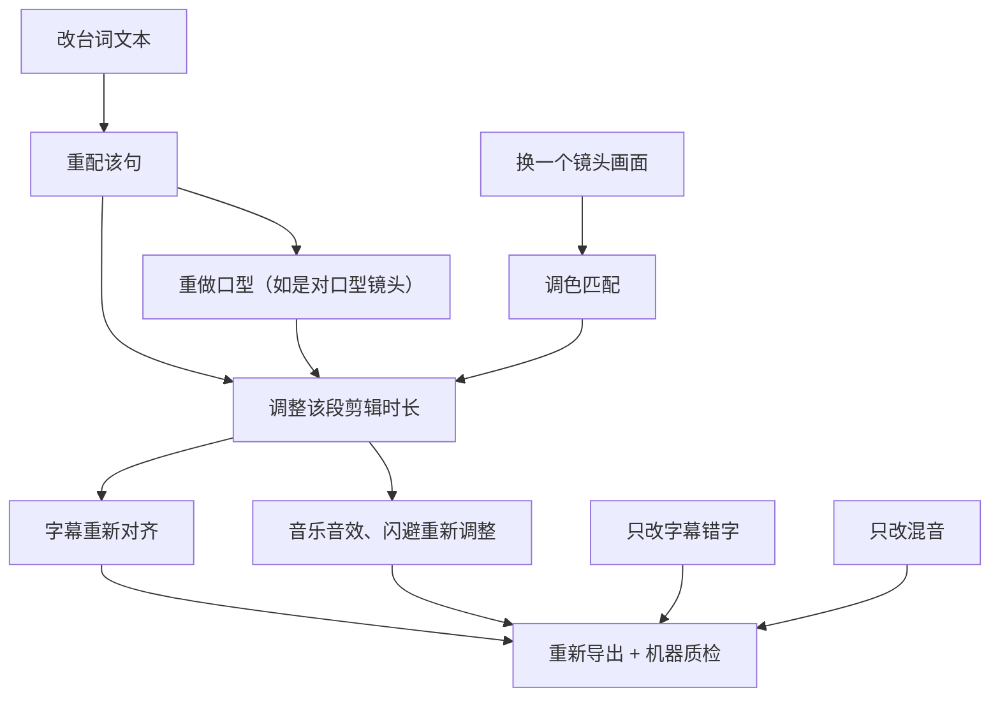

# 质检清单与返工

做后期的人看自己的片子，看到第三遍就「看不见」问题了：大脑知道台词是什么，会自动补全吞掉的字；知道人物是谁，会忽略第 17 镜的发簪换了颜色。质检的作用，就是用清单和工具代替记忆，用「第一次看」的眼睛代替做了一整天的眼睛。

这一章给出四类质检清单（画面、声音、字幕、合规）加规格检查、自动化脚本、质检记录模板，以及发现问题之后怎么返工、返工会连带影响哪些环节。

## 三轮检查

| 轮次 | 谁 | 什么时候 | 怎么看 | 重点 |
|---|---|---|---|---|
| 自检 | 剪辑的人 | 导出后立刻 | 电脑上，对照清单逐项 | 规格、字幕错字、明显穿帮 |
| 冷检 | 另一个人，或自己隔一晚 | 第二天 | **手机上**，先正常音量看一遍，再静音看一遍 | 节奏、情绪、看不看得懂、手机上的观感 |
| 交付检 | 脚本 + 人 | 交付前 | 自动脚本跑一遍，人看脚本报告 | 规格、响度、黑帧、静音段、文件命名 |

冷检最重要，也最常被省掉。一人公司没有第二个人，就把「隔一晚、换手机看」当作硬规则。还可以找一两个目标观众（不知道剧情的朋友）看，只问三个问题：哪里想划走？哪里没看懂？看完想不想看下一集？

## 问题分级

不是所有问题都要改。按严重程度分三级，决定改不改、什么时候改：

| 级别 | 定义 | 例子 | 处理 |
|---|---|---|---|
| P0 必改 | 违规、侵权、会被退回或下架，或严重影响观看 | 缺 AI 标识或编号；用了无授权音乐；错别字出现在关键台词；音画明显不同步；穿帮被观众一眼看到（六根手指的特写） | 不改不能交付 |
| P1 应改 | 明显影响观感或剧情理解 | 角色音色前后不一致；一段节奏拖沓；某镜色差明显；字幕被界面挡住 | 本次交付前改，时间不够时和合作方沟通 |
| P2 可改 | 细节瑕疵，多数观众不会注意 | 背景人物轻微变形；某个音效偏小；个别镜头轻微闪烁 | 记录下来，有空就改，或在下一集避免 |

P2 问题不要无限追。AI 短剧的画面总有瑕疵，追求零瑕疵会让单集成本失控（第 10 章算过账）。

## 质检清单

每集复制一份，逐项打勾。勾不上的写进质检记录。

### 画面

- [ ] 第 1 帧有动作或冲突，没有黑场、logo 动画
- [ ] 所有镜头分辨率、帧率一致，没有黑边、拉伸
- [ ] 镜头首尾没有残留的变形帧、静止帧
- [ ] 同一场戏色调一致（看联系表，第 7 章）
- [ ] 没有明显的亮度闪烁、纹理沸腾
- [ ] 角色外观前后一致：脸、发型、服装、配饰
- [ ] 没有穿帮：手指、五官、多余的人和物、道具凭空出现消失
- [ ] 画面中没有乱码文字被看清
- [ ] 跳轴、站位跳变已处理
- [ ] 对口型镜头：嘴型同步、牙齿和下巴没有变形、脸部清晰度和周围一致
- [ ] 结尾停在问题上，切黑干脆

### 声音

- [ ] 全片对白清楚，手机外放能听清每一个字
- [ ] 多音字、人名、专名读音正确
- [ ] 各角色音色与音色设定卡一致，没有中途换声
- [ ] 句与句之间音量一致，没有忽大忽小
- [ ] 没有 TTS 电音、吞字、尾音截断、底噪、喷麦
- [ ] 音画同步：声音最多早 1 帧、晚 3 帧（30 fps）
- [ ] 有台词时音乐已闪避；音乐没有在台词中间突然冲上来
- [ ] 动作都有对应的音效，环境声没有断档
- [ ] 音乐在剪切点没有突兀的跳变
- [ ] 综合响度在目标值 ±1 LU 以内，真峰值不超过 -1 dBTP
- [ ] 静默段是有意的，没有意外的无声

### 字幕

- [ ] 脚本比对（第 5 章）无差异，或差异都已确认
- [ ] 无错别字，人名专名与专名表一致
- [ ] 每行不超过 14–16 字，单条 1–6 秒，没有超速
- [ ] 入点不晚于说话声
- [ ] 标点符合约定（行尾无句号逗号）
- [ ] 不被平台界面遮挡，不挡人脸和关键道具
- [ ] 画外音、旁白样式符合约定
- [ ] 第一条字幕在 1 秒内出现
- [ ] 强调字没有替代普通字幕

### 合规

- [ ] 起始画面有 AI 生成标识，文字含「AI / 人工智能」和「生成 / 合成」，位于边角、清晰可辨
- [ ] 片头有剧名和对应的许可证号 / 批准文件编号 / 节目编号（按剧的类别），与目标平台对应
- [ ] 所有配音音色都有授权，授权书编号已登记在音色设定卡
- [ ] 音乐音效清单完整，每一条都有授权凭证
- [ ] 字体有商用授权
- [ ] 没有使用或模仿真实名人、公众人物的声音和长相
- [ ] 没有去除生成平台加的标识
- [ ] 字幕和画面中没有联系方式、二维码、引流信息
- [ ] 内容没有低俗、暴力过度、未成年人不当情节等平台禁止的内容（具体尺度见[《自媒体与短剧合规财税》](../media-compliance/)和平台规则）

### 规格与文件

- [ ] 导出参数检查脚本无报错（第 8 章）
- [ ] 文件命名符合约定，版本号正确
- [ ] 交付包齐全：上传版、SRT、封面、README
- [ ] 母版、干净版、工程文件已归档

## 自动化：一条命令跑完机器能查的

能交给机器的就交给机器。在第 8 章导出检查脚本的基础上，再加三项 ffmpeg 自带的检测：

```bash
#!/usr/bin/env bash
# qc.sh：机器质检。用法：./qc.sh tuihun_ep01_v3_20261103.mp4
f="$1"
echo "== 规格与响度 =="
./check_export.sh "$f"

echo "== 黑帧（超过 0.1 秒）=="
ffmpeg -nostats -i "$f" -vf "blackdetect=d=0.1:pix_th=0.10" -an -f null - 2>&1 \
  | grep -o "black_start:[0-9.]* black_end:[0-9.]*"

echo "== 画面冻结（超过 1 秒不动）=="
ffmpeg -nostats -i "$f" -vf "freezedetect=n=0.003:d=1" -an -f null - 2>&1 \
  | grep -oE "freeze_(start|end): [0-9.]+"

echo "== 静音段（超过 0.8 秒）=="
ffmpeg -nostats -i "$f" -af "silencedetect=noise=-50dB:d=0.8" -vn -f null - 2>&1 \
  | grep -oE "silence_(start|end): [0-9.]+"
```

报告示例：

```text
== 黑帧（超过 0.1 秒）==
black_start:69.80 black_end:70.01
== 画面冻结（超过 1 秒不动）==
freeze_start: 12.90
freeze_end: 13.98
== 静音段（超过 0.8 秒）==
```

机器只报告，不判断。结尾 69.8 秒的黑帧是有意的切黑，没问题；12.9 秒开始约 1 秒的冻结，对照第 6 章的节奏表是 S07 陆砚入场镜头的末尾，说明这个 AI 镜头后半段几乎不动，要么裁短，要么换镜头。这正是人眼容易放过的问题：慢推镜头里画面不动，看起来像「定格」，其实是生成失败。

字幕比对脚本（第 5 章）也接到这里，一并输出。

## 质检记录模板

每集一个 `qc.md`，放在集目录下：

```text
# 第 1 集质检记录  版本 v3  2026-11-03

检查人：自检 A / 冷检 B（手机：iPhone，外放 + 静音各一遍）
机器检查：qc.sh 通过；字幕比对 2 处差异已处理

| # | 时间码 | 镜头 | 类别 | 级别 | 问题 | 处理环节 | 状态 |
|---|---|---|---|---|---|---|---|
| 1 | 00:12.9 | S07 | 画面 | P1 | 镜头后 1 秒冻结 | 剪辑：裁短 1 秒 | 已改 v4 |
| 2 | 00:20.4 | S11 | 声音 | P1 | 柳氏「侯府」的「侯」读成第三声 | 配音：重配 L005 | 已改 v4 |
| 3 | 00:33.2 | S17 | 画面 | P2 | 对口型后下巴边缘轻微抖动 | 记录，不改 | 接受 |
| 4 | 00:45.0 | S21 | 字幕 | P1 | 字幕被右侧按钮挡住两个字 | 字幕：缩短为两条 | 已改 v4 |
| 5 | 00:00.0 | — | 合规 | P0 | 节目编号是占位文字 | 片头：替换编号图层 | 已改 v4 |

结论：v4 通过，可交付
```

时间码 + 镜头号 + 处理环节这三列，让返工的人不用重新看整片就能定位。

## 返工：改一处，连带改哪里

后期是一条流水线，上游一改，下游跟着动。返工前先想清楚连带影响，否则改完台词忘了改字幕，又是一个新问题。



| 问题 | 回到的环节 | 连带要重做 | 返工成本 |
|---|---|---|---|
| 字幕错字、样式 | 字幕 | 导出 | 低 |
| 混音、响度、某个音效 | 混音 | 导出 | 低 |
| 某镜色差 | 调色 | 导出 | 低 |
| 剪辑节奏、裁镜头 | 剪辑 | 字幕对齐、音乐衔接、导出 | 中 |
| 读音错、情绪不对（台词不变） | 配音 | 口型（如有）、剪辑微调、字幕时间、导出 | 中 |
| 改台词文本 | 配音稿 | 配音、口型、剪辑、字幕、混音、导出 | 高 |
| 画面穿帮必须换镜头 | 画面生成 | 调色、口型（如有）、剪辑、导出 | 高 |
| 编号、标识 | 片头图层 | 导出 | 低（前提是做成了可替换图层） |

两个省返工的习惯：

- **能在低成本环节解决的，不回高成本环节**。读音错一个字，先试试在剪辑软件里用同一角色的其他句子剪出那个字，或者只重配那一句；穿帮镜头先试裁切、缩短、反应镜头盖住，不行再重新生成
- **改动集中批量做**。质检发现的问题先全部记下来，按环节归类，一个环节一次改完，而不是发现一个改一个、导出一次又一次

### 返工单

交给别人返工（或者提醒以后的自己）时，用这样的格式：

```text
返工单 RW-ep01-03
剧集：退婚之后 第 1 集  基于版本：v3
问题：S11 柳氏台词 L005「侯府」的「侯」读音错误（读成第三声）
时间码：00:20.4
处理：重配 L005，读音表加注「侯 hóu」；替换后检查 S11 口型是否需要重做
连带：字幕第 3 条时间可能变化，重新比对；导出 v4
截止：2026-11-04 12:00
验收：手机外放听 L005 读音正确，qc.sh 通过
```

### 版本记录

每次导出版本号加一，在集目录里维护一个简短的变更记录：

```text
v1 2026-11-02 粗剪
v2 2026-11-02 精剪 + 混音 + 字幕
v3 2026-11-03 调色、片头标识，自检通过
v4 2026-11-03 冷检 5 处问题修复，交付
```

平台审核驳回或合作方提修改意见时，你能立刻知道对方看的是哪一版、改过什么。

## 平台退回怎么办

被平台退回或审核不通过时：

1. **看清退回理由**，截图存档。理由模糊（如「内容质量不达标」）时，对照平台公开的规则和公告逐项排查。比如红果 2026 年 7 月的公告里列出了画面衔接、人物形象、表情变化、音画同步几项
2. **按问题定位环节**，用上面的返工表估算成本
3. **改完重新走一遍完整质检**，不只检查被指出的问题
4. **把退回原因加进质检清单**。同样的问题不应该出现第二次

## 本章要点

- 三轮检查：自检、冷检（隔一晚、手机、外放和静音各一遍）、交付检（脚本）
- 问题分 P0 必改、P1 应改、P2 可改；P2 不要无限追
- 清单分画面、声音、字幕、合规、规格五类，每集复制逐项打勾
- 用 ffmpeg 的 blackdetect、freezedetect、silencedetect 加导出检查和字幕比对，机器查能查的
- 质检记录写时间码、镜头号、处理环节，返工不用重看整片
- 改台词连带配音、口型、剪辑、字幕、混音；能在低成本环节解决的不回高成本环节，改动批量做
- 平台退回的原因要写进质检清单
