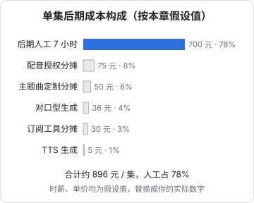

# 从 0 到一集成片：全流程演练与成本

前面九章分别讲了每个环节。这一章把它们串起来：以示例剧《退婚之后》第 1 集为例，从拿到剧本和镜头素材开始，按天、按小时列出每一步做什么、产出什么文件、用到哪一章。最后算账：一集要多少工时、多少钱，一个人一周能做几集。

演练的设定：

- **一个人**，会用剪映专业版或达芬奇的基本操作（《拍摄与剪辑实务》的水平），第一次完整做 AI 短剧后期
- **上游已完成**：剧本、分镜表（带「对应台词行号」「是否正脸说话」「预计时长」三列），28 个镜头的视频素材（每个镜头 1–3 个版本）
- **目标**：交付一集 70 秒左右、可上传平台的成片和完整交付包
- **时间**：第一集用 3 个半工作日，其中 1 天是全剧共用资产的一次性准备

## 总览

## 第 0 天：全剧资产准备（约 8 小时，只做一次）

这一天的产出，后面 39 集都会复用。很多人跳过这一步直接开剪，结果每集都在重复做同样的决定，而且做得不一致。

| 时间 | 步骤 | 产出物 | 章 |
|---|---|---|---|
| 09:00–09:30 | 建目录结构，约定命名规则 | `tuihun/00-bible/`、`ep01/` 各子目录 | 1 |
| 09:30–11:00 | 读剧本，列角色，写 5 张音色设定卡（沈知微、陆砚、柳氏、老侯爷、旁白） | `00-bible/voices.md` 初稿 | 2 |
| 11:00–12:30 | TTS 选型：拿三句最难的台词在 2–3 家工具上试，确认商用条款，截图存档 | 选型记录、条款截图 | 2 |
| 13:30–14:30 | 主角音色：和配音演员签声音授权书、录克隆样本（或确认用预置音色） | `licenses/VA-2026-001.pdf`、样本录音 | 2 |
| 14:30–15:30 | 生成音色，每个角色试 3 句，确认区分度（盲听测试），定稿音色 ID 写进设定卡 | `voices.md` 定稿、参考音频 | 2 |
| 15:30–16:30 | 音乐包：主题曲、紧张、爽点、悲伤、悬念五类，生成或从曲库选定，留存授权 | `00-bible/music/`、授权凭证 | 4 |
| 16:30–17:00 | 字幕样式预设：确认字体授权，定字号、描边、位置，在目标平台实机看一次 | 字幕预设、`fonts/` 授权截图 | 5 |
| 17:00–17:30 | 片头模板：片名、AI 生成标识、编号占位图层 | 片头模板工程 | 8 |
| 17:30–18:00 | 准备脚本：`check_export.sh`、`qc.sh`、字幕比对脚本，放进工具目录 | 脚本 | 5、8、9 |

调色 LUT 不在第 0 天做，因为要等看到实际素材。第 1 集调色时顺手定下来。

## 第 1 天：配音与粗剪（约 8 小时）

| 时间 | 步骤 | 产出物 | 章 |
|---|---|---|---|
| 09:00–10:00 | 剧本转配音稿：每句一行，填行号、镜头号、角色、情绪、强度、停顿重音、画内外、目标时长、读音备注；台词口语化改写 | `ep01/01-script/vo_script.csv`（14 行） | 2 |
| 10:00–11:30 | 批量生成配音：每句 3–5 个版本，主角关键台词多抽几次 | `03-vo/_takes/` 下约 50 个文件 | 2 |
| 11:30–12:30 | 挑选：按读音、情绪、时长、无瑕疵的顺序挑定稿，更新配音稿的「定稿文件」列 | `03-vo/` 下 14 个定稿 WAV | 2 |
| 13:30–14:00 | 干声处理：统一 48 kHz 单声道、切头尾静音 | 处理后的定稿 WAV | 2 |
| 14:00–14:30 | 素材整理：28 个镜头选定版本，统一 1080×1920、30 fps | `02-shots/` 规格统一的素材 | 7 |
| 14:30–15:30 | 先排声音：14 句配音按顺序铺在对白轨，调整句间停顿，闭眼听一遍 | 剪辑工程：对白轨 | 6 |
| 15:30–17:30 | 按台词铺画面：每句下放对应镜头，空白处放反应镜头和空镜；镜头首尾默认裁掉 | 粗剪 v1（约 75 秒） | 6 |
| 17:30–18:00 | 标出需要对口型的镜头（S04、S09、S11、S13、S17、S19），导出这 6 段片段和对应干声 | `04-lipsync/in/` | 3 |

第 1 天结束时的检查点：粗剪能从头看到尾，剧情完整，台词都在。节奏、颜色、声音都还很粗糙，正常。

**新手常见卡点**：挑配音花的时间远超预期。给自己定规矩：配角和旁白一次过，主角每句最多 5 个版本，挑不出来就改台词。

## 第 2 天：口型、精剪、调色、混音（约 8 小时）

| 时间 | 步骤 | 产出物 | 章 |
|---|---|---|---|
| 09:00–09:15 | 提交 6 段对口型任务，每段 2–3 个结果（生成期间做下一步） | 对口型任务 | 3 |
| 09:15–11:30 | 精剪：按节奏原则调整镜头时长，做高光前置开场、冲突段快切、静默蓄力、爽点声画同落、结尾停在问题上；边剪边填节奏标注表 | 精剪 v2、节奏标注表 | 6 |
| 11:30–12:30 | 检查对口型结果，逐帧看嘴部、牙齿、下巴，挑选后替换回时间轴；失败的改用规避剪法 | `04-lipsync/` 定稿 | 3 |
| 13:30–14:00 | 锁定剪辑：之后不再改镜头顺序和时长（除非质检发现问题） | 锁定的时间轴 | 6 |
| 14:00–15:00 | 调色：抽帧联系表看色差 → 去闪烁 → 选参考镜头做一级校正 → 定全剧 LUT → 加细颗粒；信封特写贴字 | `00-bible/lut/tuihun_v1.cube`、调好的时间轴 | 7 |
| 15:00–16:30 | 音乐音效：按节奏表铺音乐包、拟音、环境声、强调音效；填音乐音效清单 | `05-music-sfx/cues.csv` | 4 |
| 16:30–17:30 | 混音：轨道归位、对白高通 + 压缩 + 统一音量、音乐闪避、高潮处手动包络；手机外放听一遍 | 混音完成的时间轴 | 4 |
| 17:30–18:00 | 测量响度，归一化到 -15 LUFS、真峰值 -1.5 dBTP | 混音 WAV | 4 |

第 2 天结束时的检查点：静音看一遍，画面完整连贯；闭眼听一遍，声音完整清楚。

## 第 3 天：字幕、片头、导出、质检、交付（约 6 小时 + 次日冷检）

| 时间 | 步骤 | 产出物 | 章 |
|---|---|---|---|
| 09:00–09:30 | 自动识别字幕，导出 SRT | `07-subs/ep01_auto.srt` | 5 |
| 09:30–10:15 | 跑字幕比对脚本，改识别错误；发现 1 处配音读错，记录返工 | 校对后的 SRT、返工记录 | 5 |
| 10:15–11:00 | 断句、长度、时间轴调整；套样式预设；加 2 处强调字；检查遮挡 | 字幕定稿 | 5 |
| 11:00–11:30 | 片头：套模板，填片名、AI 生成标识；编号未下发前用醒目的占位文字，并记入质检 P0 | 片头图层 | 8 |
| 11:30–12:00 | 导出母版 v3，ffmpeg 转上传版；跑 `qc.sh` | `08-export/` 下母版和上传版、机器质检报告 | 8、9 |
| 13:30–14:30 | 自检：对照五类清单逐项打勾，写质检记录 | `ep01/qc.md` | 9 |
| 14:30–15:00 | 导出干净版和 M&E 分轨，归档工程 | 干净版、分轨 | 8 |
| 次日 09:00–09:30 | 冷检：手机上外放看一遍、静音看一遍；记录问题 | 质检记录补充 | 9 |
| 次日 09:30–11:00 | 批量返工：重配 1 句、裁短 1 个冻结镜头、改 1 条遮挡字幕；替换编号（如已下发）；导出 v4、重跑 `qc.sh` | v4、更新后的质检记录 | 9 |
| 次日 11:00–11:30 | 整理交付包：上传版、SRT、封面、README；上传时勾选 AI 生成内容声明 | `tuihun_ep01_delivery/` | 8 |

## 产出物总清单

第 1 集做完，目录里应该有这些东西。用它反查有没有漏：

| 类别 | 文件 | 复用范围 |
|---|---|---|
| 全剧资产 | 音色设定卡、声音授权书、音乐包及授权、LUT、字幕预设、字体授权、片头模板、检查脚本 | 全剧 |
| 文本 | 配音稿（含定稿文件名）、专名表 | 本集；专名表全剧 |
| 声音 | 14 个定稿干声、音乐音效清单、混音 WAV | 本集 |
| 画面 | 规格统一的镜头、6 个对口型镜头 | 本集 |
| 工程 | 剪辑工程、节奏标注表 | 本集；节奏表可作后续集模板 |
| 成片 | 母版、上传版、干净版、M&E 分轨、SRT | 本集 |
| 记录 | 质检记录、返工单、版本记录 | 本集 |
| 交付 | 交付包文件夹 | 本集 |

## 产能：稳定期每集多少工时

第 1 集加上第 0 天，大约 30 小时。从第 3 集左右开始，全剧资产都已就位、流程熟练，一集 70–90 秒的漫剧，后期稳定在 7 小时左右：

| 环节 | 稳定期工时 | 占比 | 主要变量 |
|---|---|---|---|
| 配音（标注、生成、挑选、处理） | 1.5 小时 | 21% | 台词量、主角情绪戏多少 |
| 口型同步 | 0.8 小时 | 11% | 对口型镜头数、失败重试次数 |
| 粗剪 + 精剪 | 2.0 小时 | 29% | 镜头数、节奏要求 |
| 调色与修补 | 0.6 小时 | 9% | 穿帮数量、写实还是漫画 |
| 音乐音效与混音 | 0.8 小时 | 11% | 音乐包是否够用 |
| 字幕 | 0.5 小时 | 7% | 识别准确率 |
| 片头、导出、质检、返工 | 0.8 小时 | 11% | 返工量 |
| **合计** | **7.0 小时** | 100% | |

按每天 6 个有效工时算，一个人稳定期每天约 0.85 集、每周（5 天）约 4 集。一部 40 集的剧，仅后期就要 10 周左右。这还没算画面生成：如果画面也是同一个人做，总产能至少再减半。

所以一人团队要么做集数少的剧，要么把环节拆开外包（真人配音、调色修补最适合外包），要么用工具把重复劳动压下去。哪些环节值得做成工具，见《给创作者和短剧团队做工具》。

### 提效的优先级

按投入产出比排序：

1. **全剧资产一次做好**：音色设定卡、音乐包、LUT、字幕预设、片头模板。省下的是每集的决策时间
2. **脚本化机器能查的东西**：导出检查、响度、黑帧冻结、字幕比对。每集省半小时，而且查得比人准
3. **减少对口型镜头**：从分镜阶段就设计好规避，每少一个对口型镜头省 10 分钟以上
4. **配音挑选设上限**：主角最多 5 个版本，配角一次过
5. **批量化**：几集一起做同一个环节（一次配 5 集的音），比一集一集走完整流程更快，切换成本低

## 成本测算模板

单集后期成本由四部分组成：

$$
\text{单集成本} = \sum(\text{工时} \times \text{时薪}) + \sum \text{按量费用} + \frac{\text{月订阅合计}}{\text{月产集数}} + \frac{\text{一次性投入}}{\text{总集数}}
$$

时薪对一人公司来说是机会成本：你把这些时间用在别的工作上能赚多少。不算这一项，会严重低估成本。

### 模板

复制到表格里，把「假设值」一列换成你自己的实际数字。下表的单价都是**为演示公式设的假设值，不是任何厂商的报价**，实际价格查各家当前定价页：

| 项目 | 计算方式 | 假设值 | 单集金额 |
|---|---|---|---|
| 后期人工 | 稳定期工时 × 时薪 | 7 小时 × 100 元 | 700 元 |
| TTS 生成 | 台词字数 × 抽卡倍数 × 单价 | 约 200 字 × 4 倍，合计按 5 元计 | 5 元 |
| 对口型生成 | 镜头数 × 重试次数 × 秒数 × 每秒单价 | 6 × 3 × 4 秒 × 0.5 元 | 36 元 |
| 订阅工具分摊 | （剪辑软件 + AI 音乐 + 音效库 + 其他）月费 ÷ 月产集数 | 600 元 ÷ 20 集 | 30 元 |
| 配音授权分摊 | 声音授权费 ÷ 总集数 | 3000 元 ÷ 40 集 | 75 元 |
| 主题曲定制分摊 | 作曲费 ÷ 总集数 | 2000 元 ÷ 40 集 | 50 元 |
| **合计** | | | **896 元** |

从这个结构能看出：

- **人工是大头**。按量计费的 AI 工具费用在单集成本里占比很小，真正贵的是人的时间。所以提效（上一节）比找便宜的工具更重要
- **一次性投入按集数摊薄**。40 集的剧，3000 元的声音授权每集只摊 75 元；如果只做 10 集，每集 300 元。集数少的剧，一次性投入要更克制
- **订阅费按产量摊薄**。月产 20 集时每集 30 元，月产 5 集时每集 120 元。产量没上来之前，用按量计费的工具更划算

### 全剧预算

把单集成本乘以集数，再加上第一集的额外投入：

| 项目 | 计算 | 金额（按假设值） |
|---|---|---|
| 稳定期单集成本 | 见上表 | 896 元 |
| 40 集 | 896 × 40 | 35,840 元 |
| 第 0 天和第 1 集的额外工时 | 约 23 小时 × 100 元 | 2,300 元 |
| 返工和平台退回的预留 | 总额的 10% | 约 3,800 元 |
| **后期合计** | | **约 4.2 万元** |

这只是后期。剧本、画面生成、发行投流的成本要另算，画面生成的测算见《AI 短剧分镜与画面生成》，整部剧的投入产出和分账模型见《微短剧行业全景》和《短剧发行、投流与备案》。

### 用测算倒推决策

成本模板最有用的地方不是算出一个数，而是帮你做取舍：

| 问题 | 怎么用模板回答 |
|---|---|
| 主角用真人配音还是授权克隆？ | 真人报价 × 集数 vs 克隆授权费 + 每集多出的挑选工时 × 时薪 |
| 对口型做 6 个镜头还是 3 个？ | 少 3 个镜头省下的工时和生成费，与平台对音画同步的要求、完播率的影响对比 |
| 要不要外包调色修补？ | 外包单价 vs 自己的工时 × 时薪，外包后你的时间用在哪里 |
| 这部剧值不值得做？ | 全剧后期 + 画面 + 发行成本，与保守的收入预期对比 |

## 本章要点

- 第 1 集约 3 个半工作日：第 0 天准备全剧资产，第 1 天配音粗剪，第 2 天口型精剪调色混音，第 3 天字幕片头导出质检，次日冷检返工交付
- 每一步都有明确的产出物和文件位置，用产出物总清单反查遗漏
- 稳定期一集 70–90 秒的漫剧后期约 7 小时，剪辑和配音占一半；一人每周约 4 集
- 单集成本 = 工时 × 时薪 + 按量费用 + 订阅 ÷ 月产量 + 一次性投入 ÷ 总集数
- 按假设值测算，人工占约八成，提效比找便宜工具更重要
- 用成本模板做取舍：真人还是克隆、对口型做多少、外包什么、这部剧值不值得做
