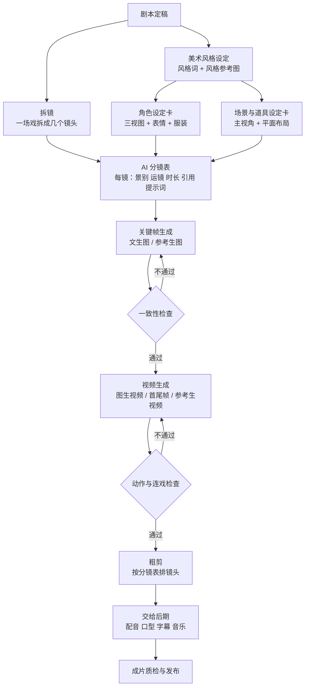

# AI 短剧的生产流程

这本书讲 AI 短剧和漫剧里最吃功夫的一段：**把剧本变成一个个能生成出来、能剪到一起的画面**。剧本怎么写见[《短剧编剧》](../drama-scriptwriting/)，配音、口型、字幕和剪辑见[《AI 短剧后期》](../ai-drama-post/)，发行和备案见[《短剧发行、投流与备案》](../drama-distribution/)。这里只管中间：分镜、设定、提示词、生成、管理。

如果你是开发者，可以把这本书当成一份「渲染管线」文档来读：剧本是源码，分镜表是中间表示，角色卡和场景卡是资源文件，提示词是编译参数，图像和视频模型是渲染器。中间表示写得好，渲染器换了也能重新出片；中间表示写得乱，每次生成都是开盲盒。

## 三种形态先分清

市面上叫「AI 短剧」的东西，生产方式差别很大。动手前先确定你做的是哪一种，因为它决定了工作量和工具选型。

| 形态 | 画面构成 | 每集主要工作量 | 对一致性的要求 | 适合谁起步 |
|---|---|---|---|---|
| 动态漫 / 静帧漫剧 | 静态图 + 镜头推拉摇移 + 局部动效（眨眼、飘发、雨丝） | 出图、精修、剪辑里做运镜 | 角色和场景必须稳定 | 一个人、预算低、先跑通流程 |
| AI 视频短剧（漫剧风格） | 图生视频为主，角色会走、会转头、会说话 | 出关键帧，再逐镜头生成视频、挑片 | 很高，人物动起来更容易崩 | 有一定预算、能接受返工 |
| AI 视频短剧（写实风格） | 接近真人拍摄的画面 | 同上，且对表情、手部、口型要求更高 | 最高，观众对真人脸最敏感 | 有经验后再做 |

建议的路径是：**先用动态漫做通一集，再把其中的部分镜头升级成视频**。原因很简单，静帧阶段已经能暴露 80% 的问题（角色不稳、构图不对、节奏太拖），而静帧返工的成本远低于视频返工。

## 从剧本到成片的完整流程

这张图里有两个循环，它们决定了一集的真实成本：

- **关键帧循环**：一张图不像角色、构图不对，就重新生成。这一圈便宜，几毛钱、几十秒
- **视频循环**：动作崩了、脸变了、镜头乱飞，就重新生成。这一圈贵，一条几秒的视频常常要几块钱、几分钟，而且成功率明显低于出图

所以整个流程的设计思路是：**把问题尽可能拦在前面**。角色卡定不下来就不要开始出分镜图，分镜图没过一致性检查就不要开始出视频。

## 每个环节的产出物

把每一步的产出写成「文件」，后面的批量生产和返工才有据可查。下面是一集需要的全部产出物，后面各章会逐个给模板。

| 环节 | 产出物 | 格式建议 | 对应章节 |
|---|---|---|---|
| 风格设定 | 风格说明 + 风格词 + 3–6 张风格参考图 | Markdown + 图片文件夹 | 美术风格、场景与道具 |
| 角色设定 | 每个角色一张设定卡 + 三视图 + 表情表 | Markdown + 图片 | 角色一致性 |
| 场景设定 | 每个场景一张设定卡 + 主视角图 + 平面布局 | Markdown + 图片 | 美术风格、场景与道具 |
| 拆镜 | AI 分镜表 | 表格（飞书多维表格、Notion、CSV 都行） | 从剧本到分镜 |
| 提示词 | 每个镜头的图像提示词和视频提示词 | 写在分镜表里，长的另存文本 | 图像提示词、视频生成 |
| 生成 | 关键帧、视频片段 | 按规则命名的文件 | 批量生产与管理 |
| 记录 | 生成记录表（工具、参数、种子、结果） | 表格 | 批量生产与管理 |

开发者往往会想：这些表能不能直接用代码管？可以，而且推荐。分镜表本质上是一张结构化数据表，后面会给出 CSV 列定义，你可以用脚本批量拼提示词、批量调用 API、自动命名文件。但第一集请先手工走一遍，搞清楚每一列为什么存在，再去自动化。

## 时间和成本怎么估

AI 短剧的成本不在单次生成，而在**返工率**。下面是估算一集成本的思路，具体单价请按你用的工具实时查：

$$
\text{一集生成成本} = \sum_{\text{每个镜头}} \text{单次单价} \times \frac{1}{\text{一次成功率}}
$$

举个计算例子（数字只用来演示公式，不代表任何工具的实际价格）：一集 90 秒，拆成 20 个镜头，每个镜头先出 1 张关键帧再生成 1 段 5 秒视频。

| 项目 | 单次单价（假设） | 一次成功率（假设） | 每镜平均次数 | 20 镜合计 |
|---|---|---|---|---|
| 关键帧 | 0.2 元 / 张，一次出 4 张 | 50%（按组算） | 2 组 | 16 元 |
| 视频 5 秒 | 5 元 / 条 | 30% | 3.3 条 | 330 元 |
| 合计 | | | | 约 346 元 |

两个结论：

1. **视频成功率是最大的变量**。成功率从 30% 提到 50%，视频成本直接从 330 元降到 200 元。后面几章讲的设定卡、提示词结构、失败排查，最终都是为了提高这个数
2. **动态漫的成本可以低一个数量级**。同样 20 个镜头只出图、不出视频，生成成本只有十几元，时间成本主要在挑图、精修和剪辑上

时间上，一个熟练的人做一集 1–2 分钟的动态漫，从拿到剧本到粗剪，大约一到两天；做成视频短剧要再加一到三天，主要耗在视频的反复生成和挑片。第一集通常要翻倍。这些是经验区间，不同题材差异很大，请用你自己的生成记录表来校准。

## 工具版图

生成工具更新极快，几乎每个季度都有大版本。这里只给一个**截至 2026 年 11 月**的定位概览，具体能力和价格以官网为准，详细对比在角色一致性和视频生成两章。

| 类别 | 代表工具 | 在本流程里的用途 |
|---|---|---|
| 国内一站式（图 + 视频） | 即梦（字节）、可灵（快手）、海螺（MiniMax）、Vidu（生数科技）、通义万相（阿里） | 关键帧、参考生图、图生视频、参考生视频，大部分个人创作者的主力 |
| 海外图像 | Midjourney | 风格探索、氛围图、风格参考 |
| 海外视频 | Runway | 视频生成与编辑，也聚合了部分第三方模型 |
| 本地 / 开源 | Stable Diffusion 系列 + ComfyUI，以及部分开源视频模型 | 需要精确控制（姿势、线稿、角色 LoRA）或大批量时 |
| 剪辑与动效 | 剪映、Premiere、After Effects 等 | 动态漫的运镜和局部动效、粗剪 |

网页版和 API 的取舍：起步阶段用网页版或 App，界面里的参考图、首尾帧、运镜等功能最全，也便于边看边挑；量产后再考虑 API，用脚本批量提交、自动命名和记录。注意同一家工具的网页会员和开放平台 API 往往是两套计费，功能也不完全相同，切换前用几个代表镜头对比一下效果。

扩散模型的原理、参数（步数、引导强度、种子）在[《多模态应用》](../multimodal-ai/)讲过，这里不重复；LoRA 的原理在《开源模型》讲过，本书只讲怎么用它锁定角色。

## 一个人还是一个小团队

这条流程可以一个人走完，也可以拆给几个人。拆的时候，按「产出物」分工最清楚：

| 角色 | 负责的产出物 | 需要的能力 | 一个人做时的提醒 |
|---|---|---|---|
| 编剧 | 剧本 | 故事、台词、钩子 | 剧本定稿后再开工，边拍边改剧本是最大的浪费 |
| 分镜 / 导演 | 分镜表、镜头设计 | 镜头语言、节奏感 | 这是最值得自己掌握的一环，决定成片质量的上限 |
| 美术设定 | 风格圣经、角色卡、场景卡、定妆图 | 审美、耐心 | 一部剧只做一次，前期多花时间，后面每集都省时间 |
| 生成 | 关键帧、视频 | 提示词、工具熟练度、挑片眼光 | 最耗时间的环节，适合批处理和脚本化 |
| 后期 | 配音、口型、字幕、剪辑 | 剪辑软件、音频 | 见《AI 短剧后期》 |

一个人做时，最常见的问题是**角色频繁切换**：写着分镜去出图，出着图又去改角色设定。批量生产与管理一章会给出按阶段批处理的时间安排。

两三个人的小团队，常见的分法是「一个人管内容（编剧加分镜），一个人管画面（美术设定加生成），一个人管后期」。分镜表就是三个人之间的接口文档，所以它的列定义要先约定好。

## 先把底线说清楚

AI 画面生成的版权和授权问题，比写文字复杂得多。动手第一天就要遵守下面几条，后面各章会在相关位置再展开：

- **不用真人的脸**：不要拿明星、网红、身边人的照片做角色参考图，不要在提示词里写真人名字。肖像权不因为「是 AI 画的」而失效
- **不碰他人 IP**：不生成已有动漫、游戏、影视作品里的角色和标志性形象，也不要用「某某作品风格的某某角色」这种写法。国内已有法院认定生成平台对生成他人知名角色的图片承担侵权责任的判例
- **不点名模仿在世艺术家**：不在提示词里写在世画师或工作室的名字来复刻其风格。用描述性的风格词（线条、色彩、光影、材质）代替
- **看清工具的商用条款**：免费版、会员版、企业版的商用权利常常不同；开源模型也有许可证，比如 Stability AI 的社区许可对年收入超过 100 万美元的组织要求购买企业许可（截至 2026 年 11 月，以官网为准）
- **按规定加标识**：国内《人工智能生成合成内容标识办法》自 2025 年 9 月起施行，AI 生成的视频需要按要求添加标识。平台和备案的具体要求见[《自媒体与短剧合规财税》](../media-compliance/)《短剧发行、投流与备案》

训练数据的版权争议目前在国内外都没有定论。你能控制的是：**自己的输入干净**（参考图、提示词不含他人肖像和 IP），**自己的用途合规**（按工具条款商用），**自己的记录完整**（保存提示词和生成记录，必要时能证明创作过程）。

## 本书的路线

后面九章按流程顺序排列：

1. 镜头语言速成：景别、角度、构图、轴线、运镜、转场，以及它们在提示词里怎么写
2. 从剧本到分镜：拆镜方法、时长分配，AI 分镜表逐列讲解
3. 美术风格、场景与道具：风格选择、风格词、场景设定卡、多机位一致
4. 角色一致性：角色设定卡、三视图、参考图、LoRA 与角色库、工具对比
5. 图像提示词：结构、权重、负面词、中英模板、失败排查
6. 视频生成：图生视频、首尾帧、运动描述、时长控制、工具选型
7. 动态漫：静帧加运镜加局部动效的做法
8. 一集完整示例：一段原创剧本，从设定卡到每个镜头的提示词
9. 批量生产与管理：命名、版本、生成记录、返工率

## 本章要点

- 「AI 短剧」分动态漫、漫剧风格视频、写实视频三种形态，建议先用动态漫跑通一集
- 流程的核心是两个循环：关键帧循环便宜，视频循环昂贵，问题要尽量拦在出视频之前
- 每个环节都要有文件形式的产出物：风格说明、角色卡、场景卡、分镜表、生成记录
- 成本主要由视频的一次成功率决定，设定卡和提示词的规范化都是为了提高它
- 工具更新很快，选型以官网最新信息为准；版权底线是不用真人脸、不碰他人 IP、不点名模仿在世艺术家、看清商用条款、按规定加标识
