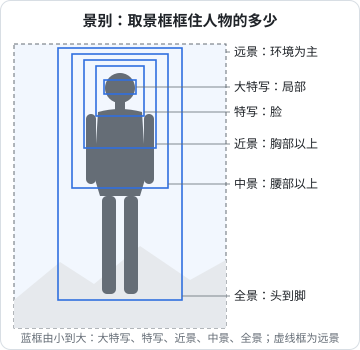
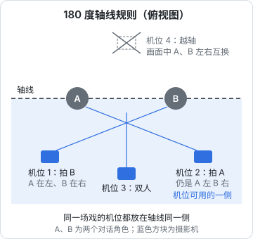

# 镜头语言速成

没学过影视的人写分镜，最常见的问题不是画面不好看，而是**每个镜头都差不多**：都是中景、都是平视、都放在画面正中、都是固定机位。单看每张图都没毛病，连起来就像幻灯片。

镜头语言就是一套「怎么拍」的词汇表。这一章把最常用的六类讲清楚：景别、角度、构图、轴线、运镜、转场。每一类都给出它的作用、什么时候用，以及在 AI 提示词里怎么写。AI 模型训练时看过大量带有这些术语的图片说明，用对词，它就能听懂。

## 景别：离人物多远

景别是画面里人物占多大比例。它是分镜表里最重要的一列，因为它直接决定观众「看到什么」和「感受到什么」。



| 景别 | 画面范围 | 用来干什么 | 中文提示词 | 英文提示词 |
|---|---|---|---|---|
| 远景 | 人很小，主要是环境 | 交代地点、时间、氛围；开场和转场 | 远景，人物很小，位于画面下方 | extreme wide shot, tiny figure in vast landscape |
| 全景 | 人物全身，头脚都在画面里 | 交代人物和环境的关系、人物站位 | 全景，人物全身入画 | full shot, full body, head to toe |
| 中景 | 膝盖或腰部以上 | 对话、动作的主力景别 | 中景，人物腰部以上 | medium shot, waist up |
| 近景 | 胸部以上 | 看清表情，同时保留一点肢体 | 近景，人物胸部以上 | medium close-up, chest up |
| 特写 | 脸部占满画面 | 情绪爆点、关键反应 | 面部特写 | close-up on face |
| 大特写 | 局部：眼睛、嘴、手、道具 | 强调细节、制造悬念 | 眼睛大特写 / 手部特写 / 某道具特写 | extreme close-up of eyes / of hand holding a letter |

在竖屏短剧里，景别的使用比电影更「近」：手机屏幕小，远景里的人物几乎看不清，所以**近景和特写的比例明显更高**。一个常用的经验是：一场对话戏里，近景和特写加起来占一半以上，全景只在开场交代一次站位。

AI 生成时的两个注意点：

- **景别词要放在提示词最前面**。模型对开头的词权重更高，景别写在末尾经常被忽略
- **全景和远景里的脸最容易崩**。人脸在画面里只有几十个像素时，模型很难画好五官。需要看清表情的内容，就用近景或特写单独出一个镜头，别指望全景里的小脸有戏

## 角度：从哪里看

同样的中景，从下往上拍和从上往下拍，传达的意思完全不同。

| 角度 | 效果 | 典型用法 | 中文提示词 | 英文提示词 |
|---|---|---|---|---|
| 平视 | 中性、客观 | 大部分对话 | 平视角度，镜头与人物视线齐平 | eye-level shot |
| 仰拍 | 人物显得高大、有压迫感 | 反派登场、主角逆袭时刻 | 低角度仰拍 | low angle shot, looking up at |
| 俯拍 | 人物显得渺小、无助 | 失败、被围困、被审视 | 高角度俯拍 | high angle shot, looking down at |
| 顶拍 | 上帝视角，抽离感 | 群体、桌面、尸体、地图 | 正上方俯视 | top-down shot, bird's-eye view |
| 荷兰角（倾斜） | 不安、失衡 | 惊恐、醉酒、心理崩溃 | 倾斜构图，画面歪斜 | dutch angle, tilted frame |
| 过肩 | 对话的主观感，交代谁在看谁 | 正反打对话 | 过肩镜头，前景是 A 的肩膀，看向 B | over-the-shoulder shot from behind A, facing B |
| 主观视角 | 观众代入角色 | 发现线索、偷看 | 第一人称视角 | POV shot, first-person view |

过肩镜头是对话戏的主力，也是 AI 最容易画错的：前景那个人的肩膀和后脑勺经常变成另一个人，或者两个人的服装混在一起。写提示词时要**明确谁在前景、谁在背景、各穿什么**，后面角色一致性一章会讲怎么配合参考图。

## 构图：东西放在哪里

构图决定观众的视线先落在哪里。新手最常见的问题是「永远居中」。

| 构图 | 做法 | 效果 | 提示词写法 |
|---|---|---|---|
| 三分法 | 画面横竖各分三份，主体放在交叉点附近 | 自然、有呼吸感 | 人物位于画面左侧三分之一 / subject on the left third |
| 居中对称 | 主体正中，左右对称 | 庄重、仪式感、压迫 | 对称构图，人物居中 / symmetrical composition, centered |
| 前景遮挡 | 画面一侧有虚化的前景物体 | 偷窥感、层次感 | 前景有虚化的门框 / blurred door frame in foreground |
| 框中框 | 用门、窗、镜子框住人物 | 困住、隔阂 | 透过窗户看到人物 / framed through a window |
| 留白 | 人物一侧留出大片空间 | 孤独、期待；也给字幕留位置 | 人物右侧大面积留白 / negative space on the right |
| 引导线 | 道路、走廊、栏杆指向主体 | 引导视线、纵深 | 长走廊延伸向远处的人物 / long corridor leading to the figure |

竖屏的一个特殊问题是**字幕和界面遮挡**：画面底部要留给字幕，右侧和底部还会被平台的点赞、评论按钮挡住。所以竖屏构图里人物的脸通常放在画面上半部到中部，关键道具不要放在右下角。

视线方向也属于构图：人物看向画面左边，左边就要留出空间（「视线空间」），否则会显得憋闷。这一点在提示词里可以直接写「人物看向画面左侧，左侧留有空间」。

## 轴线：180 度规则

轴线是连接两个对话人物（或一个人物与他的运动方向）的一条假想线。规则是：**同一场戏里，摄影机只在轴线的一侧拍**。



为什么要守这条线？因为观众靠「谁在左、谁在右」来判断空间关系。正打镜头里沈青禾在画面左边、看向右边，反打镜头里她也应该在左边或画面外的左侧。如果机位越过轴线，两个人在画面里突然左右互换，观众会一瞬间搞不清谁在跟谁说话。

对 AI 生成来说，轴线规则落到提示词上就是**明确写出每个人在画面中的位置和视线方向**：

```text
中文：过肩近景。前景左侧是沈青禾的右肩和后脑（虚化），画面右侧是陆归的正面，陆归看向画面左侧。
英文：over-the-shoulder medium close-up. Shen Qinghe's right shoulder and back of head blurred in the left foreground, Lu Gui facing camera on the right side of frame, looking toward frame left.
```

AI 模型本身不懂「同一场戏」，每一次生成都是独立的。所以轴线是**你在分镜表里管的**：在场景卡上记下「本场轴线：A 在左，B 在右」，每个镜头的提示词都按这个写，检查时逐个核对。

可以合法越轴的情况：中间插一个正好在轴线上的镜头（比如两人之间的道具特写），或者用一个运镜把机位明显地带过去，让观众看到机位是怎么移动的。

## 运镜：镜头怎么动

运镜是 AI 视频生成里最需要写清楚的部分。模型对运镜术语的理解比对复杂动作好得多，用对词成功率会明显上升。

| 运镜 | 摄影机在做什么 | 效果 | 中文提示词 | 英文提示词 |
|---|---|---|---|---|
| 固定 | 不动 | 稳定、客观，把注意力给表演 | 固定镜头，镜头静止 | static shot, locked-off camera |
| 推 | 向主体靠近 | 强调、聚焦、情绪加深 | 镜头缓慢推近人物面部 | slow push-in toward her face |
| 拉 | 远离主体 | 揭示环境、孤立感 | 镜头缓慢拉远，露出整个房间 | slow pull-back revealing the room |
| 摇 | 机位不动，镜头左右转 | 扫视环境、跟随视线 | 镜头从左向右摇 | pan from left to right |
| 俯仰（升降摇） | 机位不动，镜头上下转 | 从脚看到脸、从地面看到天空 | 镜头从下向上摇 | tilt up from feet to face |
| 移 | 机位横向平移 | 跟随行走、展示空间 | 镜头横向跟随人物平移 | tracking shot, camera moves sideways with her |
| 跟 | 跟在人物后面或前面 | 代入、紧张 | 镜头跟随人物背后前进 | follow shot from behind |
| 环绕 | 围绕主体转 | 高光时刻、关系变化 | 镜头环绕人物半圈 | orbit shot, camera circles around her |
| 升降 | 机位上升或下降 | 开场、收尾、气势 | 镜头缓慢升高俯瞰街道 | crane up revealing the street |
| 手持 | 轻微晃动 | 真实、慌乱 | 手持镜头轻微晃动 | handheld camera, slight shake |
| 变焦 | 焦距变化，机位不动 | 突然强调、惊吓 | 快速变焦推向眼睛 | snap zoom into her eyes |

两条经验：

- **一个镜头只写一种运镜**。「先推再摇再环绕」在 5 秒里基本做不出来，多半变成乱晃。复杂运镜拆成两个镜头
- **运镜速度要写**。「缓慢」「平稳」「快速」这些词对结果影响很大。短剧大多用缓慢推近和固定镜头，快速运镜留给少数高潮时刻

动态漫里的运镜是在剪辑软件里对静帧做的，原理一样，具体做法见动态漫一章。

## 转场：镜头怎么接

短剧里绝大部分镜头之间是**直接切**，不加任何效果。转场效果用多了会显得廉价。需要知道的是几种有意义的「接法」：

| 接法 | 做法 | 用途 | 分镜表里怎么写 |
|---|---|---|---|
| 硬切 | 直接接下一个镜头 | 默认 | 切 |
| 动作接动作 | 上一镜开始一个动作，下一镜换景别完成它 | 让剪辑看不出痕迹 | 动作接：转身 |
| 视线接 | 上一镜人物看向某处，下一镜是他看到的东西 | 制造悬念、交代信息 | 视线接：看向柜台 |
| 匹配剪辑 | 上下两镜形状或构图相似 | 时间跳跃、象征 | 匹配：当票 → 旧照片 |
| 黑场 / 闪白 | 中间插黑或白 | 时间流逝、回忆、冲击 | 闪白 0.2 秒 |
| 声音先入 | 下一镜的声音提前出现 | 平滑过渡 | 声音先入：雨声 |

对 AI 生成而言，「动作接动作」和「视线接」需要在**两个镜头的提示词里写成对的**：上一镜的结尾状态，就是下一镜的开头状态。首尾帧功能正好可以用来控制这一点，见视频生成一章。

## 几种常用的镜头组合

单个镜头的词汇学会之后，再记几种「组合」。短剧里大部分戏都是这几种组合的变体：

| 组合 | 镜头顺序 | 用在哪里 |
|---|---|---|
| 建立 → 推进 | 远景或全景交代地点 → 中景交代人物 → 近景进入情绪 | 每场戏的开头 |
| 正反打 | A 的过肩近景 → B 的过肩近景 → 交替，关键处给单人特写 | 两人对话 |
| 视线揭示 | 人物看向某处的近景 → 他看到的东西（主观视角或特写） → 人物的反应 | 发现线索、看到意外的人 |
| 细节先行 | 先给道具或局部的大特写 → 再拉开交代是谁、在哪 | 开场悬念，制造「这是什么」的疑问 |
| 反应堆叠 | 一句关键台词 → 两三个在场者的反应镜头快速切换 | 打脸、揭秘、身份反转 |
| 收束 | 情绪特写 → 拉远或全景 → 黑场 | 每集结尾的钩子 |

写分镜时可以先选组合，再往里填具体镜头。比如一场「来客亮出证据」的戏：建立（全景）→ 正反打（两组）→ 视线揭示（证据特写）→ 反应堆叠 → 收束。骨架有了，镜头数和时长也就大致有了。

## 一张速查表

写分镜时可以把这张表放在手边，每个镜头从每一行选一个：

| 维度 | 默认选择 | 需要变化时 |
|---|---|---|
| 景别 | 中景 / 近景 | 开场远景、情绪爆点特写、线索大特写 |
| 角度 | 平视 | 强势仰拍、弱势俯拍、慌乱倾斜 |
| 构图 | 三分法 | 庄重居中、偷窥前景、孤独留白 |
| 运镜 | 固定 / 缓慢推 | 跟随行走移、揭示拉、高潮环绕 |
| 转场 | 硬切 | 视线接、动作接、回忆闪白 |

一个判断方法：把一场戏的镜头景别按顺序写下来，如果连续三个镜头景别相同，基本就该换了。电影里有个说法叫「跳切」：同一主体、同一景别、角度变化不大的两个镜头直接接，会让人觉得画面「跳了一下」。相邻镜头的景别至少差一档，或者角度明显不同。

## 本章要点

- 景别是分镜表最重要的一列；竖屏短剧近景和特写比例更高，全景只用来交代站位
- 景别和角度词放在提示词最前面；全景远景里的脸容易崩，要看表情就单独出近景
- 构图不要永远居中；竖屏要给字幕和平台按钮留出位置
- 180 度轴线规则要在场景卡里记下来，每个镜头的提示词写清人物的左右位置和视线方向
- 运镜一镜一种，写清速度；转场默认硬切，动作接和视线接需要上下两镜的提示词成对写
