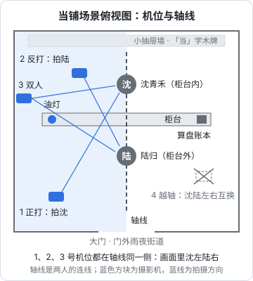

# 美术风格、场景与道具

角色一致性是 AI 短剧最常被讨论的难题，但在它之前还有一层更基础的一致：**整部剧看起来像同一部剧**。同一集里，这个镜头像厚涂插画、下个镜头像 3D 渲染；同一个当铺，这一镜是红木柜台、下一镜变成了玻璃柜台。观众未必说得出哪里不对，但会觉得「假」。

这一章讲三件事：怎么选美术风格并把它固定成文字和图片，怎么写场景设定卡，怎么让同一个场景在不同机位下保持一致。

## 先选风格

风格选择不只是审美问题，它直接影响生成成功率和观众预期。

| 风格 | 观众预期 | 生成难度 | 适合题材 | 主要风险 |
|---|---|---|---|---|
| 写实（电影感） | 像真人拍的 | 最高：脸、手、口型、物理都会被挑剔 | 都市、悬疑、现实题材 | 恐怖谷；容易像某个真人 |
| 国漫（国风厚涂 / 2.5D） | 精致的国产动画 | 中：线条和光影有容错 | 古风、仙侠、玄幻、宫斗 | 角色容易千人一面 |
| 日漫（赛璐璐） | 动画番剧 | 中低：平涂色块，一致性相对好控 | 校园、恋爱、奇幻 | 容易滑向模仿具体作品或画师 |
| 3D 卡通 | 动画电影 | 中：材质统一，动作较稳 | 合家欢、萌宠、轻喜剧 | 质感容易廉价；表情偏少 |
| 水墨 / 工笔 | 艺术感 | 高：水墨的随机性和视频运动冲突 | 短篇、意境类、片头片尾 | 不适合长篇连续叙事 |

对第一部作品的建议：**选国漫厚涂或日漫平涂**。这两类风格有足够的容错空间，观众对「漫剧」的预期也宽容；写实风格的每一处瑕疵都会被放大。

风格还要和平台、题材对齐。去看看你目标平台上同题材的热门漫剧用什么风格，赛道判断见[《微短剧行业全景》](../micro-drama-industry/)。

## 把风格写成「风格圣经」

选定风格之后，把它写成一份文件，后面每一个提示词都从这里取词。这份文件在动画行业叫「美术设定」或「风格指南」，这里叫风格圣经。

### 风格圣经模板

```text
# 风格圣经：《当票》

## 一句话风格
国风厚涂插画，电影感光影，低饱和暖色调，雨夜质感

## 风格词（每个提示词都要带，放在提示词末尾）
中文：国风厚涂插画风格，电影感光影，细腻笔触，低饱和度，暖色调，高细节
英文：Chinese painterly illustration style, thick brushwork, cinematic lighting, muted colors, warm tones, highly detailed

## 色彩
主色：深褐、暗红、烛光橙
辅色：雨夜青灰
禁用：高饱和霓虹色、纯黑大面积

## 光影
主光：室内烛光或灯笼，暖色，来自画面一侧
环境光：窗外雨夜冷蓝
对比：中高；脸部保留暗部细节

## 线条与质感
不勾粗黑边线，以色块和笔触塑形；布料有纹理，木头有包浆感

## 画幅
9:16 竖屏；人物脸部位于画面上半部；底部 20% 留给字幕

## 风格参考图
style/ref-01.png ～ style/ref-06.png（自己生成的定调图，不使用他人作品）

## 禁止
不写任何画师、工作室、作品名；不出现现代物品
```

几个要点：

- **风格词要固定，不要每次换说法**。「国风厚涂」和「中国风油画感」在模型眼里可能是两种风格。定下来就复制粘贴
- **风格参考图用自己生成的**。先花半天时间用风格词反复出图，挑出 4–6 张最满意的作为风格参考，后续所有生成都用它们定调。不要用别人的作品截图做风格参考，那是在复制别人的创作
- **不写画师和作品名**。「某某画师风格」「某某动画风格」是最省事的写法，也是最容易出问题的写法：它可能构成对他人风格和作品的模仿，平台审核和版权上都有风险。用描述性词汇代替：线条粗细、上色方式、色彩倾向、光影类型、材质感

### 描述性风格词速查

| 维度 | 中文词 | 英文词 |
|---|---|---|
| 上色方式 | 厚涂、平涂、赛璐璐、水彩晕染、水墨、工笔 | painterly, flat color, cel shading, watercolor wash, ink wash, gongbi fine line |
| 线条 | 无线稿、细线稿、粗描边、手绘线条 | lineless, thin line art, bold outlines, hand-drawn lines |
| 色彩 | 低饱和、高饱和、冷色调、暖色调、莫兰迪色、单色 | muted, vibrant, cool tones, warm tones, desaturated pastel, monochrome |
| 光影 | 电影感光影、伦勃朗光、逆光、轮廓光、柔光、硬光 | cinematic lighting, Rembrandt lighting, backlight, rim light, soft light, hard light |
| 质感 | 纸张纹理、胶片颗粒、油画笔触、3D 渲染、黏土质感 | paper texture, film grain, oil brushstrokes, 3D render, claymation |
| 氛围 | 雨夜、薄雾、黄昏、阴天、烛光 | rainy night, light mist, golden hour, overcast, candlelight |

### 风格参考功能

多数工具提供某种「风格参考」：上传一张图，让生成结果模仿它的风格而不是内容。比如 Midjourney 的风格参考参数（`--sref`），截至 2026 年 11 月在 V8.2 上仍可用（Midjourney 2026-08 官方更新公告）；国内工具一般在参考生图里提供「参考风格」或类似选项。具体名称和强度参数以各工具当前界面为准。

风格参考和风格词配合使用效果最好：风格词保证模型理解方向，参考图把方向锁定到具体的样子。

## 场景设定卡

场景卡是一个场景的「单一事实来源」。每个在剧中出现两次以上的场景都要有一张。

### 场景设定卡模板

```text
# 场景卡：SC-dangpu-night 当铺柜台内景·雨夜

## 基本信息
出现集数：第 1、2、5 集
时间：夜晚，下雨
用途：主角日常工作场所；与来客对峙的主场景

## 空间布局（俯视，用文字描述）
- 柜台横贯画面，高约齐胸，深色木质，台面有磨损
- 柜台内侧（掌柜一侧）靠墙是一排药柜式的小抽屉，墙上挂一块「当」字木牌
- 柜台外侧（客人一侧）是门厅，正对大门，门外是雨夜街道
- 柜台左端放一盏油灯，右端放算盘和账本

## 轴线约定
柜台为轴线方向参照：掌柜（沈青禾）在柜台内，画面中位于左侧；客人（陆归）在柜台外，画面中位于右侧

## 光线
主光：柜台左端的油灯，暖橙色，从画面左侧照向右侧
辅光：大门外的雨夜冷光，青灰色，从右侧背后进入
整体：暗部多，人物脸部半明半暗

## 固定陈设（每个镜头都要对得上）
油灯（左端）、算盘（右端）、账本、「当」字木牌、小抽屉墙

## 色彩
深褐木色、暗红、烛光橙、门外青灰

## 场景提示词（基础版，各镜头在此基础上调整）
中文：古代当铺内景，雨夜，深色木质高柜台横贯画面，柜台后是一整面小抽屉墙，墙上挂着写有当字的木牌，柜台左端一盏油灯发出暖橙色光，右端放着算盘和账本，大门外是下着雨的夜色街道，青灰色冷光，暗部较多
英文：interior of an ancient Chinese pawnshop at night in the rain, tall dark wooden counter across the frame, a wall of small wooden drawers behind the counter, a wooden plaque on the wall, an oil lamp on the left end of the counter casting warm orange light, an abacus and ledger on the right end, rainy street visible through the open door, cool blue-grey light from outside, deep shadows

## 参考图
SC-dangpu-main.png（主视角：从客人一侧看向柜台）
SC-dangpu-reverse.png（反打：从柜台内看向大门）
SC-dangpu-top.png（俯视布局示意，可手绘）

## 不能出现
现代物品、电灯、玻璃柜台、招牌上的错别字
```

### 「固定陈设」为什么重要

观众对场景的记忆靠的是几个**锚点物件**：油灯、算盘、木牌。只要这几样东西每次都在、位置不变，即使墙面纹理、抽屉数量有细微差别，观众也会认为「还是那个当铺」。反过来，如果油灯一会儿在左一会儿在右，观众立刻会觉得不对。

所以场景卡里只需要锁定 3–5 个锚点物件，不用追求每个细节一致。写提示词时把锚点物件和它们的位置写进去，检查时只核对这几样。

## 多机位一致

同一个场景会被从不同方向拍：正打、反打、俯拍、特写。AI 每次都是重新生成，怎么保证这些画面是同一个空间？

动手前先把场景卡里的「俯视布局」画成一张平面图，标上锚点物件、人物站位和机位。下图是当铺这场戏的平面图：两人的连线就是轴线（[第 2 章](02-shot-language.md#轴线180-度规则)讲过的 180 度规则），柜台和它垂直；所有机位放在轴线同一侧，画面里就始终是沈青禾在左、陆归在右，油灯也会按机位方向出现在固定的一边。这张图就是场景卡里的 `SC-dangpu-top.png`，分镜表里每个镜头的机位都能在图上找到对应的点。



### 方法一：先出「场景母版」，再从母版取景

1. 用场景提示词出一张**宽画幅的场景全景图**（比如 16:9 或 21:9），作为场景母版。这张图里没有人
2. 正打方向的镜头：用母版做参考图生成；或者直接从母版里**裁出**竖屏区域，再把人物合成或重绘进去
3. 反打方向：单独出一张反向的母版（从柜台内看向大门），同样无人
4. 两张母版里，锚点物件的位置要互相对得上：正打时油灯在左，反打时油灯应该在右

这是最稳的方法，代价是要多做两三张图，以及一些裁切和合成的工作。动态漫尤其适合这样做，见动态漫一章。

### 方法二：用参考生图带上场景参考

把场景母版作为参考图上传，在提示词里写清机位：「从柜台内侧看向大门，前景是柜台的木质台面」。主流的国内工具都支持在一次生成中同时参考多张图（角色图 + 场景图），具体上限各工具不同，见角色一致性一章的工具对比。

注意：参考图传得越多，单张图的影响力越弱。场景参考图一般一张就够，多了容易把不同角度混在一起。

### 方法三：本地工具精确控制

如果用 Stable Diffusion 系列模型配合 ComfyUI，可以用深度图、线稿等控制条件来锁定空间结构：先用简单的 3D 软件或者手绘搭出场景的粗模，从不同机位导出深度图，再让模型按深度图上色。这种方法空间一致性最好，但学习成本和硬件门槛也最高，适合已经批量生产、愿意投入的团队。

### 场景一致性的检查

| 检查项 | 怎么查 |
|---|---|
| 锚点物件都在 | 对照场景卡的固定陈设逐个找 |
| 锚点物件位置和机位方向对得上 | 正打油灯在左，反打应在右 |
| 光源方向一致 | 主光从哪边来，影子往哪边倒 |
| 时间天气一致 | 雨夜不能突然变成晴天，窗外不能突然天亮 |
| 色调一致 | 把同场景的镜头排在一起看缩略图 |
| 没有穿帮物件 | 古装戏里的电灯、塑料、现代文字 |

最有效的检查方法是**把同一场景的所有关键帧缩成小图排在一起看**。单张看都没问题的图，排在一起时色调和光线的差异会非常明显。

## 道具设定

剧情道具（推动剧情、会被特写的东西）也要有设定卡，比如当票、玉佩、信件、合同。道具卡比场景卡简单：

```text
# 道具卡：PR-dangpiao 当票

剧情作用：第 1 集核心悬念，票面写着女主的名字和三十年前的日期
外观：泛黄的竖长方形纸片，边缘有破损和水渍，右上角有朱红色印章，中间是竖排墨书
尺寸：约手掌大
出现镜头：S02-05（特写）、S02-06（大特写）、S03-02（手持）
文字：票面文字后期合成，不让模型生成
提示词：一张泛黄的竖长方形旧纸片，边缘破损带水渍，右上角有朱红色印章，中间有竖排的墨迹
参考图：PR-dangpiao.png
```

**道具上的文字一律后期合成**。即使有的模型能渲染中文，竖排繁体、手写体、印章文字仍然很容易出错，而且每次生成都可能不同。做法是：生成时让票面只有模糊的墨迹或干脆空白，后期在剪辑或修图软件里贴上设计好的文字图层。字体本身也有版权，商用字体需要授权，见[《自媒体与短剧合规财税》](../media-compliance/)。

## 风格和场景的常见坑

| 坑 | 表现 | 解决 |
|---|---|---|
| 风格词每次不一样 | 同一集镜头风格漂移 | 风格圣经里定死，复制粘贴 |
| 一个镜头换了工具 | 这一镜质感明显不同 | 同一集尽量用同一工具和模型版本出关键帧；必须换时用风格参考图拉齐 |
| 用他人作品做风格参考 | 版权和审核风险 | 只用自己生成的定调图 |
| 场景没有锚点 | 观众认不出是同一个地方 | 每个场景锁 3–5 个锚点物件 |
| 光源方向乱 | 正反打光线对不上 | 场景卡写明主光方向，提示词里写「光从左侧来」 |
| 让模型写字 | 招牌、票据文字乱码 | 文字后期合成 |
| 古装戏穿帮 | 出现现代物品 | 场景卡写「不能出现」，负面提示词加上 |

## 本章要点

- 第一部作品建议选国漫厚涂或日漫平涂，写实风格的瑕疵最容易被放大
- 把风格写成风格圣经：固定的风格词、色彩、光影、画幅规则、自己生成的风格参考图
- 不写画师、工作室、作品名，用描述性风格词代替
- 场景卡锁定空间布局、轴线约定、光线方向和 3–5 个锚点物件
- 多机位一致的稳妥做法是先出无人的场景母版，再从母版取景或作为参考
- 道具也要有设定卡，道具上的文字一律后期合成
