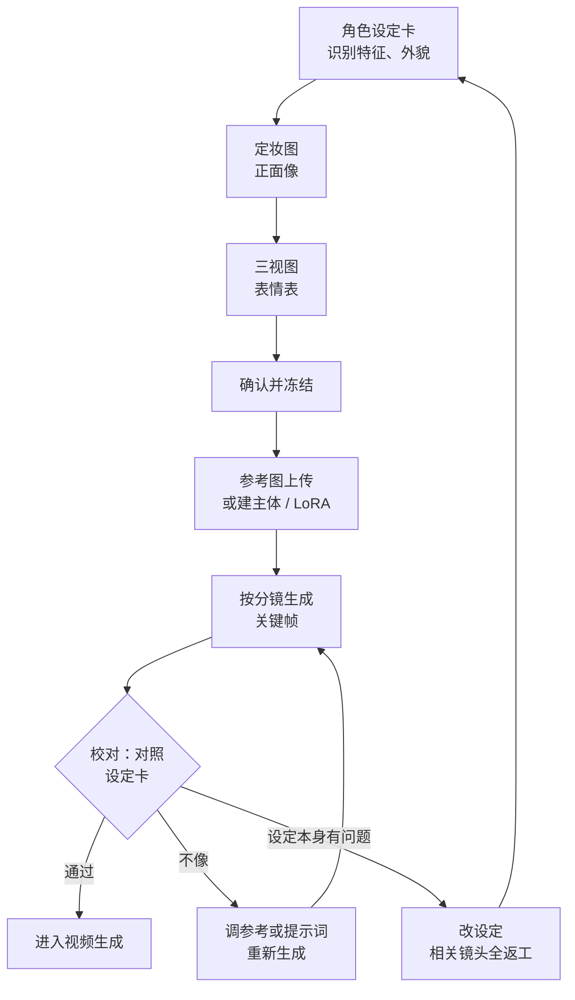

# 角色一致性

观众可以原谅背景里抽屉数量不对，但不会原谅女主角换了一张脸。角色一致性是 AI 短剧能不能看下去的底线，也是返工最多的地方。

这一章先讲「一致」到底指什么，然后给出角色设定卡和定妆图的做法，再讲三类锁定角色的技术手段（参考图、角色库 / 主体、LoRA），最后对比各工具的能力，并列出检查清单。

## 一致性分几层

「角色一致」不是一个笼统的要求，可以拆成几层，越往上越难：

| 层级 | 内容 | 观众敏感度 | 难度 |
|---|---|---|---|
| 1. 识别特征 | 发型、发色、标志性配饰、服装主色 | 很高：靠这些认人 | 低 |
| 2. 体型与比例 | 高矮胖瘦、头身比、年龄感 | 高 | 中 |
| 3. 脸型与五官 | 脸型、眼型、眉形、鼻子、嘴 | 近景特写时很高 | 高 |
| 4. 细节 | 痣、疤、耳环样式、衣服上的纹样 | 特写时才注意 | 高，但可以后期修 |
| 5. 跨动作一致 | 转头、侧脸、大笑、哭泣时仍是同一个人 | 视频里很高 | 最高 |

实用的策略是：**用第 1 层做「保险」**。给每个主要角色设计一两个非常醒目、模型容易稳定画出来的识别特征，比如一缕白发、一条红色发带、一顶黑色斗笠。即使某一镜五官有些偏差，观众也能靠识别特征认出来。很多成熟的漫剧角色设计都有这个特点，这不是偷懒，是为生产服务的设计。

识别特征要避免两种：太细小的（耳钉、小痣，在中景就看不见了）和太复杂的（繁复刺绣、多层配饰，每次画都不一样）。

## 角色设定卡

每个有台词的角色都要一张设定卡。主角的卡要写得最细。

### 角色设定卡模板

```text
# 角色卡：CH-shenqinghe 沈青禾

## 基本信息
剧中身份：城南当铺的年轻掌柜，父亲失踪后独自撑店
年龄感：二十岁出头
性格关键词：冷静、嘴硬、心细
出场集数：全剧

## 识别特征（每个镜头必须出现）
1. 黑色长发低挽成髻，插一支素银簪
2. 左眉尾有一颗小痣（近景以上才要求）
3. 深青色交领上衣，袖口挽起，外罩暗红色半臂

## 外貌描述（固定文字，复制进提示词）
中文：二十岁出头的年轻女子，鹅蛋脸，眼型细长，眉眼清冷，黑色长发低挽成髻插一支素银簪，身穿深青色交领上衣、外罩暗红色半臂，袖口挽起
英文：a young Chinese woman in her early twenties, oval face, narrow almond eyes, calm and cool expression, black hair in a low bun with a plain silver hairpin, wearing a dark teal cross-collar top with a dark red short-sleeved overgarment, sleeves rolled up

## 体型
中等身高，偏瘦，站姿挺直

## 造型版本
@掌柜装：上述默认造型（第 1–3 集）
@夜行装：黑色窄袖短打，发髻改为高马尾，簪子不变（第 4 集起）

## 表情范围（需要的表情都出一张定妆图）
平静、不耐烦、警惕、震惊、压抑的愤怒、强忍泪水

## 定妆图
CH-shenqinghe-front.png（正面半身）
CH-shenqinghe-turnaround.png（三视图全身）
CH-shenqinghe-expressions.png（表情表）
CH-shenqinghe-hand.png（手部特写，需要时）

## 声音（交给后期）
年轻女声，语速偏慢，咬字清楚。音色来源与授权见后期书

## 禁止
不使用任何真人照片作参考；不与任何明星、网红相似
```

几个要点：

- **外貌描述是固定文字**，和风格词一样，复制粘贴，不改说法
- **造型版本用 `@` 后缀区分**，分镜表里写 `CH-shenqinghe@掌柜装`，换装时不会混
- **表情范围要提前列出**。剧本里需要哪些情绪，就提前出这些表情的定妆图，后面生成时用作参考

### 角色卡从哪来

剧本里的人物小传（见[《短剧编剧》](../drama-scriptwriting/)）描述的是性格和经历，角色卡要把它翻译成**看得见的东西**。一个练习：读完人物小传，写出 3 个「只看一眼剪影就能认出这个人」的视觉特征。写不出来，说明这个角色在视觉上还没有被设计。

## 定妆图：三视图与表情表

定妆图是角色的「标准照」，后续所有生成都以它为准。

### 第一步：出一张满意的正面半身像

用外貌描述 + 风格词，文生图反复生成，直到出现一张你满意的。这一步可以多花时间，生成几十张都正常。挑选标准：

- 五官端正、没有畸形，左右基本对称
- 识别特征都清楚可见
- 光线均匀（不要强烈的侧光、阴影遮脸），否则后续参考时阴影会被当成脸的一部分
- 背景干净，最好是纯色或简单渐变
- 不像任何你认识的真人或公众人物。如果有人说「这个好像某某明星」，换掉

### 第二步：基于正面像出三视图

三视图（正面、侧面、背面，有时加四分之三侧面）让模型和你自己知道这个角色从各个角度看是什么样。

```text
中文：角色设定图，同一角色的三视图，从左到右依次为正面、侧面、背面全身站立像，白色背景，平光无阴影，全身入画，[外貌描述]，[风格词]
英文：character turnaround sheet, the same character shown from front, side and back, full body standing pose, plain white background, flat even lighting, [appearance], [style keywords]
```

上传第一步的正面像作为参考图一起生成。多数工具能直接出三视图；出不好时，可以分别生成正面、侧面、背面再拼在一起。

### 第三步：表情表

```text
中文：角色表情设定图，同一角色的六个头像排成两行，分别是平静、不耐烦、警惕、震惊、愤怒、强忍泪水，白色背景，平光，[外貌描述]，[风格词]
英文：character expression sheet, six head shots of the same character in two rows: calm, annoyed, wary, shocked, angry, holding back tears, plain white background, flat lighting, [appearance], [style keywords]
```

表情表一次生成很难全部满意，可以每个表情单独出，再挑出最好的组合。

### 第四步：确认和冻结

把正面像、三视图、表情表放在一起看，确认是同一个人。确认之后**冻结**：这些图就是这个角色的标准，后面不再改。如果中途发现角色设计有问题必须改，要把已生成的相关镜头全部标为「返工」，不能新旧混用。

### 一致性工作流

冻结之后的定妆图，在后面每个镜头里都要用上。整条链路是这样的：



校对时只对照两样东西：设定卡里的识别特征（每个镜头必须出现），和冻结的定妆图（脸和体型）。具体检查项见本章末尾的检查清单，参考图、主体、LoRA 三种手段怎么选见下一节。

## 锁定角色的三类手段

> [!WARNING]
> 本节提到的工具功能和模型许可按截至 2026 年 11 月的官方文档和报道整理，更新很快；以各工具官网、API 文档和模型许可证的当前版本为准。

### 手段一：参考图（参考生图 / 参考生视频）

上传角色定妆图作为参考，让模型生成同一个人的新画面。这是**门槛最低、最常用**的方法，国内主流工具都支持。

用好参考图的几条经验：

- **参考图要干净**：单人、背景简单、光线均匀、不遮脸。定妆图正面像通常最合适
- **侧脸镜头配侧面参考**：要生成侧脸时，上传三视图里的侧面，比只传正面稳定
- **多人镜头要标清对应关系**：参考图里每张图只放一个角色，提示词里明确写「图 1 中的女子站在左侧，图 2 中的男子站在右侧」。比如通义万相 2.7 的参考生视频接口约定用「图1」「视频1」这样的编号在提示词中指代参考素材（截至 2026 年 11 月，以阿里云百炼文档为准），其他工具也有各自的写法，查当前文档
- **提示词里仍然写外貌描述**：参考图负责「长这样」，文字负责告诉模型「重点是这些特征」。两者一致时效果最好，矛盾时（比如参考图穿红衣、提示词写蓝衣）结果不可预测

### 手段二：角色库 / 主体

一些工具提供「主体」「角色库」「元素」之类的功能：你把一个角色的多张图上传一次，保存为一个可复用的对象，之后在生成时直接调用。本质上仍然是参考图，但工具会做更多处理（比如多角度建模），使用也更方便。

这类功能更新很快、名字各不相同，比如可灵在 2026 年 10 月发布的 Kling 4.0 中，「全能参考」单次任务可组合多张图片、多段视频和多个主体（据界面新闻 2026 年 10 月 16 日报道，以官网为准）。用之前先读当前版本的说明，了解：一次能放几个主体、一个主体能上传几张图、是否支持调用视频参考。

### 手段三：LoRA（本地或支持 LoRA 的平台）

LoRA 是在基础模型上训练的一个小型附加权重，用十几到几十张角色图训练后，模型就「认识」了这个角色，用一个触发词就能画出来。原理见《开源模型》中关于 LoRA 的章节。

| 对比 | 参考图 / 角色库 | LoRA |
|---|---|---|
| 准备成本 | 几张定妆图 | 十几到几十张高质量、多角度、多表情的训练图，加训练时间 |
| 一致性 | 中到高，大幅度动作和极端角度会漂 | 高，尤其在各种角度和表情下 |
| 灵活性 | 换工具只需重新上传 | 绑定在特定基础模型上，换模型要重训 |
| 门槛 | 低 | 需要本地 GPU 或支持 LoRA 训练的平台 |
| 适合 | 大多数个人创作者、前期验证 | 长篇连载、主角固定、量产阶段 |

建议：**前几集用参考图，确认剧集能跑下去之后，再给主角训练 LoRA**。训练 LoRA 的素材正好可以用前几集里挑出来的好图。注意训练用的图必须全部是你自己生成的角色图，不能混入任何真人照片或他人作品。

如果用 Stable Diffusion 系列的开源模型做本地生成和 LoRA 训练，要看模型许可：比如 Stability AI 的社区许可允许年收入低于 100 万美元的个人和组织免费商用，超过需要企业许可（截至 2026 年 11 月，以 Stability AI 官网为准）。其他开源图像模型的许可各不相同，有的权重仅限非商用，商用需另购授权，下载前逐个确认。

## 换装与表情

### 换装

换装是角色一致性的高危操作：衣服变了，模型很容易把脸也一起变掉。做法：

1. 为每个造型版本单独出一套定妆图（至少正面半身 + 全身），用原造型的正面像作参考
2. 换装时**保留至少一个识别特征**，比如发型和簪子不变
3. 分镜表里每个镜头都写明造型版本，同一场戏里不要出现两个版本

### 表情

模型默认倾向于生成「好看的中性表情」，强烈的情绪（大哭、狰狞、惊恐）常常出不来，或者出来了但脸变了。

- 用表情表里对应的表情图作参考，比只写「震惊」稳得多
- 写具体的面部动作而不是情绪词：「眼睛睁大，眉毛上扬，嘴微张」比「震惊」有效
- 情绪强烈的镜头用近景而非特写：特写对五官细节要求更高，更容易「不像」
- 实在出不来的表情，考虑换一种表现方式：背影、手部动作、道具掉落，有时比正面表情更有张力

## 工具的一致性能力对比

> [!WARNING]
> 下面的对比按 2026 年 11 月的工具官网、官方更新公告和媒体报道整理，工具更新频繁，使用前以各工具官网和 API 文档的当前说明为准。

查不到官方数据的项写「未查到」。

- **可灵**
  - **最新版本（截至 2026 年 11 月）**：Kling 4.0（2026-10-15 发布）
  - **与一致性相关的能力**：全能参考单次最多组合 15 项：图片最多 10 张、视频最多 5 段、主体最多 7 个；支持三视图、分镜图等作为参考；多关键帧最多 10 张
  - **信息来源与备注**：界面新闻、财联社 2026-10-16 报道；发布时 API 写的是「近期开放」
- **即梦**
  - **最新版本（截至 2026 年 11 月）**：视频 Seedance 2.5（2026-07-31 上线即梦）/ 2.0；图片模型 Seedream 5.0（2026-02 起在即梦灰度）
  - **与一致性相关的能力**：首尾帧、对口型等；Seedance 2.5 最多 50 份全模态参考素材（据新华网报道）
  - **信息来源与备注**：即梦官网页面；Seedance 2.0 于 2026 年 2 月发布，2.5 于 6 月火山引擎大会发布；即梦界面里图片模型的版本名以当前界面为准
- **海螺**
  - **最新版本（截至 2026 年 11 月）**：MiniMax H3（2026-07-31 发布）
  - **与一致性相关的能力**：文本、图片、视频、音频可混合作为参考上下文；单条最长 15 秒，默认 2K
  - **信息来源与备注**：MiniMax 官方博客；参考图数量上限未查到
- **Vidu**
  - **最新版本（截至 2026 年 11 月）**：Vidu Q4 Preview（2026-10-08），另有 Q3
  - **与一致性相关的能力**：参考生视频，支持多主体参考；Q4 Preview 最多 15 张参考图
  - **信息来源与备注**：中国日报等 2026-10 报道；主体数量上限和时长上限未查到
- **通义万相**
  - **最新版本（截至 2026 年 11 月）**：wan2.7
  - **与一致性相关的能力**：参考生视频：参考图 + 参考视频合计不超过 5 个，每个参考主体应只含一个角色；可在提示词中用「图1」「视频1」指代
  - **信息来源与备注**：阿里云百炼 API 文档
- **Midjourney**
  - **最新版本（截至 2026 年 11 月）**：V8.2（2026-07-24 发布）
  - **与一致性相关的能力**：风格参考（`--sref`）和情绪板可用；2026-08-27 推出的 V8 编辑模型支持一次用最多 4 张参考图生成，官方说明它取代了全能参考（`--oref`）；要用原来的 `--oref` 得切回 V7
  - **信息来源与备注**：Midjourney 官方更新公告「Version 8.2」「Edit Model for V8」
- **Stable Diffusion 系列 + ComfyUI**
  - **与一致性相关的能力**：可训练和加载角色 LoRA，配合姿势、深度等控制条件
  - **信息来源与备注**：自部署，许可见上文

怎么用这份对比：

- **个人起步**：选一个国内一站式工具（即梦、可灵、海螺、Vidu、通义万相任选其一），图和视频都在同一个工具里做，减少风格差异
- **多人同框多**：优先看「单次能参考几个主体」，以及多主体时能否在提示词里指定谁是谁
- **长篇量产**：考虑引入本地工作流和 LoRA，或使用工具的角色库功能
- **自己做对比测试**：用同一张定妆图、同一组提示词，在两三个工具里各生成 10 次，统计「一眼认得出是同一人」的比例。这个数字比任何评测都有用

## 一致性检查清单

每张关键帧和每段视频都按这张清单过一遍。可以打印出来，或做成表格里的勾选列。

| 层级 | 检查项 | 通过标准 |
|---|---|---|
| 识别特征 | 发型、发色、标志配饰 | 和角色卡完全一致 |
| 识别特征 | 服装款式和主色 | 和本镜头造型版本一致 |
| 体型 | 头身比、胖瘦、身高关系 | 两人同框时高矮关系和设定一致 |
| 脸 | 脸型、眼型 | 和定妆正面像放在一起，一眼认得出 |
| 脸 | 年龄感 | 没有突然变老或变小 |
| 细节 | 痣、疤、簪子样式 | 近景以上镜头要对上 |
| 位置 | 左右站位 | 符合场景卡的轴线约定 |
| 视频 | 转头、动作后 | 动作前后是同一张脸，衣服没有变化 |
| 视频 | 首帧和尾帧 | 尾帧的脸仍然对得上定妆图 |
| 风险 | 是否像真人 | 不像任何明星、网红、熟人 |

判断标准有一个简单的办法：**把这一镜和角色定妆正面像并排，缩到手机屏幕大小看**。观众就是在这个尺寸上看的。在这个尺寸下一眼认得出就算通过，不必追求放大后的像素级一致。

## 肖像和形象的底线

再强调一次，因为这是 AI 短剧最容易出事的地方：

- **不用真人照片做角色参考**，包括你自己、朋友、明星、网红。用真人照片生成的角色，即使风格化了，仍可能涉及肖像权
- **不在提示词里写真人名字**，也不写「长得像某某」
- **不复刻他人 IP 角色**，包括「换个名字的某某」。国内已有法院判决生成平台因生成他人知名动漫形象的图片而承担侵权责任，创作者自己用这种方式做内容，风险只会更大
- **角色撞脸要换**：如果成片角色被观众说「像某某明星」，即使你没有用参考，也建议调整，避免争议
- 声音同理：音色克隆的授权问题见[《AI 短剧后期》](../ai-drama-post/)，合规框架见[《自媒体与短剧合规财税》](../media-compliance/)

## 本章要点

- 一致性分识别特征、体型、五官、细节、跨动作五层，用醒目的识别特征做保险
- 角色卡里外貌描述是固定文字，造型版本用后缀区分，表情范围提前列出
- 定妆图按正面像、三视图、表情表的顺序做，确认后冻结
- 锁定角色的手段：参考图门槛最低，角色库更方便，LoRA 最稳但成本最高；先用参考图，量产后再训 LoRA
- 工具能力变化快，选型时自己用同一组素材做对比测试
- 检查时把镜头和定妆图并排缩到手机尺寸看；不用真人照片、不写真人名字、不复刻他人 IP
