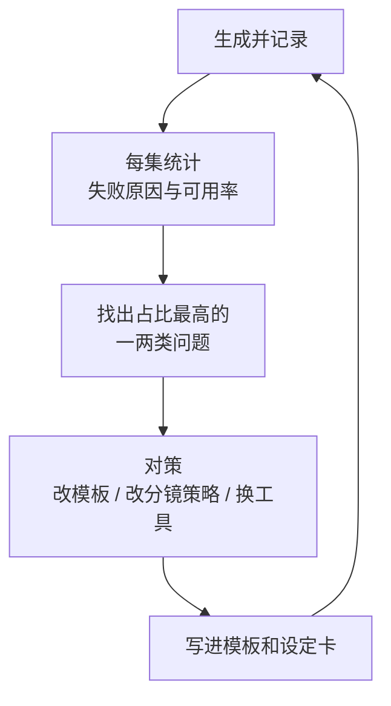

# 批量生产与管理

做完一集，你会发现最大的麻烦不是生成，而是**找**：哪个文件是 S02-07 的定稿？这一版用的是哪个提示词？上周那张特别好的陆归侧脸是用什么参数出的？到第五集时，素材文件夹里会有上千个文件，没有规则就只能靠记忆。

这一章讲把一集的做法变成可重复的生产线：文件命名、版本管理、生成记录、提示词自动拼接、返工率统计，以及一份汇总的检查清单。

## 目录结构

一部剧一个根目录，按「设定」和「分集」两条线组织：

```text
dangpiao/                         # 剧名
├── bible/                        # 设定（全剧共用，定稿后只读）
│   ├── style.md                  # 风格圣经
│   ├── style-refs/               # 风格参考图
│   ├── characters/
│   │   ├── CH-shenqinghe.md      # 角色卡
│   │   ├── CH-shenqinghe-front.png
│   │   ├── CH-shenqinghe-turnaround.png
│   │   └── CH-shenqinghe-expressions.png
│   ├── scenes/
│   │   ├── SC-dangpu-night.md
│   │   └── SC-dangpu-main.png
│   └── props/
├── ep01/
│   ├── storyboard.csv            # 本集分镜表
│   ├── log.csv                   # 本集生成记录
│   ├── frames/                   # 关键帧（含所有候选）
│   ├── videos/                   # 视频片段（含所有候选）
│   ├── final/                    # 定稿，只放进剪辑的文件
│   └── edit/                     # 剪辑工程
└── ep02/
```

两个原则：

- **设定和分集分开**。设定是全剧共用的，改一次影响所有集；分集只管自己
- **候选和定稿分开**。`frames/` 和 `videos/` 里放所有生成结果，`final/` 里只放选中的那一个。剪辑工程只引用 `final/` 里的文件

## 文件命名

命名规则的目标是：**看文件名就知道它是什么、第几版、是否定稿**，而且按名字排序时自然按镜头顺序排列。

```text
{集}_{镜号}_{类型}_v{版本}_{序号}.{扩展名}

ep01_S02-07_frame_v2_03.png      第 1 集 S02-07 关键帧，第 2 版提示词，第 3 张候选
ep01_S02-07_video_v1_02.mp4      第 1 集 S02-07 视频，第 1 版运动描述，第 2 条候选
ep01_S02-05_first_v1_01.png      首尾帧镜头的首帧
ep01_S02-05_last_v1_02.png       首尾帧镜头的尾帧
```

| 字段 | 取值 | 说明 |
|---|---|---|
| 集 | `ep01` | 两位数，便于排序 |
| 镜号 | `S02-07` | 和分镜表一致；插入的镜头用 `S02-07a` |
| 类型 | `frame` `first` `last` `video` `layer` | 关键帧、首帧、尾帧、视频、动态漫图层 |
| 版本 | `v1` `v2` | **提示词或参数改一次，版本加一** |
| 序号 | `01` `02` | 同一版本下的第几个候选 |

定稿时把文件复制到 `final/`，并改名为不带版本和序号的形式，如 `ep01_S02-07.mp4`。剪辑工程引用这个名字，以后返工替换定稿文件时，剪辑工程不用改。

工具下载下来的文件名通常是一串随机字符，要**下载后立刻改名**。如果你通过 API 生成，让脚本直接按规则命名。

## 版本：提示词改了就是新版本

「版本」不按时间算，而按**输入是否变化**算。同样的提示词和参数多抽几张，是同一版本的不同序号；提示词改了一个词，就是新版本。

这样做的意义是可以回答「改了这个词之后有没有变好」：比较 v1 和 v2 各自的可用率，就知道这次修改是否有效。

设定卡也有版本。角色卡改过外貌描述，要在卡片顶部记录：

```text
## 变更记录
- v1（2026-11-03）：初版
- v2（2026-11-05）：「眼型细长」改为「丹凤眼」，ep01 已生成的镜头保持 v1，ep02 起用 v2
```

设定卡一旦被分集引用，原则上不改；必须改时，写清楚从哪一集开始生效，避免同一集里新旧混用。

## 生成记录表

每一次生成（不管成功失败）都记一行。这张表是后面所有统计的基础。

| 列 | 内容 | 示例 |
|---|---|---|
| 时间 | 生成时间 | 2026-11-03 14:20 |
| 文件名 | 按命名规则 | ep01_S02-07_video_v1_02.mp4 |
| 镜号 | | S02-07 |
| 类型 | frame / video / … | video |
| 工具与模型版本 | | 某工具 / 视频模型 x.x |
| 参数 | 比例、分辨率、时长、种子、参考强度等 | 9:16, 1080p, 5s |
| 输入图 | 首帧、尾帧、参考图文件名 | ep01_S02-07_frame_v2_03.png |
| 提示词 | 完整文本，或提示词版本号 | v1 |
| 消耗 | 积分或金额 | 按工具计 |
| 结果 | 可用 / 不可用 | 不可用 |
| 失败原因 | 用固定的分类 | 变脸 |
| 备注 | | 2.5 秒后女子的痣消失 |

**失败原因要用固定分类**，否则没法统计。建议的分类：

```text
构图不符 / 变脸 / 识别特征丢失 / 服装错误 / 站位错误 / 肢体畸形 / 多余人物 / 动作不符 / 运动过快 / 镜头乱晃 / 背景变化 / 穿帮 / 文字乱码 / 画质问题 / 审核拦截 / 其他
```

手工记录很繁琐，所以前期可以只记视频（贵的那部分），关键帧只记定稿那一张的参数。如果用 API 批量生成，让脚本自动写入每一行。

## 用脚本拼提示词

上一章的示例里，提示词用 `{沈青禾}` `{当铺}` `{风格}` 这样的占位符引用设定卡。这一步非常适合交给脚本：人只维护设定卡和分镜表里「这一镜特有的部分」，脚本负责展开占位符、加上通用负面词、生成文件名。

下面是一个最小的 Python 示例，读取分镜表 CSV 和设定卡的固定文本，输出展开后的提示词：

```python
import csv
import json
import re
from pathlib import Path

# 设定卡里的固定描述，实际项目可以从各个 .md 文件里解析
snippets = json.loads(Path("bible/snippets.json").read_text(encoding="utf-8"))
# 例如 {"沈青禾": "二十岁出头的年轻女子……", "风格": "国风厚涂插画风格……"}

NEGATIVE_COMMON = "低质量，模糊，畸形的手，多余的手指，扭曲的脸，水印，文字，签名"

def expand(text: str) -> str:
    def repl(m: re.Match) -> str:
        key = m.group(1)
        if key not in snippets:
            raise KeyError(f"设定卡里没有：{key}")  # 拼错占位符时立刻报错
        return snippets[key]
    return re.sub(r"\{([^{}]+)\}", repl, text)

with open("ep01/storyboard.csv", encoding="utf-8") as f, \
     open("ep01/prompts.jsonl", "w", encoding="utf-8") as out:
    for row in csv.DictReader(f):
        if row["status"] not in ("待出图", "返工"):
            continue
        record = {
            "shot_id": row["shot_id"],
            "image_prompt": expand(row["image_prompt"]),
            "negative_prompt": "，".join(
                x for x in (NEGATIVE_COMMON, row["negative_prompt"]) if x
            ),
            "motion_prompt": expand(row["motion_prompt"]),
            "file_prefix": f"ep01_{row['shot_id']}",
        }
        out.write(json.dumps(record, ensure_ascii=False) + "\n")
```

有了 `prompts.jsonl`，可以手工逐条复制到工具网页里，也可以接上工具的 API 批量提交。调用 API 时注意几件事：

- **生成是异步的**：视频生成通常是提交任务、轮询结果，一个任务几十秒到几分钟。脚本要能处理排队、超时和失败重试
- **控制并发和预算**：先设一个总预算上限，超过就停。批量提交前先用两三个镜头试跑
- **结果立刻转存**：工具返回的下载链接通常有有效期，拿到就下载到本地，按命名规则存好，同时写入生成记录
- **接口和条款**：各家 API 的计费方式、并发限制、商用条款和网页版不一定相同，以开放平台文档为准

异步任务、存储和成本控制的工程细节，在[《多模态应用》](../multimodal-ai/)讲图像生成做进产品的部分有更完整的讨论。

## 返工率：最重要的生产指标

### 定义

$$
\text{一次可用率} = \frac{\text{可用的生成次数}}{\text{总生成次数}}
\qquad
\text{平均尝试次数} = \frac{\text{总生成次数}}{\text{定稿镜头数}}
$$

两个指标分关键帧和视频分别算。返工率可以理解为 $1 - \text{一次可用率}$。

### 怎么用

每集做完，从生成记录表里统计一次：

| 统计 | 用途 |
|---|---|
| 视频平均尝试次数 | 估算下一集的成本和时间；按第一章的公式算 |
| 按失败原因分类计数 | 找出最大的问题来源，集中改进 |
| 按镜头类型（单人近景、双人、道具、走路……）的可用率 | 发现哪类镜头最难，改分镜策略 |
| 按工具 / 模型版本的可用率 | 选型和升级决策的依据 |
| 按提示词版本的可用率 | 判断提示词修改是否有效 |

一个常见的发现是：失败原因高度集中。比如「变脸」占了视频失败的一半，而它主要出现在双人镜头里。那么下一集的对策就很具体：双人镜头改为正反打单人镜头，或者给这类镜头换用多主体参考能力更强的工具。

### 一个改进循环



关键是最后一步：**改进要写进模板**。比如发现「人物位于画面左侧」写在后面经常被忽略，就把它移到图像提示词模板的第一行，下一集所有镜头自动受益。

## 一份汇总的检查清单

把前面各章的检查合在一起，按流程阶段排列。每个阶段不过，不进入下一阶段。

### 设定阶段

| 检查项 | 通过标准 |
|---|---|
| 风格圣经 | 风格词固定；风格参考图都是自己生成的；不含画师、作品名 |
| 角色卡 | 每个有台词的角色都有；识别特征 1–3 个且醒目；外貌描述中英两版 |
| 定妆图 | 正面像、三视图、表情表齐全，确认是同一人，已冻结 |
| 场景卡 | 每个重复出现的场景都有；轴线约定、光线方向、3–5 个锚点物件 |
| 场景母版 | 主视角和反打两张，锚点物件位置对得上 |
| 道具卡 | 剧情道具都有；带文字的道具标注后期合成 |
| 版权 | 无真人照片、无真人名字、无他人 IP、工具档位允许商用 |

### 分镜阶段

| 检查项 | 通过标准 |
|---|---|
| 信息点 | 每个都有镜头让观众看清 |
| 反应镜头 | 关键台词后有 |
| 景别节奏 | 没有连续三个相同景别；相邻镜头不跳切 |
| 开头三秒 | 有冲突或悬念 |
| 自包含 | 每行都能独立生成，不含「她」「同上」 |
| 时长 | 总时长接近目标；生成时长不超过工具上限 |
| 生成方式 | 每镜都已决定：视频、首尾帧、参考生、动态漫、纯后期 |

### 关键帧阶段

| 检查项 | 通过标准 |
|---|---|
| 分镜符合 | 景别、角度、构图、站位 |
| 角色 | 识别特征齐全；和定妆图并排、缩到手机尺寸一眼认得出 |
| 场景 | 锚点物件在、位置对、光线方向对 |
| 硬伤 | 无畸形、无多余人物、无穿帮、无乱码 |
| 全集缩略图 | 排在一起看，色调统一、风格统一 |
| 为视频留余地 | 动作和运镜方向上有空间 |

### 视频阶段

| 检查项 | 通过标准 |
|---|---|
| 人物 | 全程认得出，动作后不变脸、不换衣 |
| 硬伤 | 无肢体扭曲、物体凭空出现或消失 |
| 动作 | 和分镜一致；起止状态和上下镜衔接 |
| 可剪 | 剪辑需要的那几秒是好的 |
| 节奏 | 运动速度自然，不像快进 |

### 交付后期前

| 检查项 | 通过标准 |
|---|---|
| 定稿齐全 | `final/` 里每个镜号都有一个文件 |
| 粗剪 | 按分镜表顺序排好，总时长接近目标 |
| 口型需求 | 标出哪些镜头需要后期做口型同步 |
| 文字合成 | 标出哪些镜头需要合成道具文字 |
| 记录 | 生成记录表完整，提示词和参数可追溯 |
| 标识 | 提醒后期按规定添加 AI 生成内容标识 |

## 一个人怎么排时间

一个人做的时候，最容易陷入的状态是「边写分镜边出图边改设定」，结果什么都在改、什么都没定。建议按阶段批处理：

| 阶段 | 做什么 | 原则 |
|---|---|---|
| 设定日 | 风格、角色、场景、道具全部定稿 | 一部剧只做一次，后续集只补新角色和新场景 |
| 分镜日 | 写完一到三集的分镜表 | 不出图，只写表；写完过分镜检查清单 |
| 出图日 | 批量出关键帧，挑选，检查 | 按场景批量做，同一场景的镜头连着出，风格最稳 |
| 出视频日 | 先做高风险镜头，再做常规镜头 | 视频生成排队时间长，可以并行提交，空档时挑片 |
| 剪辑日 | 粗剪，交后期 | 粗剪时发现的问题记下来，攒一批再返工 |

批处理的好处不只是效率：同一时间段、同一工具版本、同一批提示词生成的画面，风格天然更统一。

## 常见坑

| 坑 | 表现 | 解决 |
|---|---|---|
| 文件不改名 | 找不到定稿，误用候选 | 下载后立刻按规则改名，定稿复制到 `final/` |
| 设定卡随手改 | 同一集里角色前后不一致 | 设定卡冻结，改动写变更记录和生效集数 |
| 只记成功的 | 不知道失败率，无法估成本 | 失败也要记，失败原因用固定分类 |
| 工具中途升级 | 后半集画风突变 | 记录模型版本；一集内不换版本；升级前用代表镜头测一遍 |
| 抽卡不止 | 一个镜头重试几十次 | 设上限，五次不行就改分镜或改动态漫 |
| 定稿后又想改 | 进度无限拖延 | 软标准的问题记到下一集改进，不回头返工 |
| 生成记录丢失 | 出了版权或平台纠纷时无法说明创作过程 | 记录表和提示词随项目长期保存 |

最后一条值得多说一句：生成记录不只是生产工具，也是**创作过程的证据**。AI 生成内容的版权认定、平台申诉、商务合作中的权属说明，都可能需要你证明这些画面是怎么做出来的：用了什么工具、什么提示词、做了哪些挑选和修改。相关的合规问题见[《自媒体与短剧合规财税》](../media-compliance/)。

## 本章要点

- 目录按设定和分集两条线组织，候选和定稿分开存放，剪辑只引用定稿
- 文件名包含集、镜号、类型、版本、序号；提示词或参数改一次版本加一
- 每次生成都记一行，失败原因用固定分类；生成记录也是创作过程的证据
- 用脚本展开设定卡占位符、拼接通用负面词、生成文件名；API 批量生成要处理异步、预算和转存
- 返工率是最重要的生产指标：按失败原因、镜头类型、工具和提示词版本统计，改进写进模板
- 一个人做时按阶段批处理：设定、分镜、出图、出视频、剪辑分开做
