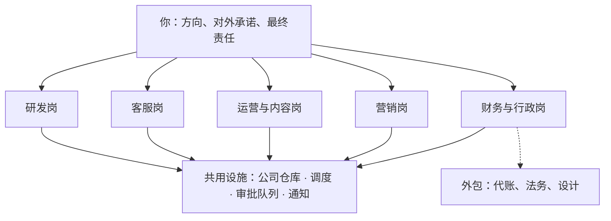
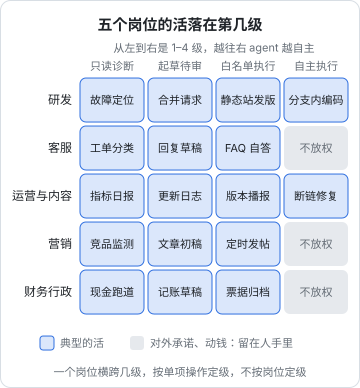
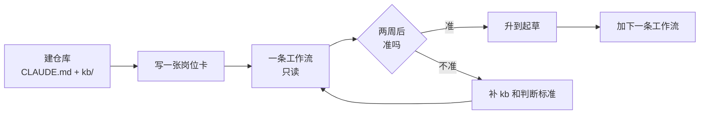

# AI 原生的一人公司

书架上前面五十本书，每一本都在讲一项手艺：写 React、部署服务、调大模型、写 CLAUDE.md、定价、记账。这一本不再讲新手艺，而是回答最后一个问题：**一个人怎样把这些手艺组织成一家公司，让 agent 承担各个岗位上的大部分执行，自己只做老板该做的事**。这一章先说清本书讲什么、怎么读，再给出全书反复使用的三样东西：一张组织图、一份岗位卡模板、一个公司仓库。

## 这本书讲什么

| 章 | 主题 | 回答的问题 |
|---|---|---|
| 1 | AI 原生的一人公司 | 什么叫 AI 原生；组织图、岗位卡、公司仓库 |
| 2 | 研发 | 从需求到上线，哪几步交给编码 agent，人守哪几道闸 |
| 3 | 客服 | 工单怎么分流、回复怎么起草、什么时候必须人来答 |
| 4 | 运营与内容 | 指标日报、用户跟进、更新日志、文档维护 |
| 5 | 营销 | 选题、内容生产、分发排期、渠道复盘 |
| 6 | 财务与行政 | 对账、凭证、月结、合同和证照的到期提醒 |
| 7 | 自动化流水线 | 把各岗位串起来：事件、队列、审批、执行器 |
| 8 | 一个人的组织设计 | 老板的节奏、审阅预算、指标、外包和容错 |
| 9 | 结语 | 回看整套书，以及接下来怎么用它 |

第 2–6 章按岗位写，结构相同：这个岗位在一人公司里管什么 → 哪些活交给 agent、交到第几级 → 两三条具体的 agent 工作流 → 人留着什么 → 去哪本书深入。第 7、8 章把岗位拼成一个整体。

**适合谁**：已经读过（或者至少翻过）书架上 Agent 系列和 OPC 系列的人；有一个在跑或准备跑的产品，正在被「什么都得自己干」拖住的独立开发者。

**怎么读**：第 1 章必读，它定义了全书的词汇。岗位章彼此独立，先读最拖累你的那个岗位，照着落地一条工作流，跑顺了再读下一个。第 7、8 章等你有了两三条工作流之后再读，那时它们才有东西可串。

这本书刻意**不重复**其他书的内容。讲到怎么写包装脚本、怎么设计确认界面、怎么写 SEO 文章时，只说「在这个岗位上为什么需要它、接在哪里」，具体做法用书名指过去。书里的命令以 Claude Code 为例，参数以你所用版本的官方文档为准。

## 什么叫 AI 原生

「用了 AI 的一人公司」和「AI 原生的一人公司」差别不在用没用 AI，而在**流程是为谁设计的**：

| | 传统一人公司 | 用了 AI 的一人公司 | AI 原生的一人公司 |
|---|---|---|---|
| 流程在哪 | 老板脑子里 | 老板脑子里，偶尔写成 prompt | 写在仓库里的文档，agent 和人读同一份 |
| 谁执行 | 老板 | 老板，AI 帮忙打下手 | agent 执行，老板审阅和拍板 |
| 输入从哪来 | 邮箱、微信、后台，散落各处 | 同左，复制粘贴给 AI | 汇集成文件或队列，agent 能直接读 |
| 结果怎么检查 | 凭感觉 | 凭感觉 | 每类产出有检查器，异常才找人 |
| 老板的时间花在 | 执行 | 执行，快了一些 | 定方向、审异常、对外承诺 |
| 扩张靠什么 | 加班 | 加班少一点 | 加一条工作流 |

最后一行是关键。传统一人公司的产能天花板是老板的工时；AI 原生的一人公司，产能天花板变成了**老板的注意力**：能同时审得过来几条工作流的产出。第 8 章会专门算这笔账。

AI 原生不意味着「全自动」。一家 AI 原生的一人公司里，绝大多数工作流仍然停在「agent 起草、人确认」这一档。它和传统做法的区别是：起草这一步不再花你的时间，而确认这一步被设计得很便宜。

### 为什么现在可以

几年前这套做法不成立，原因有三个，现在都变了：

- **agent 能干完整的活**：不再是补全一行代码，而是读几十个文件、跑命令、看结果、改到测试通过。《Agent 原理与设计》讲了这个 loop 为什么能工作
- **工具接入标准化了**：MCP 这类协议让 agent 能读邮箱、查数据库、调支付平台的 API，不用为每个工具写一遍胶水代码，见《工具设计与 MCP》
- **成本降到了可以常驻的程度**：让一个 agent 每半小时看一次客服邮箱，一个月的模型费用通常比一顿饭便宜。具体多少取决于模型和用量，第 8 章会讲怎么封顶

但有一件事没变：**agent 的产出总有一定比例是错的**。这句话是整本书的地基。所有的设计，岗位卡、检查器、审批队列、降级规则，都是为了让这个比例的错误被及时发现、能被撤回、不伤到用户。

## 一张组织图

把一人公司画成组织图，长这样：



几个要点：

- **岗位不等于 agent**。一个岗位里可能有三条工作流，各自是一次独立的 agent 调用，用不同的 prompt 和权限；也可能某个岗位一条 agent 工作流都没有，全是脚本。岗位是职责的划分，不是进程的划分
- **你不是任何一个岗位**。你是这些岗位共同的老板。这个视角的转换比任何技术都重要：当你发现自己在亲手回第二十封「怎么导出数据」的邮件时，问题不是回得不够快，而是客服岗没有被设计好
- **共用设施只建一次**。五个岗位用同一个仓库存规则和记录、同一个调度器触发、同一个审批队列等你拍板、同一个渠道通知你。第 7 章讲怎么搭
- **外包是组织图的一部分**。代账公司、律师、设计师是你的「外部员工」，agent 负责把要交给他们的材料整理好。《财务与税务》讲了怎么和代账协作

## 岗位卡：给岗位写说明书

招一个人，你会写岗位说明书。给 agent 安排一个岗位，也要写，而且要写得比给人的更具体，因为 agent 不会在第一周跑来问你「这个归不归我管」。

岗位卡是一份 Markdown 文件，放在公司仓库的 `roles/` 下，一个岗位一份。头部是机器读的字段，正文是 agent 和你都读的规则：

```markdown
---
role: support
owner: 你
workflows: [triage, draft-reply, weekly-digest]
reads: [inbox/support/, kb/, logs/support/]
writes: [outbox/support/, logs/support/]
never: [直接发送邮件, 承诺退款, 承诺上线日期, 引用不在 kb/ 里的功能]
escalate: 第一行写「需要老板」并说明原因
budget: 单次最多 20 轮，超时 10 分钟
---

# 客服岗

## 职责
- 每 30 分钟读一次 inbox/support/ 的新邮件，分类并起草回复
- 每周一汇总上周的问题分布，写进 logs/support/weekly/

## 判断标准
- 怎么用的问题：引用 kb/ 里的文档回答，附上原文位置
- 故障：先确认能否复现，查 logs/ 里同时段的报错，起草致歉 + 已记录的回复
- 退款、投诉、合作：只做摘要，标「需要老板」，不起草承诺性内容

## 验收
- 每份草稿注明依据（kb 文件名或日志时间）
- 草稿里出现的功能名必须在 kb/features.md 里存在
```

每个字段都有用处：

| 字段 | 作用 | 对应哪本书 |
|---|---|---|
| `reads` / `writes` | 最小权限：这个岗位能看什么、能改什么 | 《Agent 安全》第 4 章 |
| `never` | 硬性禁区，写进 prompt，也尽量用权限挡住 | 《Agent 安全》第 5 章 |
| `escalate` | 遇到超出职责的事，用固定格式喊人，脚本能 `grep` 到 | 《个人 Agent 工作流》第 4 章 |
| `budget` | 封住轮数和时长，防止原地打转烧钱 | 《LLM 应用上线》第 4 章 |
| 判断标准 | 这个岗位的「业务口径」，相当于给新员工的培训材料 | 《上下文工程》 |
| 验收 | 产出能被检查，检查能被脚本化 | 《评测与质量》 |

岗位卡和项目里的 `CLAUDE.md` 是同一种东西，只是作用域从「一个代码仓库」变成了「一个岗位」。《编码 Agent 实战》里关于怎么写规则文件的经验，这里全部适用：写「为什么」、写反例、出过错就补一条。

## 公司仓库

所有岗位卡、工作流的 prompt、原始输入、产出记录，都放进一个 Git 仓库，本书叫它**公司仓库**。它对你的公司，就像 `books/` 目录对这个书架：文件即真相。

| 目录 | 放什么 | 谁写 |
|---|---|---|
| `CLAUDE.md` | 公司级规则：业务是什么、语气、全局禁区、目录说明 | 你 |
| `roles/` | 每个岗位一份岗位卡 | 你 |
| `prompts/` | 每条工作流的任务 prompt，一条一个文件 | 你，agent 可以提修改 |
| `kb/` | 产品知识库：功能说明、FAQ、已知问题、政策 | 你和 agent 共同维护 |
| `inbox/` | 待处理的输入：邮件、评论、账单，按岗位分子目录 | 采集脚本 |
| `outbox/` | agent 起草、等你批准的动作 | agent |
| `approvals/` | 你的批准记录，agent 没有写权限 | 你，通过批准脚本 |
| `logs/` | 每次运行的记录、周报、复盘 | agent 和脚本 |
| `bin/` | 采集、执行、检查用的脚本 | 你，agent 协助 |

为什么是 Git 仓库，而不是一个 SaaS 工具或数据库：

- **agent 天生会用**：编码 agent 读写文件、看 diff、提交，都是它最熟练的动作
- **可回滚**：agent 改坏了 kb，`git revert` 就回去了。这是把活「往低代价那边挪」的最便宜的办法
- **可审计**：每一次改动谁做的、为什么，都在提交记录里。《Agent 安全》第 6 章讲的审计，在这里几乎是免费的
- **可迁移**：换 agent 工具、换模型，仓库不用动

有两类东西**不放进**公司仓库：密钥和凭据（放在系统钥匙串或部署机的环境变量里，见《一人运维手册》），以及用户的个人信息原文（`inbox/` 里的邮件要脱敏后再落盘，或者只存在本地加密磁盘上并加进 `.gitignore`，见《国内合规实务》第 6 章）。

## 三种稀缺资源

一人公司要精打细算的资源有三种，后面每一章的取舍都围绕它们：

| 资源 | 谁消耗它 | 怎么省 |
|---|---|---|
| 注意力 | 每一次审阅、每一条通知、每一次上下文切换 | 安静成功，大声失败；异常才找人 |
| 信任 | 每一封发出去的回复、每一篇文章、每一次故障 | 对外的东西必须过人；错了快速认错 |
| 现金 | 模型费用、服务器、外包 | 每条工作流有预算上限；先用便宜模型做分类 |

三者里最容易被忽视的是**信任**。agent 在内部犯错，代价是你多花几分钟修；agent 对用户犯错，代价可能是一个客户、一条差评、一次支付平台投诉。所以本书的默认规则是：**对外的动作一律经过审批队列**，除非某类动作已经被证明可以安全地自动化（第 3 章的 FAQ 自动回复是少数例外，而且要满足很严格的条件）。

## 各岗位放到第几级

《个人 Agent 工作流》第 6 章把运维操作的放权分成四级：只读诊断、起草命令、白名单执行、自主执行。这套分级可以推广到每个岗位：



这张图想说明两件事：

1. **定级的单位是单项操作，不是岗位**。说「客服交给 AI 了」没有意义；要说的是「客服岗的分类是第 1 级，起草是第 2 级，FAQ 自答是第 3 级，退款决定不放权」
2. **最右一列空着的地方，是对外承诺和动钱**。研发能放到第 4 级，是因为它在分支里、有测试兜底、合并前有人审；客服回复一旦发出就收不回来，财务的钱转出去也收不回来

判断一项操作该放第几级，用《个人 Agent 工作流》第 1 章的两个维度：可验证性和出错代价。本书不重复那套方法，只在每个岗位章里给出定级的结果和理由。

## 整套书在组织图上的位置

前面五十本书，都能在这张组织图上找到位置：

| 岗位 / 设施 | 核心的书 | 补充的书 |
|---|---|---|
| 研发 | 《编码 Agent 实战》 | 技术栈纵深系列、《部署与 CI/CD》 |
| 客服 | 《RAG 与知识系统》 | 《定价与商业模式》第 7 章、《文案与内容》 |
| 运营与内容 | 《数据分析与埋点》 | 《产品思维》、《一人运维手册》 |
| 营销 | 《获客与增长》 | 《文案与内容》、《出海实务》 |
| 财务与行政 | 《财务与税务》 | 《国内合规实务》、《出海实务》 |
| 共用设施 | 《个人 Agent 工作流》 | 《动手构建 Agent》、《多 Agent 编排》 |
| 安全边界 | 《Agent 安全》 | 《LLM 应用上线》、《应用安全》 |
| 老板本人 | 《一人公司方法论》 | 《AI 认知进阶》、《产品思维》 |

读这本书时遇到某个岗位的细节不熟，回到对应的书里查。

## 从哪里开始

不要试图一周内把五个岗位都搭起来。建议的顺序：

1. **建公司仓库**：只放 `CLAUDE.md` 和 `kb/`。把产品的功能说明、常见问题、退款政策写进 `kb/`，这一步本身就逼你把散落在脑子里的东西落成文字
2. **挑最拖累你的一个岗位**：通常是客服（打断最多）或运营（最琐碎）。写它的岗位卡
3. **只做一条工作流，只到第 1 级**：比如「每天早上读一遍新邮件，分类，写一份摘要」。只读，不起草
4. **跑两周，看摘要准不准**：准了再升到第 2 级，开始起草
5. **再加下一条**



这个节奏看起来慢，但它在每一步都留下了可以复用的资产：`kb/` 会被客服、营销、文档共用，岗位卡的写法会被下一个岗位照抄，第一条工作流的包装脚本会成为第 7 章流水线的雏形。

## 本章要点

- AI 原生的一人公司，流程写在仓库里，agent 执行，老板审阅和拍板；产能上限从工时变成注意力
- agent 的产出总有一定比例出错，所有设计都是为了让错误被发现、可撤回、不伤用户
- 岗位是职责划分，不是进程划分；一个岗位可以有多条工作流，各自独立的 prompt 和权限
- 岗位卡写清读写范围、禁区、升级方式、预算、判断标准和验收，是岗位级的 `CLAUDE.md`
- 公司仓库用 Git：agent 会用、可回滚、可审计；密钥和用户个人信息原文不进仓库
- 注意力、信任、现金是三种稀缺资源；对外的动作默认经过审批队列
- 放权按单项操作定级；对外承诺和动钱的操作不放到最高一级
- 从一个仓库、一个岗位、一条只读工作流开始，跑准了再升级
